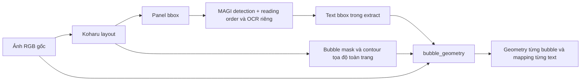

# Điều tra input và output bubble geometry so với AIP419

Ngày 11/10/2026. Chạy local trên After School chapter 1. Không chạy Habatake.
Repo đối chiếu: `D:/download/AIP419-master/AIP419-master`.

## Kết luận

**Output khác.** Khác ở detection input, contour, ghép text và schema output.
AIP419 không có classifier bubble style tương đương `classify_bubble` hiện tại;
nó xuất bubble/text, mask, contour, bbox và reading-order metadata. Vì vậy không
thể coi thought/shout/normal hiện tại là các nhãn đã port từ AIP419.

Đã đối chiếu contour trên **53 mask / 11 trang**, ghép trên **58 box text MAGI**,
và chạy thật detector AIP419 trên **toàn bộ 11 trang** với cùng checkpoint Koharu.
Lượt đầu kiểm tra trang 1 và 10; lượt mở rộng tái dùng hai kết quả đó và chạy
chín trang còn lại. Đây là chẩn đoán output, chưa có gold labels để đo accuracy.

## Lần ngược input của pipeline hiện tại

Stage `bubble_geometry` đọc `extract` và `layout` đã commit, không đọc crop text
hay output LLM. Nó đối chiếu số trang, panel, kích thước, file/hash và ảnh nguồn.
Mask được nạp theo kích thước **toàn trang**. Contour dùng tọa độ tuyệt đối, và
`pixels` là toàn bộ ảnh **RGB gốc** cùng hệ tọa độ. Không thấy lỗi truyền crop
local nhưng coi là ảnh toàn trang trong đường code này.

`classify_bubble(contour, pixels)` chỉ nhận **contour và RGB**, không nhận text,
OCR, tail MAGI, điểm dialogue, speaker hay score detection. Nó tạo:

- Shape từ solidity, rectangularity, circularity, số góc nhọn, số đỉnh sau simplify.
- Border từ pixel tối trong vùng 5×5 quanh các mẫu trên contour, cách khoảng 3 px.
- Style: spiky → shout_hint; cloud → thought_hint; rectangular → caption_hint;
  dashed → whisper_hint; rounded + solid → normal; còn lại unknown.
- `confidence` geometry là hằng số heuristic theo shape, **không phải score model**
  và không phải xác suất câu có speech style đó.

`match_bubble` nhận **text bbox + bubble records + mask toàn trang + config**.
Nó đo tỷ lệ pixel mask trong toàn bbox text; yêu cầu coverage >= 0.80. Nếu hai
mask cùng đạt 0.80 và chênh lệch < 0.15 thì giữ unmatched/ambiguous_overlap.
Output text có bubble_id/bbox, coverage/reason và geometry của bubble được chọn.

Probe bubble đã chạy trực tiếp backend Koharu và classifier hình học; phần ghép
text được kiểm tra riêng bằng các box MAGI đã lưu. Không tuyên bố probe đã chạy
toàn stage OCR/analyze/dịch của pipeline.

## Đối chiếu phương pháp

| Phần | Pipeline hiện tại | AIP419 |
|---|---|---|
| Model | Koharu cùng repo; revision ghim | Loader đọc model local, gọi optimize_for_inference(compile=False) nếu có |
| Detection input | Dò panel toàn trang; dò bubble toàn trang và trong crop panel | Dò panel toàn trang; bubble/text chủ yếu trong crop panel; fallback toàn trang nếu không có panel |
| Crop padding | 24 px | max(64, int(page_height × 0.08)) |
| Ngưỡng trong phép đối chiếu | Bubble 0.25, panel 0.50, mask > 0.50 | Bubble 0.25, panel 0.50, text 0.20, mask > 0.50 |
| Bubble dedup | Sắp theo confidence, IoU >= 0.65 | Sắp theo diện tích rồi confidence; IoU hoặc intersection-over-smaller, ngưỡng phụ thuộc cùng panel/cùng bubble/khác panel |
| Contour | Trace biên ô pixel; Polygon lớn nhất; simplify(1.0, preserve_topology=True) | cv2.findContours(RETR_EXTERNAL, CHAIN_APPROX_SIMPLE), contour lớn nhất; approxPolyDP epsilon=max(1, perimeter × 0.003) |
| Mask storage | Mask toàn trang | Mask crop chặt + mask_origin tuyệt đối |
| Text detector | MAGI; OCR Hayai khi chạy pipeline mới | Koharu text class; OCR là bước riêng |
| Ghép text vào bubble | Mask coverage và ambiguity margin | Tâm bbox text nằm trong bbox bubble hoặc intersection/text-area > 0.25; chọn bbox bubble nhỏ nhất |
| Style classification | Có geometry heuristic, evidence và hint | Không có classifier normal/thought/shout/whisper tương đương |
| Reading order | Sorter hiện tại + panel assignment; giữ provenance | Sort panel/bubble/text và finalize reading-order sau dedup |

Hai code đều đưa contour trở lại hệ tọa độ toàn trang. Khác biệt biểu diễn
mask crop/full-page tự nó không chứng minh có sai tọa độ.

## Kết quả 1: giữ nguyên 53 mask, chỉ đổi hàm contour

Gọi **hàm thật** `_mask_to_contour` của AIP419 trên mask crop chặt và origin,
rồi đưa contour đó vào **classifier hiện tại** cùng RGB gốc. Nhãn dưới đây
không phải nhãn native của AIP419, vì AIP419 không có classifier này.

| Chỉ số | Kết quả |
|---|---:|
| Bubble được đối chiếu | 53 |
| Mean polygon IoU, trên 52 cặp polygon hợp lệ | 0.978338 |
| Contour quá ngắn/degenerate để đối chiếu đầy đủ | 1 |
| Đổi bubble_shape | 5 |
| Đổi border_style | 10 |
| Đổi bubble_style | 8 |
| Đổi bubble_id khi mapping bằng cùng mask | 0 |

Các style thay đổi: 1 normal → caption_hint, 4 normal → unknown,
2 thought_hint → unknown, 1 shout_hint → unknown. Shape gần nhau theo IoU vẫn
có thể đổi nhãn khi vượt ngưỡng heuristic hoặc khi đường contour simplify đi
xa khỏi nét viền ảnh. Ví dụ border dark support của normal → unknown:

| Trang/bubble | Contour hiện tại | Contour AIP419 |
|---|---:|---:|
| 3/B3 | 0.9307 | 0.7810 |
| 4/B4 | 0.9788 | 0.8462 |
| 10/B1 | 0.9920 | 0.8711 |
| 11/B3 | 0.9847 | 0.8906 |

Classifier đòi support >= 0.90 để gán solid. Đây là nguyên nhân trực tiếp khiến
các case trên mất nhãn normal, dù shape vẫn rounded. Cloud/spiky còn nhạy với
số đỉnh và góc sau simplify; 7/B3 có contour AIP419 không đủ cho classifier.

## Kết quả 2: giữ cùng detections/text, đổi quy tắc mapping

Áp công thức bbox trong `_is_inside_or_overlapping` và quy tắc chọn bbox nhỏ
nhất của AIP419 lên **cùng 58 box MAGI và cùng 53 bubble**. Hiện tại mapping
bằng mask ghép được 38/58 text. Công thức bbox chọn khác ở **9/58 text**:

| Trang/text | Mask hiện tại | Công thức bbox AIP419 | Lý do mask |
|---|---|---|---|
| 3/4 | unmatched | B2 | coverage 0.0095 |
| 5/1 | unmatched | B1 | ambiguous_overlap |
| 5/2 | unmatched | B4 | ambiguous_overlap |
| 5/3 | B6 | B7 | matched |
| 6/1 | unmatched | B2 | ambiguous_overlap |
| 6/3 | unmatched | B3 | ambiguous_overlap |
| 6/4 | unmatched | B7 | ambiguous_overlap |
| 7/1 | unmatched | B2 | ambiguous_overlap |
| 7/3 | B1 | B4 | matched |

Đây là đối chiếu công thức trên input cố định; không phải số liệu text native
AIP419, vì detector/text source và NMS của pipeline AIP419 cũng khác.

## Kết quả 3: chạy detector AIP419 thật trên toàn chapter

Dùng method `MangaDetector.detect_with_panels` từ repo AIP419, inject **cùng
checkpoint ghim** đang dùng ở local, và gọi optimization compile=False giống
loader AIP419. Không tải model khác, không chạy OCR và không sửa repo AIP419.
Baseline hiện tại là probe đã hoàn tất trước đó, bubble 0.25.

| Trang | Bubble hiện tại | Bubble AIP419 | Panel AIP419 | Text records AIP419 |
|---|---:|---:|---:|---:|
| 1 | 5 | 4 | 5 | 7 |
| 10 | 5 | 4 | 5 | 6 |

Lượt mở rộng toàn chapter:

| Trang | Bubble hiện tại | Bubble AIP419 |
|---|---:|---:|
| 1 | 5 | 4 |
| 2 | 5 | 4 |
| 3 | 7 | 7 |
| 4 | 6 | 6 |
| 5 | 7 | 3 |
| 6 | 7 | 2 |
| 7 | 4 | 1 |
| 8 | 3 | 3 |
| 9 | 1 | 1 |
| 10 | 5 | 4 |
| 11 | 3 | 2 |
| Tổng | 53 | 37 |

Đã ghép đủ 11 PNG giữ cùng tỷ lệ ảnh gốc: current bên trái, AIP419 bên phải.
Hai bên dùng chung màu contour và nhãn ID/score để xem khác biệt hình học.
ID mỗi bên đánh số độc lập, không phải matching bubble giữa hai phương pháp.
Danh sách ảnh đầy đủ (artifact local): `outputs/diagnostics/bubble-geometry-aip419-comparison-20261011/side-by-side/README.md`
và [ảnh tổng quan](../../outputs/diagnostics/bubble-geometry-aip419-comparison-20261011/side-by-side/overview.jpg).

Trang 1: bubble 3 score 0.267665 của current không có bbox tương ứng ở reference
(max bbox IoU = 0). Bốn ô narration tương ứng có bbox IoU khoảng 0.969–0.980.

Trang 10: bubble 5 score 0.402111 của current là **biểu tượng bóng đèn** qua
kiểm tra ảnh, nhưng classifier tạo thought_hint. Detector AIP419 trong lượt
thử này không giữ region đó; bốn bubble thoại còn lại tương ứng với bbox IoU
khoảng 0.943–0.995. Không quy nguyên nhân riêng cho padding, NMS hay optimization
vì các yếu tố thay đổi cùng nhau trong phép thử detector này.

Ngưỡng mới **0.32 không loại được bóng đèn 0.402111**. Do đó chỉ tăng score
threshold không giải quyết hoàn toàn false-positive và nhãn thought_hint sai.
Trên 53 candidate đã lưu, lọc score >= 0.32 còn 48; không coi phép lọc hậu kỳ
này là inference mới ở 0.32.

## Đánh giá và việc có thể làm tiếp

- Không thấy lỗi tọa độ crop/origin trong đường bubble_geometry được kiểm tra.
  Khác biệt input detection và postprocessing có bằng chứng trực tiếp.
- Classifier hiện tại bổ sung ý nghĩa speech-style từ hình học, nên không thể
  kiểm chứng tính đúng bằng cách chỉ đối chiếu schema AIP419.
- Nếu đổi sang contour OpenCV, cần hiệu chỉnh/kiểm thử classifier border/shape;
  port contour nguyên xi có thể làm tăng unknown dù mask gần như giống nhau.
- Nên kiểm tra riêng NMS containment với các bubble nested/duplicate và giữ
  ambiguity rõ ràng; chọn bbox nhỏ nhất không mặc nhiên là lựa chọn đúng hơn.
- False-positive icon cần evidence khác ngoài score/hình dạng, ví dụ text-mask
  support và review mẫu có nhãn. Chưa triển khai filter hay thay geometry rules
  trong lượt điều tra này.

## Artifact và source

- [JSON contour và mapping](../../outputs/diagnostics/bubble-geometry-aip419-comparison-20261011/contour-comparison.json).
- [JSON detector toàn chapter](../../outputs/diagnostics/bubble-geometry-aip419-comparison-20261011/detector-comparison.json).
- [Current trang 10](../../outputs/diagnostics/speech-bubbles-default-20261011/after-school/page-010.png),
  [AIP419 trang 10](../../outputs/diagnostics/bubble-geometry-aip419-comparison-20261011/aip419-page-010.png).
- [Current trang 1](../../outputs/diagnostics/speech-bubbles-default-20261011/after-school/page-001.png),
  [AIP419 trang 1](../../outputs/diagnostics/bubble-geometry-aip419-comparison-20261011/aip419-page-001.png).
- [Stage input](../../src/manga_pipeline/visual/stages.py),
  [geometry classifier và mapping](../../src/manga_pipeline/visual/bubbles.py),
  [Koharu detection](../../src/manga_pipeline/visual/koharu.py),
  [contour hiện tại](../../src/manga_pipeline/visual/geometry.py).
- Reference source: `D:/download/AIP419-master/AIP419-master/core/detector.py`
  (contour dòng 60; detection dòng 295; NMS dòng 592; bbox mapping dòng 686).
- [Script tái lập](../../scripts/diagnostics/compare_bubble_geometry_aip419.py).
