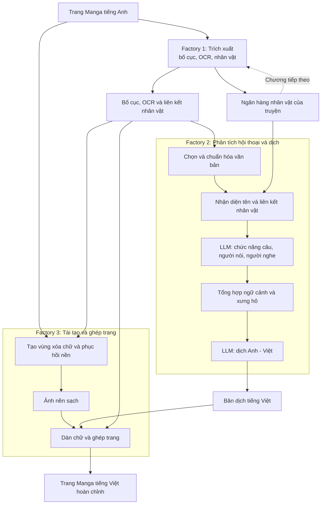

# 3. PHƯƠNG PHÁP ĐỀ XUẤT

## A. Kiến trúc tổng thể

Đầu vào của hệ thống là các trang Manga tiếng Anh thuộc cùng một chương; đầu ra hướng tới là những trang Manga tiếng Việt giữ được bố cục của bản gốc. Kiến trúc gồm ba factory với đầu vào và đầu ra riêng. Factory 1 nhận ảnh trang và ngân hàng nhân vật đã có từ các chương trước, sau đó xuất dữ liệu bố cục, văn bản, nhân vật và ngân hàng nhân vật được cập nhật. Factory 2 sử dụng dữ liệu trích xuất cùng ngân hàng nhân vật để phân tích hội thoại và tạo bản dịch tiếng Việt. Factory 3 nhận ảnh gốc, dữ liệu bố cục từ Factory 1 và bản dịch từ Factory 2 để xóa chữ nguồn, dàn chữ mới và ghép thành trang dịch hoàn chỉnh.

Ngân hàng nhân vật được hình thành từ kết quả nhận diện nhân vật của Factory 1 và tiếp tục được tái sử dụng ở các chương sau của cùng truyện. Hai nhánh dịch và xử lý ảnh có thể tạo kết quả trung gian riêng, nhưng cùng hội tụ tại bước ghép trang cuối. Hình 1 trình bày luồng dữ liệu tổng quát, đồng thời tách các công việc chính của Factory 2 để làm rõ phần đóng góp của nghiên cứu.

*Hình 1. Kiến trúc tổng thể và đầu vào–đầu ra của ba factory. Ngân hàng nhân vật được cập nhật từ Factory 1 và dùng lại qua các chương; kết quả dịch và tái tạo ảnh được ghép ở bước cuối.*

## B. Định hướng phương pháp

Các thử nghiệm thành phần đã khảo sát trích xuất văn bản và nhân vật, phát hiện tên trong lời thoại, suy luận người nói–người nghe và dịch Anh–Việt. Kết quả bước đầu cho thấy mỗi tác vụ cần đầu vào và cách đánh giá riêng: một tên được phát hiện chưa phải danh tính nhân vật, còn một câu dịch hợp lệ về hình thức chưa bảo đảm cách xưng hô phù hợp. Vì vậy, nghiên cứu tổ chức các tác vụ thành những khối chức năng có thể nối và kiểm tra độc lập, thay vì giao toàn bộ quy trình cho một mô hình duy nhất.

Ở giai đoạn này, bài báo mô tả vai trò của từng nhóm phương pháp — phân tích bố cục, OCR, nhận diện nhân vật, phân tích hội thoại, dịch và phục hồi ảnh — mà chưa cố định mô hình cụ thể cho từng khối. Factory 2 được chia thành nhiều bước vì kết quả nhận diện tên, định danh người tham gia và lựa chọn cách xưng hô cần được hình thành theo thứ tự trước khi tạo bản dịch.

## C. Factory 1: Trích xuất nội dung và nhân vật

Factory 1 nhận ảnh Manga tiếng Anh và, nếu đã có, ngân hàng nhân vật của cùng truyện. Các phương pháp phân tích ảnh xác định khung truyện, vùng chữ, bóng thoại và nhân vật; OCR chuyển vùng chữ thành văn bản. Kết quả nhận diện nhân vật cập nhật ngân hàng để hỗ trợ đối sánh ở những trang và chương sau. Đầu ra của factory là dữ liệu có cấu trúc về văn bản, bố cục và nhân vật, cùng ngân hàng nhân vật đã cập nhật. Dữ liệu này là đầu vào chung cho bước phân tích–dịch và bước tái tạo ảnh.

## D. Factory 2: Phân tích hội thoại và dịch Anh–Việt

Factory 2 nhận văn bản OCR, vị trí trong trang, liên kết nhân vật–câu thoại và ngân hàng nhân vật từ Factory 1. Đây là phần trung tâm của hệ thống, gồm năm bước liên tiếp.

Thứ nhất, văn bản được chọn và chuẩn hóa theo mục đích xử lý. Hệ thống tách các lượt cần phân tích hội thoại khỏi những vùng chữ chỉ cần dịch, đồng thời giữ thứ tự đọc và vị trí nguồn. Nhờ đó, các nội dung cần chuyển ngữ vẫn được giữ mà không phải gán người nói hoặc người nghe cho mọi vùng chữ.

Thứ hai, một phương pháp nhận diện tên tìm các tên người được nhắc đến trong văn bản. Các tên này được đối chiếu với ngân hàng nhân vật, nhưng chỉ là ứng viên cho đến khi có đủ căn cứ liên kết với một nhân vật cụ thể. Bước này phân biệt việc tìm thấy một tên trong câu với việc xác định người mang tên đó trên trang.

Thứ ba, mô hình phân tích hội thoại xem các lượt thoại lân cận cùng ứng viên nhân vật và thông tin bố cục để xác định chức năng câu, người nói, người nghe và vai trò của các tên được nhắc đến. Liên kết nhân vật từ Factory 1 là bằng chứng hỗ trợ, không phải kết luận cuối cùng. Trường hợp thiếu bằng chứng được giữ là chưa xác định thay vì gán cho một nhân vật tùy ý.

Thứ tư, kết quả của nhiều lượt thoại được tổng hợp thành ngữ cảnh nhân vật phục vụ lựa chọn cách xưng hô. Ngữ cảnh này nối câu hiện tại với người nói, người nghe và những thông tin đã có từ các lượt trước; nó không tự tạo tuổi, vai vế hoặc quan hệ xã hội chưa được xác nhận. Nhờ tách bước tổng hợp ngữ cảnh khỏi bước dịch, hệ thống có thể kiểm tra căn cứ của một lựa chọn xưng hô trước khi đưa vào bản tiếng Việt.

Thứ năm, mô hình dịch sử dụng văn bản nguồn, ngữ cảnh hội thoại và thông tin nhân vật để tạo bản dịch Anh–Việt. Bản dịch có thể được xuất theo hai phong cách: diễn đạt tự nhiên, sát nghĩa và diễn đạt bản địa hóa linh hoạt hơn. Mỗi câu tiếng Việt được gắn với vùng chữ nguồn, tạo thành đầu ra của Factory 2 để Factory 3 đặt lại vào trang tương ứng.

## E. Factory 3: Tái tạo và ghép trang dịch

Factory 3 nhận ảnh gốc, vị trí chữ và bóng thoại từ Factory 1, cùng bản dịch tiếng Việt từ Factory 2. Văn bản tiếng Anh được xóa bằng phương pháp phù hợp với nền ảnh; những vùng nền phức tạp được phục hồi bằng mô hình inpainting. Ảnh nền sạch và bản dịch được đưa vào bước dàn chữ theo không gian của bóng thoại, sau đó ghép lại để tạo trang Manga tiếng Việt hoàn chỉnh. Đây là đầu ra cuối của kiến trúc đề xuất; trong phiên bản phần mềm hiện tại, phần tạo nền sạch và bản dịch đã có, còn bước dàn chữ và xuất trang dịch hoàn chỉnh cần được hiện thực và đánh giá.

---

Ghi chú biên tập ngoài bài báo: các phương pháp cụ thể trong từng factory chưa được chốt, vì vậy mục này dùng tên nhóm chức năng thay cho tên mô hình. Những thành phần được giới thiệu như đóng góp đã hoàn thành chỉ nên giữ nguyên khi có hiện thực và kết quả đánh giá tương ứng; bước dàn chữ và trang dịch hoàn chỉnh hiện vẫn thuộc kiến trúc đề xuất.
