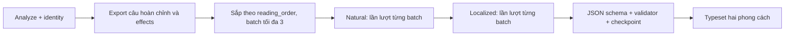

# Kiểm tra cơ chế translate hiện tại — 2026-10-22

Phạm vi: đọc working tree main hiện tại và cấu hình đã nạp; không sửa code translate, không chạy inference hoặc dùng Runpod. Luồng thực thi chính là `src/manga_pipeline/v6/translation.py`, được gọi từ `v6/stages.py:123`. `translation/stage.py` chỉ cung cấp cấu hình, glossary và overrides; không phải vòng dịch chính của v6.

## Luồng dữ liệu

Diagram mô tả thứ tự các lượt; kiểm tra và checkpoint thực hiện ngay sau từng batch, không chờ dịch hết hai lượt.

- Export giữ speaker_person_id, speaker_name, addressee_ids đã canonicalize, mentions, speech_style và tình trạng semantic. Caption/thought/dialogue nằm trong utterances; sfx/action_state sang effects; ui/watermark bị loại khỏi danh sách cần dịch (`v6/semantic.py:99`).
- Translate trộn utterances và effects theo reading_order. Dịch một target là toàn câu đã normalize/gộp, không dịch riêng từng contour. Effects có bản dịch trong `effects-translated.json` nhưng không chỉnh ảnh effect (`v6/translation.py:69–106,195–197`).
- Hai phong cách chạy độc lập: natural trung thành và tự nhiên, localized linh hoạt/khẩu ngữ nhưng không thêm tình tiết hay cảm xúc. Toàn bộ natural chạy trước localized. Lịch sử bản dịch của mỗi style tách riêng (`translation/contract.py:7–29`).
- Đây là yêu cầu text-only: không truyền images vào provider. Model mặc định `cyankiwi/Qwen3.5-27B-AWQ-4bit` qua vLLM, context 32768; generation tắt thinking, temperature 0, top_k 20, top_p 0.95, JSON schema strict.

## Batch, context và xưng hô

Mặc định translation.batch_size=3, context_radius=2. Batch OCR=16 vừa đổi không tác động batch dịch. Pipeline thường tắt adaptive runtime; profile Runpod bật adaptive và giới hạn translation_max_batch=3. Trong một run, vòng translate chỉ gửi một batch tại một thời điểm, không có executor/scheduler song song như analyze.

Mỗi request chứa target và tối đa hai hàng lân cận ở mỗi phía của batch, gồm text, role/style, speaker/listener IDs, mentions, semantic resolution và một số scene/batch trace. Context tính theo danh sách toàn chương, không tách cứng theo scene.

Thêm tối đa 12 hàng dịch trước đó có speaker thuộc những person IDs đang liên quan trong batch, bỏ speaker null và semantic unresolved (`known_address_history`, dòng 62). Prompt yêu cầu giữ cách A gọi B riêng với B gọi A, không tự tạo tuổi/quan hệ và không coi mọi speaker null là một người. Tuy nhiên đây là hướng dẫn cho model, chưa có bảng xưng hô theo cặp ID hoặc validator bắt buộc giữ đại từ.

Document export có scenes và person_registry_snapshot, nhưng request dịch không truyền toàn bộ registry hay scene summary; chỉ có trường được chọn trong `fields`. Không nên coi model dịch đã đọc đầy đủ suy luận analyze hoặc hồ sơ nhân vật.

## Glossary và sửa tay

- Đọc glossary mặc định từ thư mục bank: `translation_glossary.json`. Chỉ dùng entry confirmed=true; duplicate source term bị từ chối.
- Overrides mặc định tại run/translation_overrides.json, có map riêng natural/localized theo target ID. Các target đã override không gửi để model dịch; vẫn qua kiểm tra chung.
- Cả hai tài nguyên đóng băng vào `snapshots/translation-v6.json` ở lần chạy đầu (`resources`, dòng 50). Sửa file glossary/overrides gốc sau đó không tự cập nhật snapshot của run. CLI cũng từ chối đổi config trên run v6 đã có; cần revision/run mới theo cơ chế hiện hành.
- glossary_proposals của model chỉ là đề xuất trong kết quả; translate không tự duyệt và không tự ghi chúng vào glossary đã xác nhận.

## Budget, validation và lỗi

- vLLM dùng endpoint /tokenize để đo chat prompt kèm schema, dự trữ output và 512 token đệm; hiện output thực tế là llm.translation_num_predict=2048. Budget input/output giới hạn theo context_fraction, thường 0.85 (`providers/vllm.py:81`, `runtime/llm_budget.py:26`).
- Khi batch nhiều target vượt budget, giảm số target trước. Singleton vẫn quá dài và compact_context bật thì bỏ lịch sử cũ trước, sau đó chỉ giữ target trong context; không cắt source text hoặc glossary. Nếu vẫn vượt, ghi lỗi; bản dịch bị giảm context được đánh review.
- Wire schema dùng map theo ID, nhận đủ và đúng các target. Sau đó đổi về thứ tự source, kiểm tra bản dịch không rỗng, review fields, tối đa ba glossary proposals, các hậu tố -san/-kun/-chan và glossary bắt buộc (`translation/contract.py:47`).
- Semantic unresolved/source_only vẫn được dịch best-effort từ source/context và bị gắn needs_review; translate không tự sửa danh tính.
- Adaptive runtime có thể chia đôi batch và thử lại có giới hạn khi lỗi cấu trúc hoặc tài nguyên. Provider vLLM không có vòng tự repair JSON nội bộ dù signature nhận retries; cấu hình hiện retries=0. Lỗi dịch thông thường được ghi vào failures rồi xử lý batch sau; lỗi hệ thống có thể dừng stage. Stage còn failures là partial và main pipeline không coi translate đã hoàn thành để chạy tiếp bình thường.
- Checkpoint theo style và batch start, kiểm tra request/result hash. Provider có thêm cache theo model/runtime/payload và receipt cho request đã gửi; không âm thầm gửi trùng khi timeout chưa biết kết quả.

## Các điểm cần lưu ý, theo mức ảnh hưởng

1. **Validator chưa bảo đảm chất lượng dịch/nghĩa.** Kiểm tra schema, glossary và một số honorific; chưa kiểm tra số, phủ định, bản dịch thực sự tiếng Việt, hoặc cách xưng hô nhất quán. Những điều đó chủ yếu nằm trong prompt. -sama/-sensei/-senpai được prompt yêu cầu giữ nhưng validator hiện chỉ bắt -san/-kun/-chan. Đây là giới hạn đã xác nhận từ code, không phải kết luận bản dịch thực tế đang sai.
2. **translation.num_predict không điều khiển token output của v6.** Trường này có trong cấu hình và validator nhưng vòng dịch không đọc. Giá trị được dùng là llm.translation_num_predict. Trong pipeline.json hai giá trị hiện là 1536 và 2048; người chỉnh nhầm trường có thể không thấy tác dụng.
3. **Xưng hô là bộ nhớ ngắn, chưa có state quan hệ bền vững.** Chỉ tối đa 12 hàng liên quan và có thể bị rút bớt vì budget; không có bảng quyết định xưng hô xác định theo directed pair để ép xuyên chương/batch. Cũng không có full scene summary/person registry trong request.
4. **Translate chưa tận dụng parallel requests trong một run.** Tăng llm_slots không tự tăng số batch dịch đồng thời. Song song hóa cần xử lý phụ thuộc lịch sử xưng hô; không chỉ thêm threads.
5. **Manual/glossary cập nhật sau snapshot bị bỏ qua trong run đó theo thiết kế đóng băng.** File tài nguyên gốc không phải lớp sửa nóng đang được đọc ở mỗi batch.

## Sau translate

Typeset dùng bản dịch theo style, layout/font và checkpoint riêng. Có helper shorten() có cache khi cần rút ngắn: yêu cầu giữ nghĩa, names/honorifics, số/thuật ngữ được bảo vệ, phủ định và xưng hô; gọi infer_once cho mỗi attempt. Đây là bước của typeset, không phải một lượt tự biên tập toàn chương trong translate. Cần đọc cấu hình typeset thực tế để biết chiến lược fit nào được dùng.

Nguồn chính: `src/manga_pipeline/v6/{translation,semantic,typeset,stages}.py`, `src/manga_pipeline/translation/{contract,stage}.py`, `src/manga_pipeline/providers/vllm.py`, `src/manga_pipeline/runtime/{llm_budget,resources}.py`, `src/manga_pipeline/storage/runs.py`, `src/manga_pipeline/cli/main.py`, `configs/{pipeline,pipeline-v6-runpod}.json`.
