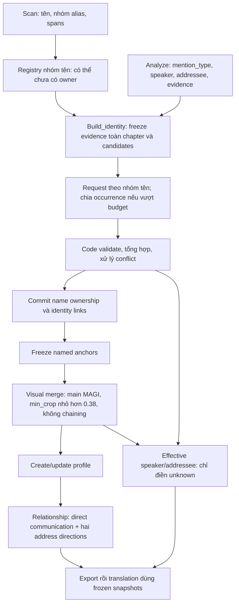

# v7 — Khởi tạo named identity trong build_identity

Ngày: 2026-10-23. **Trạng thái: người dùng đã yêu cầu triển khai; code và kiểm tra
tích hợp model giả đã có. Chưa kiểm chứng bằng inference thật.**
Thiết kế không cấp quyền chạy Runpod. Xem [implementation report](../../v7/delivery/identity-bootstrap-implementation.md).

Thiết kế bổ sung cho [identity–relationship v2](identity-relationship-v2-design.md).
Hướng dẫn pipeline hiện hành: [docs/v7](../../v7/README.md).
Quyết định được chốt qua phỏng vấn grill-me, Q1–Q25.

## 1. Vấn đề đã xác minh

Batch `iris-zero-ch1-identity-relationship-l40s-20261023-r1`, run
`20261023T102705Z-bfbb5d8e`, đã chạy lại analyze68/68 batches cho44 trang:

- Scan có45 name candidates; các request analyze chứa40 lượt tên, tất cả chưa
  có candidate person ownership được biết trước.
- Analyze cuối có260 rows,26 name mentions:9 `direct_address`,17 `reference`;
  không có confirmed person-name mention, calling event hay named person.
- Build_identity có0 eligible profile identities; relationship có0 pairs.
  Hai stage commit artifact nhưng không gửi request profile/relationship.
- Schema hiện cho phép gắn tên mới vào person chưa có tên. Response model lại
  thường từ chối vì không có candidate/known-name owner. Vấn đề không phải
  validator tuyệt đối cấm tên mới.
- Analyze hiện chỉ gửi text và metadata; việc nhìn ảnh được bổ sung ở bước
  xác định identity này.

Mục tiêu là tạo được named identity đầu tiên bằng evidence hợp lệ, không giả
seed registry và không hạ điều kiện bảo vệ identity để làm graph hết rỗng.

## 2. Luồng và trách nhiệm

Không thêm stage top-level mới. `build_identity` thực hiện name binding trước,
visual merge sau, rồi tạo/cập nhật profile. Các phần có plan/decision/review riêng
để review được trong cùng stage. Analyze không phải làm thêm lượt sửa OCR hoặc
suy luận ownership toàn chapter.

Phải có policy/version marker đóng băng để phân biệt run dùng bootstrap với
run v2 lịch sử. Không bật hành vi mới chỉ vì source mới được cài khi resume một
manifest cũ; không reuse cache/profile/graph theo input contract khác. Run dùng
bootstrap cần config/source và batch mới, import checkpoint upstream phù hợp.

### Hai kết luận độc lập về tên

1. Một nhóm tên/alias đã được ghi nhận trong nguồn.
2. Tên đó thuộc named identity/MAGI nào đã được xác nhận.

Registry lưu được nhóm tên chưa có owner. `confirmed_person_name=false` ở output
analyze không được dùng làm điều kiện loại bỏ toàn bộ nhóm khỏi bootstrap.
Tên mới không cần có named owner sẵn trong registry mới được xem xét.

## 3. Bằng chứng và các lượt được xử lý

Ba nguồn bằng chứng được chấp nhận:

- Nhân vật tự giới thiệu.
- Người dẫn truyện giới thiệu nhân vật.
- Nhân vật được người khác gọi tên.

**Một lần có bằng chứng rõ, liên kết duy nhất với nhân vật là đủ.** Không ép
bootstrap phải có hai lượt gọi tên. Việc một chuỗi tên xuất hiện gần một crop
hoặc lặp lại nhiều lần không tự đủ xác nhận ownership.

Model quyết định theo từng lần xuất hiện tên, sau đó code tổng hợp theo nhóm.
Mỗi quyết định phải chỉ rõ occurrence/source references, evidence kind, MAGI
owner nếu xác nhận và lý do; không chỉ trả một confidence số cho cả nhóm.

### Mention type

- Dùng `mention_type` đã có từ analyze để phân biệt direct address/reference.
- **Thiếu hoặc unknown mention_type: bỏ qua lượt đó để xác nhận ownership**;
  build_identity không tự phân loại bổ sung.
- Giữ text/provenance của các lượt nguồn; việc giữ một lượt làm context không
  cấp quyền xác nhận owner cho lượt đã bị loại khỏi tập decision hợp lệ.
- `reference` không tự nghĩa là vô dụng: lời dẫn giới thiệu có thể là reference
  nhưng vẫn cung cấp evidence giới thiệu. Nó không được dùng làm direct-call
  listener fallback hoặc tạo communication pair chỉ vì có tên.

### Phạm vi chapter

Tìm các lượt nhắc tên và context liên quan trên toàn chapter, không bị giới hạn
trong batch analyze gốc. Giữ source IDs, spans, reading order và kết quả analyze
gốc. Không truyền kết quả request nhóm tên trước thành evidence của nhóm sau.

## 4. Candidate MAGI và ảnh

Ứng viên cho một nhóm tên gồm:

1. Các MAGI xuất hiện trong panel liên quan đến các lượt nhắc tên của nhóm trên
   toàn chapter.
2. Identity đã biết có tên/alias phù hợp trong registry.
3. Người nghe từ analyze trong ngoại lệ được quy định bên dưới.

Không mặc định đưa mọi MAGI của chapter vào từng request. Bank/history vẫn là
nguồn crop và identity references; không tự gán tên cho một người không có liên
hệ evidence với nhóm tên đang xét.

### Người được gọi không xuất hiện trong panel

Khi panel chỉ có người nói và người được gọi không hiện diện, có thể dùng người
nghe từ analyze nếu đồng thời đáp ứng:

- Mention là `direct_address`, tên thực sự dùng để gọi người nghe.
- Analyze đã phân giải một người nghe cụ thể; không dùng group/unknown.
- Người nghe có MAGI bank ID hợp lệ.
- Liên kết không vi phạm identity đã xác nhận hoặc cannot-link.

“Sasamori, nghe này” có thể dùng ngoại lệ này; “Tôi vừa gặp Sasamori” không được
gắn Sasamori vào người đang nghe câu chuyện. Lời dẫn có recipient audience không
được chuyển thành một người nghe cụ thể để gán tên.

### Người không có bank ID

**Bỏ qua người không có MAGI bank ID** trong bootstrap identity/profile/graph.
Không tạo identity tạm từ appearance và không bổ sung lane liên kết appearance
chờ bank. Raw scan/analyze/crop nguồn vẫn được giữ; quy tắc này không xóa dữ liệu
nguồn hoặc xóa bản ghi nhóm tên chưa có owner.

### Hình ảnh request

Kết hợp panel chứa evidence với crop bank đại diện của ứng viên. Panel và crop
phải được gắn nhãn MAGI/source IDs rõ để nối model output về nguồn thật.

Giữ text các lượt nhắc tên và references toàn nhóm. Chọn ảnh trong giới hạn
ảnh/context, ưu tiên giới thiệu/gọi tên rõ và evidence mâu thuẫn. Ghi danh sách
ảnh/context không được chọn; không âm thầm bỏ phần phản chứng để dễ xác nhận.
Retain ảnh thực tế đã gửi, hashes và source mapping để audit/resume.

## 5. Nhóm alias, tổng hợp và bảo vệ identity

### Không tự sửa nhóm scan

Build_identity **không tách/sửa nhóm alias do scan tạo**. Nếu nhóm bị nghi gộp
nhầm, đánh dấu review và **treo cả nhóm, không tạo identity mới từ nhóm đó**.
Giữ identity đã confirmed trước đó, không phá registry để ép nhóm khớp.

Quy tắc này khác với một lượt tên chưa đủ evidence: lượt đó có thể chưa phân
giải trong khi các lượt rõ khác vẫn được dùng, miễn nhóm không bị nghi gộp nhầm.

### Nhiều tên trên cùng identity

Nhiều nhóm tên có thể được xác nhận thuộc cùng MAGI/identity, ví dụ Toru và
Mizushima. Cho phép bổ sung name forms/aliases nếu từng liên kết có evidence
hợp lệ và không mâu thuẫn. Điều đó không tự sửa/gộp nhóm alias trong scan.

Tiếp tục áp dụng quy tắc identity đã có: một chuỗi họ/tên trùng đơn thuần không
buộc nhập người; identity confirmed không được tự chuyển/nhập vào identity
confirmed khác; cannot-links được giữ. Các liên kết cùng named identity hợp lệ
được tổng hợp trước khi freeze tập named anchors của visual pass.

### Tổng hợp bằng code

Tổng hợp tất cả quyết định hợp lệ sau các request của bootstrap, không gọi LLM
reduce. Không lấy completion order, majority vote hoặc confidence lớn nhất làm
lý do chọn owner khi có xung đột semantic.

Nếu một request con lỗi, vẫn dùng các quyết định thành công đã qua kiểm tra;
phần lỗi/chưa phân giải được ghi review. Nếu bất kỳ kết quả hợp lệ nào cho thấy
nhóm alias bị gộp nhầm, treo cả nhóm theo chính sách trên. Request lỗi không
được coi là đồng thuận hoặc bằng chứng phủ định.

## 6. Visual merge, profile và relationship

Identity vừa xác nhận được phép làm neo ngay trong cùng run. Sau khi tổng hợp
name-binding claims và kiểm tra xung đột, freeze tập neo rồi chạy visual merge:

- Threshold strict `min_crop < 0.38` trên retained enabled normalized vectors.
- Target chỉ là main MAGI member của identity; main chọn theo lifetime
  appearance count lớn nhất trong bank.
- Không dùng secondary member hoặc member vừa visual-link làm cầu nối.
- Nhiều target phù hợp chọn minimum distance; không thêm margin mới.
- Không đổi metadata/vector/crop hay renumber MAGI bank.

Profile tiếp tục chỉ cho named identity đủ điều kiện: mặc định8 unique current
chapter detections, hoặc identity đủ điều kiện lịch sử theo contract v2 hiện có.
Tối đa10 crop gần prototype main member. Các quy tắc profile attributes,
version/history và update triggers hiện tại được giữ.

### Bổ sung communication evidence

Build_identity được bổ sung cặp giao tiếp nếu evidence xác định rõ người gọi và
người nhận, kể cả addressee từ analyze trước đó unknown. Lưu source decision,
utterance/panel/MAGI references và kết quả canonicalize qua identity links.

Tự giới thiệu/nhắc tên/lời dẫn không tự tạo pair nếu không có giao tiếp trực
tiếp xác định được hai phía. Relationship dùng cả communication evidence hợp
lệ từ analyze và bổ sung này, deduplicate theo identity pair.

Social relations và hai directed address edges tiếp tục tách riêng. Giữ các
quy tắc confirmed/provisional/unknown, profile anchors, bảo vệ confirmed history
và no-retry của relationship v2.

## 7. Effective speaker/addressee cho export và dịch

Cho phép dùng kết quả build_identity để **điền phần người nói/người nghe đang
unknown** trong dữ liệu effective mà export/translation tiêu thụ.

- Giữ nguyên artifact và kết quả analyze gốc.
- Lưu lớp bổ sung riêng với references, decision ID và nguồn build_identity.
- Canonicalize references qua registry sau identity/visual merge.
- Nếu analyze đã có kết luận resolved khác, không ghi đè; tạo conflict review.
- Không biến group/audience/self thành một người cụ thể chỉ để lấp unknown.
- Translation đọc frozen effective semantics + profile/graph snapshots; không
  tự suy luận lại identity hoặc cập nhật graph trong từng batch dịch.

Tên field/path cụ thể là lựa chọn triển khai; phải thể hiện được cả original,
effective và provenance, không làm mất dữ liệu gốc.

## 8. vLLM, chia request và resume

### Freeze và preflight

Mặc định một request/nhóm tên. Freeze nhóm, occurrences, candidate IDs,
known-identity snapshot, source text, retained image hashes, schema, prompt và
generation config trước POST. Không để request sau thấy identity mới do request
trước trả về; mọi request bootstrap dùng cùng snapshot ban đầu.

Tokenize message đầy đủ qua provider/vLLM, gồm chat template, schema, text và
image tokens, cùng output reserve. Dùng context32768 và protected budget hiện
hành; image cap phải phù hợp frozen `vllm.max_images_per_prompt` hiện tại10.
Giới hạn engine64 sequences không phải concurrency64 cho bootstrap.

### Chia do context overflow

Nếu nhóm không vừa context sau đóng gói, cho phép chia thành request con theo
**các lượt nhắc tên**. Mỗi occurrence và đoạn evidence của nó là đơn vị nguyên,
không cắt đôi câu/ảnh rồi mất liên kết nguồn. Các child giữ group ID, snapshot
chung và references; ghi rõ coverage của từng child.

Chia và tokenize trước khi gửi, đóng băng child plan có IDs/hash ổn định. Không
gửi request cha quá budget rồi lấy lỗi làm lý do retry/split. Một occurrence
không thể vừa context một mình được ghi budget failure trước POST và review;
không mất source occurrence khỏi coverage report.

### Scheduling và failures

- Một hàng đợi phẳng cho bootstrap, tối đa8 request in flight tổng cộng, còn
  chịu runtime-wide slots; không nhân8 theo số nhóm hoặc child.
- Drain bootstrap và tổng hợp/commit mapping trước visual pass/profile jobs.
- Không thêm worker/provider/OOM retry. Child được chia trước POST không phải
  retry. Lỗi response/truncation sau POST không tự phát sinh request thay thế.
- Completed valid decisions được reuse; failed/uncertain không resend khi resume.
  Chưa gửi có thể tiếp tục khi service sẵn sàng theo cơ chế v2 hiện hành.
- Không để lỗi một child xóa kết quả child khác. Corrupt evidence/hash/provenance
  vẫn là integrity error, không được đổi thành semantic unknown để tiếp tục.

### Config đề xuất để triển khai

Trong namespace tương thích `v6`, config mới có:

- `identity_name_binding_policy=chapter-multimodal-name-binding-v1`.
- `identity_binding_concurrency=8`, validator1..8.
- `identity_binding_output_tokens=4096`, validator1..8192.

Marker thiếu/null ở manifest lịch sử giữ contract cũ. Bốn config main hiện bật
policy mới cho run mới, không thay config của batch đã freeze.

Profile và relationship giữ cap8; engine image/context settings không bị đổi
ngầm khi thêm bước này. Source/config thay đổi phải freeze batch mới.

## 9. Registry, artifacts và review

Nhóm tên chưa có owner cần store/snapshot tách khỏi person confirmed. Store có
group ID, source occurrences/spans, aliases theo scan, status, binding history
và evidence references. Không gán confirmed person chỉ vì group tồn tại.

Đề xuất subtree riêng trong `build_identity` cho name-binding plan, packed
evidence, requests, decisions, reference crops và request summary. Giữ tách với
request/profile plan hiện tại để cache không va chạm hoặc replay sai task.

Artifact stage cần công bố:

- Số nhóm/occurrences tổng, eligible, skipped, bound và unresolved.
- Nhóm suspect bị treo; người/candidate thiếu bank ID.
- Request cha/child, sent/completed/failed/uncertain/never-sent/budget-failed.
- Named identities tạo/bổ sung; name links, visual links và conflicts.
- Original/effective speaker/addressee và communication evidence bổ sung.
- Input hashes, version/snapshot lineage, retained image references.

Nếu có tên cần xử lý nhưng không tạo được identity nào, tiếp tục pipeline với
**completed_with_review**, không báo thành công model quality. Phân biệt thiếu
candidate, mention_type không hợp lệ, model không xác nhận, request lỗi,
context overflow và alias group bị treo. Nếu identity có tên nhưng chưa đủ mốc
profile, báo eligibility skip riêng, không gọi nó là name-binding failure.

Markdown review tự sinh, dùng số MAGI và câu nguồn dễ đọc, hiển thị lý do/span/
ảnh liên quan. Không dùng review làm approval gate giữ pipeline/pod chờ agent.

## 10. Validation trước inference thật

Các regression cần kiểm chứng có ý nghĩa:

1. Registry không có tên → self/narrator/direct-call evidence → named identity,
   profile eligibility và directed relationship; không seed sẵn desired names.
2. Empty candidate ownership và `confirmed_person_name=false` không làm mất tên
   khỏi bootstrap; missing/unknown mention_type vẫn bị bỏ qua đúng Q19.
3. Narrator reference giới thiệu có thể gắn tên; reference về người thứ ba không
   gắn cho listener và không tạo communication pair.
4. Off-panel listener fallback chỉ nhận một resolved individual có bank ID;
   group/unknown/no bank bị loại.
5. Nhóm alias suspect treo cả nhóm, không tự split; hai valid name forms có thể
   cùng thuộc một MAGI khi không có semantic conflict.
6. Split trước POST, occurrence coverage không mất/duplicate; một oversized
   occurrence không gửi POST; toàn queue không vượt8 request.
7. Partial child success được giữ, failed/uncertain không replay; quyết định
   không phụ thuộc completion order, không có LLM reduce.
8. Named anchors mới dùng được cho visual pass; strict0.38, main lifetime count,
   confirmed identity protection và no chaining vẫn đúng.
9. Supplemental direct pairs và effective unknown fills đi đến export/translation;
   resolved analyze facts không bị ghi đè, original/provenance không mất.
10. Zero eligible/zero confirmed có review counts/reasons đúng; crop/decision
    tampering và incompatible resume vẫn bị chặn.

Code/tests đã triển khai theo yêu cầu sau xác nhận. Inference Runpod cần yêu cầu
trực tiếp cho tác vụ triển khai/thử tiếp; dùng L40S Secure, freeze batch mới,
reuse upstream checkpoint phù hợp và không hotpatch run cũ.

## 11. Rủi ro và phương án đã loại

- Analyze chỉ thấy text nên mention_type/person/addressee có thể sai; không
  override resolved facts tự động giúp giữ phạm vi nhưng có thể giữ lỗi cũ.
- Q19 bỏ qua unknown/missing types làm giảm recall; không biến bootstrap thành
  lượt sửa analyze toàn diện để bù phần này.
- Q12 bỏ người thiếu bank ID làm một số tên vẫn không tham gia graph.
- Q14 treo suspect alias group có thể chặn cả lượt tên đúng trong nhóm đó.
- Một bằng chứng rõ đủ xác nhận giúp chapter đầu hoạt động, nhưng grounding
  sai có thể lan sang visual links; cần evidence references và conflict checks.
- Chia nhiều child làm phân mảnh context; code chỉ kiểm tra mâu thuẫn được biểu
  diễn, không thay thế suy luận liên-child bằng LLM. Partial success có thể chưa
  thấy mâu thuẫn nằm trong request lỗi; review phải công bố phần thiếu này.

Đã loại trong phạm vi này: chỉ sửa prompt analyze rồi hy vọng tên xuất hiện;
ép seed registry; bắt buộc tên có owner trước; tự sửa OCR; tự tách nhóm alias;
identity tạm không có bank; listener group/unknown fallback; tự đoán mention_type
thiếu; LLM reduce; replay failed/uncertain; ghi đè resolved analyze facts; visual
chaining; stage completed rỗng không có cảnh báo.

## 12. Nhật ký quyết định Q1–Q25

| Q | Quyết định |
|---|---|
| 1 | Build_identity chịu trách nhiệm bootstrap trước profile |
| 2 | Registry lưu nhóm tên chưa có owner |
| 3 | Bằng chứng trên toàn chapter |
| 4 | Request theo nhóm tên |
| 5 | Panel evidence + crop bank đại diện |
| 6 | Self introduction, narrator introduction, được người khác gọi tên |
| 7 | Một bằng chứng rõ đủ xác nhận |
| 8 | Quyết định theo từng occurrence rồi tổng hợp |
| 9 | Cho bổ sung direct communication pair từ build_identity |
| 10 | Giữ text các lượt tên, chọn ảnh theo budget |
| 11 | Không tự tách/sửa nhóm alias scan; đánh dấu review |
| 12 | Bỏ qua người không có MAGI bank ID |
| 13 | Candidates từ panel liên quan + known names; thêm resolved listener fallback khi off-panel |
| 14 | Nhóm alias nghi gộp nhầm bị treo, không tạo identity mới |
| 15 | Identity mới làm frozen visual anchor ngay cùng run |
| 16 | Dùng mention_type analyze; nhắc người thứ ba không gắn vào listener |
| 17 | Listener fallback chỉ một resolved individual có bank ID |
| 18 | Zero identities cần completed_with_review, pipeline tiếp tục |
| 19 | Bỏ qua occurrence thiếu/unknown mention_type |
| 20 | Cho nhiều valid name forms cùng identity, không sửa nhóm scan |
| 21 | Cho chia nhóm thành nhiều request nếu context overflow |
| 22 | Chia theo occurrence + evidence nguyên vẹn |
| 23 | Code tổng hợp, không LLM reduce |
| 24 | Dùng valid partial success; lỗi không phủ nhận/đồng thuận |
| 25 | Effective export/translation điền unknown; không overwrite resolved analyze |

## 13. Xác nhận trước triển khai

Người dùng đã trực tiếp yêu cầu “triển khai thiết kế”. Các quyết định được triển
khai theo bảng trên; recommendation bị bác không được coi là default.
