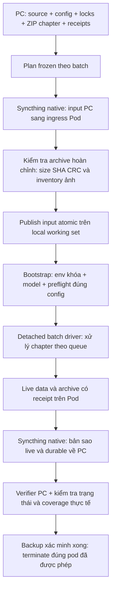

# Overview phương pháp chạy Runpod V6 để chốt thiết kế

Ngày tổng hợp: 2026-10-14.

> Snapshot thiết kế lịch sử. Quy trình hiện hành nằm trong
> [runbook vận hành](runpod-v6-agent-operational-plan.md), cập nhật 15/10/2026.
> Các lựa chọn Ollama/Qwen/context và phần chưa triển khai bên dưới đã được thay
> bằng [thiết kế vLLM/Qwen 3.5](qwen35-vllm-4090-implementation-vi.md).

Nguồn chính: [plan vận hành cập nhật ngày 2026-10-13](runpod-v6-agent-operational-plan.md), [chính sách Runpod](../news/runpod_agent_fast_policy_vi.md), các controller hiện có và quyết định trong phiên thiết kế analyze hiện tại. Bộ nhớ phiên trước cũng ghi nhận luồng native sync; không dùng lịch sử để suy ra quyền chạy của phiên này.

Trạng thái phiên này: chuẩn bị local và rà tích hợp tĩnh; chưa tạo/kết nối pod, chưa chạy tests hoặc model inference. Các ghi nhận lượt chạy trước thuộc tài liệu lịch sử, không chứng minh source mới đã được kiểm chứng.

## 1. Kiến trúc được thảo luận gần nhất

Một GPU Pod Secure Cloud, working set trên local filesystem và batch driver chạy detached. PC giữ plan frozen và bản sao dữ liệu. Syncthing native đảm nhiệm truyền payload, kể cả khi agent/controller mất kết nối.

Các driver/controller chính:

- `deployment/runpod/local_v6.py`: chuẩn bị batch, launch và bootstrap remote.
- `deployment/runpod/batch_v6.py`: chạy queue và giữ checkpoint/trạng thái mỗi chapter.
- `deployment/runpod/native_sync.py`: ghép cặp daemon native, cấu hình các luồng truyền.
- `deployment/runpod/native_verify.py`: kiểm tra archive đã về PC bằng receipt.
- `deployment/runpod/manage.py`: môi trường, model, preflight và thực thi pipeline.

## 2. Chuẩn bị trước khi thuê GPU

1. Chốt source, thuật toán, prompt, model và cấu hình; không sửa thuật toán trong phiên GPU đang chạy để chữa từng nội dung.
2. Chọn chapter từ nguồn local mặc định `D:\download\EN-data\...` khi người dùng yêu cầu lấy dữ liệu mà không chỉ định nguồn khác.
3. Chuẩn bị ba environment/lock riêng: main MAGI, visual Koharu và Hayai. Hayai không được làm thay đổi dependency pin của MAGI.
4. Đóng gói `source.zip`, `locks.zip`, `pipeline-v6.json` và ZIP từng chapter, cùng SHA-256/size/image inventory. Mỗi batch có ID và destination riêng.
5. Chuẩn bị Syncthing native và địa chỉ/port theo controller. Credential nằm ngoài source bundle và folder dữ liệu replicate.
6. Khi thực sự được yêu cầu chạy, đọc giá/stock hiện tại, xác minh storage/VRAM và lựa chọn GPU trước provisioning. Giá hoặc thứ tự ưu tiên trong plan cũ không phải kết quả catalog của phiên này.

Phiên hiện tại không chạy test, build/push image, tải model hoặc chuẩn bị kết nối thật. Quy tắc này ưu tiên hơn ví dụ trong plan cũ có đề cập test fixture/preflight thực thi.

## 3. Storage và truyền dữ liệu

- Working set đề xuất: `/opt/manga-work`; execution root `/opt/manga-work/execution`, runtime `/opt/manga-work/runtime` và ingress riêng.
- Thực thi trên local filesystem đã được xác minh, không suy ra tốc độ hoặc tính bền chỉ từ tên thư mục.
- PC → Pod: folder input send-only từ PC, receive-only ở Pod.
- Pod → PC: live data và durable archives send-only từ Pod, receive-only trên PC; PC có bảo vệ bản sao khỏi thao tác delete ở nguồn theo cấu hình native hiện có.
- Chờ archive hoàn chỉnh rồi kiểm tra size/SHA/CRC/per-image trước khi publish. Không inference vào folder còn đang upload.
- Live replication hỗ trợ cứu dữ liệu; archive cùng receipt cung cấp mốc đầu ra bất biến để verifier kiểm tra.
- Kết nối agent có thể ngắt, nhưng PC, Pod và daemon native vẫn phải hoạt động và liên lạc được để tiếp tục sao chép.
- Local/container disk không được coi là backup. Backup là dữ liệu đã về PC và được xác minh.

## 4. Launch và vòng chạy

Sau khi được yêu cầu chạy và các điều kiện chuẩn bị đạt, dùng một controller launch cho task-owned pod. Controller kích hoạt native sync, xác minh canary, gửi phần bootstrap nhỏ qua SSH, rồi chạy driver detached có PID/identity/lock.

Bootstrap dùng frozen config, cài env từ locks, prefetch đúng model, chuẩn bị assets visual và chạy preflight một lần tại ranh giới cần thiết. Các bước này là công việc của lượt chạy tương lai, chưa thực thi trong phiên này.

Driver xử lý chapters theo queue. Lỗi một chapter phải giữ partial/checkpoint/journal và tiếp tục thử các chapter còn lại theo chính sách hiện có; không đánh dấu failed thành completed hoặc bỏ target lỗi để làm đẹp coverage. Không hot-sync prompt/algorithm khi driver đang chạy.

Các stage vẫn tạo JSON, review Markdown, visualization, bản dịch, bank và audit theo contract. Review Markdown là đầu ra, không là cổng agent đọc rồi duyệt giữa stage.

## 5. Model và analyze sau quyết định mới

### Model đã chọn

- Ollama tag: `qwen3.8:27b-q4_K_M`, thay `gemma4:e4b-it-q4_K_M` trong config Runpod V6.
- Đây là tag quantized có hỗ trợ text/image, đã đối chiếu [danh sách chính thức](https://ollama.com/library/qwen3.8/tags) và metadata manifest registry.
- Giữ context 16384 và `think=false`; không dùng context tối đa quảng cáo làm cấu hình mặc định.
- Đã sửa source bootstrap để prefetch và doctor nhận config frozen của batch; tránh tải/kiểm tra Gemma từ default config rồi inference bằng Qwen.
- Chưa kiểm chứng inference, latency, VRAM hoặc JSON output của Qwen trong pipeline.

GPU cần tính lại theo Qwen 27B, projector, KV cache, request ảnh và các worker khác. Dung lượng download khoảng 18 GB trên trang Ollama không phải toàn bộ VRAM runtime. Chưa chốt GPU/giá/region mới và chưa gọi catalog Runpod.

### Analyze đang chốt

- Chỉ `caption_hint` vào nhánh caption; nhánh dialogue vẫn có thể chứa suy nghĩ → self.
- Hai nhánh đọc riêng nội dung; dùng metadata scene và danh tính chung.
- Scene dựa trên sự liên quan ngữ nghĩa của dialogue, bỏ câu đệm khỏi đánh giá chủ đề; phân biệt chen ngang với đổi mạch.
- Dialogue có text–tail, text–character và ID ổn định làm neo khóa người nói; suy luận cả trước và sau trong cùng mạch.
- Người nghe dialogue được suy ra từ quan hệ lượt thoại và danh sách người liên quan trong scene, thay cửa sổ người nói 10 kết quả trước.
- Caption ưu tiên người nói gốc, sửa nhiễu bằng cả mạch; narrator ngoài lề không ghi đè người kể chính. Khoảng nối tối đa mặc định 7 essential text, tính từng khoảng và gồm dialogue xen giữa.
- Scene dài chia đoạn chồng lấn, giữ trạng thái scene và chạy hai chiều; chia đoạn không tạo scene mới.
- Giảm false positive shout bằng prompt yêu cầu cue rõ về việc hét; không dùng quota. Thay đổi prompt đã được chuẩn bị, chưa đo mức giảm.

Chi tiết quyết định và giả định cần xác nhận nằm trong [thiết kế analyze hai nhánh](analyze_dual_branch_design_vi.md). Hai nhánh, scene và checkpoint hai lượt chưa được triển khai.

## 6. Theo dõi, cứu dữ liệu và kết thúc

- Khi có lượt chạy được phép: theo dõi read-only bằng state/counter/log của đúng attempt; cập nhật tiến độ, tránh chạy lại toàn bộ doctor/hash liên tục.
- Mốc tiến độ phải là page/utterance counter, checkpoint, batch hoàn thành hoặc bytes transfer tăng. PID và heartbeat riêng lẻ chưa đủ.
- Sau 10 phút không có tiến độ đo được, chẩn đoán nguyên nhân; đây không phải lệnh tự động xóa pod.
- Native verifier kiểm tra archive đã nhận theo SHA/size/CRC và receipt. Kết quả đó phải được đối chiếu terminal state, inventory và coverage; archive hợp lệ không đồng nghĩa mọi chapter thành công.
- Đầu ra partial/failed cũng phải tải và bảo toàn. Lỗi coverage được báo đúng, không ngăn việc cứu dữ liệu thực tế đã sinh ra.
- Sau backup xác minh xong, terminate đúng task-owned pod khi có quyền và read-back để xác nhận kết thúc. Không coi tắt Ollama hoặc dừng process là ngừng phí pod.

## 7. Phần còn phải chốt hoặc hoàn thiện trước lượt chạy mới

1. Xác nhận thiết kế analyze, gồm quy ước caption sát ranh giới và caption ngoài lề không kéo dài khoảng nối mạch chính.
2. Triển khai thực sự scene, hai nhánh và hai lượt; định dạng schema/ID phải phù hợp đường `v6/semantic.py`, không chỉ đường legacy.
3. Hoàn thiện gate đường dẫn model visual: plan 2026-10-13 ghi nhận worker có thể tìm `project/models/visual` trong khi bootstrap tải vào `runtime/models/visual`. Source `local_v6.py` hiện chưa tích hợp alias/preflight này. Đây là blocker chuẩn bị đã biết, chưa được sửa trong phiên overview.
4. Đánh giá khả năng phục vụ Qwen 27B của GPU/engine/context khi có yêu cầu kiểm thử; chưa có kết quả thực nghiệm cho source mới.
5. Tạo batch frozen mới từ source/config đã chốt. Các batch cũ không tự nhận thay đổi model/prompt.
6. Chốt corpus, output destination, chi phí và quyền vận hành cho lượt chạy thực tế.

Overview này tổng hợp thiết kế và trạng thái hiện tại; không phải thông báo workload đã được triển khai hoặc đang chạy.
