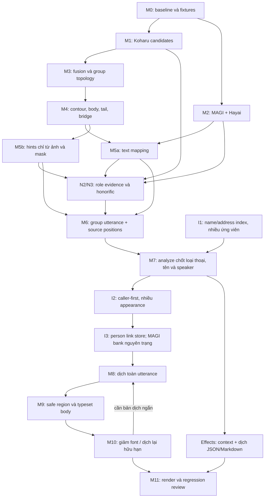

> **Pipeline hiện hành được đặt tên v7 (2026-10-23): [hướng dẫn v7](../v7/README.md).**
> Bộ v6 được giữ làm thiết kế nền và lịch sử. Các đoạn Hayai/GLiNER/Gemma và
> stage identity cũ bên dưới không phải defaults mới. CLI/module/schema vẫn có
> tên v6 để tương thích; xem phần migration của v7 trước khi resume.
>
> Technical interface (2026-10-21): [independent analysis](independent-analysis.md).
> Offline implementation and mock/fixture checks are complete: [validation report](../plan/v6-only-parallel-analyze-refactor-implementation-20261021.md). GPU qualification is separate.
> Legacy controller/config examples below are historical and cannot resume new-policy runs.

# v6 — Tổng quan thiết kế và triển khai pipeline manga

Ngày tổng hợp: 2026-10-11. **Thiết kế đã được xác nhận và luồng v6 đã được
nối vào pipeline mặc định.** Phạm vi đã kiểm chứng và tiến độ pilot nằm trong
[trạng thái triển khai](delivery/implementation-status.md). Các câu trả lời Q1–Q17 đã được ghi vào hợp đồng từng phần.
Tài liệu này là điểm bắt đầu và chỉ mục chính; mỗi mốc có phương pháp, mô hình,
input/output và tiêu chí hoàn thành trong file riêng.

Pilot local After School chapter 1 (11 trang) đã dừng theo yêu cầu. Habatake đã
hủy. Không chạy test dài trên CPU hoặc chạy thử/fix case trên local. File vận hành
Runpod v6 đã được chuẩn bị; chưa kiểm thử hay triển khai. Không tự mở hoặc sử dụng
Runpod; chỉ dùng khi người dùng cho phép và gọi trực tiếp.

- [Runbook Runpod hiện hành](../plans/runpod-v6-agent-operational-plan.md): local working-set, Syncthing native, vLLM, prepare/launch/verify/teardown. Đây là điểm vào cho run mới.
- [Controller Runpod workspace cũ](delivery/runpod-execution.md): tham khảo tương thích; không dùng thay runbook hiện hành.
- [Review chuẩn bị Runpod](delivery/runpod-preparation-review.md): các xung đột tích hợp đã sửa và phạm vi kiểm tra tĩnh.

## Thay đổi toàn cục từ pipeline hiện tại tới v6

| Phần | Baseline trước v6 | Thiết kế v6 |
|---|---|---|
| Bubble detection | Koharu toàn trang + crop panel; baseline trước v6 dùng 0.32. | Ngưỡng bubble hiện tại 0.45; giữ provenance và đo recall bằng cùng baseline. |
| Geometry | Trace mask và contour lớn nhất; dễ mất cấu trúc bubble ghép/xuyên panel. | Group có nhiều part, contour toàn bộ và contour body; giữ đuôi/cầu nối, panel membership và đoạn biên dựng thêm. |
| Gợi ý loại thoại | Heuristic hình học chưa hiệu chỉnh độ tin cậy. | Gợi ý chỉ từ đặc trưng ảnh/mask, không dùng text; analyze kết hợp text/ngữ cảnh với hints để chốt loại thoại trong lượt hiện có. |
| Đơn vị lời thoại | Text box còn là đơn vị xử lý chính. | Một utterance cho các phần thuộc cùng group; giữ vị trí/source boxes riêng, analyze và dịch chung. |
| Người nói | Association theo từng text box. | Lưu raw association; analyze chọn một speaker cho group, không rõ dùng null/Other như MAGI. |
| Dịch/dàn chữ | Chưa có contour typesetter thực tế trong repo. | Dịch một chuỗi rồi phân bổ theo sức chứa body, cùng cỡ chữ; margin/OCR anchor giới hạn vùng chữ và loại cầu nối. |
| OCR và effects | NFC/whitespace; noise rules cho một số whole-box SFX, chưa là role classifier hoàn chỉnh. | Không thêm phục hồi từ/dehyphenation theo Q12. SFX/trạng thái đã xác nhận làm context và dịch riêng trong JSON/Markdown; không render effects lên ảnh. |
| Tên và identity | Casefold lookup cơ bản; cluster/prototype matching và bank merge chưa thống nhất mọi name/reference. | Tên/alias lưu và lookup chữ thường; họ/tên đệm/honorific có cấu trúc; key trả nhiều ứng viên; nhiều cluster/appearance cùng person theo caller-first; bank MAGI nguyên trạng, person registry/link store riêng. |
| Cache và review | Manifest/cache của các stage hiện có. | Version schema/dependency fingerprint; calling-event receipts, inferred contour segments, person journal và source-bank hash để review/revert links. |

Không coi một tên trùng là lý do tự merge. Q15:A giữ nhiều ứng viên và phân giải
bằng context; chưa rõ thì unknown. Giữ Q16:A một call rõ + ảnh phù hợp. Bổ sung
**nhiều calls confirmed cùng person/recipient ưu tiên hơn visual similarity** để
giữ person qua chibi/hóa hình/góc vẽ/già đi. Contradiction phải là bằng chứng
ngữ nghĩa khác người, không chỉ embedding xa. Bank/cluster IDs/embedding MAGI
nguyên trạng; person registry/link store là tầng riêng.

## Cấu hình và mô hình

Cấu hình thiết kế: text detection **0.45**, text–character association **0.25**,
dialogue logit **-0.5**, bubble detection **0.45** trong code và cấu hình mới. Dialogue logit và text–character
association là hai ngưỡng độc lập, dùng cho hai quyết định khác nhau.

Giữ MAGI cho text/character/association; Koharu cho layout/mask; Hayai cho OCR;
GLiNER đề xuất tên và Gemma local xác nhận ngữ nghĩa/analyze/dịch. Không thêm
model segmentation mới ở v6. Phiên bản pin, môi trường tách, giới hạn bằng chứng
và cấu hình chi tiết nằm trong [mô hình và cấu hình](foundation/models-and-config.md).
AOT là model inpaint đã có cấu hình; bật inpaint/render cần thực hiện và kiểm chứng
theo mốc, không coi cấu hình hiện tại là tính năng đã hoạt động.

## Luồng dữ liệu

N1 (phục hồi từ OCR) không nằm trong luồng. I1 cung cấp index trước semantic
confirmation, I2/I3 dùng calling support/context đã xác nhận để liên kết person ở tầng riêng. M9/M10 nhận
utterance, không nhận effects. M5b không nhận OCR/text box/dialogue score; dùng
code trên ảnh/mask có sẵn. Chốt loại thoại nằm trong response analyze M7, không
thêm lượt gọi model riêng. Cache visual hints độc lập với nội dung OCR. Phụ thuộc storage/cache và thứ tự code chi tiết
ở [kế hoạch triển khai](delivery/implementation-plan.md).

## Nền tảng và quyết định

| Tài liệu | Nội dung |
|---|---|
| [Quyết định Q1–Q17](foundation/decisions.md) | Các lựa chọn đã chốt, phạm vi local và group/part/utterance. |
| [Hiện trạng và bằng chứng](foundation/current-state.md) | Căn cứ code/probe; liên kết so sánh AIP419 và review v1–v5. |
| [Mô hình và cấu hình](foundation/models-and-config.md) | Model/revision, chức năng, môi trường và default hiện tại so với đề xuất. |
| [Hợp đồng dữ liệu chung](foundation/data-contracts.md) | Tọa độ, ID, provenance và đơn vị dữ liệu. |
| [Bubble threshold 0.45](foundation/bubble-threshold.md) | Tác động lọc cached detections, giới hạn kết luận và ca cần review. |
| [Hiệu chỉnh tham số](foundation/calibration.md) | Tham số geometry/hints cần pilot, không đặt số tùy ý rồi coi là đã kiểm chứng. |
| [Rủi ro và phương án](foundation/risks-and-alternatives.md) | Biên suy luận, topology, độ tin cậy và các phương án chưa chọn. |

## Các mốc thị giác và nhóm thoại

| Mốc | Phương pháp / đầu ra chính | Tài liệu chi tiết |
|---|---|---|
| M0 | Khóa model/config/input và baseline; bộ fixture lỗi cụ thể. | [Baseline và fixtures](baseline/m0-fixtures.md) |
| M1 | Koharu toàn trang/crop; candidates, masks và provenance. | [Layout detection](vision/m1-layout-detection.md) |
| M2 | MAGI + Hayai; OCR/text/character và raw association. | [Text extraction](vision/m2-text-extraction.md) |
| M3 | Fusion và đồ thị quan hệ; bubble group xuyên panel. | [Group topology](vision/m3-group-topology.md) |
| M4 | Trace/repair contour; outer/body/tail/bridge và inferred segments. | [Contour và parts](vision/m4-contour-and-parts.md) |
| M5 | Hai nhánh độc lập: text mapping và gợi ý ảnh/mask có quyền unknown. | [Text mapping và hints](vision/m5-text-mapping-and-hints.md) |
| M6 | Ghép một utterance từ group, giữ source boxes riêng. | [Group normalization](dialogue/m6-group-normalization.md) |
| M7 | Analyze text + hints; chốt loại thoại, một speaker cho group và xác nhận tên. | [Analysis và speakers](dialogue/m7-analysis-and-speakers.md) |

## OCR, role và định danh nhân vật

| Tài liệu | Nội dung |
|---|---|
| [Ảnh hưởng OCR và nhận nhầm tên](text/ocr-and-entity-impact.md) | Ngắt từ, honorific và hậu quả khi SFX bị ghi vào bank tên. |
| [Chính sách OCR theo Q12](text/ocr-policy.md) | Bỏ N1; giữ nguyên giả định LLM hiểu từ bị ngắt và kiểm chứng bằng fixture. |
| [N2 — Role evidence](text/n2-role-evidence.md) | SFX/trạng thái so với person; semantic confirmation hiện tại, không quarantine riêng. |
| [N3 — Honorific contract](text/n3-honorific-contract.md) | Hậu tố có cấu trúc, raw span và validator nhất quán. |
| [I1 — Names và aliases](identity/i1-names-and-aliases.md) | NFC/casefold, họ/tên đệm/address forms, key → danh sách identity. |
| [Calling events](identity/calling-events.md) | Phân biệt name mention và lần gọi tên rõ, recipient/source và quy tắc đếm. |
| [I2 — Identity evidence](identity/i2-identity-evidence.md) | Caller-first; nhiều appearance cùng person dù embedding khác xa. |
| [I3 — Person link store](identity/i3-canonical-identity.md) | Cluster–person mapping/journal ở tầng riêng; không sửa MAGI bank. |

## Dịch, dàn chữ và kiểm chứng

Cấu hình mặc định hiện tại chỉ dịch/render **natural**, tái sử dụng batch analyze,
có đồ thị quan hệ/xưng hô dùng lại giữa các chapter. Xem [đặc tả triển khai hiện tại](translation/natural-parallel-relationships.md)
cho quy tắc ngưỡng crop, chọn ảnh, đồ thị chỉ bổ sung, concurrency 8/8/32 và resume.

| Mốc / nhánh | Phương pháp / đầu ra chính | Tài liệu chi tiết |
|---|---|---|
| M8 | Dịch toàn utterance một lần, giữ mapping nguồn. | [Group translation](translation/m8-group-translation.md) |
| Effects | Dịch SFX/trạng thái riêng; JSON/Markdown, không sửa ảnh. | [Effects route](translation/effects-route.md) |
| M9 | Safe mask theo contour margin/OCR anchor; cùng font, phân bổ theo capacity. | [Typesetting](translation/m9-typesetting.md) |
| M10 | Font tối thiểu rồi dịch ngắn hữu hạn; không vừa → needs_review. | [Overflow](translation/m10-overflow.md) |
| M11 | Render, đối chiếu baseline, kiểm tra topology/role/identity/layout. | [Regression review](validation/m11-regression-review.md) |

## Thực hiện và nghiệm thu

[Thứ tự triển khai và vùng mã](delivery/implementation-plan.md) chia công việc
thành sáu đợt, giữ schema/fingerprint/migration cùng thay đổi tương ứng.
[Điều kiện xác nhận thiết kế](delivery/design-review.md) ghi phạm vi duyệt và
giới hạn kết luận. Mỗi mốc phải có artifact kiểm tra được; không tạo gate chờ
duyệt từng trang/stage.

Chất lượng contour/hints, việc LLM hiểu OCR bị ngắt, phân bổ dịch và identity
reconciliation đều cần chứng minh trên fixtures/pilot. Thiết kế không đồng nghĩa
với kết quả đã được kiểm thử hoặc mô hình đã được cài/chạy.

## Đường dẫn tài liệu trên máy khác

Liên kết Markdown dùng **đường dẫn tương đối từ file nguồn**, dấu `/` và đúng
chữ hoa/thường. Từ `identity` dùng `i2-identity-evidence.md`; từ `dialogue` dùng
`../identity/i2-identity-evidence.md`. Không dùng ổ đĩa/user path tuyệt đối hoặc
`file://`/`vscode://` cho liên kết tài liệu.

Input/model/artifact paths là dữ liệu minh họa/nguồn local, không là navigation.
Artifact `outputs/` không mặc nhiên có sau clone; tài liệu dùng file review
trong `docs/` làm đích điều hướng.
