# Báo cáo hệ thống và chẩn đoán lỗi Bocchi v6

Ngày báo cáo: 12/10/2026. Workload: Bocchi chapter 1–3, 76 trang.
Batch: `bocchi-v6-localdisk-20261012`.

## 1. Kết luận

Full pipeline chưa thành công. Cả ba chapter hoàn thành từ `layout` đến `scan`,
nhưng `analyze` chỉ tạo kết quả partial. Các bước phụ thuộc phía sau chưa chạy.

Nguyên nhân chính là **schema đầu ra cho tên chưa ràng buộc theo từng câu**:
schema cho phép mỗi câu sử dụng bất kỳ candidate ID nào trong batch, trong khi
validator yêu cầu đúng toàn bộ candidate ID của chính câu đó. Với batch không có
tên, schema còn đưa `<no-candidates>` vào enum. Model đã dùng các khả năng này để
trả ID của câu khác, lặp ID hoặc tạo một mention placeholder. Validator từ chối
đúng theo hợp đồng, nhưng retry không cung cấp thông tin cụ thể để model sửa.

Đây là lỗi thiết kế hợp đồng đầu ra và khả năng tuân thủ của model. Bằng chứng
không cho thấy thiếu VRAM hoặc thiếu context là nguyên nhân chính của lần chạy.
Không cần thay GPU để sửa các lỗi coverage này.

Đã tải và xác minh kết quả partial, bank cluster và audit. Pod A40
`h0hfjlcram3mxe` đã terminate sau backup; readback trả 404. Chẩn đoán này dùng
artifact trên máy, không mở lại Runpod và không chạy model/test pipeline.

## 2. Phạm vi và nguồn bằng chứng

Nguồn chính:

- `outputs/runpod-bocchi-v6-localdisk-20261012/final-state.json`: trạng thái,
  exit code, lỗi và coverage của từng chapter.
- `outputs/runpod-bocchi-v6-localdisk-20261012/verification.json`: xác minh local
  các checkpoint đã commit và những bước còn thiếu.
- Các thư mục `06_analyze/result.json`, `06_analyze/targets` và `cache/rejected`
  của ba run: kết quả thành công, nhóm thất bại và phản hồi model bị từ chối.
- `05_scan/result.json`: candidate tên cùng ID và câu nguồn.
- `src/manga_pipeline/v6/semantic.py`, `v6/persons.py` và
  `providers/ollama.py`: schema, validator, xử lý tên và retry.

Hash của cả ba file source trên khớp metadata trong source bundle đã triển khai.
Do đó, phần đối chiếu code phản ánh đúng code của lần chạy, không dựa vào một
bản sửa xuất hiện sau đó. Không dùng review Markdown làm cổng phê duyệt stage.

## 3. Hệ thống liên quan hoạt động như thế nào

### 3.1. Luồng pipeline v6

```mermaid
flowchart LR
    A[76 ảnh gốc] --> B[layout: Koharu]
    B --> C[extract: MAGI + Hayai OCR]
    C --> D[bubble_geometry]
    D --> E[normalize]
    E --> F[scan: candidate tên]
    F --> G[analyze: Gemma + validator]
    G --> H[identity]
    H --> I[export]
    I --> J[inpaint]
    J --> K[translate]
    K --> L[typeset]
```

| Bước | Vai trò trong hệ thống | Trạng thái lần này |
| --- | --- | --- |
| `layout` | Koharu cung cấp layout/panel và dữ liệu vùng ảnh để các bước sau dùng chung. | Hoàn thành 3 chapter |
| `extract` | MAGI nhận diện text/character và liên hệ hình ảnh; Hayai OCR đọc chữ trong môi trường riêng. | Hoàn thành 3 chapter |
| `bubble_geometry` | Tạo thông tin hình học/mask của vùng chữ và bubble phục vụ xử lý ảnh, đặt chữ. | Hoàn thành 3 chapter |
| `normalize` | Chuẩn hóa cấu trúc target; một lượt thoại có thể gồm nhiều phần bubble. | Hoàn thành 3 chapter |
| `scan` | Đề xuất span có thể là tên người, gắn candidate ID và utterance ID. | Hoàn thành 3 chapter |
| `analyze` | Quyết định vai trò nội dung, phong cách lời thoại, người nói, người nhận và ý nghĩa của candidate tên. | Partial cả 3 chapter |
| `identity` | Tiếp nhận kết quả semantic hợp lệ để xử lý/commit danh tính người. | Chưa chạy |
| `export` | Xuất dữ liệu semantic với provenance và các trường cần cho dịch. | Chưa chạy |
| `inpaint` | Tạo ảnh đã xóa vùng chữ theo cấu hình. | Chưa chạy |
| `translate` | Sinh bản dịch `natural` và `localized`. | Chưa chạy |
| `typeset` | Dàn bản dịch lên ảnh, dùng font và các quy tắc bố trí đã chốt. | Chưa chạy |

Stage có dependency và kiểm tra artifact. Khi `analyze` còn target lỗi, hệ thống
không đánh dấu nó completed và không cho các bước sau dùng kết quả thiếu như
một chapter hoàn chỉnh. Vì vậy, không có bản dịch/typeset là hệ quả của điểm dừng
ở analyze; chưa phải bằng chứng rằng translate hoặc typeset có lỗi riêng.

### 3.2. Candidate tên chưa phải tên người đã xác nhận

`scan` tạo một candidate gồm các trường như:

- `id`: ID của span đề xuất.
- `utterance_id`: câu/target chứa span.
- `name`, `raw_surface`, `start`, `end`: nội dung và vị trí span.
- `candidate_person_ids`: các người có thể liên quan, nếu có.

GLINER có thể đề xuất nhầm một từ hoặc cụm từ thông thường. Ví dụ artifact có
candidate `the rrummer` và phản hồi model có xử lý từ `BUTTLOAD`. Candidate chỉ
là đề xuất để analyze đánh giá, không tự động được thêm thành tên người.

Analyze phải trả quyết định cho candidate ngay cả khi quyết định là
`confirmed_person_name=false` hoặc chưa biết người được nhắc tới. Loại bỏ ID,
chuyển nó sang câu khác hoặc invent một ID mới làm mất quan hệ với span nguồn.

### 3.3. Hai loại bank

| Dữ liệu | Ý nghĩa | Kết quả lần này |
| --- | --- | --- |
| MAGI cluster bank, local `banks/bocchi` | Lưu các nhóm/appearance và dữ liệu hình ảnh của character. Cluster ID không phải person ID. | Bank mới đã sinh ra và được nhập local |
| Person registry, dự kiến `banks/_persons_v6/bocchi` | Lưu danh tính semantic, tên và các quan hệ người do pipeline v6 commit. | Chưa sinh registry vì `identity` chưa chạy |

Analyze còn lưu `person_state` và các kết quả thành công trong artifact partial.
Đó không đồng nghĩa với việc person registry đã được commit. Không được trộn
cluster ID và person ID hoặc coi bank hình ảnh là bank danh tính hoàn chỉnh.

### 3.4. Provider, schema và validator

Analyze gửi nhóm target cho Gemma qua Ollama. Request có target, candidate tên,
candidate người, cluster nhìn thấy, ngữ cảnh thoại và ảnh khi cần.

Provider truyền JSON schema qua trường `format`. Schema giới hạn cấu trúc và
giá trị model được phép trả; validator kiểm tra thêm các quan hệ semantic.
Trong lần này:

- Model: `gemma4:e4b-it-q4_K_M`; context cấu hình 16384.
- Provider đặt output budget tối thiểu 2048 token cho `analyze_dialogue_v6`,
  dù cấu hình chung `num_predict` là 768 (`ollama.py:41`).
- Retry hiện có thêm thông báo lỗi ngắn vào system prompt. Thông báo coverage
  chỉ là `Name candidate coverage changed`, không kèm câu và ID lệch.
- Một lỗi trong nhóm làm nhóm đó thất bại; nhóm thường có tối đa ba target.
  Các kết quả hợp lệ của nhóm khác vẫn được lưu, nhưng toàn stage là partial.

## 4. Kết quả đo được

### 4.1. Coverage semantic cuối cùng

“Target” ở bảng này là đơn vị semantic mà analyze xử lý, không phải số trang và
không nhất thiết chỉ là lời thoại; nó có thể là nội dung/effect cần phân loại.

| Chapter | Trang | Target thành công | Target thất bại | Nhóm thất bại | Nhóm lỗi coverage tên |
| --- | ---: | ---: | ---: | ---: | ---: |
| 1 | 31 | 200 | 105 | 37 | 36 |
| 2 | 24 | 108 | 135 | 46 | 42 |
| 3 | 21 | 133 | 57 | 19 | 18 |
| Tổng | 76 | 441 | 297 | 102 | 96 |

Khoảng 59,8% target semantic có kết quả thành công. 96/102 nhóm thất bại cuối
cùng, khoảng 94,1%, mang lỗi coverage tên. Mỗi chapter trả exit code 2.
Các bước còn thiếu đều là `analyze`, `identity`, `export`, `inpaint`,
`translate`, `typeset`.

### 4.2. Phản hồi bị từ chối, tính cả retry

| Lỗi trong `cache/rejected` | Số phản hồi |
| --- | ---: |
| `Name candidate coverage changed` | 211 |
| `An effect/action-state cannot supply a confirmed person name` | 7 |
| `Sentinel/suffix cannot become a person name` | 2 |
| `Incomplete model response` | 2 |
| Tổng | 222 |

Số phản hồi bị từ chối không bằng số nhóm thất bại cuối: một nhóm có thể lỗi ở
lượt đầu rồi được retry thành công, hoặc lỗi cả hai lượt.

Đối chiếu 211 phản hồi coverage với candidate của scan tìm thấy:

| Kiểu lệch | Số hàng phản hồi có kiểu lệch |
| --- | ---: |
| Thêm candidate không thuộc câu hiện tại | 219 |
| Trong đó: lấy candidate của câu khác | 123 |
| Trong đó: ID không có trong scan | 96 |
| Lặp candidate ID trong một câu | 61 |
| Thiếu candidate phải có | 10 |

Các loại lệch có thể chồng nhau, không cộng bảng này thành tổng target lỗi.
Placeholder `<no-candidates>` xuất hiện 98 lần trong toàn bộ phản hồi bị từ chối.

## 5. Giải thích từng nguyên nhân

### 5.1. Nguyên nhân chính: schema rộng hơn hợp đồng của validator

Ở `semantic.py:99`, schema mention dùng enum candidate ID của **toàn batch**.
Ở `semantic.py:111`, mỗi row dùng chung schema mention array đó. Schema có thể
chấp nhận candidate của câu B xuất hiện trong câu A.

Nhưng `semantic.py:252–255` tính tập candidate đúng của **từng utterance** và
yêu cầu tập trả về phải bằng tập đó, không trùng ID. Vì vậy, một phản hồi có thể
đúng JSON schema nhưng sai validator.

Ví dụ thực tế ở chapter 1:

- Target `ca029eb60577e74b:p5:g4:u` không có candidate tên, nên kết quả hợp lệ
  phải có `mentions=[]`.
- Model trả mention ID `bbdc8deb1ec1e59b185d`, thuộc target khác.
- Cả attempt 0 và attempt 1 của cache key bắt đầu `00c9da90...` lặp lại sai lệch.
- Validator từ chối bằng `Name candidate coverage changed`.

Schema đã khóa target utterance theo từng key, nhưng chưa áp dụng cách khóa
tương tự cho mention của từng target. Đây là nguyên nhân thiết kế có bằng chứng
trực tiếp trong cả code và phản hồi.

### 5.2. Placeholder làm nhánh “không có tên” dễ sinh dữ liệu sai

Nếu batch không có candidate, enum vẫn cho phép `<no-candidates>`.
Mention array chưa bị khóa thành rỗng trong trường hợp này. Model đã trả một
mention mang placeholder thay vì `[]`.

Ví dụ chapter 2: target `3e1ec407e765089e:p22:t3:u` không có candidate, nhưng
phản hồi `01106def...-0.json` trả `candidate_id="<no-candidates>"`.
Validator yêu cầu tập rỗng nên từ chối. Placeholder không phải một candidate
thật và không được biến thành dữ liệu semantic.

### 5.3. Prompt và retry chưa mô tả đủ bất biến tên

Prompt yêu cầu mỗi target xuất hiện đúng một lần và chỉ dùng ID được cung cấp,
nhưng chưa nói rõ mỗi candidate tên phải xuất hiện đúng một lần **trong đúng
utterance nguồn**, kể cả khi nó không phải tên người.

Retry chỉ nhận thông báo coverage chung. Model không biết target nào sai,
candidate nào thiếu/thừa hoặc ID nào thuộc câu khác. Dữ liệu cho thấy nhiều
attempt 1 giữ nguyên sai lệch của attempt 0. Chỉ tăng số retry có thể tăng thời
gian và chi phí mà không xử lý nguyên nhân này.

### 5.4. Xác nhận tên từ effect/action-state

Validator cấm `sfx`, `action_state`, `ui`, `watermark` cung cấp một tên người đã
xác nhận (`semantic.py:264–265`). Có 7 phản hồi bị từ chối vì model vừa phân loại
nội dung vào một trong các nhóm này, vừa đặt `confirmed_person_name=true`.

Candidate scan có thể sai. Quyết định phù hợp khi candidate nằm trong effect
là giữ ID để bảo toàn coverage nhưng không xác nhận nó là tên người. Không nên
bỏ validator này để đưa effect vào person registry.

### 5.5. Honorific bị model coi là thành phần tên

`persons.name_form()` không cho `san`, `kun`, `chan`, `Other`, `unknown` đứng
riêng thành tên người. Một số phản hồi lại tạo component như:

- `Hiroi-san`: component `surname="hiroi"` và `surname="san"`.
- `Gin-chan`: component `given_name="Gin"` và `surname="chan"`.

Ở `semantic.py:274`, validator chuẩn hóa component bằng `name_form()`, nên
suffix đứng riêng bị từ chối. Ngoài hai phản hồi cache mang lỗi này, xử lý tên
sau phản hồi cũng có thể tạo lỗi tương tự và ghi vào `result.json`; vì thế số
lỗi cuối cùng và số lỗi cache không nhất thiết bằng nhau.

Hệ thống đã có trường honorific từ parser tên, nhưng schema component hiện chỉ
có given/middle/surname/nickname/full-name. Cần hướng dẫn rõ cách biểu diễn tên
gốc và suffix, tránh model dùng surname để chứa một hậu tố xưng hô.

### 5.6. Hai phản hồi bị cắt ở giới hạn output

Cả hai phản hồi `Incomplete model response` có `eval_count=2048`; JSON bị cắt
giữa chừng. Đây là bằng chứng chạm output budget, không phải context input đầy.

Trong các phản hồi bị từ chối, `prompt_eval_count` lớn nhất là 3350, thấp hơn
context 16384. Không có lỗi context reserve trong thống kê rejected này.
Tăng `num_ctx` không trực tiếp sửa output bị cắt, và không sửa lỗi candidate ID.

Nên sửa cấu trúc mention để output ngắn và xác định hơn trước, rồi chọn budget
hoặc kích thước batch theo payload thực tế; không chỉ tăng token vô điều kiện.

## 6. Vì sao cả chapter dừng và vì sao chạy lâu

Một candidate sai làm validator từ chối cả nhóm, ảnh hưởng các target khác
trong nhóm. Sau retry hữu hạn, nhóm được ghi vào `failures`. Khi còn nhóm lỗi,
stage analyze giữ trạng thái partial và không mở dependency cho các bước sau.

Hệ thống vẫn thử cả ba chapter, giữ kết quả thành công và lỗi. 222 phản hồi bị
từ chối bao gồm nhiều lượt generation/retry; các ví dụ lỗi đã đọc có generation
khoảng 19–42 giây. Điều này giải thích một phần thời gian analyze dài. Không
đủ dữ liệu ở đây để quy toàn bộ thời gian chạy cho một bottleneck duy nhất.

Ngoài lỗi analyze có hai vấn đề vận hành riêng:

- Upload từ máy tới pod chậm; đích disk local và OpenSSH WSL đã được dùng để
  tiếp tục truyền, đồng thời bootstrap môi trường/model song song.
- Launcher ban đầu bỏ giải nén vì setup đã tạo thư mục input rỗng. Cả ba target
  chapter dừng trước khi tạo run. Lượt này được giữ trong audit
  `attempt-ingress-failed`; sau đó archive và từng ảnh được xác minh, publish
  input atomically và chạy batch từ source/config nguyên trạng.

Hai vấn đề này làm tăng thời gian triển khai nhưng không gây lỗi candidate ID
trong ba run analyze đã có artifact. Cần sửa launcher riêng cho lần triển khai
sau, dựa vào manifest/ready receipt thay vì chỉ kiểm tra thư mục tồn tại.

## 7. Hướng sửa đề xuất, theo thứ tự

Đây là đề xuất, **chưa được triển khai hoặc kiểm thử** trong tác vụ chẩn đoán.

1. **Khóa mention theo từng utterance ở wire schema.** Dùng object keyed bằng
   candidate ID riêng của câu; yêu cầu đầy đủ các key và cấm key ngoài tập đó.
   Câu không có candidate chỉ được trả object rỗng. Sau validation, normalize
   về public `mentions` array nếu các bước nội bộ vẫn cần array. Giữ validator
   coverage để kiểm tra độc lập, không silently xóa hoặc thêm mention.
2. **Nói rõ bất biến trong prompt và retry.** Candidate không phải tên vẫn phải
   có quyết định `confirmed_person_name=false`. Lỗi retry cần target ID cùng
   các tập missing/extra/duplicate, thay vì thông báo coverage chung.
3. **Ràng buộc effect và biểu diễn honorific.** Không xác nhận tên người từ
   effect/action-state. Tách tên gốc và honorific; không đưa suffix vào name
   components như surname. Giữ kiểm tra chống sentinel.
4. **Giảm output thừa và xử lý budget theo batch.** Nhánh không có tên không
   được sinh placeholder mention. Sau khi schema ổn định, kiểm tra batch nhiều
   candidate để lựa chọn output budget/splitting có căn cứ.
5. **Sửa điều kiện ingress của launcher.** Thư mục rỗng không phải input đã sẵn
   sàng. Kiểm tra ready manifest, đủ file và hash rồi mới cho inference dùng.

Không đề xuất giảm threshold, bỏ validator, nhận phản hồi sai thành completed,
trộn bank cũ hoặc thay GPU để chữa lỗi schema.

## 8. Phạm vi kiểm chứng cần thiết sau khi sửa

Có thể bắt đầu bằng kiểm chứng contract thuần dữ liệu từ phản hồi đã lưu,
không cần thuê GPU hoặc rerun pipeline:

- Câu không có tên; batch nhiều câu chỉ một câu có tên; một câu có nhiều span.
- Candidate không phải tên, ID trùng, ID thuộc câu khác, placeholder ID.
- `Hiroi-san`, `Gin-chan`, effect bị scan nhầm là tên.
- Phản hồi thiếu trường hoặc JSON bị cắt ở giới hạn output.
- Public artifact vẫn giữ liên kết candidate/span và bằng chứng semantic.

Sau đó mới cần một pilot inference được cho phép rõ ràng để đo model có tuân
thủ schema mới hay không. Khi được yêu cầu chạy tiếp, phải dùng cơ chế
resume/fork phù hợp với thay đổi contract, kiểm tra checkpoint tương thích và
bảo toàn run cũ; không sửa manifest để đánh dấu thành công. Layout, extract và
các visual artifact đã xác minh là tài sản có thể xem xét tái dùng, không cần
mặc định chạy lại từ ảnh gốc.

## 9. Trạng thái bàn giao

- Backup: `outputs/runpod-bocchi-v6-localdisk-20261012`.
- Cả ba run partial và các phản hồi bị từ chối đã giữ để tái lập lỗi.
- Cluster bank mới có tại `banks/bocchi`; person registry chưa có.
- Bản dịch, inpaint và typeset chưa được tạo.
- Pod của tác vụ đã terminate. Không cần hạ tầng Runpod để đọc báo cáo này.
- Không sửa source/prompt/config và không chạy inference trong lượt chẩn đoán.
