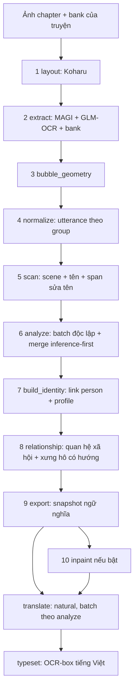

# v7 — Pipeline dịch manga hiện hành

> Historical documentation before chapter-story-graph-v7. See [current docs](../../v7/README.md).

Thay đổi mới nhất: [analyze có quyền ưu tiên, đăng ký identity bằng code](delivery/analyze-authoritative-identity.md).

Mốc đối chiếu mã: **2026-10-24**. Đây là bộ tài liệu vận hành hiện hành, thay cho
các mô tả mặc định cũ trong `docs/v6`. Cấu trúc giữ cách chia theo nền tảng,
thị giác, văn bản, hội thoại, identity, dịch và triển khai của v6.

v7 kết hợp Koharu, MAGI, GLM-OCR, Qwen qua vLLM, bank nhân vật xuyên chapter,
phân tích batch độc lập, profile identity và đồ thị xưng hô có hướng. Dịch chỉ có
bản **natural**. Tài liệu phân biệt hành vi đã có trong mã với chất lượng chưa
được kiểm chứng bằng inference thật.

## Đọc theo mục tiêu

| Mục tiêu | Tài liệu |
|---|---|
| Nắm toàn bộ pipeline và stage | [Kiến trúc, trạng thái và giới hạn](foundation/current-state.md) |
| Biết sửa config nào và phạm vi hợp lệ | [Danh mục config](foundation/configuration.md) |
| Chọn model, môi trường và tài nguyên | [Models và runtime](foundation/models-and-runtime.md) |
| Hiểu file đầu ra, checkpoint, ID và review | [Data contracts](foundation/data-contracts.md) |
| Hiểu validator scan, identity, profile và relationship | [Cách các validator hoạt động](foundation/validators.md) |
| Tự chạy full-pipeline test Runpod bằng PowerShell + Console, không cần agent | [Hướng dẫn tự chạy](deployment/self-service-test.md) |
| Xem thay đổi scan/OCR, ngưỡng identity và kiểm tra tích hợp mới | [Triển khai validator giản lược](delivery/simplified-validators-implementation.md) |
| Sửa OCR giữ tên ngắn, tránh lặp tên và khớp tiền tố | [OCR surface spelling v4](delivery/ocr-surface-spelling-fix.md) |
| Xem ảnh thật và dữ liệu đối chiếu từng bước | [Ví dụ pipeline và HTML review](examples/README.md) |
| Layout, text/character detection, geometry | [Thị giác và bank](vision/detection-and-bank.md) |
| OCR, scan scene và sửa tên có vị trí | [OCR và tên](text/ocr-and-name-scan.md) |
| Thiết kế scan mới: tên sửa là OCR hiện hành, replace-all và validator tối thiểu | [Đặc tả thiết kế scan mới](text/scan-redesign.md) |
| Analyze, speaker, addressee và merge | [Phân tích hội thoại](dialogue/independent-analysis.md) |
| Gộp identity, tạo profile và graph | [Identity–relationship](identity/identity-relationship.md) |
| Thiết kế giản lược validator tạo identity: >=8 crop/chapter và tên được gọi/nhắc đến | [Điều kiện tạo identity mới](identity/identity-validator-simplification.md) |
| Đầu vào, output model, gate tạo mới và luồng build_identity giản lược | [Thiết kế build_identity mới](identity/build-identity-redesign.md) |
| Bootstrap khi registry chưa có tên | [Triển khai và kiểm chứng bootstrap](delivery/identity-bootstrap-implementation.md) |
| Xem tên, profile, graph và lý do bằng HTML | [HTML review hai stage](delivery/identity-html-review.md) |
| Dịch natural, xóa chữ và dàn chữ Việt | [Dịch và render](translation/natural-and-rendering.md) |
| Chuẩn bị, launch, theo dõi và thu hồi Runpod | [Runbook](deployment/runbook.md) |
| Resume, thiếu identity, OOM, quá context | [Khắc phục và tái sử dụng](deployment/recovery.md) |
| Quy tắc duy trì tài liệu, đối chiếu v6 | [Chuyển tiếp và kiểm chứng](delivery/migration-and-validation.md) |

## Luồng hiện hành

Mỗi stage có artifact và Markdown review; review được tạo tự động, không phải
cổng chờ agent phê duyệt. Khi `inpaint.enabled=false`, stage inpaint không tồn
tại trong run và số thứ tự các stage phía sau giảm một.

## Tên v7 và tương thích

**v7 là tên phiên bản pipeline trong tài liệu.** Mã vẫn dùng module
`manga_pipeline.v6`, section config `v6`, `pipeline_version=6`,
`analysis_contract=independent-batches-v6.1`, `runpod-v6.ps1` và
`deployment/runpod/local_v6.py`. Đây là các giao diện tương thích hiện có;
không tự đổi chúng thành `v7` trong JSON, manifest hoặc lệnh.

Run mới chọn `v6.identity_relationship_policy=identity-relationship-v2` và có
hai stage `build_identity`, `relationship`. Run lịch sử thiếu marker này giữ
stage `identity` cũ. Resume không di trú một run sang DAG mới.

## Quy tắc sử dụng

- Sửa config/source trước khi freeze batch mới; không chỉnh run đã đóng băng.
- Runpod mặc định **L40S Secure**, cần yêu cầu Runpod trực tiếp cho tác vụ hiện tại.
- Tận dụng checkpoint đã kiểm chứng; thay đổi semantic contract thì import ở
  ranh giới upstream phù hợp và tạo run mới.
- Không chạy model pilot dài trên local để sửa từng trường hợp nội dung.
- Giữ JSON, request receipts, crop, visualization và backup; không chỉ giữ ảnh cuối.

Chính sách vận hành bắt buộc: [fast policy](../archive/news/runpod_agent_fast_policy_vi.md),
[operational plan](../archive/plans/runpod-v6-agent-operational-plan.md) và `AGENTS.md`.
Các tài liệu v7 giải thích cách thực hiện; các chính sách này tiếp tục chi phối
quyền sử dụng tài nguyên và teardown.
