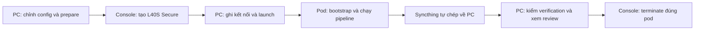

# Tự chạy test Runpod từ Windows, không cần agent

> Historical documentation before chapter-story-graph-v7. See [current docs](../../../v7/README.md).

**Chạy thẳng khi có chỉ định bỏ test khởi động:** thêm
`--skip-startup-tests` vào lệnh `prepare` của **batch mới**. Cờ này bỏ inference
preflight, CUDA parity và concurrency qualification ở cả bootstrap lẫn batch
runner; không tạo receipt giả đánh dấu đã đạt. Checksum nguồn/checkpoint,
dependency locks, GPU yêu cầu và kiểm tra đầu ra của các stage vẫn được giữ.
Mặc định không bật cờ này. Để chạy lại scan → analyze → build_identity →
relationship, dùng `--import-through normalize --until relationship` cùng
checkpoint đầu vào đã xác minh như phần restore bên dưới.

Áp dụng cho repository `D:\AIP491\manga-translate-v2`, cập nhật 24/10/2026.
Thao tác bằng **PowerShell trên PC + Runpod Console**. Không cần API key Runpod
trong script và không cần agent để tạo pod, chạy pipeline, lấy kết quả hay terminate.

Luồng chuẩn:



**Chạy đầy đủ:** bỏ `--until`. Controller sẽ chạy tới stage cuối của pipeline,
gồm dịch natural, inpaint nếu bật, và typeset. `--until relationship` chỉ test
nhánh ngữ nghĩa/graph, chưa phải full pipeline. Không có flag `--until typeset`
ở controller này.

## 1. Chuẩn bị một lần trên PC

Máy này đã có venv và dependency locks. Mỗi lần test có thể dùng lại chúng nếu
requirements/model pins không đổi. Không cần cài lại toàn bộ môi trường trước
mỗi lần chạy.

Mở PowerShell:

```powershell
$RepoRoot = 'D:\AIP491\manga-translate-v2'
Set-Location -LiteralPath $RepoRoot
$Python = Join-Path $RepoRoot 'venv\Scripts\python.exe'
$env:PYTHONPATH = Join-Path $RepoRoot 'src'

& $Python --version
ssh -V
Test-Path -LiteralPath '.runpod\v6-locks'
Get-PSDrive C, D | Select-Object Name, Used, Free
```

Cần Python/venv làm việc được, OpenSSH, Internet, tài khoản Runpod có số dư và
ổ D đủ chỗ cho input/output. Giữ PC bật và có mạng trong lúc chạy. Không sleep
PC khi đang dựa vào Syncthing để backup.

SSH public key đang dùng trên máy này:

```powershell
$SshKey = Join-Path $HOME '.ssh\id_ed25519'
Test-Path -LiteralPath $SshKey
Get-Content -LiteralPath ($SshKey + '.pub')
```

Đưa **public key `.pub`** vào mục SSH Keys của tài khoản Runpod trước khi tạo pod.
Private key ở `$SshKey` chỉ giữ trên PC. Nếu key có passphrase, bảo đảm SSH agent
đã nạp key để controller có thể kết nối không cần nhập tương tác.

Syncthing native dùng phiên bản/digest đã pin trong project. Nếu máy chưa có
binary đã chuẩn bị, chạy một lần:

```powershell
& $Python -B deployment/runpod/prepare_native_sync.py
```

Không chạy lại installer này khi daemon Syncthing đang hoạt động: Windows có
thể khóa executable. Mỗi batch có identity riêng; không dừng daemon của batch khác.

## 2. Chỉnh config trước khi thuê GPU

File dùng cho Runpod: **`configs/pipeline-v6-runpod.json`**. Tên còn `v6` nhưng
đây là cấu hình pipeline v7 hiện hành. `prepare` chưa có flag `--config` để
chọn file bất kỳ, vì vậy phải chỉnh file này **trước prepare**.

Các mục thường dùng:

| Mục | Mặc định hiện hành | Dùng khi test |
|---|---|---|
| `runtime.preset`, `runtime.required_gpu` | `l40s`, `L40S` | Giữ L40S Secure |
| `ocr.backend` | `glm-ocr` | OCR mặc định mới |
| `llm.num_ctx` | 32768 | Context Qwen; không đổi tùy tiện khi reuse |
| `runtime.llm_slots` | 64 | Giới hạn request song song chung |
| `v6.analyze_batch_size` | 8 | Số câu mục tiêu/batch analyze |
| `v6.scan_policy` | `canonical-scan-v4` | Sửa chính tả tên giữ cách gọi, không tự mở rộng thành họ tên đầy đủ |
| `v6.scan_output_tokens` | 8192 | Reserve output cho scan một lượt |
| `v6.identity_name_binding_policy` | `chapter-name-binding-simple-v2` | Validator mới |
| `v6.identity_min_chapter_crops` | 8 | Gate tạo identity có tên mới |
| `v6.identity_binding_concurrency` | 8 | Queue name binding |
| `v6.profile_concurrency` | 8 | Queue profile |
| `v6.relationship_concurrency` | 8 | Queue relationship |
| `inpaint.enabled` | true trong config tham chiếu | Bật để chạy bước xóa chữ |

Danh mục đầy đủ: [configuration](../foundation/configuration.md).
Kiểm tra config mà không gọi model:

```powershell
& $Python -c "import sys; from manga_pipeline.pipeline import load_config; c=load_config(sys.argv[1]); print(c['runtime']); print(c['v6'])" 'configs/pipeline-v6-runpod.json'
if ($LASTEXITCODE -ne 0) { throw 'Config không hợp lệ; chưa thuê pod.' }
```

Sau prepare, sửa config ngoài không thay cấu hình run đã freeze. Muốn đổi
prompt/source/threshold/model phải tạo batch mới, không sửa `plan.json`,
`pipeline-v6.json` hoặc source.zip của batch đã chuẩn bị.

## 3. Prepare một full-pipeline test

Ví dụ Iris Zero chapter 1. Batch dùng timestamp nên mỗi lần chạy là một nhánh
độc lập, không ghi đè kết quả trước:

```powershell
$Batch = 'iris-zero-ch1-full-l40s-' + (Get-Date -Format 'yyyyMMdd-HHmmss')
$InputFolder = 'D:\download\EN-data\Iris Zero\EN\Chapter 1'

.\runpod-v6.ps1 prepare $InputFolder `
  --batch $Batch `
  --gpu-preset l40s `
  --llm-slots 64 `
  --story-workers 1 `
  --story iris-zero `
  --chapter chapter-001 `
  --locks '.runpod/v6-locks'
if ($LASTEXITCODE -ne 0) { throw 'Prepare thất bại; chưa thuê pod.' }

$Plan = Join-Path $RepoRoot ".runpod\v6\$Batch\plan.json"
$BoundPlan = Join-Path $RepoRoot ".runpod\v6\$Batch\bound-plan.json"
$Output = Join-Path $RepoRoot "outputs\runpod-$Batch"

& $Python -B deployment/runpod/native_sync.py --plan $Plan prepare
if ($LASTEXITCODE -ne 0) { throw 'Syncthing prepare thất bại; chưa thuê pod.' }

$Frozen = Get-Content -LiteralPath $Plan -Raw | ConvertFrom-Json
$Frozen | Select-Object batch, until, local_working_set, native_sync
$Frozen.chapters | Select-Object story, chapter, pages, until
```

Với full pipeline, `until` không có hoặc null. Iris Zero chapter 1 ở nguồn này
có 44 trang. `local_working_set` và `native_sync` phải là true.
Các bước trên là offline, chưa tạo pod và chưa tính phí GPU.

### Muốn dùng lại kết quả trước

Chỉ dùng backup có `verification.json` đã xác minh. Ví dụ chạy lại **scan và
toàn bộ downstream**, giữ layout/extract/geometry/normalize:

```powershell
# Dùng Batch mới; chạy thay cho lệnh prepare ở trên.
$Backup = Join-Path $RepoRoot 'outputs\runpod-iris-zero-ch1-bootstrap-identity-l40s-20261023-r3'

.\runpod-v6.ps1 prepare $InputFolder `
  --batch $Batch `
  --gpu-preset l40s --llm-slots 64 --story-workers 1 `
  --story iris-zero --chapter chapter-001 `
  --reanalyze-existing `
  --restore-from $Backup `
  --import-preanalyze --import-through normalize `
  --locks '.runpod/v6-locks'
```

Sau đó vẫn chạy `native_sync.py --plan $Plan prepare` như trên. Không chạy cả
hai lệnh prepare cho cùng Batch. Chọn một nhánh ngay từ đầu.

| Nhu cầu | Tùy chọn |
|---|---|
| Chạy mới toàn bộ | Không restore/import; không `--until` |
| Chạy lại scan trở đi | `--import-through normalize` |
| Giữ scan, chạy lại analyze trở đi | `--import-through scan`, chỉ khi scan contract/config tương thích |
| Giữ analyze, chạy lại identity/graph trở đi | `--import-through analyze`, chỉ khi upstream tương thích |
| Dừng sau scan/analyze/identity/graph | Thêm `--until scan`, `analyze`, `build_identity` hoặc `relationship` |

Đổi scan policy mới từ run legacy phải import tới **normalize**. Controller từ
chối checkpoint không tương thích; không sửa hash/manifest để vượt kiểm tra.

## 4. Tạo pod trong Runpod Console

Chỉ tạo sau khi prepare và native prepare thành công. Trong Console chọn một
GPU Pod, dùng các thông số sau:

| Trường | Giá trị |
|---|---|
| Cloud | **Secure Cloud** |
| GPU | **1 × NVIDIA L40S, 48 GB VRAM** |
| Data center | Nơi đang có L40S Secure; có thể xem All data centers |
| CUDA host | **>=13.0** cho lock vLLM hiện hành, dù boot image là CUDA12.8 |
| Template/image | Runpod PyTorch2.8.0, `runpod/pytorch:1.0.2-cu1281-torch280-ubuntu2404` |
| Container disk | 200 GB |
| Pod volume disk | 30 GB, mount `/workspace` |
| TCP ports | `22`, `22000` |
| SSH | Bật Start SSH và dùng public key đã đăng ký |
| Jupyter | Không cần |
| Entrypoint | `/bin/bash -lc` |
| Command | `exec /start.sh` |
| Environment | `MANGA_EXECUTION_ROOT=/opt/manga-work/execution`, `MANGA_RUNTIME=/opt/manga-work/runtime` |

Đây là shape dùng cho test hiện tại, không phải cam kết giá/stock. Xem giá ở
Console trước Deploy. Lượt đọc catalog 24/10/2026 của đợt test này là
**$1.09/GPU-hour**, chưa dùng con số đó thay giá Console/billing tương lai.
Không có L40S Secure thì chờ hoặc đổi data center; không tự đổi sang Community/5090.

Đợi pod chạy và phần Connect có **Direct TCP SSH**. `RUNNING` mà chưa có IP/port
thì vẫn đang khởi tạo. Không tạo thêm pod vì máy đầu chưa boot xong.

## 5. Ghi kết nối và kiểm tra GPU

Lấy Pod ID, public IP, port public ánh xạ tới **22/tcp**, và port public ánh xạ
tới **22000/tcp** từ pod vừa tạo. Hai port public không nhất thiết là 22/22000.

```powershell
# Nhập thông tin mới từ Console, không dùng lại IP/port của ví dụ cũ.
$PodId = Read-Host 'Pod ID'
$PodHost = Read-Host 'Public IP'
$SshPort = [int](Read-Host 'Public port cho 22/tcp')
$SyncPort = [int](Read-Host 'Public port cho 22000/tcp')

$Connection = [ordered]@{
  host = $PodHost
  port = $SshPort
  user = 'root'
  key = $SshKey
  pod_id = $PodId
  syncthing_address = "tcp://${PodHost}:$SyncPort"
}
$ConnectionFile = Join-Path $RepoRoot '.runpod\connection.json'
# UTF-8 không BOM, tương thích cả Windows PowerShell5.1 và PowerShell7.
[IO.File]::WriteAllText($ConnectionFile, ($Connection | ConvertTo-Json), [Text.UTF8Encoding]::new($false))

ssh -i $SshKey -p $SshPort "root@$PodHost" nvidia-smi
```

Xác nhận NVIDIA L40S và CUDA capability >=13.0 trong header `nvidia-smi`.
Có thể kiểm tra Torch của boot image một lần:

```powershell
$GpuCommand = 'python3 -c ''import torch; assert torch.cuda.is_available(); print(torch.cuda.get_device_name(0)); print(torch.ones((16,16),device="cuda").sum().item())'''
ssh -i $SshKey -p $SshPort "root@$PodHost" $GpuCommand
```

Kỳ vọng tên L40S và `256.0`. Bootstrap sẽ kiểm dependency, filesystem local,
runtime thực, CUDA parity và cấu hình serving. Không cài lại package bằng tay
trong lúc driver đang chạy. `.runpod/connection.json` là kết nối dùng chung của
controller trên PC; không ghi đè nó khi đang điều khiển một batch khác.

## 6. Launch đúng một lần

```powershell
.\runpod-v6.ps1 launch --plan $Plan --pod-id $PodId
if ($LASTEXITCODE -ne 0) { throw 'Launch chưa thành công; xem lỗi, không launch trùng.' }
```

Lệnh ghép Syncthing, xác minh canary, chuyển payload, khởi động driver detached
và verifier trên PC. Sau launch thành công, đóng cửa sổ lệnh không giết driver
pod; **PC vẫn phải bật** để nhận output. Không chạy thêm một process pipeline thủ công.

Bootstrap cài môi trường từ locks, tải cache model và khởi động vLLM. Lần đầu
có thể mất nhiều phút. Cấu hình song song có thể chạy qualification thật trước
chapter. Các trạng thái này chưa phải scan/analyze.

Full pipeline đi theo các stage:

```text
layout → extract (MAGI + GLM-OCR) → bubble_geometry → normalize
→ scan → analyze → build_identity (gồm profile) → relationship
→ export → inpaint khi bật → translate natural → typeset
```

Các công việc chạy ở `/opt/manga-work`; dữ liệu công bố bền ở
`/workspace/manga-runtime/local-v6`. Có source.zip không đồng nghĩa job đã chạy;
có Pod RUNNING không đồng nghĩa inference thành công.

## 7. Theo dõi và xem review

Kiểm tra một lần từ PC:

```powershell
$Watch = .\runpod-v6.ps1 watch --plan $BoundPlan | ConvertFrom-Json
$Watch.'bootstrap.json'.status
$Watch.'state.json' | Select-Object status, chapters
$Watch.log_tail
```

`watch` là một lượt đọc, không tự lặp. Muốn xem lại, chạy lại sau khoảng 60 giây.
Kiểm tra đồng bộ và xem các file local:

```powershell
& $Python -B deployment/runpod/native_sync.py --plan $Plan status
Get-ChildItem -LiteralPath $Output
```

Thư mục kết quả:

```text
outputs/runpod-<Batch>/
  live/outputs/<story>/<chapter>/<run-id>/  # artifact, ảnh, review của pipeline
  live/banks/                            # bank bản sao
  durable/<Batch>/jobs/                  # bootstrap, state, driver.log
  durable/<Batch>/published/             # archive + ready receipt
  local-reviews/                         # Markdown, HTML, JSON cho người/agent
  verification.json                     # bằng chứng archive đã về PC
```

Review watcher được native prepare/launch chuẩn bị. Nếu cần dựng lại một lần
từ artifact local, không gọi model:

```powershell
& $Python -B deployment/runpod/local_review.py --batch $Output
Get-ChildItem -LiteralPath (Join-Path $Output 'local-reviews') -Recurse -Filter 'index.html' |
  Select-Object FullName
```

Mở HTML/Markdown để review OCR, speaker, tên identity, crop và graph. Review
không phải approval gate của driver: không cần xác nhận từng stage để pipeline tiếp tục.

Nếu 10 phút không có counter/checkpoint/request hoàn tất hoặc byte transfer tăng,
xem bootstrap/state/log của đúng batch. GPU0% trong một mẫu không đủ kết luận treo.
Không sửa prompt/source/config dưới process đang chạy. Lỗi semantic/provider
được giữ lại; các stage mới không tự gọi lại model để sửa response.

## 8. Xác minh rồi terminate

Launch đã khởi động verifier nền. Xem báo cáo khi có:

```powershell
$VerificationFile = Join-Path $Output 'verification.json'
if (Test-Path -LiteralPath $VerificationFile) {
  $Verification = Get-Content -LiteralPath $VerificationFile -Raw | ConvertFrom-Json
  $Verification | Select-Object status, pipeline_status, verified_at
  $Verification.chapter_statuses | Format-List
}
```

Chỉ khi verifier nền không còn chạy mà cần kiểm lại, dùng lệnh foreground:

```powershell
& $Python -B deployment/runpod/native_verify.py --plan $Plan --wait
```

`status=replica_archives_verified` xác nhận byte count, SHA-256 và ZIP CRC của
các publication đã về PC. **Nó không có nghĩa mọi stage đều thành công**.
Đọc thêm `pipeline_status`, `chapter_statuses`, summary và các lỗi. Kết quả
completed_with_review/completed_with_errors vẫn được tải, không vứt partial.

Sau khi driver terminal, không còn writer và backup đã xác minh:

1. Trong Runpod Console mở đúng `$PodId` của test này.
2. Chọn **Terminate**, xác nhận xóa pod/volume gắn với pod.
3. Kiểm tra pod đã biến mất. Không chỉ đóng terminal hoặc dừng vLLM.

**Hiện controller/verifier không tự terminate pod. Anh phải làm bước Console này**.
Stop có thể giữ phí disk; terminate làm mất container/pod volume, nên không
terminate trước khi backup đủ. Không terminate pod khác chỉ vì tên giống nhau.

## 9. Test lỗi và phục hồi

| Hiện tượng | Cách làm |
|---|---|
| Prepare báo thiếu lock | Chưa thuê GPU; xem phần dependency locks bên dưới |
| SSH timeout | Xem lại Direct TCP IP/port, Start SSH và public key; không dùng SSH proxy thay cho TCP Syncthing |
| Canary chưa verified | Inference chưa launch; sửa kết nối Syncthing trước, không chạy driver thứ hai |
| Pod còn chạy nhưng PowerShell đã đóng | Mở lại repo, đặt lại Batch/Plan/BoundPlan/Output; dùng watch trước khi làm gì khác |
| Scan/identity/relationship có lỗi model | Giữ raw response/receipt/review, không POST lại thủ công để che lỗi |
| Thay threshold/prompt/code | Prepare batch mới, reuse checkpoint tương thích |
| Syncthing không tải được nhưng publication đã có | Có thể dùng `collect` fallback dưới đây; vẫn kiểm archive/hash |
| Bootstrap failed, chưa có inference | Giữ driver.log/bootstrap.json/plan trên PC; xác nhận process đã dừng trước khi kết thúc pod |

Fallback tải publication đã chốt qua SSH, chỉ khi native gặp lỗi:

```powershell
$Collected = Join-Path $RepoRoot "outputs\collected-$Batch"
.\runpod-v6.ps1 collect --plan $BoundPlan --destination $Collected
```

Không dùng collect để đóng gói file đang ghi. Nó không thay cơ chế Syncthing
liên tục và có thể chờ tới khi queue terminal. Không chạy collect trùng nhiều lần.

### Dependency locks khi đổi requirements hoặc chuyển máy

Máy đang dùng đã có `.runpod/v6-locks`. Nếu requirements không đổi, giữ nguyên.
`prepare` kiểm đúng signature; không copy đại một lock sang tên signature mới.

Nếu cần resolve mới, làm **trước thuê GPU**, bằng CPU Docker trong WSL:

```powershell
& $Python -B deployment/runpod/prepare_locks.py `
  --image 'runpod/pytorch:1.0.2-cu1281-torch280-ubuntu2404'
```

Cần WSL có Docker hoạt động và image pin trên khả dụng. Script hiện resolve
main, GLM và vLLM; **chưa tự resolve visual lock**. Nếu prepare báo thiếu
`visual-<signature>/requirements.lock`, tạo visual lock bằng cùng CPU image:

```powershell
$LinuxRepo = (wsl.exe -- wslpath -a ($RepoRoot.Replace('\', '/'))).Trim()
$VisualLockCode = @'
import sys, pathlib, subprocess
sys.path.insert(0, '/prepared/deployment/runpod')
import manage
root = manage.PROJECT / '.runpod/v6-locks' / ('visual-' + manage.visual_signature())
root.mkdir(parents=True, exist_ok=True)
subprocess.run([str(manage.ensure_uv()), 'pip', 'compile', str(manage.PROJECT / 'deployment/runpod/requirements-visual.in'), '--python', str(manage.current_python()), '--index-strategy', 'unsafe-best-match', '--generate-hashes', '--output-file', str(root / 'requirements.lock')], check=True)
'@
wsl.exe -- docker run --rm --entrypoint python3 `
  -v "${LinuxRepo}:/prepared" `
  'runpod/pytorch:1.0.2-cu1281-torch280-ubuntu2404' `
  -c $VisualLockCode
```

Resolve mới không đồng nghĩa đã kiểm chứng runtime GPU. Sau đó prepare batch
mới; bootstrap vẫn phải chạy preflight thật trên pod.

Tài liệu liên quan: [runbook](runbook.md), [recovery](recovery.md),
[validator hiện hành](../foundation/validators.md),
[cấu hình](../foundation/configuration.md).
# Cập nhật cấu hình analyze / identity (24/10/2026)

Mặc định mới: chỉ analyze bật thinking, `analyze_num_ctx=65536`,
`analyze_num_predict=12288`, `analyze_timeout=1200`, concurrency analyze8.
Stage khác context32768, thinking tắt. Server vLLM có ceiling65536 với parser
qwen3. build_identity dùng `analyze-authoritative-v3`, không gọi model gán lại
tên/owner hoặc nhận panel; profile và relationship vẫn gọi model như trước.

Khi chạy với source/config mới, freeze batch mới và thực hiện qualification GPU
mới; không tái sử dụng chứng nhận32k cũ để bỏ qua kiểm tra thinking64k.
Xem [báo cáo triển khai](../delivery/analyze-authoritative-identity.md).

