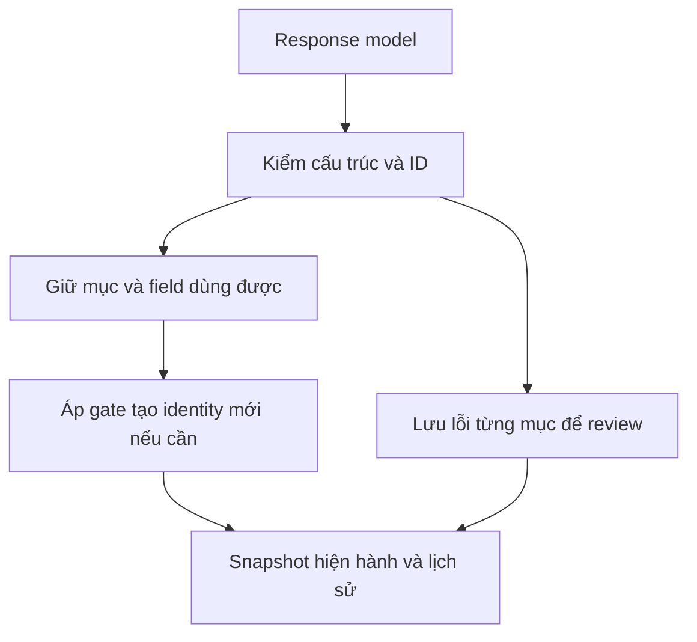

# Validator của scan, build_identity, profile và relationship

> Historical documentation before chapter-story-graph-v7. See [current docs](../../../v7/README.md).

Mốc source: **24/10/2026**. Các policy mặc định đang triển khai là
`canonical-scan-v4` và `analyze-authoritative-v3`.
Đã kiểm tra bằng test không gọi model; chưa đánh giá chất lượng suy luận thật.
Xem [báo cáo triển khai](../delivery/simplified-validators-implementation.md).

## 1. Nguyên tắc

**Cập nhật hiện hành:** build_identity không gọi LLM gán tên/owner và không gửi
panel. Code lấy owner đã xác nhận bởi analyze và alias group của scan; chọn tên
theo số occurrence khác nhau, rồi introduction, direct_address, reference và
thứ tự xuất hiện. Gate tạo mới vẫn là >=8 crop thật trong chapter và có tên.
Các nhóm cạnh tranh được lưu để review; không hợp nhất chúng để giải quyết hòa.
Speaker, addressee, mentions và owner của analyze được giữ nguyên trong export;
mapping identity nằm trong các trường bổ sung cho downstream.
Xem [thiết kế hiện hành](../identity/analyze-authoritative-build-identity-design.md).
Những đoạn mô tả request name-binding/model bên dưới chỉ áp dụng policy v1/v2
được giữ để đọc lại output lịch sử. Profile và relationship tiếp tục dùng LLM,
thinking tắt; chúng không sửa quyết định của analyze.

Model quyết định tên, alias, owner, profile và quan hệ. Code kiểm tra cấu trúc,
kiểu dữ liệu, ID có tồn tại và tính toàn vẹn snapshot/file. Validator không dùng
một bộ luật ngữ nghĩa khác để bác bỏ suy luận chỉ vì model không chép citation,
không dùng từ trong từ điển xưng hô, hoặc kết luận khác phiên bản trước.



Một lỗi nhỏ không loại toàn bộ request. JSON/root không đọc được, ID identity
của cả profile không hợp lệ hoặc input bắt buộc vượt context vẫn có thể làm
request thất bại. Scan, name binding, profile và relationship **không tự gọi
model lại**. Receipt giữ kết quả đã nhận để resume không POST trùng.

Hash/file/snapshot bị thay đổi là lỗi integrity, vẫn phải chặn. Đây không phải
kiểm chứng tính đúng sai của nội dung model.

## 2. Scan và OCR hiện hành

Source: `v6/scan_v3.py`, adapter `v6/name_normalization.py:apply`.
Chi tiết: [scan-redesign](../text/scan-redesign.md).

Một request đọc toàn chapter, trả ba mảng `scenes`, `groups`, `names`.
Tên gồm `text_id`, `old_name`, `new_name`, `group_id`; không yêu cầu offset.

| Dữ liệu | Code xử lý |
|---|---|
| `new_name` khác OCR thô | Cho phép; tên model sửa là nguồn hiện hành |
| Tên ngắn → họ tên đầy đủ, chèn/bỏ phần tên hoặc đảo thứ tự rõ ràng | Giữ tên nguồn và group candidate; ghi đề xuất model để review, không áp phép sửa |
| Phép sửa tên | Find-all trên toàn chapter, bỏ qua hoa/thường, khoảng trắng và dấu gạch nối |
| Tiền tố/hậu tố của một từ | Không khớp: Koyuk không sửa Koyuki, yuki-chan không sửa Koyuki-chan |
| Tên dài đã đúng | Không sửa một phần bên trong bằng rule tên ngắn; canonical_name dùng làm metadata riêng |
| Thứ tự phép sửa | Một lượt theo thứ tự model; A→B rồi B→C tạo C |
| Không tìm thấy `old_name` | Ghi `no_match`; giữ suy luận tên để review, không bác bỏ các phép sửa khác |
| `text_id` không tồn tại hoặc sai kiểu | Bỏ riêng mục; ghi warning |
| Group thiếu/không hợp lệ | Tên vẫn có thể sửa OCR nhưng giữ ungrouped, không đưa vào identity |
| Group/assignment trùng | Object cuối thay object trước; lưu warning về bản bị thay |
| Scene thiếu đầu chapter | Code giữ coverage bằng scene unresolved; không tự suy luận summary |
| Scene summary không phải tiếng Anh | Không có validator ngôn ngữ/số câu |

Code lưu `canonical_rows`, `canonical_hash`, `source_hash` và lịch sử trước/sau.
`ocr-current.json` và `replacement-history.json` nằm cạnh artifact scan.
Analyze, build_identity, profile, relationship, export và local review dùng OCR
sau sửa qua adapter. OCR thô chỉ để đối chiếu/khôi phục, không dùng bác bỏ tên mới.
Code không chạy lại OCR/detection hay viết lại toàn bộ JSON bằng model.

## 3. Build identity

Source: `v6/identity_binding_simple.py`, `v6/identity_binding_evidence.py`.
Chi tiết: [build_identity](../identity/build-identity-redesign.md).

Điều kiện tạo **identity có tên mới**, xét từng MAGI:

```text
chapter_crop_count >= v6.identity_min_chapter_crops (mặc định 8)
AND model gắn tên được gọi/nhắc đến cho MAGI đó
```

Đếm các detection thật từ `extract.pages[].character_ids` và `characters`,
khử trùng theo `(page_id, bbox)`. Không lấy lifetime appearance_count, số vector
hoặc số ảnh gallery giữ lại. Identity đã có tên từ snapshot/registry trước đó
được giữ kể cả chapter sau ít crop hơn.

Model trả `characters[{magi_id, primary_name, aliases, reason}]` theo nhóm tên.
Code tự biết group qua job. Không đòi model trả crop/panel/source refs hoặc phải
chứng minh mention_type. Một tên được nhắc đến cũng đủ về phía gate tên.

MAGI không tồn tại bị bỏ riêng mục. MAGI dưới ngưỡng vẫn giữ nguyên tên model đã
đề xuất trong review, chưa tạo identity mới. Field alias hỏng không loại primary
name dùng được. Những tên analyze đề xuất không tự vượt qua gate tạo mới này.

Giữ cơ chế liên kết MAGI vào identity đã có, các ràng buộc cannot-link và bảo vệ
identity đã xác lập. Không thêm cơ chế gộp hai identity đã có tên, không xóa/gộp
entry MAGI, không sửa bank gốc. Visual linking vẫn theo main prototype và ngưỡng
hiện hành, không thay đổi vì nới validator tên.

## 4. Profile

Source: `v6/structural_validators.py:profile`, `v6/identity_profiles.py`.
Model vẫn nhận ảnh, thoại, tên được nhắc và lịch sử theo lựa chọn cũ.

- `person_id` phải là identity của job; attributes phải là object.
- Field không dùng được được thay bằng unknown và có review; field khác giữ lại.
- Không bắt confirmed phải có dialogue ref, visual phải cite crop hay roles chỉ
  được dựa trên dialogue.
- Các value/status/basis là chuỗi; không dùng closed vocabulary để veto nội dung.
- Profile mới thay toàn bộ object ngữ nghĩa trước; phiên bản cũ vẫn lưu trong history.

Thiếu profile không làm mất named identity đã tạo được.

## 5. Relationship

Source: `v6/structural_validators.py:relationship`, `v6/relationship_v2.py`.
Không thay cách chọn cặp có giao tiếp trực tiếp hoặc cách reuse graph hiện có.

- `from_id` và `to_id` phải là hai identity của job; không chấp nhận self-edge.
- Mỗi chiều xưng hô là object riêng. Chiều A→B không xác nhận hay phủ quyết B→A.
- Mục sai ID bị bỏ; field hỏng được giữ unknown để review. Chiều thiếu là unknown.
- Không bắt từ xưng hô phải có trong danh sách Python, không bắt hai profile refs
  hay dialogue citation để model được phép trả kết luận.
- Object cạnh trùng dùng bản cuối, có review bản bị thay.
- Quyết định mới thay object ngữ nghĩa cũ; không để confirmed cũ veto tự động.

Graph vẫn phân biệt social relations và address edges. History/version, source
hash và commit đồng thời vẫn được kiểm tra.

## 6. Nguồn được cung cấp khác với citation

Code gắn `supplied_evidence_refs` theo packet thực sự gửi. Model có thể trả
`evidence_refs`; nguồn hợp lệ đó được lưu thêm trong `model_evidence_refs`.
Không coi toàn bộ ảnh/thoại đầu vào là những nguồn model đã trích dẫn.

HTML và Markdown dành riêng cho identity/relationship hiển thị tên MAGI, ảnh,
thoại, lý do đã lưu, lỗi field và kết quả chưa áp dụng. Trang `errors.html` của
policy mới đọc receipt từng mục; không replay các luật bằng chứng cũ để gắn lỗi
sai cho kết quả mới. HTML dựng bằng code, không gọi model.

## 7. Analyze và tương thích lịch sử

Mention của bubble dialogue không được gắn `narrator_introduction`. Nếu model
vẫn trả nhãn đó, code đổi riêng mention_type thành unknown/review, giữ các phần
tên/owner dùng được. Đây là chỉnh nhãn sai, không phải chạy identity thêm lần nữa.

Các policy legacy vẫn có trong code để đọc/resume run đã freeze. Không chỉnh
ngầm manifest cũ. Khi đổi scan policy, chỉ import tới normalize rồi chạy lại
scan và các stage phía sau. Kiểm tra import từ chối dùng lại scan theo contract
cũ trong config mới. Các điều kiện chặt cũ có trong
[bản review validator lịch sử](../delivery/validator-review-20261024.md).
