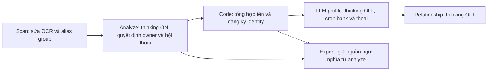

# Analyze có quyền quyết định, build_identity giảm nhiệm vụ

> Historical documentation before chapter-story-graph-v7. See [current docs](../../../v7/README.md).

Trạng thái: **đã triển khai**, kiểm thử offline; chưa qualification GPU cho cấu hình thinking 64k.
Các lựa chọn Q1–Q7 do người dùng trả lời trong phiên thiết kế ngày24/10/2026.
Không chạy Runpod hoặc model inference trong lượt thiết kế.

## 1. Quyết định đã trả lời

| Mục | Lựa chọn |
|---|---|
| Q1 | Bỏ request LLM gán tên/owner lại trong build_identity; code dùng analyze và alias group; LLM chỉ tạo profile |
| Q2 | Server vLLM trần65536; analyze dùng tối đa65536; các stage khác giữ32768 |
| Q3 | Analyze tối đa12288 token output tổng, gồm thinking và JSON cuối |
| Q4 | Analyze tối đa8 request đồng thời |
| Q5 | Chọn group có nhiều occurrence riêng biệt hỗ trợ nhất cho từng MAGI; vẫn tạo identity khi có xung đột |
| Q6 | Nếu hòa, ưu tiên introduction, direct_address, reference; còn hòa thì occurrence xuất hiện trước |
| Q7 | Timeout analyze1200 giây/request; lấy giá trị số người dùng ghi, không dùng1800 của nhãn A trước đó |

## 2. Ranh giới trách nhiệm

Analyze có quyền quyết định content_type, speech_style, speaker, addressee,
mention_type và owner của tên. Build_identity không gọi model để đoán lại các
trường này; không đổi unknown thành một owner suy đoán từ speaker/addressee.

Không chỉ giữ nguyên file analyze/result.json: các semantic field ở bản export
cũng phải giữ quyết định và source reference của analyze. Identity mapping là
dữ liệu bổ sung riêng để profile/graph/translation tra cứu. Không dùng redirect
hay effective_updates để âm thầm đổi người nói/nghe/owner của tên.

## 3. Name registration bằng code

Nguồn vào: alias group scan, name mentions và owner analyze đã xác nhận, mapping
person/cluster/MAGI từ snapshot analyze, số crop thật của chapter và registry cũ.
Không dùng panel, không cần LLM name-binding request.

Mỗi occurrence tên có owner hợp lệ đóng góp tối đa một phiếu cho MAGI/group
tương ứng. Không lấy mọi character được nhắc trong context làm owner của mọi
occurrence. Không dùng số crop làm số phiếu tên.

Với mỗi MAGI:

1. Tổng hợp các group được analyze gán cho nó bằng occurrence khác nhau.
2. Chọn group có nhiều occurrence hỗ trợ nhất.
3. Nếu hòa tổng, so số occurrence introduction, rồi direct_address, rồi reference.
   Mention có owner đã xác nhận nhưng type unknown không được ưu tiên hơn các
   loại đã biết. Nếu vẫn hòa, dùng occurrence sớm nhất theo thứ tự chapter.
4. Tạo/đăng ký identity với tên của group được chọn khi đủ điều kiện đã chốt,
   kể cả khi tồn tại group cạnh tranh hoặc quyết định phải dùng tie-break.
5. Lưu số phiếu, các group cạnh tranh, lý do chọn/tie-break và needs_review.
   Không đổi lại bất kỳ mention hoặc owner nào trong analyze cho khớp tên đã chọn.

Tổng hợp tên là quyết định đăng ký ở registry, không phải xác nhận những nhãn
cạnh tranh trong analyze đều sai. Nếu analyze chưa xác nhận owner cho tên thì
không phát minh owner để có tên cho một MAGI; giữ dữ liệu chưa phân giải để review.

## 4. Các quy tắc identity đã có vẫn giữ

- Gate tạo identity có tên mới: từng MAGI có ít nhất8 crop thật trong chapter
  hiện tại và có tên được analyze gán. Ngưỡng vẫn cấu hình được.
- Identity cũ không mất tên chỉ vì chapter sau ít crop.
- Nhiều MAGI có thể liên kết tới cùng identity theo nhóm tên đã quyết định và
  cơ chế liên kết đã chốt. Không union mọi owner từ các child response của group.
- Không hợp nhất hai identity đã xác lập. Không sửa/gộp entry MAGI trong bank gốc.
- Visual linking giữ ngưỡng min_crop<0.38, đối chiếu main prototype của identity
  có số lần xuất hiện nhiều nhất theo quy tắc cũ, không tạo chuỗi gộp bắc cầu.
- Không thêm model để giải quyết xung đột tên; không khôi phục validator citation
  hoặc mention-type proof chặt của các bản cũ.

## 5. Profile và hình ảnh

LLM trong build_identity chỉ tạo profile cho identity có tên đủ điều kiện theo
thiết kế hiện hành. Giữ lựa chọn crop gần prototype và phạm vi thoại/lịch sử
đã chốt; không gửi panel. Crop nhân vật có nhãn MAGI vẫn được phép dùng.

Input profile dùng tên identity đã đăng ký cùng các semantic result của analyze.
Output profile không được đổi owner, speaker/addressee hoặc name assignment.
Thinking của profile tắt. Relationship và các stage khác cũng tắt thinking.

## 6. Thinking, context, output và vận hành

- Một server Qwen/vLLM dùng chung, max_model_len65536; không khởi động thêm bản
  model thứ hai chỉ cho analyze.
- Analyze: thinking bật ở cả chat-template/tokenize lẫn inference. Output cap
 12288 là thinking+JSON; không phải12288 thinking cộng thêm JSON riêng.
- Stage khác: thinking tắt và effective context tối đa32768; budget token phải
  áp giới hạn của stage, không lấy trần server64k cho mọi request.
- Giữ batch analyze hiện hành; không tự nhồi thêm context chỉ vì mở trần64k.
- Thinking được tách khỏi JSON semantic bằng cơ chế response/parser đúng của
  engine; không dùng nội dung reasoning thay cho JSON cuối.
- Analyze có trần8 request đồng thời, timeout1200 giây. Đây không phải bảo đảm
 8 request đầy64k có thể cùng resident trên L40S.
- Tokenizer cache, request cache/journal, plan signatures và qualification phải
  phân biệt stage context và thinking flag. Không dùng lại response thinkingOFF
  như thể đã chạy thinkingON.
- Giữ xử lý lỗi/review/no-retry theo contract hiện hành; không tự retry model
  để biến JSON thiếu hoặc lỗi hệ thống thành kết quả semantic thành công.

Các tên config mới, cách tách parser và tương thích version là chi tiết triển
khai cần đối chiếu engine/pins thực tế; tài liệu này không khẳng định CLI đã có
các flag/config đó.

## 7. Review và kiểm tra cần có khi triển khai

Review từng MAGI: group được chọn, số occurrence riêng biệt, phân bố mention_type,
các group cạnh tranh, tie-break, tên registry, các liên kết MAGI/identity và
quyết định analyze nguyên gốc. Profile/relationship giữ output và lỗi riêng.

Regression bắt buộc:

- Reference Sasamori với ownerMAGI5 không bị đổi thành speakerMAGI2/addresseeMAGI12.
- Context có Toru/Hijiri không tự gắn hai người đó vào occurrence Sasamori.
- Một MAGI có nhiều group vẫn tạo identity theo kết quả bỏ phiếu/tie-break,
  không gộp các group cạnh tranh và không viết lại analyze.
- Các semantic field trước/sau export giữ source decision của analyze, đồng
  thời downstream vẫn tra được identity mapping.
- Build_identity không có name-binding POST và không gửi panel; profile chỉ
  nhận đúng crop/thoại và thinkingOFF.
- Analyze request/tokenization dùng thinkingON/64k/12288/1200s; stage khác dùng
  thinkingOFF/32k. Budget/cache khác nhau được kiểm chứng.
- Giữ gate crop, bank immutability, không merge identity đã xác lập, main-prototype
  guard và các receipt/resume/integrity checks hiện hành.

## 8. Những phương án không chọn và rủi ro

Không chọn LLM gán tên lại hoặc sửa analyze từ build_identity; không gửi panel;
không giữ mọi stage ở32k; không tăng mọi stage lên64k; không chọn concurrency4;
không để hòa phiếu làm identity mới không có tên khi đã đủ dữ liệu/gate.

Rủi ro: kết quả analyze sai có thể đi tới registry; vote/tie-break vẫn có thể
chọn sai tên. Vì vậy giữ provenance/competing candidates, không coi completion
hoặc vote là bằng chứng chất lượng tuyệt đối. Thinking có thể tăng latency,
thiếu output hoặc gây preemption. Cấu hình64k/8 request cần qualification mới;
bằng chứng32k trước đó không đủ.

Đã triển khai và kiểm thử tích hợp bằng provider giả lập, không gọi model.
Chi tiết trong [báo cáo triển khai](../delivery/analyze-authoritative-identity.md).
Chỉ chạy Runpod khi người dùng yêu cầu riêng cho lượt chạy đó.
