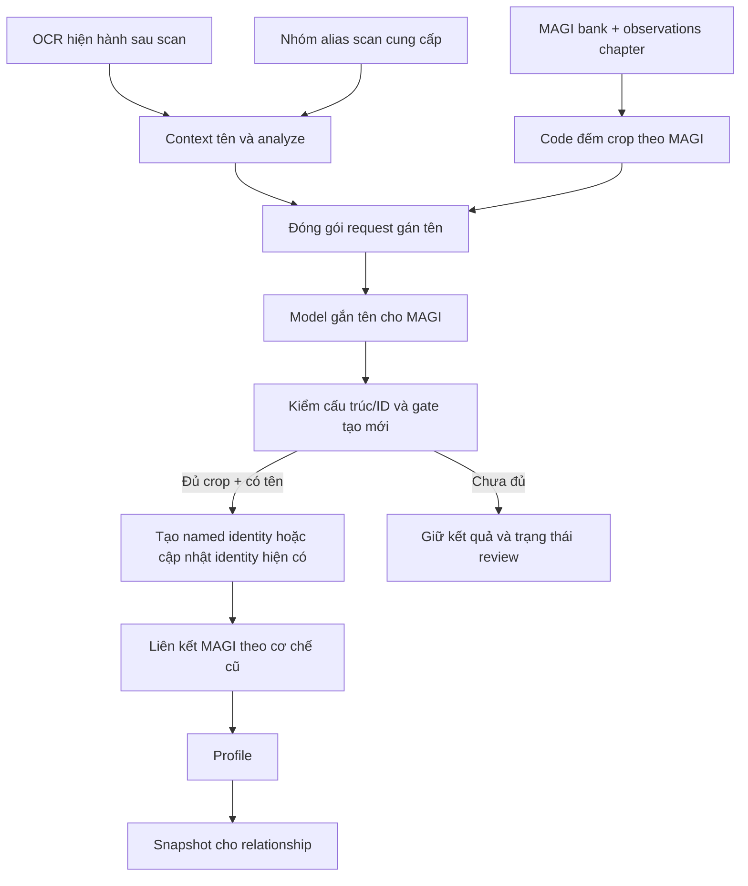

# Thiết kế build_identity với validator tối thiểu

> Historical documentation before chapter-story-graph-v7. See [current docs](../../../v7/README.md).

> Tài liệu lịch sử cho policy v2. Mặc định mới là
> [analyze-authoritative-v3](analyze-authoritative-build-identity-design.md):
> không còn request model gán lại tên/owner hoặc panel trong build_identity.

**Trạng thái: đã triển khai `chapter-name-binding-simple-v2`, ngày 24/10/2026.**
Đã kiểm tra bằng test không gọi model; chưa chạy inference thật hoặc Runpod.
Tài liệu cụ thể hóa [điều kiện tạo identity](identity-validator-simplification.md)
và dùng [scan mới](../text/scan-redesign.md) làm upstream.

## 1. Điều kiện tạo mới

```text
được_tạo_named_identity(MAGI) =
    số_crop_trong_chapter(MAGI) >= ngưỡng_mặc_định_8
    AND có_tên_được_gọi_hoặc_nhắc_đến
    AND model_gắn_tên_đó_cho_MAGI
```

Không yêu cầu tên phải được gọi trực tiếp và nhắc đến đồng thời. Một tên được
nhắc đến mà model gắn cho character là đủ về phía điều kiện tên. Không cần thêm
một số lượng calling event đã được validator xác nhận.

Đây là gate tạo **identity có tên mới**. Person record kỹ thuật mà pipeline đã
tạo để analyze tham chiếu không đồng nghĩa một named identity đã được tạo.
Gate không được dùng để xóa identity có sẵn khi chapter sau ít xuất hiện.

## 2. Giữ nguyên những gì đã có

- Nhiều MAGI character được liên kết với cùng một identity theo cơ chế hiện hành.
- Giữ các MAGI entry/ID, crop và prototype riêng; không hợp nhất các MAGI ID.
- Không thêm cơ chế gộp hai identity đã có.
- Giữ cách chọn main MAGI và visual linking cũ; không thay threshold/prototype
  bằng việc sửa validator trong tài liệu này.
- Giữ stage `build_identity` rồi `relationship`; không thêm một stage mới.
- Profile vẫn được tạo trước relationship theo cơ chế hiện hành.

## 3. Luồng xử lý



Không có bước validator yêu cầu model chứng minh lại quyết định bằng crop ID,
panel ID hoặc câu nguồn. Crop/thoại vẫn có thể gửi làm context để model suy luận.

## 4. Chuẩn bị đầu vào bằng code

### 4.1 Đếm crop

Code xây bảng `chapter_crop_count` theo MAGI character từ observations của
extraction scope hiện tại. Một detection được tính một lần; sử dụng cùng crop ở
nhiều request không làm tăng count.

Không dùng các đại lượng sau thay cho count này:

- `appearance_count` tích lũy toàn bộ lịch sử bank.
- Số vector trong prototype, gallery hoặc số crop đại diện còn giữ trên đĩa.
- Số ảnh thực sự đưa vào vLLM.
- Tổng tùy ý của các character chưa được liên kết, chỉ để đạt ngưỡng.

Code gắn count vào metadata request và tự dùng nó khi commit. Model không phải
chép lại con số hoặc xuất một danh sách 8 crop refs.

### 4.2 Tên và context

- Dùng tên và text từ OCR hiện hành sau sửa, không dùng OCR thô làm nguồn phủ quyết.
- Dùng các group alias đã có từ scan. Tên ungrouped giữ review, chưa đưa vào
  identity theo quyết định Q14=B; không tự tạo nhóm fallback theo chuỗi.
- Mỗi group cần có tên được model scan ghi nhận trong chapter. Đây là dữ liệu
  tên/context được cung cấp, không phải yêu cầu Python xác nhận chính tả hoặc
  bắt analyze đã đánh `confirmed_person_name=true`.
- Analyze cung cấp speaker/addressee/content_type và ngữ cảnh tham khảo, không
  còn là một bộ semantic gate bắt name-binding phải khớp từng nhãn.
- Registry cung cấp identity và alias hiện hành để tránh tạo lại identity đã biết.

### 4.3 Character

Request cho biết MAGI ID, count chapter, liên kết identity hiện có và các ảnh
đại diện/context được chọn theo cấu hình hiện hành. Ảnh là input suy luận.
Không xuất hiện trong một panel cụ thể không tự làm một MAGI ID hợp lệ bị bác bỏ.

Character chưa có identity và count <8 được đánh dấu không đủ điều kiện tạo mới.
Nếu cần giữ trong context thì vẫn cho model thấy; quyết định tên của nó không
biến thành một identity mới chỉ vì model gọi là confirmed.

## 5. Output model đơn giản

Ví dụ minh họa contract, không phải inference thật:

```json
{
  "characters": [
    {
      "magi_id": "5",
      "primary_name": "Sasamori Koyuki",
      "aliases": ["Sasamori", "Koyuki", "Sasamori-san"],
      "reason": "The chapter dialogue and introductions identify this character."
    },
    {
      "magi_id": "9",
      "primary_name": null,
      "aliases": [],
      "reason": "No name can be assigned from this context."
    }
  ]
}
```

Model trả một đối tượng ngữ nghĩa hoàn chỉnh cho character đang xét. Request
đã thuộc group nào thì code gắn group đó từ job, không bắt model chép group_id.
Code giữ ID kỹ thuật, namespace truyện, count và provenance; model không phải tự
tạo person_id hoặc chép lại các hash/reference của input. MAGI ID trong output
chỉ để chỉ ra character mà model chọn trong bank.

Không yêu cầu output có `evidence_refs`, `owner_crop_ref`, `panel_ref`, caller
proof hoặc một decision cho mọi lần tên xuất hiện. Tên mới không cần khớp nguyên
văn OCR thô. Có thể giữ giải thích bổ sung mà model trả, nhưng không kiểm chứng
nội dung giải thích bằng một bộ luật crop/thoại.

`primary_name=null` là kết quả chưa gắn được tên, không phải lý do retry cả request.
Canonical name trong bank là tên identity; nó không tự thay tất cả cách gọi trong
OCR thành họ tên đầy đủ. Sửa OCR vẫn dùng cơ chế tên cũ→tên mới của scan.

## 6. Áp dụng kết quả và giới hạn validator

| Tình huống | Xử lý |
|---|---|
| MAGI hợp lệ, >=8 crop chapter, model gắn tên từ group đã có | Tạo named identity mới nếu chưa có; không đòi citation |
| MAGI đã thuộc identity | Dùng/cập nhật identity đó theo cơ chế cũ, không tạo một identity trùng chỉ vì chapter ít crop |
| MAGI <8 crop và chưa có identity | Giữ tên model suy luận để review, chưa tạo mới |
| Có >=8 crop nhưng model chưa gắn tên | Giữ unnamed; không đặt tên Unknown rồi coi như named identity |
| Tên/group chưa được scan gom | Giữ review, chưa tạo identity từ mục đó |
| MAGI ID không tồn tại hoặc record sai kiểu | Chỉ record liên quan không áp dụng; giữ phần còn lại |
| Alias/reason/caller field tùy chọn lỗi | Ghi lỗi field, không xóa owner/name còn dùng được |
| JSON không đọc được hoàn toàn | Lưu raw response và báo lỗi request, không retry |
| Snapshot/version hỏng | Báo lỗi dữ liệu, không ghi thành công giả |

Không kiểm ngữ nghĩa bắt buộc như:

- Owner phải là người hiện diện trong panel hoặc một `allowed_magi_ids` hẹp.
- Tên phải có một crop/panel/câu nguồn được model cite.
- Reference phải biến thành direct_address mới được tạo identity.
- Lời giải thích phải mang một evidence_kind được Python xác nhận là phù hợp.
- Chỉ cần một item sai thì loại toàn bộ response.

ID được đối chiếu với bank của đúng truyện. Đây là kiểm tra dữ liệu, không phải
một phép xác nhận người trong ảnh có đúng là chủ tên hay không.

### Ngoại lệ dialogue đã chốt

Vùng đã xác định là dialogue không được mang nhãn narrator_introduction.
Nếu một field model trả vi phạm điều này, đánh dấu field đó unknown/review,
giữ các field tên/owner dùng được. Không tự đổi thành direct_address, không sửa
dialogue thành narration, không loại cả character/request.

## 7. Liên kết MAGI và identity

Việc đặt tên xong được chuyển vào cơ chế liên kết hiện có. Không dùng thay đổi
validator để thêm thuật toán merge identity hoặc hợp nhất bank entry.

Ví dụ: MAGI 5 đủ điều kiện tạo identity có tên. MAGI 14 có thể được cơ chế cũ
liên kết với identity đó; hai MAGI ID/crop vẫn tồn tại riêng. MAGI 14 ít crop
không phải lý do tạo thêm identity có cùng tên.

Nếu một đề xuất đòi gộp hai identity đã có, giữ nguyên nguyên tắc không gộp đã
chốt và đưa đề xuất đó vào review. Chỉ giữ lại phần dữ liệu khác có thể sử dụng.

## 8. Profile và mô hình cập nhật

Giữ loại dữ liệu profile, cách chọn ảnh và bằng chứng đầu vào hiện có. Không
buộc model cite crop/thoại để profile được giữ; không dùng confirmed cũ như một
validator ngữ nghĩa cấm model đưa ra giá trị mới.

Khi có một profile mới dùng được, dùng toàn bộ đối tượng mới theo nguyên tắc
kết quả sau ưu tiên. Lưu trước/sau/version để review. Field lỗi được xử lý riêng;
không làm mất named identity chỉ vì profile chưa hoàn chỉnh.

Cơ chế tái sử dụng khi không có input mới và eligibility profile/graph vẫn được
tách khỏi gate **tạo named identity mới**. Không âm thầm thay toàn bộ thuật toán
profile/graph khi chỉ sửa validator identity.

## 9. Request và batch

- Giữ concurrency theo cấu hình hiện hành, tối đa 8 request của nhánh identity.
- Các group có thể đóng gói/chia request khi context hoặc giới hạn vLLM cần;
  child request giữ cùng group_id. Số request không bằng số identity.
- Code giữ source context/crop đã cung cấp để review, không bắt model tạo citation.
- Thiếu ảnh tham khảo hoặc không cite ảnh không làm mất một kết luận model.
  Source/ảnh hỏng về mặt dữ liệu vẫn phải được báo đúng trạng thái.
- Không model reducer mới, không automatic retry và không gửi lại request uncertain.
- Freeze input/config trước khi chạy; response khác nhau không được chọn theo
  tốc độ hoàn thành để ghi đè ngẫu nhiên cùng một đối tượng.

## 10. Output và review

Kết quả cần tách ba loại thông tin:

1. **Model kết luận:** primary_name, aliases, character được gán tên, lý do.
2. **Code đo được:** crop count chapter, gate đủ/chưa đủ, ID/snapshot/version.
3. **Review:** phần chưa áp dụng, field lỗi, đề xuất xung đột với cơ chế identity cũ.

Hiển thị mọi kết quả model kể cả character chưa đủ ngưỡng. Không giấu kết luận
chỉ vì model không trả crop refs. Review có thể trình bày ảnh đã cấp cho model,
nhưng phải ghi đó là input, không tự nhận model đã cite ảnh đó.

Các chỉ số tối thiểu:

```text
characters_in_chapter
eligible_for_new_identity
named_identities_created
existing_identities_updated_or_reused
below_crop_threshold
no_name_assignment
ungrouped_names
invalid_data_items
profile_missing_or_needs_review
automatic_retries = 0
```

## 11. Phạm vi code khi triển khai

| Thành phần | Thay đổi |
|---|---|
| Chuẩn bị identity input | Đếm crop theo MAGI/chapter trước gate tạo mới; dùng canonical OCR và nhóm scan mới |
| `identity_binding.schema/validate` | Output đơn giản, không citation proof, không semantic rejection toàn request |
| `identity_runtime.run_jobs` | Xử lý item/field riêng và giữ raw response; không retry |
| Reconcile/apply names | Áp gate >=8 khi tạo named identity; giữ cơ chế liên kết/không gộp identity cũ |
| Profile validator/reconcile | Không đòi crop/thoại proof để nhận kết quả; dùng bản model mới và lưu lịch sử |
| Export/review | Dùng snapshot mới nhất, hiển thị cả kết quả chưa áp dụng và count chapter |

Config gate hiện có là `v6.identity_min_chapter_crops=8` (số nguyên dương).
Không âm thầm đổi ngưỡng graph/profile khi thêm
gate tạo identity. Các config hiện tại vẫn được giữ cho hành vi cũ tương ứng.

## 12. Ca chấp nhận

- 8 crop chapter + tên được nhắc đến + owner model trả hợp lệ, không refs: tạo được.
- 7 crop chapter + tên rõ: kết luận còn để review, không tạo named identity mới.
- Nhiều crop lịch sử nhưng chapter chỉ có 3: không dùng lịch sử vượt gate tạo mới.
- >=8 crop nhưng không gắn được tên: không ép đặt tên.
- Tên model sửa từ scan: dùng bình thường, không so OCR thô để từ chối.
- Một caller/reason/ref lỗi: không làm mất owner/name hoặc các character khác.
- Một identity đã tồn tại nhưng ít xuất hiện ở chapter mới: không bị xóa/tạo lại.
- Hai MAGI liên kết cùng một identity: vẫn giữ hai MAGI entry, không merge identity.
- Profile thiếu dữ liệu: không làm mất identity đã được tạo.
- Dialogue+narrator_introduction: xử lý riêng nhãn và giữ phần còn dùng được.
