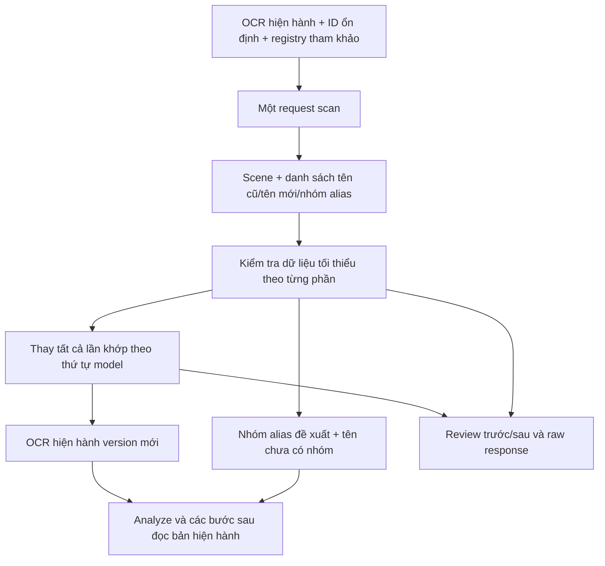

# Thiết kế lại scan: tên model sửa là OCR hiện hành

> Historical documentation before chapter-story-graph-v7. See [current docs](../../../v7/README.md).

**Trạng thái: đã triển khai `canonical-scan-v4`, ngày 24/10/2026.** Mặc định mới
đã có trong Python và bốn config đang dùng. Đã kiểm tra bằng test không gọi model;
chưa đánh giá chất lượng inference thật. Không chạy Runpod trong lượt triển khai.
Xem [báo cáo triển khai](../delivery/simplified-validators-implementation.md).

**Bổ sung OCR surface v4:** [sửa OCR giữ cách gọi](../delivery/ocr-surface-spelling-fix.md).
`canonical_name` chỉ là metadata nhóm. `new_name` chỉ sửa chính tả/spacing của
tên đang dùng trong câu, không tự thêm họ/tên hay honorific và không đổi thứ tự.
Replace-all chỉ khớp tên nguyên vẹn, bảo vệ tên dài đã đúng. Đề xuất chèn/bỏ
thành phần tên hoặc đổi thứ tự rõ ràng được giữ review, không áp vào OCR.
Các phép sửa hợp lệ vẫn chạy tuần tự. Run v3 cũ không bị viết lại.

Thiết kế này thay cơ chế scan phải khớp substring OCR thô, patch phải có bằng
chứng chính tả, canonical name phải có sẵn trong source, coverage thiếu thì gọi
model lại và nhóm tên fallback theo chuỗi. Giữ nguyên cơ chế identity hiện có:
nhiều MAGI character có thể liên kết cùng một identity; không hợp nhất MAGI ID
hoặc thêm cơ chế gộp identity.

## 1. Mục tiêu và phạm vi

Scan làm ba việc trong **một lượt gọi model**:

1. Chia scene từ văn bản hiện hành của chapter.
2. Phát hiện tên và quyết định sửa tên cũ thành tên mới.
3. Đề xuất nhóm alias của cùng người, như Sasamori/Koyuki/tên đầy đủ/biến thể OCR.

Model chịu trách nhiệm về nội dung tên và việc gom alias. Code chịu trách nhiệm
về ID, thay thế văn bản, phiên bản dữ liệu và lịch sử review. Không dùng một bộ
luật Python khác để xác nhận model đã sửa tên đúng chính tả hay chưa.

Scan không xác nhận ai là MAGI 5/MAGI 14, không cập nhật embedding/prototype,
không gộp identity, không hợp nhất MAGI ID và không chạy lại OCR/detection.
Việc gắn nhóm tên cho nhân vật vẫn thuộc identity theo cơ chế đã có.

## 2. Luồng mới



## 3. Đầu vào

Model nhận một snapshot đã đóng băng gồm:

- Các text/utterance của chapter: ID ngắn, text hiện hành, thứ tự và trang.
- Đánh dấu text nào được dùng để chia scene.
- Tên/alias đã biết trong registry để tham khảo; registry không được dùng làm
  bộ từ điển bắt buộc để bác bỏ tên mới của model.

Model không cần nhận OCR thô như một nguồn ngôn ngữ có quyền ưu tiên cao hơn.
OCR thô được giữ riêng cho review. Nếu chapter đã có bản OCR hiện hành sau sửa,
lượt scan tiếp theo đọc bản hiện hành đó.

Trong API, `text_id` là ID ổn định của đơn vị text mà scan đang nhận. Adapter
của pipeline hiện tại ánh xạ nó với `utterance_id`; không thay ID khi sửa tên.
Bbox, panel ID, page ID và liên kết source box được code giữ nguyên.

## 4. Output model: một danh sách tên, không ba bảng phụ thuộc nhau

Ví dụ JSON dưới đây chỉ minh họa contract, không phải output inference thật:

```json
{
  "scenes": [
    {"start_id": "u0", "summary": "The students discuss an incident."}
  ],
  "groups": [
    {
      "group_id": "g1",
      "canonical_name": "Sasamori Koyuki",
      "reason": "The chapter connects the surname, given name and full name."
    },
    {
      "group_id": "g2",
      "canonical_name": "Mizushima Toru",
      "reason": "These forms refer to the same named character."
    }
  ],
  "names": [
    {"text_id": "u3", "old_name": "SASA- MORI- SAN", "new_name": "Sasamori-san", "group_id": "g1"},
    {"text_id": "u8", "old_name": "KOYUKI", "new_name": "Koyuki", "group_id": "g1"},
    {"text_id": "u12", "old_name": "MIZU- SHIMA", "new_name": "Mizushima", "group_id": "g2"},
    {"text_id": "u16", "old_name": "TORU", "new_name": "Toru", "group_id": "g2"},
    {"text_id": "u20", "old_name": "ANOTHER NAME", "new_name": "Another Name", "group_id": null}
  ]
}
```

Một record `names` đồng thời nói:

- Model thấy tên nào trong ngữ cảnh `text_id`.
- Model muốn dùng tên mới nào; tên mới không cần xuất hiện nguyên văn trong OCR.
- Tên thuộc nhóm nào, hoặc chưa được gom nhóm.

Không yêu cầu model trả start/end, occurrence_index, danh sách patch riêng,
group.members riêng, hash crop hay evidence_refs. Nếu model trả giải thích thêm,
review giữ lại; thiếu giải thích không làm mất tên hoặc phép sửa.

Code dựng aliases/members từ `names`, nên model không phải chép lại cùng một tên
ở nhiều mảng rồi bị loại vì các mảng không khớp nhau. Code tự gắn source/context
đã cung cấp và phân biệt chúng với trích dẫn mà model chủ động đưa ra.

Mỗi tên phát hiện dùng một record cho mỗi surface khác nhau trong một text.
Code có thể mở rộng các lần lặp thực tế trong text; model không phải đếm ký tự.
Không ép chapter luôn có đúng hai nhóm: tên tác giả/người khác có thể ở nhóm
riêng hoặc ungrouped. Canonical name là kết luận của model, không phải lookup từ điển.

## 5. Find-all / replace-all

### 5.1 Tạo danh sách phép sửa

Từ `names`, code lấy các cặp `(old_name, new_name)` theo thứ tự model trả.
Các record nhắc lại cùng một cặp chỉ tạo một lệnh thay thế toàn chapter, giữ lần
xuất hiện đầu tiên. Việc nhắc tên ở nhiều text không làm lệnh sửa bị chạy lặp.
Các cặp khác nhau vẫn được giữ nguyên thứ tự; code không tự chọn tên nào đúng hơn.

Nếu hai cặp có cùng tên cũ nhưng tên mới khác nhau, vẫn thực hiện tuần tự và
ghi lịch sử. Không bác bỏ cả request vì model đưa ra các quyết định như vậy.

### 5.2 Cách khớp

Khóa khớp bỏ khác biệt hoa/thường, khoảng trắng và gạch nối. Code giữ ánh xạ
từ khóa đã chuẩn hóa về các vị trí trong text thật để thay đúng phần khớp.

- Không fuzzy-match khác chữ cái/chữ số hoặc dùng embedding để tìm tên gần nhất.
- Thay **mọi lần khớp** trên toàn OCR hiện hành của chapter, không chỉ text_id
  mà model dùng làm ngữ cảnh cho record đó.
- Không tự áp phép sửa sang OCR của chapter khác.
- Giá trị chèn là `new_name` model trả; không bắt nó tồn tại trong OCR cũ hoặc registry.
- Không tự đổi nó về chữ hoa, cắt hậu tố hoặc ép theo từ điển của code.

### 5.3 Có dây chuyền — quyết định Q16=B

Mỗi lệnh sửa nhìn vào kết quả sau lệnh trước. Không chạy lặp đến khi hội tụ;
chỉ duyệt danh sách lệnh đã lấy từ response một lần.

```text
Đầu vào: T0RU gặp TORU.
Lệnh 1: T0RU → TORU
Lệnh 2: TORU → TŌRU
Kết quả: TŌRU gặp TŌRU.
```

Review ghi được cả chuỗi A→B→C, thay vì chỉ ghi A→C. Mỗi event có rule index,
text_id, đoạn trước/sau và số lần thay. Offset nếu cần là dữ liệu code tính,
không phải điều kiện model phải cung cấp chính xác.

Nếu không tìm thấy tên cũ: ghi `no_match` và count=0, tiếp tục các lệnh khác.
Điều này chỉ có nghĩa lệnh không sửa được văn bản; không tự bác bỏ chính tả tên
mới hoặc xóa nhóm alias/kết luận khác của model.

## 6. OCR sau sửa là nguồn chính

Code dựng một bản `ocr_current` hoàn chỉnh sau khi thực hiện các lệnh. Đây là
nguồn ngôn ngữ chính cho analyze và những bước sau; không chỉ là gợi ý kèm theo OCR thô.

- Văn bản sửa được coi là bản gốc hiện hành của pipeline.
- OCR thô và các bản trước chỉ nằm trong lịch sử review/khôi phục.
- Không dùng so sánh với OCR thô để bác bỏ một tên model đã sửa.
- Các ID/bbox vẫn ổn định; sửa text không làm lại hình học hoặc ảnh.
- Model không viết lại toàn bộ JSON OCR: model trả tên cũ/tên mới, code dựng snapshot.

Không sửa lén artifact đã commit làm hỏng hash. Bản hiện hành là một version mới
và được snapshot trong kết quả scan; các consumer dùng cùng version đó. Hash/version
vẫn kiểm tính toàn vẹn dữ liệu, không được biến thành phép xác thực chính tả theo OCR thô.

## 7. Nhóm alias và ungrouped

- `group_id` là nhóm tên đề xuất của model, không phải person_id hay MAGI ID.
- Code lưu canonical_name model trả, kể cả nó chưa có nguyên văn trong OCR cũ.
- Aliases gồm các dạng tên cũ/mới được model gắn với nhóm, giữ cả lịch sử sửa.
- Code tự xây members/source context; không buộc model trả lại một danh sách
  thành viên kèm offset để đối chiếu lần nữa.
- Tên `group_id=null`, thiếu group hoặc tham chiếu group không tồn tại được giữ
  là ungrouped và hiển thị review. Phép sửa OCR độc lập vẫn có thể thực hiện.
- Theo Q14=B, **ungrouped chưa được đưa sang xử lý identity**.
- Không tự tạo singleton/fallback theo base_name rồi trình bày như nhóm người
  đã được scan gom xong; cũng không gọi model lại chỉ để lấp coverage.

Hai nhóm cùng canonical_name không tự gộp. Code không suy ra cùng người từ
tên giống nhau, tần suất hoặc khoảng cách chuỗi. Một group_id lặp được xử lý
như cập nhật đối tượng: bản model trả sau thay bản trước và có lịch sử review.

## 8. Validator mới: chỉ dữ liệu và truy vết

| Kiểm tra còn giữ | Cách xử lý khi lỗi |
|---|---|
| Response không parse được thành JSON dùng được | Lưu raw response, stage báo lỗi; không gọi model lại |
| Sai kiểu một phần tử/field cần dùng | Đánh dấu riêng phần đó, tiếp tục các phần còn lại |
| text_id/start_id không tồn tại | Không áp dụng phần tham chiếu sai; lưu review, không loại response còn lại |
| old_name/new_name không phải chuỗi dùng được | Bỏ riêng lệnh không thể thực thi; giữ dữ liệu khác |
| group reference không tồn tại | Giữ tên/correction, membership thành ungrouped |
| Snapshot/version không toàn vẹn | Báo lỗi dữ liệu; không giả vờ đã áp dụng một snapshot không xác định |

Các kiểm tra phải bỏ ở đường scan mới:

- Tên mới phải là substring nguyên bản.
- Model phải đưa đúng character offset/occurrence_index.
- Canonical name phải có sẵn trong source hoặc registry.
- Sửa chữ phải có một câu khác xác nhận cách viết.
- Thay đổi hậu tố, số từ, độ dài hoặc hoa/thường là lý do loại phép sửa.
- Bắt model cite một tập evidence_refs để phép sửa tên được chấp nhận.
- Loại cả response vì một tên/group/scene item lỗi.
- Coverage alias chưa đủ thì retry hoặc làm hỏng toàn bộ stage.
- Dùng validator tiếng Anh/số câu của summary để bác bỏ scene model trả.

Prompt vẫn yêu cầu model làm đúng nhiệm vụ, sửa tên và gom alias có lý do.
Đó là yêu cầu đối với model, không phải một bộ luật ngữ nghĩa thứ hai trong code.

## 9. Scene trong cùng request

Giữ việc chia scene cùng lượt scan. Model trả start_id và summary; code đổi ID
ngắn về ID thật, sắp theo thứ tự nguồn và xây các range.

Start ID không có trong input chỉ làm mất marker đó và tạo warning. Các marker
hợp lệ còn lại vẫn dùng được. Marker trùng được code chuẩn hóa, không gọi lại model.
Đoạn đầu chưa có marker được giữ bằng một container `scene:unresolved`, summary
unknown và review flag, thay vì bỏ mất text. Nếu không có marker dùng được,
container này chứa toàn bộ target; nó không phải kết luận rằng chapter thật sự
chỉ có một scene.

Thiết kế này cần adapter trước planner analyze để phân biệt scene model đề xuất
với container code giữ coverage. Không thay đổi cơ chế nhận diện nhân vật.

## 10. Giới hạn quyền và quy tắc dialogue

Scan không gán narrator_introduction, speaker hay addressee cho tên. Đây không
phải điều kiện cần để sửa OCR hoặc gom alias.

Ràng buộc đã chốt cho bước sau: nếu bubble/content source đã được chốt là
dialogue, không được mang nhãn narrator_introduction. Lỗi nhãn không làm mất cả
request hoặc các trường còn dùng được. Không tự đổi lời thoại thành narration
để hợp thức hóa nhãn. Chi tiết giảm validator của identity/relationship là phạm
vi triển khai khác; không dùng thiết kế scan này để sửa cơ chế liên kết MAGI/identity.

## 11. Lưu output và review

Các file dưới đây là contract đề xuất, chưa phải CLI/file đã có sẵn:

| Artifact đề xuất | Nội dung |
|---|---|
| `05_scan/result.json` | Scene, names, groups, ungrouped, warning và các version được sử dụng |
| `05_scan/ocr-current.json` | Snapshot văn bản hiện hành có quyền ưu tiên cho downstream |
| `05_scan/replacement-history.json` | Lệnh theo thứ tự, trước/sau, matches/no_match và trace dây chuyền |
| Request journal/raw response | Bản model trả nguyên vẹn, kể cả phần không dùng được |
| `05_scan/review.md` và HTML local | Nhóm alias, câu trước/sau, ungrouped, warnings, nguồn đã cung cấp |

Không còn cổng chờ người/agent xác thực sửa chính tả. Review để xem và điều chỉnh,
không phải điều kiện cho canonical OCR được sử dụng.

Chỉ số cần hiển thị: số tên model trả, số nhóm đề xuất, số ungrouped, số lệnh
thay, tổng matches, no_match, số item lỗi dữ liệu và số request model thực tế.
Không gọi số nhóm tên là số identity đã xác nhận.

## 12. Request, timeout và retry

- Một request chung toàn chapter, nhận snapshot cố định.
- Không tự retry vì parse lỗi, chính tả, thiếu nhóm, lỗi reference hoặc bất đồng ngữ nghĩa.
- Khi timeout, giữ trạng thái uncertain và không POST lại khi chưa xác định
  request cũ đã dừng. Không ghi completed nếu không có response đầy đủ.
- Output reserve và timeout phải được freeze trước run, đủ cho response dài.
  Lượt thử 24/10 bị timeout ở 600 giây khi server vẫn sinh khoảng 12 token/giây;
  đây không phải bằng chứng validator đã bác bỏ các nhóm alias.
- Trước lần kiểm chứng tiếp theo cần cấu hình timeout phù hợp với output reserve
  và tốc độ decode; không thay ngầm thông số của batch đang chạy.

Không chạy thêm Runpod cho đến khi người dùng yêu cầu trực tiếp.

## 13. Phạm vi code khi triển khai

| Module | Thay đổi cần thực hiện |
|---|---|
| `scene.py` | Prompt/schema mới; bỏ exact-substring gate của tên mới; một attempt; nhận từng item độc lập |
| `scene_wire.py` | Giữ mapping ID; lỗi tham chiếu cục bộ thành warning, không phá phần không liên quan |
| `name_normalization.py` | Thay luật xác thực patch bằng engine replace-all tuần tự và audit; dựng OCR hiện hành |
| `semantic.scan` | Xuất candidates/groups từ danh sách tên thống nhất, giữ tên đã sửa và membership do model chọn |
| Adapter canonical text | Các consumer đọc cùng OCR hiện hành; OCR thô chỉ đi vào review/history |
| Adapter grouping/scene | Ungrouped giữ review theo Q14=B; scene container không được coi là suy luận của model |
| Review | Hiển thị kết quả model kể cả lỗi dữ liệu, trước/sau và toàn bộ warnings |

Không bổ sung merge identity, merge MAGI ID, thay prototype, thay detector,
hoặc mô hình khác. Các thay đổi adapter chỉ để dùng contract scan mới.
Artifact lịch sử được đọc theo version cũ; không tự viết lại lịch sử để khớp schema mới.

## 14. Ca chấp nhận trước khi triển khai thực tế

1. Model sửa SASA- MORI thành Sasamori dù tên mới không phải substring nguyên bản.
2. Mọi biến thể hoa/thường/khoảng trắng/gạch nối cùng khóa đều được thay trong chapter.
3. A→B rồi B→C cho kết quả dây chuyền như Q16=B; không lặp vô hạn.
4. Không thay text chapter khác; không đổi ID hoặc bbox.
5. Một lệnh no_match không làm mất các lệnh khác hoặc nhóm model đề xuất.
6. Một text_id sai không làm hỏng cả response.
7. Thiếu group khiến tên thành ungrouped/review, không tạo fallback singleton.
8. Canonical name mới không bị từ chối do thiếu từ điển/source form.
9. OCR thô không thể bác bỏ tên mới; downstream đọc đúng bản hiện hành.
10. Không có automatic retry; raw response và phần kết quả dùng được đều còn để review.
11. Source/snapshot bị hỏng vẫn được nhận diện là lỗi dữ liệu, không ghi thành công giả.
12. MAGI/identity vẫn theo cơ chế cũ, không phát sinh gộp ID mới từ scan.
