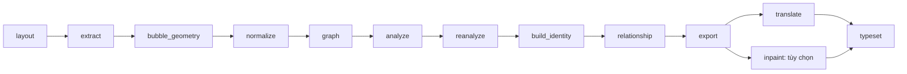

# Pipeline v7 — hướng dẫn theo stage

Luồng hiện hành dùng contract **`chapter-story-graph-v7`**: dựng ngữ cảnh toàn chapter, analyze có ảnh theo event và reanalyze toàn chapter. Tất cả request LLM dùng context **64K, thinking tắt**.

Mỗi trang stage giải thích theo cùng cách: **input/output → hình minh họa → thành phần JSON và ý nghĩa trường → cách xử lý/config → dữ liệu chuyển sang bước sau**. [Layout](stages/01_layout.md) là ví dụ đọc chi tiết với ảnh zoom panel, bubble, mask và reading order. [Thư viện minh họa](examples/README.md) ghi rõ nguồn thật, ví dụ lịch sử và schema giả định.

| Stage | Nội dung và tài liệu |
|---|---|
| 1. [layout](stages/01_layout.md) | Koharu: panel, bubble, thứ tự đọc |
| 2.1. [extract — MAGIv2](stages/02,1_extract_magiv_extract.md) | Input/output detection, cluster, OCR và hai loại liên kết text–character/text–tail |
| 2.2. [extract — bank](stages/02,2_extract_bank.md) | Input/output gán ID qua trang, prototype/crop, pending và lưu bank |
| 3. [bubble_geometry](stages/03_bubble_geometry.md) | Hình học bubble và mapping text |
| 4. [normalize](stages/04_normalize.md) | Utterance, panel chính và các panel liên quan |
| 5. [graph](stages/05_graph.md) | Thay scan: nhóm tên, OCR hiện hành, scene/event và graph sơ bộ |
| 6. [analyze](stages/06_analyze.md) | Scene song song, event tuần tự, ảnh vùng trang và confidence |
| 7. [reanalyze](stages/07_reanalyze.md) | Hai nửa text-only độc lập, context rút gọn, patch theo ID sở hữu |
| 8. [build_identity](stages/08_build_identity.md) | Đăng ký tên theo semantic hiệu lực và gộp MAGI |
| 9. [relationship](stages/09_relationship.md) | Profile và quan hệ/xưng hô có hướng |
| 10. [export](stages/10_export.md) | Xuất thoại/effect và nguồn semantic |
| 11. [inpaint](stages/11_inpaint.md) | Tùy chọn xóa chữ |
| 12. [translate](stages/12_translate.md) | Chỉ dịch natural |
| 13. [typeset](stages/13_typeset.md) | Dàn chữ, kiểm tra render |

Các số trên là thứ tự tài liệu. Hai phần 2.1/2.2 cùng giải thích stage CLI `extract`, không tạo thêm stage hay đổi thư mục `02_extract`. Thư mục artifact được tính theo các stage thực sự bật trong manifest; không hardcode ordinal khi tắt inpaint/translation.

- [Toàn bộ thiết kế và các quyết định đã chốt](design.md).
- [Cấu hình hiện hành](configuration.md).
- [CLI, checkpoint, Runpod và review local](operations.md).
- [Migration, phần đã loại bỏ và kiểm chứng](migration.md).
- [Ảnh minh họa upstream](examples/README.md).

Code dùng lại namespace/storage `v6` cho các thành phần nền. Nhận diện thế hệ pipeline bằng **analysis_contract**, không suy ra chỉ từ tên file hay `pipeline_version` của container lưu trữ.

Bộ minh họa hiện có graph thật và checkpoint analyze từ Iris Zero chapter 1, cùng artifact upstream/inpaint đã lưu. Ví dụ schema được ghi rõ ngay tại từng trang; không xem nó là kết quả model thật. Các lượt này phục vụ review, chưa phải benchmark chất lượng bản dịch hoặc độ chính xác nhận diện nhân vật.
