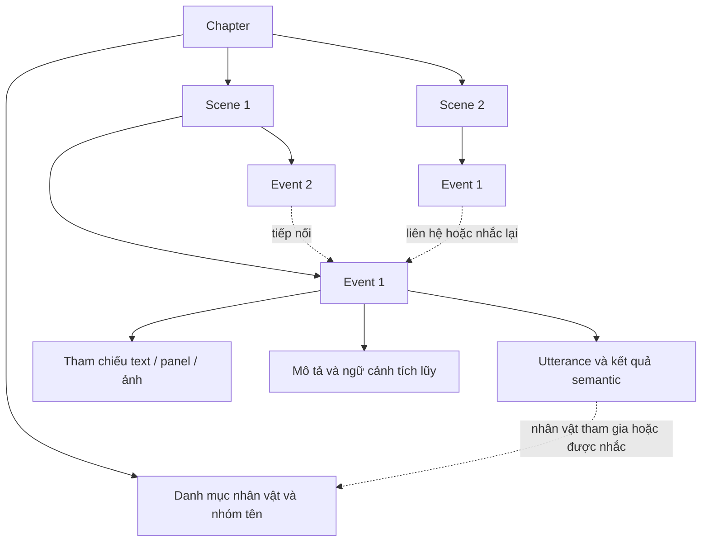

# Thiết kế ngữ cảnh chapter và story graph

Trạng thái: **đã được người dùng yêu cầu triển khai; luồng graph/analyze/reanalyze đã được nối vào code**. Xem [migration và mức kiểm chứng](migration.md); chưa đánh giá chất lượng bằng model/GPU thật.

Ngày tổng hợp: 2026-10-26.

## 1. Phạm vi và mục tiêu

Thiết kế lại luồng normalize → graph toàn chapter → analyze → reanalyze. Mục tiêu là giữ ngữ cảnh xuyên event/scene, đồng thời chạy song song giữa các scene và truy vết được từng quyết định.

Tạm thời chưa thiết kế cách build_identity, profile, relationship hoặc translation sử dụng kết quả mới. Không thay đổi điều kiện tạo/gộp identity trong phạm vi tài liệu này.

Story graph mô tả diễn biến, các nhân vật tham gia và các lần nhắc đến. Một nhân vật trong story graph không mặc nhiên là identity đã đăng ký trong bank.

## 2. Runtime chung

- Context tối đa đồng bộ **65.536 token (64K)** ở các bước dùng LLM.
- **Thinking tắt ở mọi bước.** Quyết định này thay thế thiết kế cũ bật thinking riêng cho analyze.
- Ngân sách context gồm đầu vào, ảnh nếu có, schema và phần dự phòng đầu ra; 64K không chỉ là ngân sách text đầu vào.
- Không tự tăng concurrency hoặc chuyển GPU theo tài liệu này. Giữ giới hạn tài nguyên đang được cấu hình; triển khai cần kiểm tra số scene hoạt động đồng thời theo khả năng phục vụ thực tế.
- Không tự retry nội dung hoặc gọi model để sửa JSON lỗi.
- Đầu vào không vừa ngân sách phải được báo rõ; không âm thầm cắt bỏ câu mục tiêu hoặc bằng chứng ảnh bắt buộc. Phạm vi event được giữ cố định.

## 3. Cấu trúc phân cấp

Chỉ có hai cấp diễn biến: **scene → event**. Không có macro-scene.

Utterance và bằng chứng là dữ liệu thuộc event, không phải một cấp phân cảnh mới. Các quan hệ ngoài cây được biểu diễn bằng liên kết tham chiếu, không sao chép toàn bộ nút nhân vật vào từng event.

### Chapter

- Thứ tự trang, panel và utterance.
- Danh sách scene có thứ tự.
- Nhóm tên: tên chuẩn, alias và các occurrence cụ thể.
- Danh mục nhân vật được tham chiếu trong chapter.
- Liên kết xuyên event/scene.
- Các phiên bản graph: khung graph, kết quả analyze hợp nhất, kết quả sau reanalyze.

### Scene

- ID ổn định; tên ngắn **dưới 5 từ**, tức tối đa 4 từ.
- Phạm vi utterance/trang và danh sách event có thứ tự.
- Mô tả sơ bộ từ graph và mô tả sau analyze, được phân biệt rõ.
- Nhân vật/giả thuyết liên quan và các liên kết xuyên scene.
- Scene biểu diễn một tình huống rộng, không tự tách chỉ vì đổi panel hoặc góc nhìn. Ví dụ trao đổi giữa Toru và Sasamori ở trang 8–18 có thể thuộc cùng scene như người dùng đã mô tả.

### Event

- ID ổn định; tên ngắn tối đa 4 từ.
- Một cụm utterance liên tiếp cùng phục vụ một diễn biến: giải thích một vấn đề, chào hỏi, đề nghị và phản hồi, v.v.
- **Tối đa 8 utterance**, được phép ngắn hơn; không vượt ranh giới scene.
- Một diễn biến dài được chia thành các event đánh số tiếp nối. Không tạo thêm cấp phân cảnh.
- Mỗi event tương ứng một batch analyze. Analyze không được chia/gộp lại event, chuyển utterance hoặc thay ranh giới scene.
- Đầu vào gồm ngữ cảnh chapter, mô tả scene, tóm tắt event trước, ngữ cảnh scene tích lũy và bằng chứng.
- Đầu ra gồm semantic của utterance, mô tả diễn biến bằng văn xuôi, confidence từng quyết định và ngữ cảnh tích lũy cập nhật.

### Utterance

- Một đơn vị text đã normalize có ID riêng; tính cả dialogue, thought, narration và caption, không đếm bằng dấu câu.
- Text hiện hành, các text box nguồn, thứ tự đọc, panel chính và các panel liên quan.
- Speaker, addressee, loại nội dung và các occurrence tên.
- Với từng occurrence: mention_type, người được nhắc, confidence và nguồn tham chiếu.
- Confidence và lý do được lưu riêng theo từng quyết định, không dùng một điểm chung cho cả event.

## 4. Normalize và mapping panel

Một utterance được phép liên quan nhiều panel.

Quy tắc panel chính:

1. Lấy panel của text box đầu tiên theo thứ tự đọc.
2. Tính diện tích giao giữa text box đầu tiên và panel đó, chia cho diện tích text box đầu tiên.
3. Nếu tỷ lệ **<10%**, chuyển sang panel có độ phủ lớn nhất trên các vùng text thực tế của toàn utterance.
4. Nếu không có panel phù hợp thì giữ trạng thái chưa gán; không tạo panel giả.

Không dùng bbox bao ngoài của nhóm text để thay thế diện tích các text box thực tế khi tính độ phủ. Panel chính là mapping định vị, không phải bằng chứng kết luận speaker hoặc người được gọi tên.

Hình thức trình bày và vai trò nội dung phải tách riêng: caption không đồng nghĩa narration. Analyze được chuyển nội dung có nhãn narration/caption ban đầu thành thought mà không bị đánh lỗi chỉ vì khác nhãn ban đầu. Thought vẫn cần xác định chủ thể theo contract hiện hành. Không diễn giải speech dialogue thành narrator introduction.

## 5. Graph toàn chapter

Đọc toàn bộ OCR hiện hành, thứ tự đọc, metadata panel/MAGI và thông tin bank phù hợp; **không nhận ảnh**. Giữ các yêu cầu sửa OCR tên hiện hành; thiết kế graph không cấp thêm quyền sửa text tùy ý.

Graph chủ yếu tạo khung chapter/scene/event và ngữ cảnh sơ bộ:

Toàn bộ prose do graph, analyze và reanalyze tạo (title, description, evidence, reason, memory và unresolved note) dùng **tiếng Anh**. OCR/tên được trích giữ nguyên dạng nguồn; artifact lịch sử không bị dịch hoặc viết lại. Review Markdown/HTML mới dùng nhãn tiếng Anh.

- Nhóm tên, alias và occurrence.
- Các câu có thể là tự giới thiệu, lời dẫn giới thiệu hoặc lời người khác giới thiệu.
- Scene/event, tên ngắn, phạm vi và mô tả ban đầu.
- Liên kết xuyên scene/event.

Graph không đề xuất nhân vật, người nói, ánh xạ tên–MAGI hoặc somebody. Mô tả ban đầu không phân công utterance cho visual person; nhóm tên chỉ tổ chức surface trong text. Analyze chốt quyết định semantic từ dữ liệu nguồn và ảnh. Giả thuyết trong graph lịch sử không được đưa vào packet analyze mới; artifact gốc vẫn được giữ.

## 6. Ảnh đầu vào analyze

### Phạm vi panel

Xác định khoảng đọc liên tục từ utterance đầu đến utterance cuối của event. Bao gồm cả panel không có text trong khoảng đó.

Ví dụ event bắt đầu ở panel 5 trang 1 và kết thúc ở panel 7 trang 3: lấy phần khoảng đọc tương ứng trên trang 1, toàn bộ panel nằm giữa trên trang 2 và phần tới panel 7 trên trang 3.

### Cắt theo từng trang

Trên mỗi trang, lấy các điểm cực trị của:

- Bbox các panel thuộc phạm vi event.
- Speech bubble liên quan các panel đó theo mapping normalize, kể cả phần tràn ra ngoài panel.
- Text box mục tiêu, bao gồm caption/thought ngoài panel.
- Bbox đuôi MAGIv2 được liên kết với text mục tiêu, kể cả phần ngoài panel.

Dựng một bbox chữ nhật từ các điểm cực trị để cắt vùng trang. Giữ bố cục tương đối và mapping tọa độ từ trang gốc sang vùng cắt.

Ảnh có bbox/ID panel và thứ tự đọc. **Chỉ nhân vật đã có MAGI được đánh số MAGI trên ảnh.** Nhân vật chưa có MAGI vẫn giữ detection/metadata hiện hành nhưng không gắn nhãn cục bộ trên ảnh.

Đuôi lấy từ `tails` và `text_tail_associations` của MAGIv2; renderer vẽ bbox tím và nhãn `TAIL <tail_index>` trước khi gửi model. Mỗi target có `bubble_tail.has_tail` và danh sách bbox/liên kết nguồn do code tạo. Model không detect đuôi, không sửa bbox và không mượn đuôi của bubble khác. Nếu MAGI không cấp đuôi cho target thì coi là không có đuôi, không tự suy diễn thêm. Bằng chứng nguồn này được giữ qua analyze/reanalyze.

Text ngoài event nhưng nằm trong panel/vùng được chọn được cung cấp dưới nhãn **context**. Chỉ các utterance mục tiêu của event được yêu cầu trả kết quả; số đó vẫn không vượt 8.

## 7. Analyze theo scene/event

Các scene chạy song song trên cùng một phiên bản ngữ cảnh chapter đã đóng băng. Mỗi scene tạo phần bổ sung graph riêng, không ghi trực tiếp vào graph dùng chung để các scene khác đọc giữa chừng.

Trong mỗi scene, event chạy tuần tự:

1. Nhận tóm tắt event trước và bản ngữ cảnh scene tích lũy.
2. Nhận mô tả chapter/scene sơ bộ, dữ liệu mục tiêu/context và ảnh vùng trang.
3. Xác định semantic cho các utterance mục tiêu.
4. Viết mô tả diễn biến event bằng văn xuôi, cập nhật ngữ cảnh tích lũy và được sửa mô tả scene.

Analyze được sửa tên ngắn và mô tả nhưng không đổi phạm vi đã đóng băng. Mô tả scene cuối phản ánh các event đã được phân tích; phải biểu diễn rõ khoảng còn thiếu khi có event lỗi.

### Xác định nhân vật

- Speaker và addressee giữ cách xác định theo contract hiện hành; không mở cơ chế dùng một tên không có crop/MAGI để thay thế tùy ý.
- **Chỉ mention dạng reference** được trỏ đến một nhân vật có tên nhưng chưa có crop/MAGI, kể cả nhân vật vắng mặt.
- Các trường hợp direct_address/introduction và các loại khác không được tự áp dụng ngoại lệ của reference.
- Analyze phải chọn ứng viên hợp lý nhất khi trả kết quả thành công, kể cả confidence thấp; lưu rõ trạng thái quyết định tạm.
- Phân biệt confidence biết ai đang nói, ai đang nghe, loại nhắc tên và tên thuộc về ai. Chắc speaker không đồng nghĩa chắc tên được nhắc thuộc chính speaker.

### Confidence

Model tự chấm từng quyết định trên thang 10. Không thay bằng điểm chung cho event/scene hoặc hệ thống xếp ưu tiên bằng chứng do code tự chấm.

Graph, analyze và reanalyze dùng chung `EVIDENCE_CONFIDENCE_PROMPT` trong `v6/policy.py`: không chấm confidence cao khi bằng chứng mơ hồ, thiếu, mâu thuẫn hoặc còn cách hiểu cạnh tranh chưa giải quyết. **Được phép suy luận từ nguồn** (text/OCR, ảnh khi được cấp, metadata detector và anchor nguồn), nhưng phải chỉ ra liên hệ từ nguồn đến kết luận và source ID khi có.

Giả thuyết, tóm tắt, memory, tên và quyết định do model tạo trước đó không phải quan sát nguồn mới. Nhắc lại, diễn giải lại hoặc tiếp tục suy luận từ chính kết luận cũ không tạo bằng chứng độc lập. Khi dùng lại suy luận cũ, phải truy về nguồn ban đầu; nếu chưa kiểm chứng được tiền đề thì giữ mức bất định qua chuỗi suy luận, không tự nâng confidence chỉ vì các output trước đồng ý với nhau. Quy tắc áp dụng riêng cho từng quyết định và mô tả có confidence; không thêm trần điểm cố định hoặc gate confidence bằng code.

Anchor là thông tin hỗ trợ model chấm điểm cao hơn cho quyết định liên quan. Anchor speaker không tự là bằng chứng người nói mang tên vừa được gọi. Không cộng điểm cố định bằng code.

Riêng analyze, prompt yêu cầu coi source anchor cho speaker có sức nặng **8/10**, chỉ trái anchor khi có bằng chứng thị giác/nguồn rõ ràng và giải thích cụ thể. Không áp dụng quy tắc ưu tiên này cho reanalyze.

### Event lỗi

Nếu request lỗi, đầu ra bị cắt hoặc không dùng được:

- Lưu lỗi/response và trạng thái event chưa hoàn tất.
- Không tự retry nội dung, không tạo semantic/tóm tắt giả để lấp chỗ trống.
- Event sau tiếp tục bằng ngữ cảnh tích lũy hợp lệ gần nhất, kèm text và dấu hiệu event trước chưa phân tích thành công.
- Các scene khác vẫn chạy bình thường.
- Reanalyze được thấy các khoảng chưa hoàn tất.

## 8. Hợp nhất story graph

Sau khi các scene hoàn tất, code hợp nhất các phần bổ sung theo ID/thứ tự cố định. Không để kết quả phụ thuộc scene nào chạy nhanh hơn.

Phiên bản đầu có các nhóm liên kết:

- Quan hệ chứa chapter/scene/event/utterance.
- Thứ tự và tiếp nối.
- Nhân vật tham gia, người nói/người nghe, người được nhắc.
- Event nhắc lại hoặc liên quan event khác.

Chưa phát triển nhóm cạnh riêng cho nguyên nhân–hệ quả, động cơ hoặc mục đích. Những nội dung đó có thể nằm trong mô tả văn xuôi nhưng không tự trở thành cạnh graph để ảnh hưởng bước khác.

Giữ nguồn tham chiếu của mô tả và quyết định. Một nhận định được sao chép qua nhiều tóm tắt không trở thành nhiều bằng chứng độc lập.

## 9. Reanalyze hai nửa độc lập

Sau khi hợp nhất analyze, chia chapter thành **hai nửa liên tiếp** tại ranh giới event gần giữa nhất theo số utterance. Mỗi nửa có một request 64K, thinking tắt; chạy song song tối đa hai request theo runtime slots. Hai batch đọc cùng snapshot analyze ban đầu, không đọc sửa đổi của nhau. Chapter một event dùng một batch, chapter rỗng không gọi model.

Đầu vào:

- Mô tả từng scene và event.
- Toàn bộ text hiện hành.
- Bảng semantic của nửa được sở hữu: speaker, addressee, mention, loại nội dung, confidence và evidence đầy đủ. Chỉ giữ assignment/conflict của anchor, trạng thái/index đuôi MAGI; bỏ bbox và lịch sử detection khỏi input text-only.
- Graph đã hợp nhất và trạng thái event lỗi/chưa hoàn tất.
- **Không gửi ảnh.**

Model kiểm tra mức thống nhất xuyên event/scene và trả **các sửa đổi theo ID**, không viết lại toàn bộ graph. Mỗi sửa đổi có quyết định/trường bị ảnh hưởng, giá trị mới, confidence và lý do.

Quyền sửa: speaker, addressee, loại nhắc tên, người được nhắc, dialogue/thought/narration và phần mô tả/graph liên quan event được xét. Không sửa OCR hoặc bank hình ảnh.

### Điều kiện áp dụng

- Model xem lại bằng chứng khi các kết quả mâu thuẫn; không tự chọn chỉ vì chênh 1 điểm confidence.
- Theo cập nhật 2026-10-27, bỏ ràng buộc Q31 cũ: được sửa cả khi confidence mới thấp hơn confidence cũ, kể cả với mô tả event. Confidence vẫn phải hữu hạn trong 0–10; giữ kiểm tra ID, cấu trúc, mention coverage và dependencies của patch.
- Quy tắc ưu tiên source anchor **8/10 thuộc analyze**, nơi có ảnh để đối chiếu. Reanalyze không có ưu tiên anchor đặc biệt. Nó nhận catalog person/cluster nhất quán và đánh giá semantic dựa trên evidence.
- Mỗi batch chỉ sửa `scope.target_ids`/`scope.event_ids` của mình. Nửa kia chỉ cung cấp tóm tắt scene và text event sát ranh giới làm context. Ghép các patch đã nhận, không ghép toàn bộ snapshot worker để tránh ghi đè sửa đổi của batch còn lại.
- Đề xuất không được áp dụng vẫn được lưu để review, kèm kết quả cũ/mới.
- Giữ lịch sử graph và các sửa đổi đã áp dụng.

### Phạm vi ảnh hưởng

Chỉ sửa event đang xét và dữ liệu mô tả/graph của nó. **Không tự kiểm tra hoặc chạy lại các event sau đã dùng tóm tắt của event bị sửa.** Lịch sử ngữ cảnh đầu vào đã dùng của các event khác vẫn được giữ.

Nếu một event khác cũng được reanalyze xác định là bất nhất và được đề xuất sửa trực tiếp, đó là một sửa đổi riêng; không phải cơ chế tự lan truyền sửa đổi.

### Reanalyze lỗi

Một batch lỗi: giữ analyze cho nửa đó và vẫn nhận sửa đổi hợp lệ của nửa còn lại; đánh dấu `completed_with_review`, lưu `batch_failures`. Cả hai batch lỗi: fallback nguyên analyze, `status=failed`. Không tự retry. Các bước sau dùng effective snapshot cùng trạng thái nguồn; không báo batch lỗi đã thành công.

Nếu reanalyze chỉ áp dụng được một số sửa đổi hoặc còn đề xuất không hợp lệ về cấu trúc/tham chiếu, cần biểu diễn riêng với trường hợp không phát hiện bất nhất.

## 10. Review và truy vết

Hiển thị được cây chapter/scene/event với tên ngắn, mô tả sơ bộ và mô tả sau analyze. Mỗi event dẫn tới utterance, panel, vùng ảnh, nhãn MAGI và kết quả semantic.

Review cần phân biệt:

- Cấu trúc/nhóm tên từ graph và kết luận analyze.
- Tên nhân vật trong graph và identity trong bank.
- Quyết định confidence thấp và event chưa phân tích thành công.
- Graph sau analyze và các đề xuất/sửa đổi reanalyze.
- Sửa đổi được áp dụng, không được áp dụng và lỗi request.

Các kiểm tra kỹ thuật cần bảo vệ cấu trúc, ID, phạm vi patch, ranh giới event, giới hạn context và thang confidence 0–10. Không so sánh confidence mới/cũ để chặn sửa; không tự bổ sung bộ kiểm chứng semantic phức tạp hoặc retry sửa JSON.

## 11. Rủi ro đã chấp nhận

1. Confidence do model tự chấm chưa được hiệu chuẩn; không bảo đảm điểm giữa các request có cùng ý nghĩa.
2. Reanalyze được sửa cả khi giảm confidence; model vẫn có thể cân nhắc sai bằng chứng. Chỉ analyze có hướng dẫn ưu tiên anchor 8/10.
3. Quyết định bắt buộc chọn người khi confidence thấp có thể đưa liên kết tạm sai vào graph.
4. Không lan truyền kiểm tra sau sửa event có thể để lại ảnh hưởng của một nhận định sai trong các event sau.
5. Chạy tuần tự trong scene giới hạn độ song song khi chapter chỉ có ít scene hoặc một scene rất dài.
6. Chỉ gắn nhãn nhân vật có MAGI làm việc chỉ đúng detection chưa vào bank khó hơn.
7. Reanalyze không ảnh, hai nửa độc lập, có thể thiếu dữ kiện thị giác hoặc bỏ sót lỗi xuyên ranh giới khi nửa kia chỉ có tóm tắt và context sát ranh giới.
8. Một lượt toàn chapter có thể vượt ngân sách 64K; cần báo rõ trạng thái, không giả định mọi chapter đều vừa context.

## 12. Các phương án không chọn

- Ba cấp macro-scene/scene/event; event vượt 8 utterance hoặc vượt scene.
- Analyze mọi event độc lập, không có tóm tắt tích lũy trong scene.
- Các scene ghi/đọc ngay một graph dùng chung giữa lúc chạy.
- Gửi ảnh vào graph toàn chapter hoặc reanalyze.
- Chấm một confidence chung cho event/scene, hoặc thay model confidence bằng thứ bậc bằng chứng do code quyết định.
- Giữ somebody ở kết quả analyze thành công; dùng người không có crop/MAGI làm ngoại lệ chung cho speaker/addressee.
- Đánh số detection chưa có MAGI trên ảnh.
- Reanalyze hai pha phát hiện/rồi sửa, trả lại toàn bộ graph hoặc tự lan truyền sửa sang event phụ thuộc. Hai batch sở hữu hai nửa chapter không phải hai pha này.
- Tự retry nội dung/JSON.
- Bật thinking riêng analyze.

## 13. Tích hợp triển khai

Code triển khai ở các module graph/event_analysis/event_visuals/reanalysis/story_contract/story_graph trong namespace manga_pipeline.v6. Artifact và luồng được mô tả theo stage trong bộ docs hiện hành.

CLI hiện đã có lệnh `reanalyze` để tạo run revision tái sử dụng extraction. Pha đối chiếu mới cũng được người dùng gọi là reanalyze; lệnh tạo revision đã đổi tên thành revise; reanalyze được dùng cho stage đối chiếu mới.

Các chi tiết kỹ thuật như màu nhãn, font, kích thước ảnh, quy tắc xuống dòng, schema patch chính xác và hạn mức scene đồng thời sẽ được cụ thể hóa theo code/runtime hiện hữu. Nếu một giới hạn thực tế buộc phải thay đổi quyết định thiết kế, phải nêu rõ thay vì tự bỏ ảnh, text hoặc đổi phạm vi event.

Việc build_identity và các bước sau sử dụng confidence/graph mới được để lại cho một thiết kế riêng. Đợt triển khai chỉ kiểm tra bằng fixture không gọi model/GPU/Runpod.
