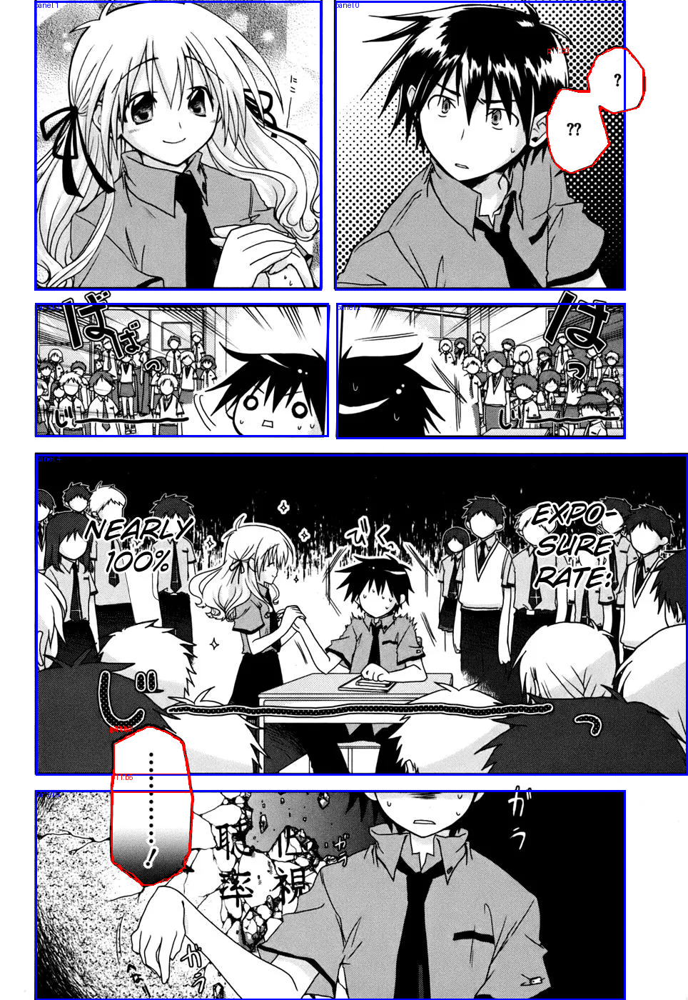
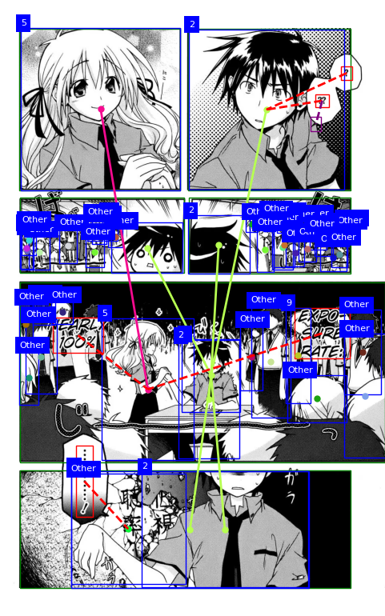
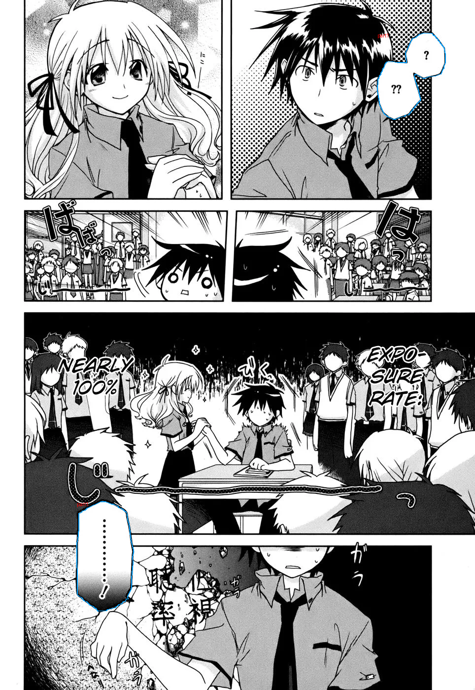

# Ví dụ thật theo pipeline v7

Nguồn: `20261023T102705Z-bfbb5d8e` · Iris Zero chapter 1 · trang 11.

Đây là dữ liệu upstream đã chạy, dùng để giải thích luồng dữ liệu. Chất lượng OCR/analyze có thể còn lỗi; các ảnh này không chứng minh chất lượng identity–relationship của batch mới.

Nguồn và SHA-256: [manifest.json](manifest.json). Dữ liệu đối chiếu: [page-evidence.json](page-evidence.json).

## Ảnh đầu vào nguyên bản.

## Overlay Koharu: panel và bubble.

## MAGI: character/text boxes và số nhân vật trong bank.

## Bubble geometry: nhóm bubble, hình học và vùng text.

## Từ ảnh đến dữ liệu ngữ nghĩa

1. `layout` xác định panel/bubble; `extract` phát hiện nhân vật, gắn MAGI bank ID và nhận OCR.
2. `bubble_geometry` gom vùng; `normalize` tạo utterance với nguồn bbox/text giữ nguyên để truy vết.
3. `scan` chia scene, lấy tên và span sửa tên; `analyze` suy luận speaker/addressee/mention_type theo batch.
4. `build_identity` gắn tên với MAGI bằng panel + crop + thoại, rồi tạo profile cho identity đủ điều kiện.
5. `relationship` dùng profile và giao tiếp trực tiếp để tạo quan hệ xã hội cùng hai chiều xưng hô độc lập.
6. `export` cố định snapshot; `inpaint` xóa chữ; `translate` dịch natural; `typeset` đặt chữ Việt.

## Review hai bước identity–relationship

Chạy `deployment/runpod/identity_review.py` với `--run-dir`, `--output`, `--source-folder`, `--bank-root`.
Kết quả: `build_identity.html`, `relationship.html`, `review.md`, `report.json`. HTML không cần model hoặc CDN.
Build identity có tên → MAGI, panel/crop bằng chứng, profile, lý do và trường hợp chưa phân giải. Relationship có mũi tên riêng từng chiều; bấm cạnh để xem xưng/gọi, lý do, thoại và ảnh.
Nếu chưa có identity hoặc chưa commit, trang hiển thị rõ trạng thái đó. JSON giữ ID để agent truy vết; giao diện dùng số MAGI.
