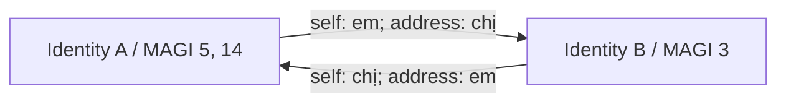

# Identity, profile và đồ thị quan hệ v7

[← Chỉ mục](../README.md)

## Stage 7 — build_identity

**Đặc tả thay đổi mới nhất:** [validator tạo identity giản lược](identity-validator-simplification.md)
quy định >=8 crop trong chapter và có tên model gắn cho character, không bắt model
trả bằng chứng crop/panel/reference. Đặc tả chưa triển khai; các đoạn sau mô tả
code/prototype trước khi giản lược.

Run mới bật `v6.identity_name_binding_policy=chapter-multimodal-name-binding-v1`.
Trước linking/profile, stage xác định tên theo từng nhóm từ scan, kết hợp text
toàn chapter, panel được gắn nhãn và crop bank. Analyze cung cấp mention_type;
không yêu cầu name owner đã confirmed. Một self introduction, narrator
introduction hoặc direct name call rõ có thể đủ xác nhận.

Mỗi occurrence có quyết định/evidence riêng. Candidates từ panel liên quan và
known names; off-panel chỉ fallback một resolved individual listener có MAGI ID
và mention_type direct_address. Bỏ người không có bank ID, occurrence thiếu hoặc
unknown mention_type; alias group nghi gộp nhầm bị treo, không tự tách.

Một group/request, chia theo occurrence nguyên vẹn trước POST nếu quá budget.
Mọi child chung queue cap8; code tổng hợp, giữ valid partial success, không LLM
reduce và không retry. Registry `name_groups_v1` là collection riêng trong
person registry, có version history; run giữ snapshot riêng. Nó lưu được nhóm
chưa có owner mà không biến nhóm đó thành person confirmed.

Identity mới làm frozen visual anchor ngay cùng run. Effective speaker/addressee
chỉ điền unknown cho export/translation, giữ analyze_original và provenance;
resolved analyze facts không bị ghi đè. Bootstrap có thể bổ sung direct pair
cho relationship khi cả người gọi và nhận được xác định rõ.

Chi tiết: [thiết kế bootstrap](../../archive/plans/identity-bootstrap-v7-design.md).
Artifacts riêng ở `07_build_identity/name-binding/`; marker thiếu/null ở manifest
lịch sử không tự bật hành vi mới.

Stage dùng semantic evidence đã merge và bank thị giác đóng băng để xây person
links. Nó bảo vệ identity có tên confirmed và giữ các tiêu chí confirmed-name
của semantic/person layer. Không sửa vector, metadata hay crop của MAGI bank.

Có hai nguồn hỗ trợ liên kết: tên/alias được xác nhận theo quy tắc hiện có và
visual link của member chưa có named identity vào một named identity đã tồn tại.
Trùng một chuỗi tên chưa được xác nhận không phải lệnh nhập mọi người trùng tên.
Semantic cannot-links tiếp tục có hiệu lực.

### Visual linking có neo chính

1. Chỉ xét target đã có identity confirmed có tên; không gộp hai cụm vô danh
   chỉ bằng visual threshold này.
2. Chọn main MAGI member của identity bằng `appearance_count` lớn nhất trên
   **toàn lịch sử bank**, với tie-break ổn định trong code.
3. Tính minimum L2 distance giữa các retained enabled crop vectors theo hợp
   đồng visual, với target giới hạn ở main member; phải **`min_crop < 0.38`**.
   Đây không phải khoảng cách trung bình giữa hai prototype centers.
4. Nhiều identity đạt điều kiện thì chọn minimum distance, không chọn người
   đầu tiên duyệt thấy.
5. Đóng băng target/main trong pass: secondary member và member vừa link không
   trở thành cầu nối lan truyền. Không chaining.
6. Member đã thuộc named identity không được chuyển sang identity có tên khác
   bằng visual linking. Conflict ngữ nghĩa được giữ và review.

Ngưỡng `<0.38` là nghiêm ngặt; bằng0.38 không đạt. Nó độc lập với hậu matching
bank0.55. Gộp identity không renumber các MAGI ID; các thành viên cùng identity
chia sẻ profile và quan hệ ở tầng person.

### Profile trước graph

Chỉ tạo/cập nhật profile cho named identity đủ điều kiện: ít nhất
`relationship_min_appearances=8` unique detections **trong chapter hiện tại**
qua các members, hoặc named identity đã có trong graph v2. Count của chapter
khác với lifetime count dùng chọn main MAGI.

Mỗi profile dùng tối đa **10** crop enabled, unique, gần production prototype
nhất của main member, cùng thoại của nhân vật và mô tả nhắc tên nhân vật. Các
crop được giữ/hash trong run để biết model đã nhìn đúng ảnh nào.

Thuộc tính gồm ngoại hình, nhóm tuổi/presentation suy đoán, tính cách,
formality, brevity, vai trò và hành vi giao tiếp. Không tạo trường thói quen
dùng từ hoặc sắc thái giọng nói. Ngoại hình là neo cho lựa chọn xưng hô tạm thời;
vai trò xã hội cần story evidence, không suy ra quan hệ gia đình từ nét vẽ.

Cập nhật ở chapter sau chỉ khi có thoại mới hoặc mô tả nhắc tên mới theo
fingerprint evidence. Thay crop/scene number đơn thuần không kích hoạt update.
Giá trị confirmed cũ được giữ nếu đề xuất mới mâu thuẫn; claim mới vào review.

## Stage 8 — relationship

### Candidate pair

Chỉ **giao tiếp trực tiếp** mới tạo candidate pair: speaker/addressee resolved từ
analyze hoặc communication evidence bổ sung đã xác nhận trong bootstrap. Nhắc
tên trong một câu không tự tạo edge. Hai MAGI cùng identity là cùng
person node; không gửi một relationship request giữa hai appearance của chính
người đó. Khi hiển thị theo MAGI, các members được giải về cùng identity.

Một request cho một unordered pair, dùng profiles, crop/evidence đã gắn nhãn và
thoại giao tiếp của pair. Response gồm social relations và **hai address edges
độc lập**. Một pair có thể có nhiều quan hệ xã hội.

### Hai lớp edge khác nhau

| Lớp | Trường chính | Ý nghĩa |
|---|---|---|
| Social relation | category, relationship, from/to, role_from/role_to, symmetric, status, evidence, reason | Quan hệ xã hội; có thể đối xứng hoặc bất đối xứng |
| Address edge | `from_id`, `to_id`, `self`, `address`, status, basis, evidence_refs, reason | Người nguồn tự xưng và gọi người đích thế nào |

Ví dụ minh họa, **không phải kết quả Iris Zero**:

Không lưu một cạnh hai chiều rồi đảo đại từ máy móc. Categories hỗ trợ:
`family`, `friendship`, `romance`, `school_work`, `authority`, `unknown`.
Named address term phải là tên/alias của **target**; đại từ phải bằng tiếng Việt.

### Chứng cứ và fallback

Lời thoại rõ hỗ trợ quyết định confirmed; suy đoán từ profile/tuổi ảnh là
provisional và giữ basis. Nếu profile anchors không đủ, giữ unknown. Không
bịa tuổi, giới tính hoặc vai trò để loại bỏ unknown.

Lỗi request không xóa graph tốt đã có. Kết quả confirmed cũ được giữ khi claim
mới xung đột. Trường hợp thiếu quyết định dùng prior v2 hợp lệ trước; nếu không
có thì dùng fallback appearance/profile có điều kiện, cuối cùng unknown.
Graph legacy không được dùng làm fallback tự động.

## Request, batch và failure policy

- Một request/profile create hoặc update; một request/communicating pair.
- Concurrency mỗi stage tối đa8, vẫn chịu runtime-wide slots.
- Tokenize multimodal messages trước POST; pack whole evidence segments, ưu
  tiên direct/named evidence, ghi omitted segments; giữ ảnh bắt buộc.
- Không provider recovery retry, scheduler OOM retry hay worker retry cho hai
  stage. OOM có thể hạ admission cho job sau, không enqueue lại job lỗi.
- Resume dùng completed valid decision; failed/uncertain không resend. Job chưa
  gửi có thể tiếp tục khi service hồi phục.
- Lỗi inference thành reviewable outcome và cho phép downstream tiếp tục;
  lỗi artifact/hash/provenance là lỗi integrity cần xử lý, không fallback giả.

## Persistence và review

`profiles-v2.json`, `relationships-v2.json` có history/version và atomic commit.
Run freeze plan, decisions, crops và snapshot hash. Translation chỉ đọc những
snapshot đã commit này, không xây graph trong từng batch dịch.

Review có graph Mermaid có hướng, social table, address table, evidence/reason
và lỗi/unknown. Nhãn người dùng là số MAGI; `person_id` là khóa máy. Với một
identity có nhiều MAGI, mọi relationship ở tầng identity được tái sử dụng cho
các appearance cùng identity, không model-infer lại mỗi cặp MAGI tương đương.

Nguồn mã: `identity_v2.py`, `identity_profiles.py`, `identity_runtime.py`,
`relationship_v2.py` trong `src/manga_pipeline/v6/`.
