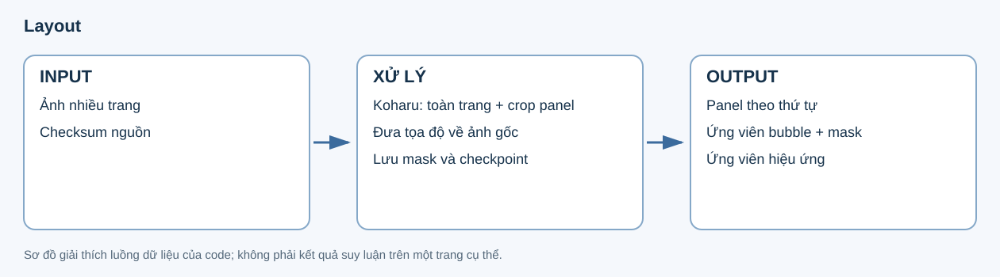
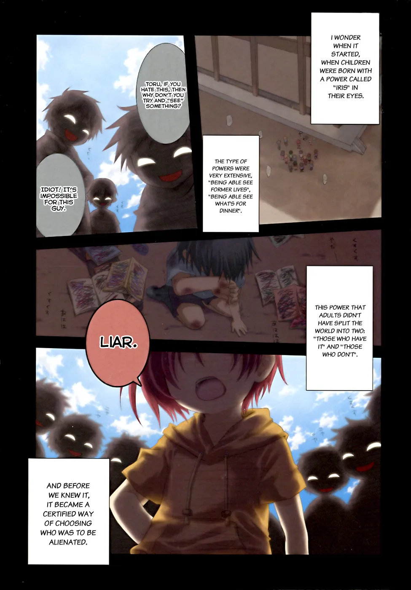
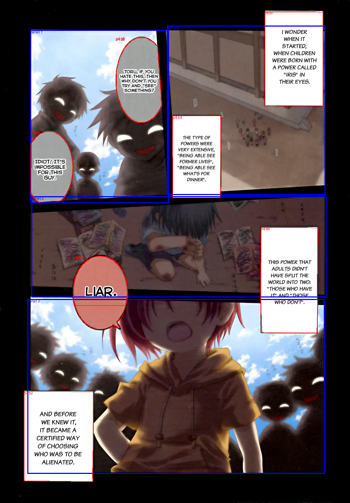
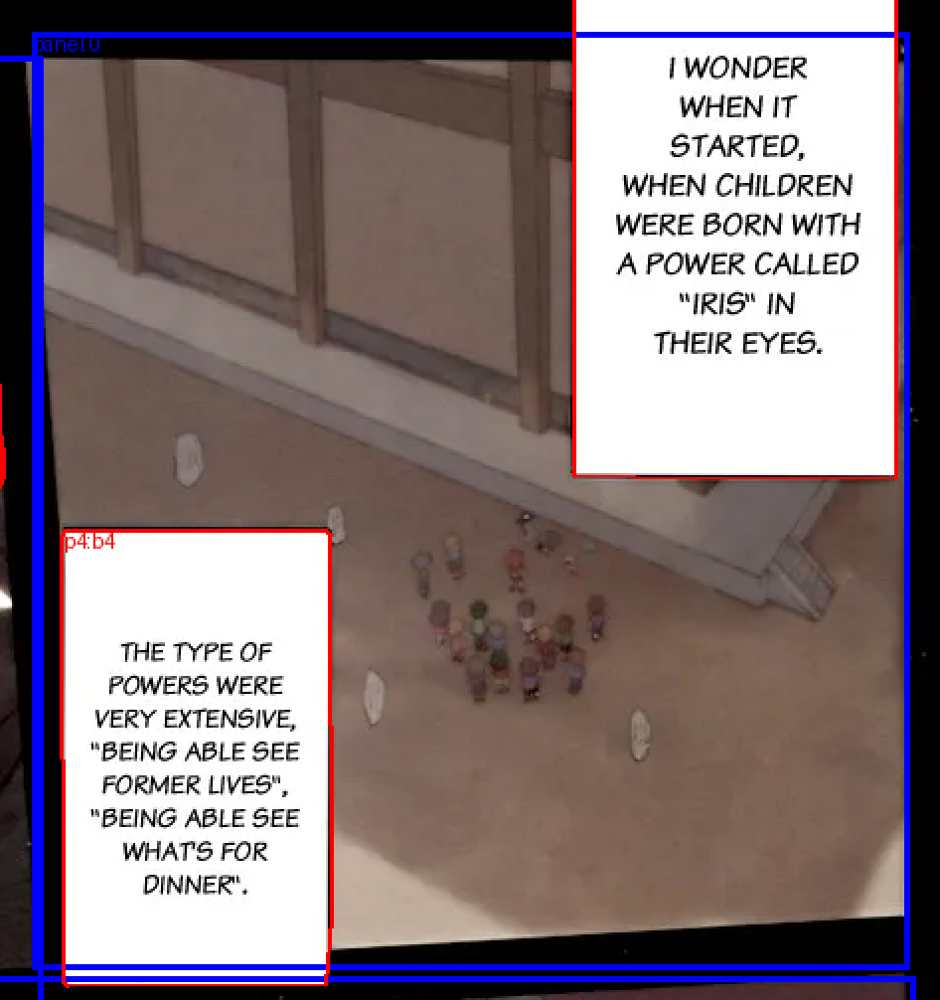
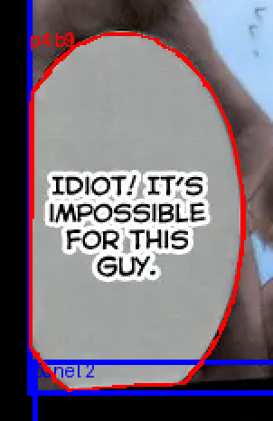
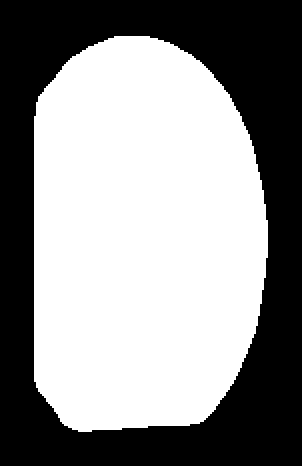
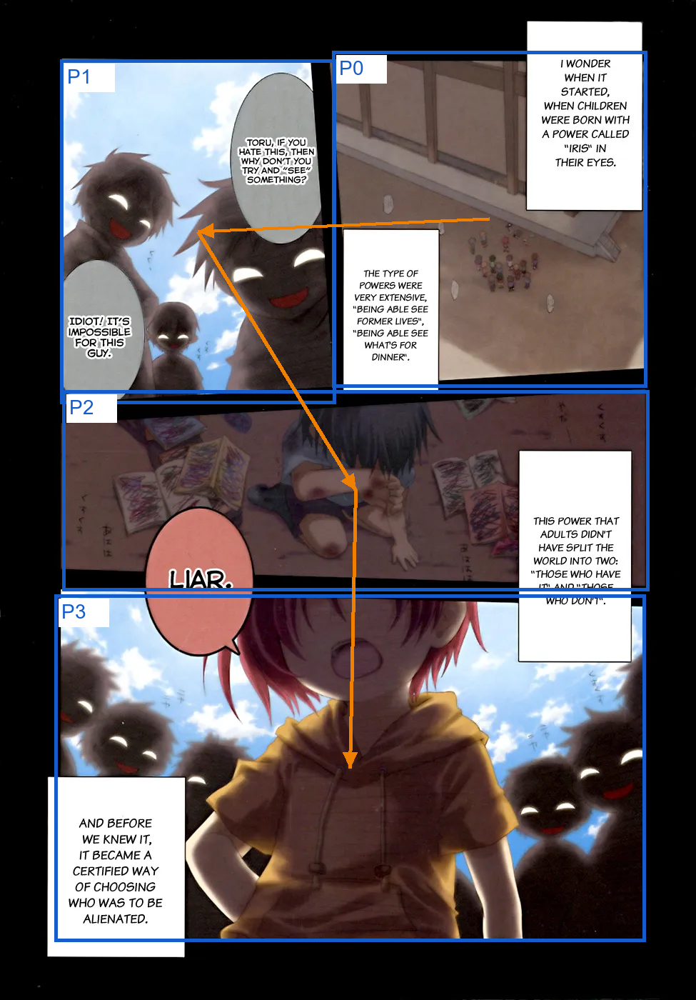
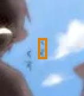

# 1. Layout — xác định bố cục trang

Layout tìm **panel, bubble và vùng có thể là chữ hiệu ứng** trên từng trang truyện. Mỗi bubble còn có mask để mô tả hình dạng của vùng được phát hiện. Các thành phần này được lưu bằng JSON và ảnh minh họa, làm dữ liệu hình học cho những stage tiếp theo.



Ví dụ xuyên suốt tài liệu là **trang 4 của Iris Zero chapter 1**, kích thước 975 × 1.400 pixel. Trang này có 4 panel, 10 ứng viên bubble và 3 ứng viên hiệu ứng trong artifact thực tế. [JSON đầy đủ của trang](../examples/layout/layout-page-04.json) và [nguồn/checksum các ảnh minh họa](../examples/layout/manifest.json) được lưu cùng tài liệu.

## Input và output

**Input:** danh sách ảnh của chapter theo thứ tự nguồn. Mỗi ảnh có đường dẫn và SHA-256 để nhận biết đúng phiên bản dữ liệu. Ví dụ này dùng `04.webp`.

**Output:** thông tin bố cục của từng trang trong `01_layout/result.json`, mask của các bubble trong `01_layout/masks/` và ảnh khoanh vùng trong `01_layout/overlays/`. Ảnh truyện gốc được giữ nguyên; ảnh output bên dưới là bản overlay để xem các phát hiện.

| Ảnh input | Ảnh output: bố cục được khoanh vùng |
|---|---|
|  |  |

Trong ảnh output, **khung xanh dương là panel**, **đường đỏ là contour bubble**. Nhãn `panel 0`, `panel 1`… là chỉ số panel; `p4:b1`, `p4:b2`… là ID bubble của trang 4.

## Quá trình xử lý

1. Kiểm tra checksum ảnh đầu vào; tái sử dụng checkpoint của trang nếu input và cấu hình khớp, đồng thời kiểm tra lại các file đã lưu.
2. Koharu chạy trên toàn trang để phát hiện panel, bubble và chữ hiệu ứng.
3. Code lấy thêm vùng crop quanh từng panel, có padding, để tìm bubble/hiệu ứng trên vùng nhỏ hơn. Các kết quả crop được đưa về tọa độ trang gốc.
4. Lọc trùng/sắp xếp panel và ứng viên hiệu ứng; gán các vùng phát hiện về panel theo diện tích giao nhau lớn nhất. Luồng hiện tại giữ danh sách ứng viên bubble từ các lượt phát hiện để bubble_geometry tiếp tục gom nhóm, thay vì coi chúng là các bubble độc lập đã chốt.
5. Lưu JSON, mask, overlay và checksum của các file. Khi một trang lỗi, lỗi được ghi vào `failures` để giữ lại thông tin của những trang đã xử lý được.

Model dùng trong ví dụ là `mayocream/koharu-layout-rfdetr-seg-2xl-1152`, revision `aed55fdb8ca953c6bec33cf6ed6dd52a9b72bfa2`. Tên policy lưu trữ `koharu-layout-v6.1` được giữ lại trong pipeline v7.

## Thông tin chung của một trang

Đây là các trường chung được trích từ `pages[]` của kết quả:

```json
{
  "page": 4,
  "source": {
    "path": "/opt/manga-work/runtime/data/input/iris-zero-chapter-001-v6/04.webp",
    "sha256": "93fa7fba194f167091a7d914c772b6784ea7acb7fce37e3c0b6ffb1bf456dfd4"
  },
  "width": 975,
  "height": 1400,
  "model_asset_sha256": "9bf6d2cbd7793c956d8c857bb1672a396eb7f100eb0682f86830d05e31168efb"
}
```

| Trường | Ý nghĩa |
|---|---|
| `page` | Số thứ tự trang trong danh sách input, bắt đầu từ 1. |
| `source.path` | Đường dẫn ảnh gốc đã được xử lý trên máy chạy pipeline. |
| `source.sha256` | Checksum ảnh gốc, dùng kiểm tra đúng nội dung ảnh khi tái sử dụng kết quả. |
| `width`, `height` | Chiều rộng và chiều cao của ảnh gốc, tính bằng pixel. |
| `model_asset_sha256` | Checksum file trọng số model dùng cho kết quả này. |

Các `bbox`, contour và mask được đưa về hệ tọa độ ảnh gốc; box từ một lượt crop không được giữ ở hệ tọa độ riêng của crop.

## Panel — khung truyện

Panel xác định một vùng khung truyện trên trang. Hình sau phóng to **panel 0**, ở góc trên bên phải của trang 4:



Phần tương ứng trong `pages[3].panels`:

```json
{
  "panels": [
    {
      "bbox": [465, 71, 906, 542],
      "confidence": 0.8418416976928711
    }
  ]
}
```

Đoạn trích chỉ hiển thị panel đầu tiên; trang này có tổng cộng 4 phần tử trong `panels`.

| Trường | Ý nghĩa |
|---|---|
| `panels` | Danh sách panel của trang, đã sắp thứ tự. |
| `bbox` | Tọa độ bbox của panel trên ảnh gốc. |
| `confidence` | Điểm phát hiện do detector trả về, trong khoảng 0–1. |

**Chỉ số panel bắt đầu từ 0.** Vì vậy `panel_index: 1` trong một bubble trỏ tới panel thứ hai của danh sách, không phải panel có nhãn `panel 0`.

## Bubble — vùng chứa lời thoại hoặc chữ

Bubble là vùng được detector nhận diện theo hình dạng. Artifact hiện tại lưu các **ứng viên bubble** từ lượt toàn trang và các crop; một vùng thực có thể có nhiều ứng viên trước khi bubble_geometry xử lý. Trong ví dụ, ứng viên đầu tiên có ID **`p4:b1`** và thuộc **panel 1**. Nó nằm ở một panel khác với panel 0 được phóng to ở trên.



Các trường chính của bubble này, trích từ `pages[3].bubbles[0]`:

```json
{
  "id": "p4:b1",
  "bbox": [85, 363, 204, 564],
  "confidence": 0.7460538148880005,
  "source_pass": "full_page",
  "crop_bbox": [0, 0, 975, 1400],
  "source_panel_index": null,
  "clipped_edges": [],
  "panel_index": 1,
  "mask_path": "01_layout/masks/page-4-bubble-1.png",
  "mask_sha256": "ed2e9d0cfc5a308a801121b82930d62aa4bef8c1594f3c1ee65520ffbf3b75f1"
}
```

| Trường | Ý nghĩa |
|---|---|
| `id` | ID bubble: `p4` là trang 4, `b1` là bubble thứ nhất trong danh sách của trang. |
| `bbox` | Tọa độ bbox của bubble trên ảnh gốc. |
| `confidence` | Điểm phát hiện bubble, trong khoảng 0–1. |
| `source_pass` | Lượt tạo ra phát hiện: `full_page` cho toàn trang hoặc `panel_crop` cho crop quanh panel. |
| `crop_bbox` | Vùng ảnh đã gửi cho lượt phát hiện, biểu diễn bằng tọa độ trang gốc. Ví dụ này dùng toàn trang. |
| `source_panel_index` | Panel được dùng để tạo crop nếu là lượt `panel_crop`; `null` ở lượt toàn trang. |
| `clipped_edges` | Những cạnh của vùng crop mà phát hiện chạm vào; danh sách rỗng trong ví dụ này. |
| `panel_index` | Panel được code gán cho bubble sau khi quy đổi và đối chiếu hình học. |
| `contour` | Danh sách điểm đường bao bubble, có trong JSON đầy đủ; overlay dùng các điểm này để vẽ đường đỏ. |
| `mask_path`, `mask_sha256` | Đường dẫn tương đối và checksum của ảnh mask tương ứng. |

`source_panel_index` mô tả **nguồn của lượt crop**, còn `panel_index` mô tả **kết quả gán panel**. Hai trường này có vai trò khác nhau.

Bubble ở stage layout chưa xác định người nói, người nghe hay loại lời nói `dialogue/thought/narration`. Nội dung chữ và các kết luận ngữ nghĩa được bổ sung ở những stage sau.

## Mask — hình dạng vùng bubble

Bbox chỉ bao vùng bằng hình chữ nhật; **mask cho biết pixel nào nằm trong vùng bubble được phát hiện**. Mask của layout có kích thước bằng ảnh trang gốc. Ảnh bên phải dưới đây là phần mask được crop và phóng to theo đúng bbox của `p4:b1`.

| Bubble trên trang | Mask của cùng bubble |
|---|---|
|  |  |

Màu trắng đánh dấu vùng thuộc bubble; màu đen là vùng nằm ngoài. Có thể mở [mask toàn trang](../examples/layout/bubble-mask-full.png) để thấy vị trí của nó trong hệ tọa độ trang.

Thông tin liên kết giữa bubble và file mask:

```json
{
  "mask_path": "01_layout/masks/page-4-bubble-1.png",
  "mask_sha256": "ed2e9d0cfc5a308a801121b82930d62aa4bef8c1594f3c1ee65520ffbf3b75f1"
}
```

`mask_path` được tính tương đối từ thư mục run. Bảng `pages[].files` còn ghi đường dẫn và checksum của tất cả mask/overlay đã lưu cho trang đó. Stage sau có thể kiểm tra nội dung file trước khi tái sử dụng.

Mask layout là đầu vào hình học cho bubble_geometry; nó chưa phải mask xóa chữ cuối cùng của inpaint.

## Reading order — thứ tự hình học

Các panel được sắp **từ trên xuống dưới, trong cùng hàng từ phải sang trái**. Code nhóm các box có vị trí mép trên đủ gần nhau thành hàng rồi sắp theo chiều ngang.

Trong ví dụ trang 4, thứ tự panel là **P0 → P1 → P2 → P3**. Mũi tên màu cam dưới đây được dựng từ thứ tự phần tử của mảng `panels`, không phải một dự đoán mới từ model:



```json
{
  "panels": [
    {"bbox": [465, 71, 906, 542], "confidence": 0.8418416976928711},
    {"bbox": [84, 83, 470, 565], "confidence": 0.9004430770874023},
    {"bbox": [87, 546, 909, 827], "confidence": 0.8268970847129822},
    {"bbox": [76, 832, 904, 1318], "confidence": 0.7895426750183105}
  ]
}
```

Artifact layout **không có một trường `reading_order` riêng cho panel**: thứ tự nằm ở vị trí phần tử trong mảng. Riêng `bubbles` đang lưu danh sách ứng viên theo lượt thu thập; ID `b1`, `b2`… không xác định thứ tự đọc thoại. Thứ tự chữ/utterance được extract và normalize xử lý tiếp.

Code thực hiện quy tắc: [`ordered_boxes`](../../../src/manga_pipeline/visual/geometry.py).

## Ứng viên chữ hiệu ứng

`effects_candidates` chứa các vùng detector cho là có thể có chữ hiệu ứng/onomatopoeia. Trang 4 có 3 ứng viên; vùng đầu tiên rất nhỏ, được khoanh màu cam trong ảnh zoom sau:



```json
{
  "effects_candidates": [
    {
      "bbox": [286, 477, 293, 494],
      "confidence": 0.459611177444458,
      "source_pass": "panel_crop",
      "crop_bbox": [60, 59, 494, 589],
      "source_panel_index": 1,
      "clipped_edges": [],
      "panel_index": 1
    }
  ]
}
```

Các trường hình học và nguồn crop có cùng ý nghĩa như ở bubble. Đây là **ứng viên**, chưa phải một effect đã có text hoặc bản dịch. Code dùng ngưỡng phát hiện nhóm này theo cấu hình bubble; không có một `effect_threshold` riêng trong cấu hình layout hiện tại.

## Cấu hình có thể thay đổi

| Cấu hình | Giá trị trong artifact ví dụ | Tác dụng |
|---|---|---|
| `layout.enabled` | `true` | Bật stage bố cục. |
| `layout.model`, `layout.revision` | Koharu và revision nêu ở trên | Chọn đúng model/phiên bản trọng số. |
| `layout.panel_threshold` | `0.5` | Ngưỡng giữ phát hiện panel. |
| `layout.bubble_threshold` | `0.45` | Ngưỡng giữ phát hiện bubble/ứng viên hiệu ứng. |
| `layout.crop_padding` | `24` pixel | Mở rộng vùng crop quanh panel cho lượt phát hiện bổ sung. |
| `layout.mapping_coverage` | `0.8` | Tham số nằm trong section layout nhưng được bubble_geometry dùng để gán text với vùng bubble. |
| `layout.mapping_margin` | `0.15` | Chênh lệch cần có khi bubble_geometry chọn một bubble thay vì ứng viên cạnh tranh. |
| `layout.device` | `auto` | Thiết bị dùng cho detector. |

Giá trị cột giữa lấy từ cấu hình đã lưu trong kết quả ví dụ; cấu hình run mới được đọc từ file pipeline tương ứng. [Bảng cấu hình tổng thể](../configuration.md) giải thích các stage khác.

## Dữ liệu chuyển tới các bước sau

| Dữ liệu từ layout | Bước dùng tiếp và mục đích |
|---|---|
| Panel và thứ tự của chúng | Extract dùng bố cục khi nối kết text với vùng trang; normalize xác định panel chính và các panel liên quan của utterance. |
| Bbox, contour, mask của bubble | Bubble_geometry đối chiếu với text đã extract và hoàn thiện vùng hình học. |
| Ứng viên hiệu ứng | Bubble_geometry giữ dữ kiện để xử lý hình học/effect; các bước sau tiếp tục đối chiếu nội dung. |
| Tọa độ gốc và thông tin source | Analyze dựng vùng ảnh theo event; các stage cần ảnh có thể đối chiếu đúng trang và checksum. |
| File và checksum | Checkpoint/review kiểm tra lại dữ liệu đã lưu trước khi dùng lại. |

Sau layout, pipeline đã biết **trang có những vùng nào, hình dạng và vị trí của chúng, cùng thứ tự hình học ban đầu**. Bước extract được trình bày trong hai phần: [MAGIv2 extract](02,1_extract_magiv_extract.md) bổ sung detection, cluster, OCR và liên kết text–character/text–tail; [extract bank](02,2_extract_bank.md) gán ID thị giác bền vững. [Bubble_geometry](03_bubble_geometry.md) kết hợp layout và extract để chuẩn bị dữ liệu cho normalize.

## Dựng lại ảnh trong tài liệu

Chạy từ gốc repository, dùng artifact đã có; lệnh này chỉ tạo ảnh/JSON minh họa local:

```powershell
venv/Scripts/python.exe -B scripts/build_v7_layout_examples.py --run-dir "outputs/runpod-iris-zero-ch1-graph-v7-l40s-20261026-r4/live/outputs/iris-zero/chapter-001/20261026T101458Z-e586087e" --source-folder "D:/download/EN-data/Iris Zero/EN/Chapter 1" --output "docs/v7/examples/layout" --page 4
```

Script kiểm tra checksum ảnh nguồn, overlay và mask trước khi tạo minh họa. [Manifest ảnh](../examples/layout/manifest.json) ghi checksum artifact, model, script và từng file output. Code xử lý stage: [Koharu](../../../src/manga_pipeline/visual/koharu.py), [lưu checkpoint và artifact](../../../src/manga_pipeline/visual/stages.py). [Script dựng ví dụ](../../../scripts/build_v7_layout_examples.py) không gọi model.
