# 2.1. Extract — MAGIv2: detection, cluster, OCR và association

## Input

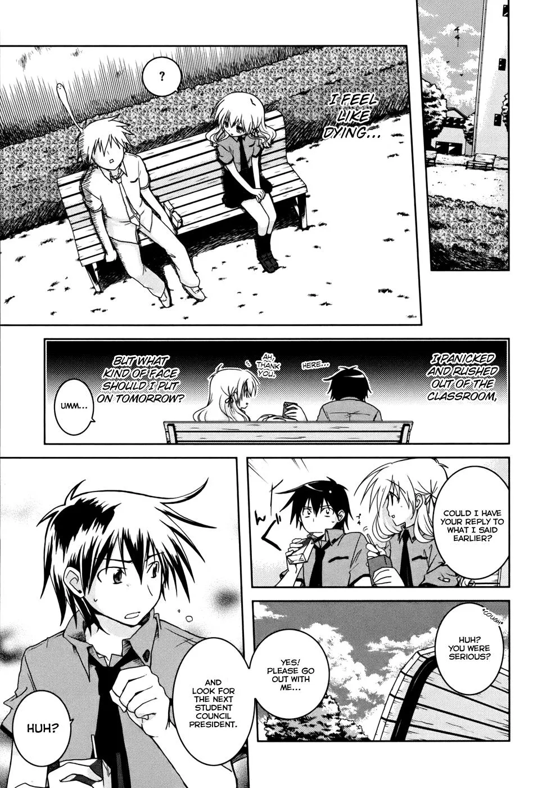

Ảnh gốc **trang 12 Iris Zero chapter 1**, kích thước **964 × 1400 pixel**. Ví dụ dùng extract lịch sử được import vào run graph r4; ảnh minh họa dựng lại từ tọa độ và liên kết đã lưu, không chạy lại model.

| Input | Dữ liệu đưa vào |
|---|---|
| Ảnh chapter | Các trang đã kiểm checksum, giữ thứ tự nguồn; worker chuyển ảnh sang grayscale rồi RGB. |
| Layout đã commit | Panel Koharu trên từng trang, cùng hệ tọa độ ảnh gốc. |
| MAGIv2 | `ragavsachdeva/magiv2`, revision `fbc890fec52977142e8ee00bfe26e9458b65517c`. |
| OCR riêng | `zai-org/GLM-OCR`, revision `2e85a62840ccac27daa451df36c736c4636b8628`; MAGI gọi với `do_ocr=False`. |
| Bank | Assigner bền vững của pipeline nhận embedding/cluster trong lượt MAGI; phần này trình bày ở [2.2 — extract bank](02,2_extract_bank.md). |

## Output

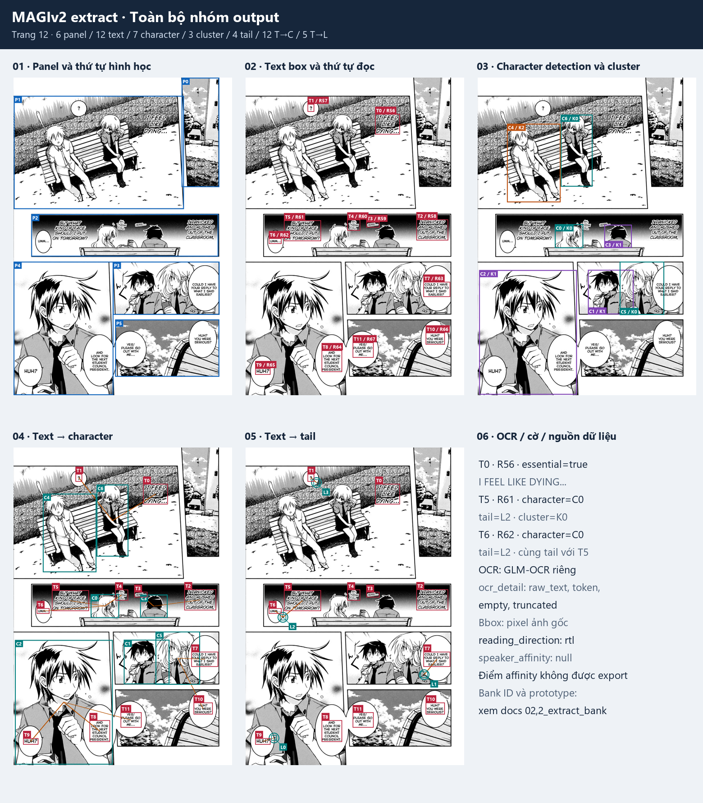

Trang này có **6 panel, 12 text box, 7 character detection, 3 cluster, 4 tail**, cùng **12 cặp text–character** và **5 cặp text–tail**. Overview tách từng lớp để nhìn thấy output; các ảnh chi tiết bên dưới có kích thước lớn hơn. Đường cam biểu diễn cặp chỉ số đã lưu, không phải đường đi hình học của tail.

| Output | Trường trong `02_extract/result.json` | Phần minh họa/giải thích |
|---|---|---|
| Trang và panel | `pages[].id`, `page`, `image_path`, `width`, `height`, `panels` | 1. Panel và tọa độ |
| Text box, thứ tự đọc | `texts[].id`, `page_id`, `text_index`, `reading_order`, `bbox`, `panel_index` | 2. Text và OCR |
| Chữ OCR và phân loại text | `text`, `is_essential_text`, `ocr_detail`; cấp document có `ocr`, `ocr_review` | 2. Text và OCR |
| Character detection | `pages[].characters` | 3. Character và cluster |
| Cluster trong trang | `pages[].character_cluster_labels`, `texts[].speaker_cluster_id` | 3. Character và cluster |
| Text–character | `pages[].text_character_associations`, `texts[].character_detection_index` | 4. Liên kết text–character |
| Tail và text–tail | `pages[].tails`, `text_tail_associations`, `texts[].tail_index` | 5. Tail và liên kết text–tail |
| ID/nhãn/trạng thái bank | `character_ids`, `character_display_labels`; `speaker_id`, `speaker_display_label`, `speaker_status` | [Doc bank](02,2_extract_bank.md) |
| Nguồn liên kết, affinity | `association_source`, `speaker_affinity`, `speaker_affinity_source` | 6. Nguồn và giới hạn export |
| Metadata document | `schema_version`, `kind`, `document_id`, `story_id`, `chapter_id`, `reading_direction`, `reading_order_source`, `model_fingerprint`, `device`, `panel_source` | 6. Nguồn và giới hạn export |
| File phụ của worker | Transcript, visualization nếu bật, receipt phục hồi | 6. File và nguồn dữ liệu |

[JSON nguồn cho các trang minh họa](../examples/extract/magiv-pages.json) giữ nguyên các trường trên. Panel trong result đến từ **Koharu**; chữ đến từ **GLM-OCR**; bank ID đến từ **assigner của pipeline**. Cần phân biệt nguồn này với detection, cluster, essential flag và association của MAGIv2.

## 1. Panel và tọa độ

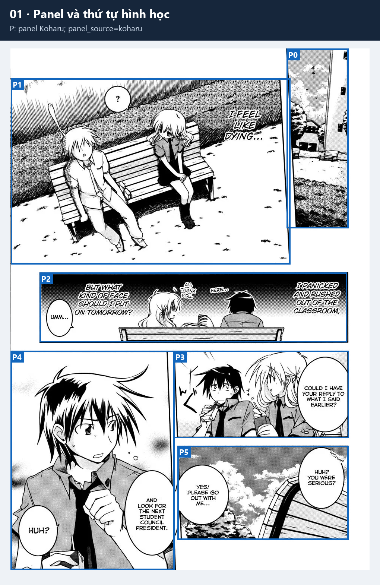

`pages[].panels` giữ sáu bbox từ layout. `P0`…`P5` là chỉ số trong mảng này. Tọa độ bbox có dạng `[x1, y1, x2, y2]`, tính bằng pixel trên ảnh gốc; trang đánh số từ 1, các chỉ số panel/text/character/tail bắt đầu từ 0.

Extract gán `texts[].panel_index` theo panel phủ diện tích text box lớn nhất; nếu không giao panel nào thì để `null`. Metadata ghi `panel_source="koharu"`, `reading_direction="rtl"`, `reading_order_source="magi_text_sort_with_koharu_panels"`. Đây là thứ tự upstream, còn graph sẽ tổ chức scene/event ở bước sau.

## 2. Text box, chữ OCR và cờ essential

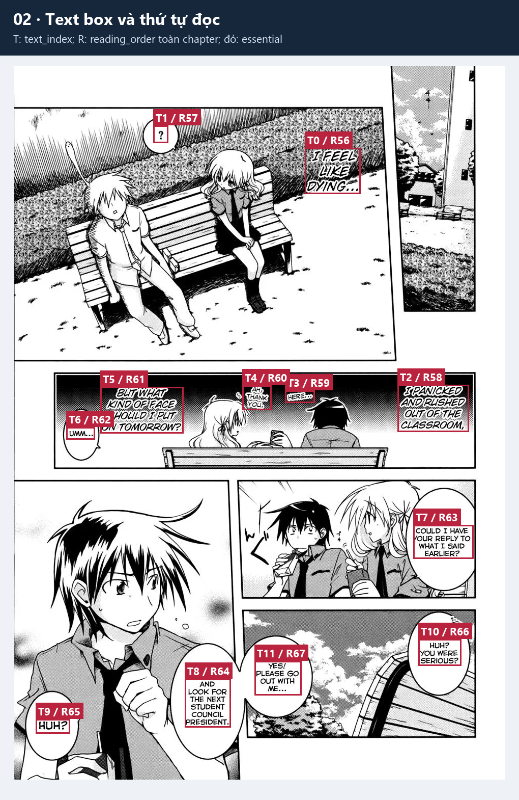

Nhãn `T5 / R61` nghĩa là **text index 5 trong trang 12**, ở vị trí **61 trong thứ tự đọc toàn chapter**. Không dùng `texts[5]` của toàn document để tra text số 5 của trang này: phải tìm bằng `page_id` và `text_index`, hoặc source text ID.

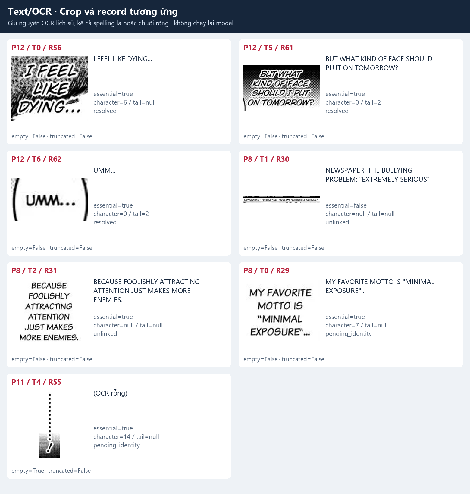

Ảnh ghép cho thấy cả output bình thường và các trường hợp thiếu dữ liệu. Chữ OCR được giữ nguyên, kể cả `PLUT`, `IPANICKED` hay chuỗi rỗng; đây là artifact thật, chưa phải bản đã sửa OCR ở graph.

| Trường | Ý nghĩa |
|---|---|
| `id`, `page_id`, `page`, `text_index` | ID text, trang nguồn và chỉ số cục bộ; ID có dạng `<document>:p12:t5`. |
| `bbox`, `panel_index` | Vùng text trên ảnh gốc và panel nhận text. |
| `reading_order` | Thứ tự liên tục toàn chapter, bắt đầu từ 0. |
| `text` | Chữ nhận được từ worker OCR. |
| `is_essential_text` | Kết quả phân loại của MAGI; không phải điều kiện xóa box khỏi raw document. |
| `ocr_detail.raw_text`, `text` | Output OCR thô và text sau xử lý của worker; cả hai được giữ để truy vết. |
| `ocr_detail.output_tokens`, `empty`, `truncated` | Số token output và cờ rỗng/bị cắt. |
| `ocr_review` | Danh sách cấp document cho các text OCR rỗng hoặc bị cắt; có thể chứa cả trang không được chọn minh họa. |

Ví dụ `P8/T1` là dòng báo có `is_essential_text=false` nhưng vẫn có text/bbox trong raw. `P8/T2` có chữ và essential=true, nhưng không link character. `P11/T4` có box và association character dù OCR thành chuỗi rỗng. Ba tình huống này cần được biểu diễn riêng.

## 3. Character detection và phân cụm trong trang

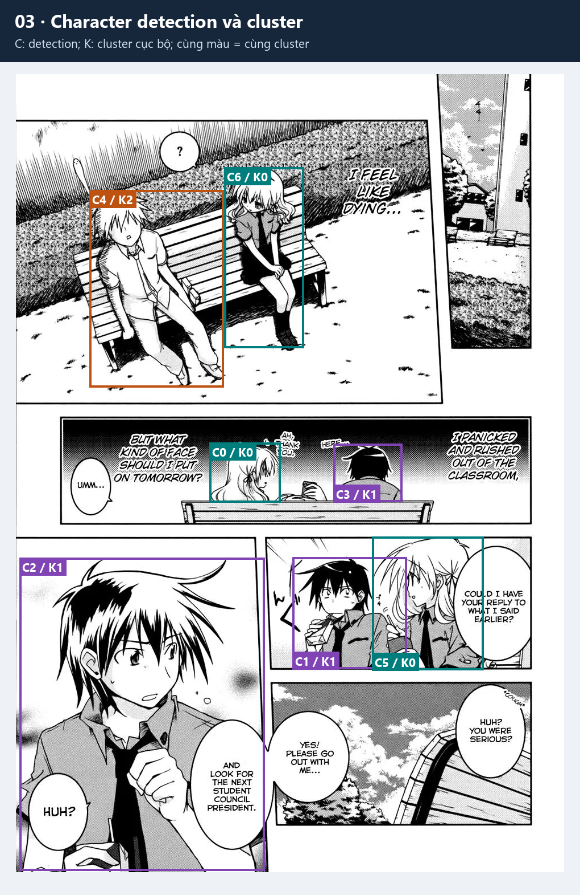

`C0`…`C6` là các phần tử của `pages[].characters`. Mỗi phần tử là **một lần phát hiện trên ảnh**; một người xuất hiện ở nhiều panel có thể có nhiều bbox.

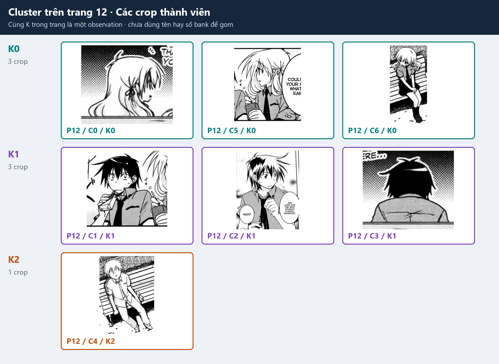

`character_cluster_labels[i]` là label cluster của detection `characters[i]`. MAGI đã phân cụm trước khi assigner đối chiếu bank. Trên trang 12:

| Cluster | Detection thành viên | Output |
|---|---|---|
| `K0` | `C0`, `C5`, `C6` | Ba crop được gom cùng observation. |
| `K1` | `C1`, `C2`, `C3` | Ba crop, gồm cả góc sau đầu. |
| `K2` | `C4` | Một detection đơn; vẫn là cluster hợp lệ. |

Cluster chỉ có ý nghĩa **trong trang**. `K0` ở trang 12 không mặc nhiên là `K0` ở trang 13. Khi export cho text, pipeline đặt namespace đầy đủ, ví dụ `speaker_cluster_id="b68ed9e490d577e6:p12:c0"`. Đối chiếu bền vững qua trang và các vector crop nằm trong [phần bank](02,2_extract_bank.md).

## 4. Liên kết text–character

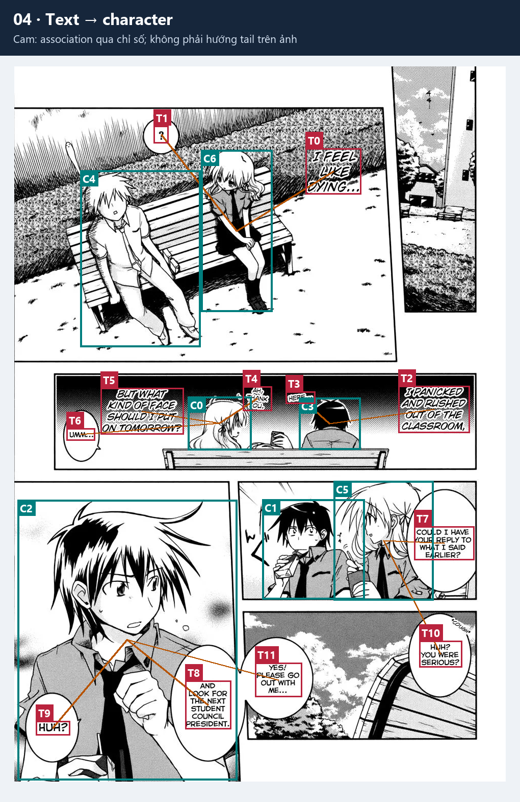

`pages[].text_character_associations` chứa các cặp **`[text_index, character_detection_index]`**. Một text có tối đa một character link trong schema export; nhiều text có thể link cùng detection. Chỉ số đều thuộc cùng trang.

Ví dụ trang 12 có `[5, 0]` và `[6, 0]`: `T5` và `T6` cùng link `C0`. Text record nhận `character_detection_index=0`, rồi tra `character_cluster_labels[0]=0` để tạo cluster ID. Bank ID và nhãn được bổ sung từ assigner; nội dung câu OCR không quyết định phép nối này.

Export kiểm chỉ số nằm trong mảng và không có hai cặp character cho cùng text. Nếu không có cặp liên kết, `character_detection_index`, `speaker_cluster_id`, `speaker_id` đều `null`, trạng thái là `unlinked`. Trường `association_source` vẫn chỉ nguồn của cơ chế export; riêng tên trường này không chứng minh text có link.

## 5. Tail detection và liên kết text–tail

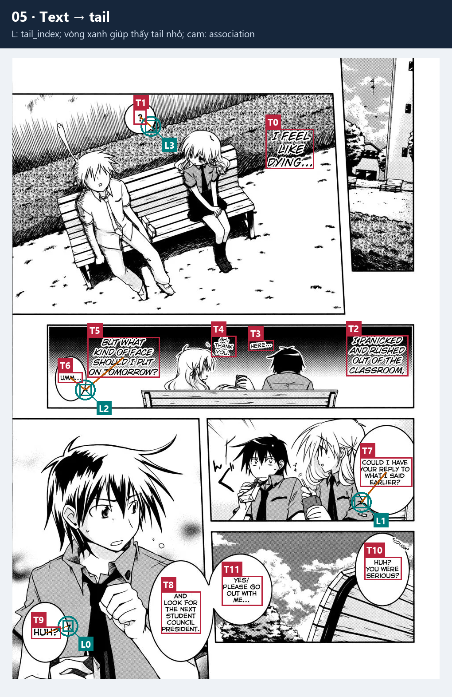

`pages[].tails` chứa bbox **đuôi bubble** MAGI phát hiện. `L2` trên ảnh nghĩa là `tail_index=2`. Vòng xanh giúp tìm các bbox nhỏ; đường cam nối text với tail để đọc association, không biểu diễn một vector hướng tới nhân vật.

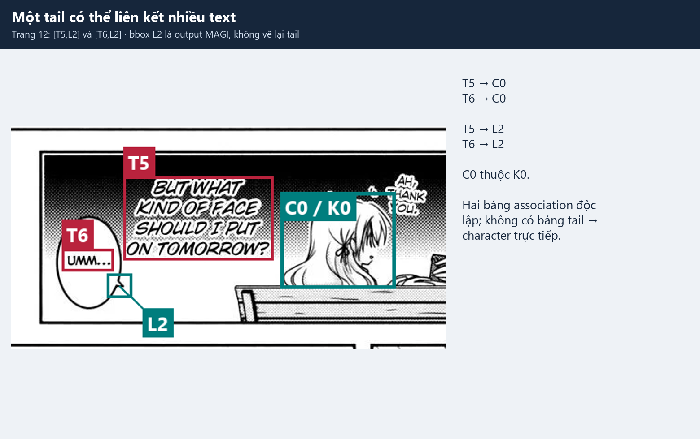

`text_tail_associations` chứa cặp **`[text_index, tail_index]`**, độc lập với bảng text–character. Trang 12 có:

| Text | Character link | Tail link | Ý nghĩa |
|---|---|---|---|
| `T0` | `[0, 6]` | Không có | Có character, `tail_index=null`. |
| `T1` | `[1, 6]` | `[1, 3]` | Character `C6`, tail `L3`. |
| `T5` | `[5, 0]` | `[5, 2]` | Character `C0`, tail `L2`. |
| `T6` | `[6, 0]` | `[6, 2]` | Dùng chung tail `L2` với `T5`. |
| `T7` | `[7, 5]` | `[7, 1]` | Character `C5`, tail `L1`. |
| `T9` | `[9, 2]` | `[9, 0]` | Character `C2`, tail `L0`. |

Export cho mỗi text tối đa một tail link, cho phép nhiều text dùng cùng tail. Một text có thể có cả hai loại association, chỉ một loại hoặc không có loại nào. `tail_index=null` nói rằng không có link được xuất; không kết luận ảnh không có đuôi bubble.

Extract không xuất bảng **tail–character trực tiếp**, đỉnh tail hay đường từ tail tới người. Có thể tra hai liên kết qua cùng text, ví dụ `T5 → L2` và `T5 → C0`. Tail MAGI cũng khác group/part/bridge được dựng ở bubble_geometry; không thay thế association bằng khoảng cách bbox hay hình dạng bridge.

## 6. Record tổng thể, file và nguồn dữ liệu

Trích record `P12/T5` thật; bbox/OCR/ID không phải dữ liệu minh họa tự đặt:

```json
{
  "id": "b68ed9e490d577e6:p12:t5",
  "page_id": "b68ed9e490d577e6:p12",
  "page": 12,
  "text_index": 5,
  "reading_order": 61,
  "text": "BUT WHAT KIND OF FACE SHOULD I PLUT ON TOMORROW?",
  "bbox": [169.0313262939453, 629.9320678710938, 332.64996337890625, 720.83642578125],
  "panel_index": 2,
  "character_detection_index": 0,
  "speaker_cluster_id": "b68ed9e490d577e6:p12:c0",
  "speaker_id": 5,
  "speaker_display_label": "5",
  "speaker_status": "resolved",
  "tail_index": 2,
  "is_essential_text": true,
  "speaker_affinity": null,
  "speaker_affinity_source": "not_exposed_by_magi_prediction",
  "association_source": "magi_text_character_associations",
  "ocr_detail": {
    "raw_text": "BUT WHAT KIND OF FACE SHOULD I PLUT ON TOMORROW?",
    "text": "BUT WHAT KIND OF FACE SHOULD I PLUT ON TOMORROW?",
    "output_tokens": 21,
    "truncated": false,
    "empty": false
  }
}
```

`speaker_affinity=null` với nguồn `not_exposed_by_magi_prediction` nghĩa là prediction không xuất điểm affinity; không diễn giải thành confidence bằng 0. Raw document cũng không chứa embedding crop, ma trận matching score hay mask segmentation character/tail. Vector đã chọn được lưu trong bank; mask bubble nằm ở layout/bubble_geometry.

| File / metadata | Nội dung |
|---|---|
| `02_extract/result.json` | `schema_version=1`, `kind=magi_raw`, các ID document/story/chapter, `pages`, `texts`, fingerprint model, `device`, nguồn panel/thứ tự đọc và cấu hình OCR. |
| `02_extract/transcript.txt` | Chỉ text essential, kèm nhãn bank hoặc `Other`; không thay thế raw đầy đủ. |
| `02_extract/visualizations/page_<n>.png` | Overlay của worker nếu bật `visualizations`; bộ ảnh docs này vẽ riêng từng lớp từ result. |
| `02_extract/worker_commit.json` | Output và hash, cùng hash transcript, cho phép phục hồi worker mà không gọi MAGI lần nữa. |
| Bank và snapshot | Trình bày ở [2.2 — extract bank](02,2_extract_bank.md). |

### Cấu hình liên quan

| Key | Config Runpod hiện hành | Vai trò |
|---|---|---|
| `character_detection_threshold` | `0.3` | Detection nhân vật. |
| `text_detection_threshold` | `0.45` | Detection text. |
| `character_character_matching_threshold` | `0.81` | Matching/phân cụm MAGI; khác distance bank. |
| `text_character_matching_threshold` | `0.25` | Matching text–character. |
| `text_classification_threshold` | `-0.5` | Phân loại essential text. |
| `ocr.batch_size`, `ocr.max_new_tokens` | `8`, `2048` | Batch và giới hạn output worker OCR riêng. |

Wrapper hiện không có key riêng cho ngưỡng text–tail. Config hiện hành không được dùng để sửa contract hay kết quả của artifact lịch sử.

Nguồn: [worker](../../../src/manga_pipeline/extraction/magi.py), [raw schema và kiểm association](../../../src/manga_pipeline/extraction/document.py), [patch ngưỡng MAGI](../../../src/manga_pipeline/bank/assignment.py), [manifest/checksum ảnh docs](../examples/extract/manifest.json), [script dựng ảnh](../../../scripts/build_v7_extract_examples.py).

## Tổng hợp bước MAGIv2 extract

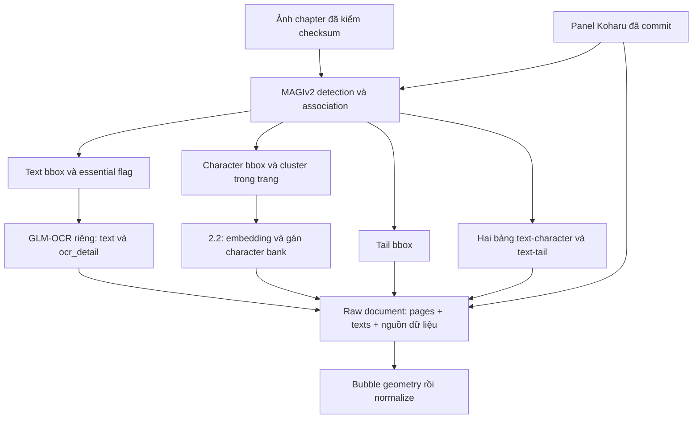

## Kết luận

Phần MAGIv2 extract cung cấp vùng text/character/tail, cluster và hai loại liên kết nguồn; GLM-OCR bổ sung chữ cho text box. Bộ output giữ được cả dữ kiện thiếu hoặc chưa link để truy ngược ảnh. Bước [extract bank](02,2_extract_bank.md) chuyển bằng chứng thị giác của cluster thành ID bền vững; speaker/listener theo ngữ cảnh được quyết định ở các stage semantic sau.
