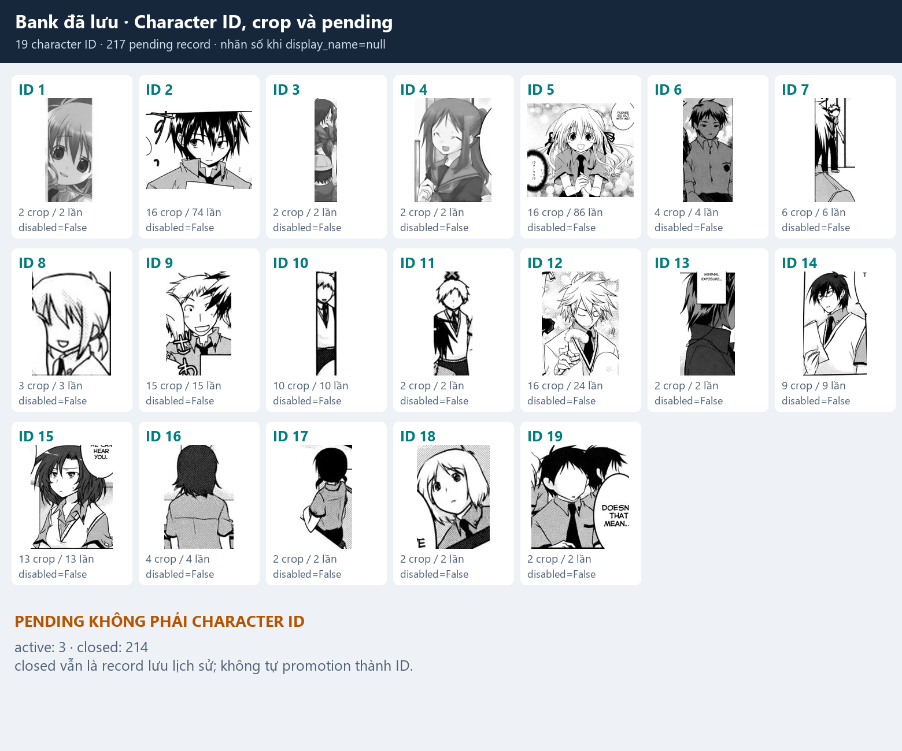
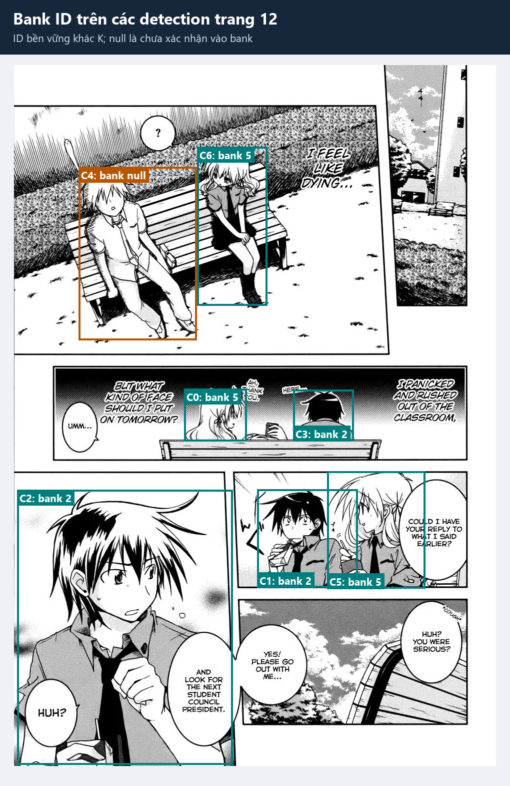
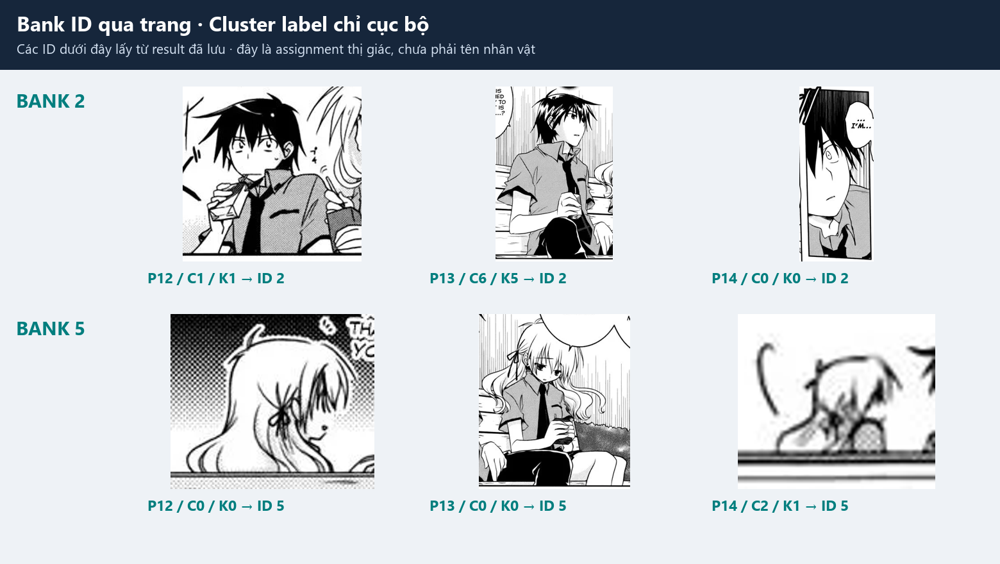
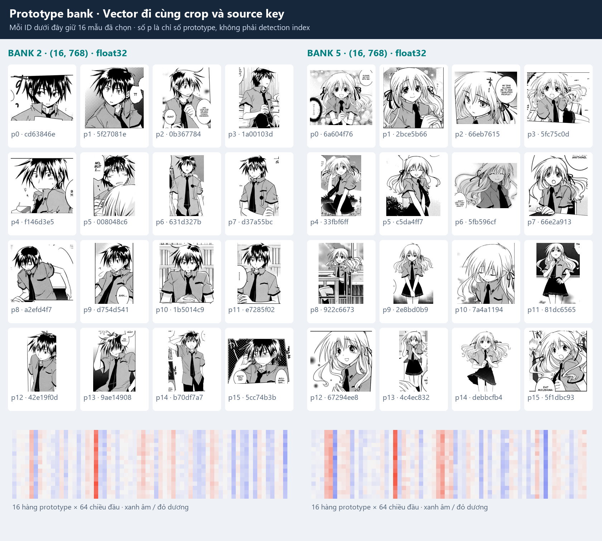
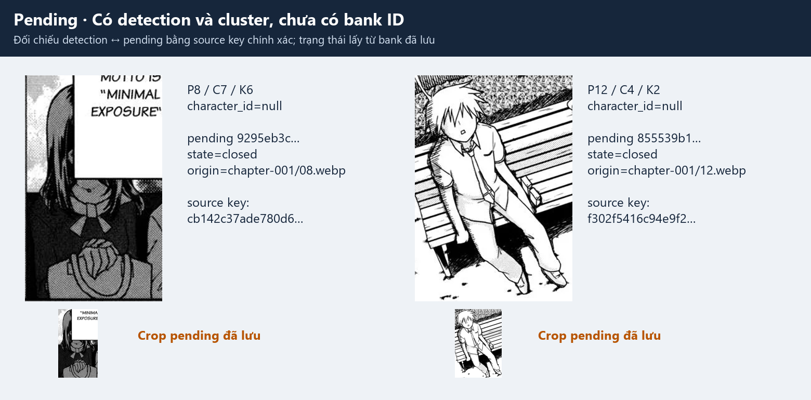
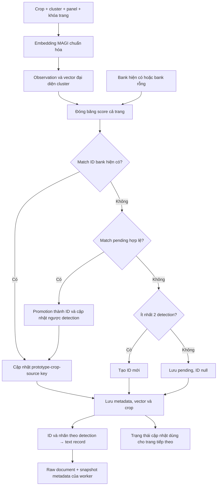

# 2.2. Extract — tạo, đối chiếu và lưu character bank

## Input


Input trực tiếp là các **character bbox, cluster label và crop ảnh** từ [phần MAGIv2 extract](02,1_extract_magiv_extract.md). Trên trang 12, `K0` có `C0/C5/C6`, `K1` có `C1/C2/C3`, `K2` có `C4`.

| Input | Dữ liệu dùng khi gán bank |
|---|---|
| Ảnh và character bbox | MAGI tính embedding cho từng crop; embedding được chuẩn hóa L2. |
| Cluster trong từng trang | Gom detection có cùng label thành một observation: các vector/crop, detection index và panel chứa detection. |
| Thứ tự và khóa trang | `chapter-001/12.webp`…; dùng theo dõi appearance, source key và khoảng cách pending. |
| Bank hiện có hoặc bank rỗng | Prototype/ID đang hoạt động, pending, nhãn hiển thị, trạng thái disable và config. |
| Tương thích | Fingerprint model embedding, schema bank và fingerprint hình học Koharu. |

Ảnh đầu vào không chứa tên thật được gán sẵn. Assigner sử dụng embedding MAGI, không dùng tên mà OCR đọc được để cấp ID.

## Output



Bank local cùng batch graph r4 có **19 character ID**, **217 pending record**, gồm **3 active / 214 closed**. Mỗi ô trên là một ID và crop đầu tiên trong record đã lưu; số lần là `appearance_count`. Đây là trạng thái bank đã lưu của batch, không phải một ảnh chụp bank ngay trước trang 12 hay một phép chạy lại để tạo before/after.



| Output | Nơi lưu | Ví dụ thật |
|---|---|---|
| ID cho từng detection | `pages[].character_ids` trong result | `[5, 2, 2, 2, null, 5, 5]` trên trang 12. |
| Nhãn hiển thị | `character_display_labels` | `["5", "2", "2", "2", "Other", "5", "5"]`. |
| ID/nhãn/trạng thái của text | `texts[].speaker_id`, `speaker_display_label`, `speaker_status` | `T5 → C0 → bank 5`, trạng thái `resolved`. |
| Character/pending metadata | `<bank>/metadata.json` | ID, config, crop/prototype mapping, appearance, trạng thái. |
| Embedding đã chọn | `<bank>/embeddings/vectors.npz` | `character_2` và `character_5` đều có shape `[16, 768]`, dtype `float32` trong bank này. |
| Crop đã lưu | `<bank>/crops/` | Crop đi cùng prototype hoặc pending. |
| Snapshot khi worker extract chạy | `<run>/snapshots/after_extract_bank.json` | Snapshot metadata; không gồm vector/crop. Run r4 minh họa import upstream nên không có snapshot này tại run đích. |

[JSON bank minh họa](../examples/extract/bank-example.json) chứa record đầy đủ của ID 2/5, pending được đối chiếu chính xác và shape các mảng embedding. [Manifest](../examples/extract/manifest.json) ghi checksum result, metadata, vector archive, crop và ảnh nguồn.

## 1. Phân biệt detection, cluster và bank ID



| Cấp định danh | Ví dụ | Phạm vi |
|---|---|---|
| Detection index | `P12/C1` | Một bbox trong mảng character của một trang. |
| Cluster label | `P12/K1` | Một nhóm detection trong trang đó. |
| Cluster ID có namespace | `b68ed9e490d577e6:p12:c1` | Phân biệt cluster giữa document/trang. |
| Bank ID | `2` | ID thị giác bền vững trong bank của truyện. |

ID `2` xuất hiện ở `P12/K1`, `P13/K5`, `P14/K0`. ID `5` xuất hiện ở `P12/K0`, `P13/K0`, `P14/K1`. Vì vậy không lấy label cluster làm bank ID, và không gộp hai cluster chỉ vì cùng label ở hai trang.

Bank có thể tách/gộp sai theo ngoại hình. ID bank chưa phải identity có tên: tên và liên kết semantic được xử lý ở [build_identity](08_build_identity.md). Nhiều crop trong một ID không tự chứng minh mọi gán ID đều đúng.

## 2. Embedding, prototype và crop tương ứng



Mỗi ô `p0`…`p15` là **một prototype bank**, khác detection index `C0`… của trang. Crop trong ô đọc trực tiếp từ `prototype_crop_paths`; chuỗi ngắn dưới crop là phần đầu `prototype_source_keys` để truy vết nguồn. Hai mảng phải cùng độ dài và cùng thứ tự với mảng vector.

Heatmap phía dưới vẽ **16 hàng prototype × 64 chiều đầu** của vector `float32` đã lưu, xanh cho giá trị âm và đỏ cho giá trị dương, scale riêng theo ID. Vector đầy đủ có 768 chiều trong ví dụ này. Đây là lát cắt số liệu thật, không phải tọa độ không gian ảnh hay điểm confidence.

Pipeline tạo vector đại diện observation bằng `consensus_mean`: chọn tối đa 16 vector thuộc nhóm gần nhau, lấy trung bình rồi chuẩn hóa L2. Các prototype bank dùng strategy `closest-2-to-16-paired-mean-v2`:

1. Khi tạo ID, chọn các embedding/crop từ observation và giữ source key tương ứng.
2. Khi cập nhật ID, bỏ prototype đã disable, tránh thêm lại source key đã có và gom mẫu cũ với mẫu mới.
3. Chọn lại nhóm gần nhau, tối đa 16; giữ mapping vector–crop–source key theo cùng chỉ số. Mức tối thiểu 2 áp dụng khi đủ dữ kiện; pending ban đầu vẫn có thể chỉ có một crop.

Prototype chỉ chứa tập mẫu đã chọn, còn `appearance_count` đếm source appearance đã ghi nhận. Ví dụ ID 2 có **74 appearance nhưng 16 prototype**, ID 5 có **86 appearance nhưng 16 prototype**; không coi số crop giữ lại là tổng số lần xuất hiện.

## 3. Match bank hiện có và quy tắc theo panel/trang

Với mỗi cluster observation, assigner chấm khoảng cách Euclid giữa vector đại diện observation và `consensus_mean` của prototype đang hoạt động của từng ID. Khoảng cách nhỏ hơn nghĩa là gần hơn.

| Điều kiện | Config hiện hành |
|---|---|
| Ứng viên tốt nhất đủ gần | `best_distance <= character_bank.max_distance`, hiện `0.55`. |
| Tách biệt ứng viên thứ hai | `second_distance - best_distance >= character_bank.min_margin`, hiện `0`; nếu chỉ có một ứng viên, margin là vô hạn. |
| ID/prototype được xét | Bỏ ID disabled; prototype bị disable không tham gia vector bank đang hoạt động. |

Đây là distance của bank, khác với `character_character_matching_threshold=0.81` mà MAGI dùng trước đó để matching/phân cụm. Result lịch sử không lưu bảng candidate distance cho mỗi assignment; các ảnh ở đây không tự đặt thêm điểm match hay dựng lại lịch sử gán ID từ bank cuối chapter.

Strategy `page-frozen-frequent-id-then-distance-v1` vận hành như sau:

1. Tính và đóng băng candidate score cho mọi observation của trang trên trạng thái bank trước khi cập nhật trang.
2. Trong các đề xuất đủ điều kiện, ưu tiên ID có nhiều appearance trước đó, rồi khoảng cách nhỏ hơn.
3. Khi gán ID bank có sẵn cho một cluster, giữ chỗ ID trên mọi panel cluster đó xuất hiện. Cluster khác cùng panel bị chặn nhận lại ID ấy qua nhánh match bank có sẵn.
4. Chốt kế hoạch cả trang rồi mới cập nhật prototype/tạo ID. ID và prototype vừa thêm trở thành bằng chứng cho trang tiếp theo.

Lượt extract chuẩn không cấu hình postprocessor bổ sung để ép chọn một ứng viên khi không đạt điều kiện. Các trường hợp còn lại đi vào nhánh pending/tạo mới bên dưới.

## 4. Tạo ID mới và pending



`P8/C7/K6` và `P12/C4/K2` đều có bbox/cluster nhưng `character_ids=null`. Crop nhỏ bên dưới là crop pending đọc từ bank, đối chiếu bằng **source key đầy đủ** gồm khóa trang, digest ảnh grayscale RGB và bbox float32. Các record này ở trạng thái `closed` trong bank đã lưu; ảnh không ngụ ý chúng đã được promotion.

| Sau khi không match được ID bank hiện có | Hành động |
|---|---|
| Match được pending hợp lệ từ trang trước | Promotion pending thành ID mới; bổ sung prototype và cập nhật ngược ID/nhãn cho detection pending trước đó trong cùng lượt extract. |
| Không match pending, observation có ít nhất 2 detection | Tạo bank ID mới ngay từ embedding/crop được chọn. |
| Không match pending, observation chỉ có 1 detection | Lưu pending; ID vẫn `null`, nhãn `Other`. |

Pending chỉ match khi trang gốc thuộc chapter đang xử lý, khác trang hiện tại và cách từ 1 đến `pending_max_page_gap` trang (hiện là **1**). Match pending cũng dùng điều kiện distance/margin. Record quá hạn hoặc không thuộc danh sách trang hiện tại bị đánh dấu `closed`; closed không tự trở thành character ID.

Khi bank chưa có metadata, `CharacterBank` tạo bank rỗng với `next_character_id=1`. Mỗi ID mới lấy giá trị tiếp theo; tên hiển thị mặc định là `null`, label xuất ra là chuỗi số ID. `Other` là nhãn cho detection chưa được gán ID, không phải một nhân vật chung để gộp mọi pending.

## 5. Gắn ID bank vào text record

Assigner cung cấp mảng ID thật cho từng detection; export không parse ID từ nhãn hiển thị. Các mảng dưới đây luôn đối chiếu theo cùng detection index:

```json
{
  "character_cluster_labels": [0, 1, 1, 1, 2, 0, 0],
  "character_ids": [5, 2, 2, 2, null, 5, 5],
  "character_display_labels": ["5", "2", "2", "2", "Other", "5", "5"]
}
```

Text `T5` đã có association `[5, 0]`, nên tra detection `C0` để nhận `speaker_cluster_id=<page>:c0`, `speaker_id=5`, `speaker_display_label="5"` và `speaker_status="resolved"`. Bank chỉ bổ sung định danh cho detection đã được MAGI link; không tự tạo thêm cặp text–character hoặc text–tail.

| `speaker_status` | Ý nghĩa trong extract |
|---|---|
| `resolved` | Có link detection và detection có bank ID. |
| `pending_identity` | Có link detection, assigner đã chạy nhưng chưa cấp bank ID. |
| `unlinked` | Không có cặp text–character. |
| `identity_unavailable` | Export không được cung cấp mảng ID bank; khác trường hợp assigner đã chạy nhưng ID vẫn null. |

`resolved` xác nhận trạng thái gán bank ở extract, chưa kết luận speaker/listener theo ngữ cảnh. Cùng một câu nhắc tên cũng không có nghĩa character được link với câu đó mang tên ấy.

## 6. Lưu trữ và dữ liệu chuyển tiếp

| File / nhóm trường | Nội dung |
|---|---|
| `<bank>/metadata.json` | `schema_version`, `story_name`, `story_key`, `next_character_id`, `model_fingerprint`, `geometry_fingerprint`, config, postprocessor metadata, `characters`, `pending`. |
| Mỗi character record | `id`, `display_name`, `created_at`, `crop_paths`, `prototype_crop_paths`, `prototype_source_keys`, `appearance_keys`, `appearance_count`, `disabled`, `disabled_prototype_indices`, `disabled_crop_paths`. |
| Mỗi pending record | ID pending, `page_keys`, `origin_page_key`, `state`, crop/source key, thời điểm tạo; vector lưu riêng. |
| `<bank>/embeddings/vectors.npz` | Mảng embedding cho từng character/pending; không nhúng vào result. |
| `<bank>/crops/` | File ảnh của mẫu được lưu. |
| `<bank>/.bank.lock` | Khóa truy cập bank. |
| `<run>/snapshots/after_extract_bank.json` | Worker extract lưu snapshot metadata sau xử lý; muốn backup đủ bank phải giữ cả vector và crop. |

Bank có thể tái sử dụng qua chapter khi tương thích. Loader kiểm schema/fingerprint model; worker kiểm fingerprint hình học Koharu trước khi dùng bank đã có character hoặc pending. Cấu hình mới hay thay model không cho phép sửa ngầm bank lịch sử.

### Cấu hình bank

| Key trong `character_bank` | Config Runpod hiện hành |
|---|---|
| `max_distance`, `min_margin` | `0.55`, `0` |
| `pending_max_page_gap` | `1` |
| `prototype_strategy` | `closest-2-to-16-paired-mean-v2` |
| `assignment_strategy` | `page-frozen-frequent-id-then-distance-v1` |
| `min_embeddings_per_character`, `max_embeddings_per_character` | `2`, `16` |
| `min_crops_per_character`, `max_crops_per_character` | `2`, `16` |

Bubble_geometry giữ các liên kết nguồn khi ghép text vào group/part. Normalize có thể tách một nhóm không phải caption thành nhiều đoạn khi các text có đủ text–character, text–tail và bank ID hoạt động nhưng anchor trỏ nhiều ID khác nhau. Analyze nhận các source box, crop và tail đã link để xem xét speaker theo ngữ cảnh; tail evidence dùng association MAGI tường minh.

Nguồn: [assigner](../../../src/manga_pipeline/bank/assignment.py), [bank storage](../../../src/manga_pipeline/bank/identity.py), [prototype selection](../../../src/manga_pipeline/bank/prototypes.py), [bank config](../../../src/manga_pipeline/bank/config.py), [worker extract](../../../src/manga_pipeline/extraction/magi.py), [normalize](../../../src/manga_pipeline/v6/normalize.py), [tail evidence](../../../src/manga_pipeline/v6/event_visuals.py), [manifest ảnh/JSON](../examples/extract/manifest.json), [script dựng ảnh](../../../scripts/build_v7_extract_examples.py).

## Tổng hợp bước extract bank



## Kết luận

Extract bank tạo ID thị giác bền vững từ cluster/crop, giữ prototype có nguồn và để pending khi chưa đủ bằng chứng. Output gồm cả mapping detection–ID trong raw document lẫn metadata/vector/crop trên đĩa. Sau hai phần extract, pipeline có thể truy từ text về detection, cluster, bank ID và tail nguồn; [bubble_geometry](03_bubble_geometry.md) tiếp tục tổ chức các vùng bubble cho normalize và semantic.
