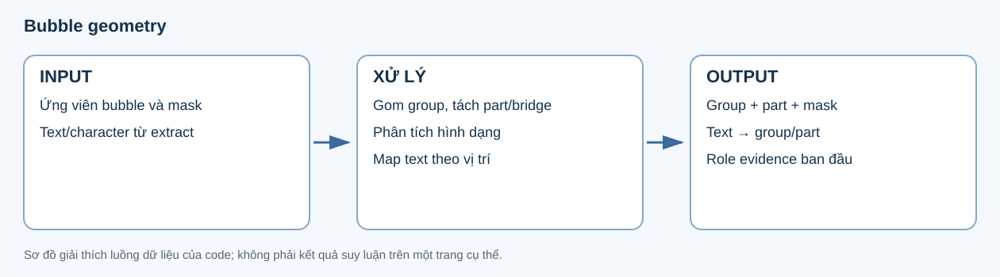
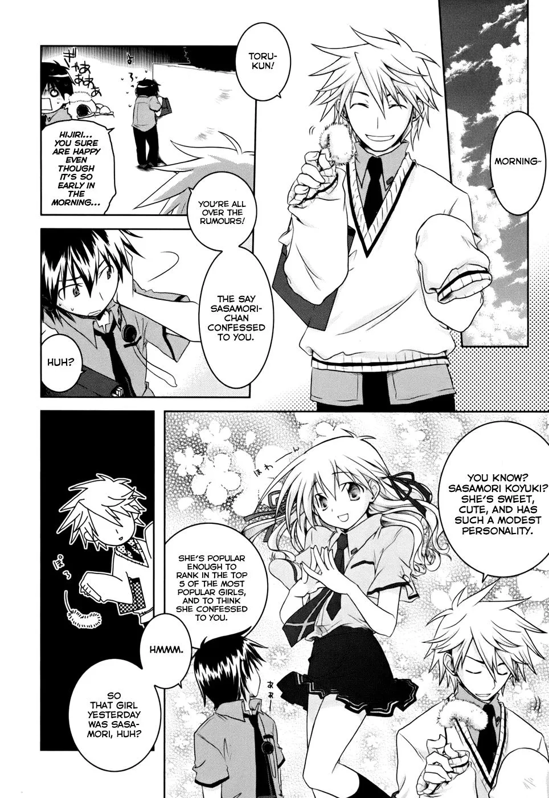
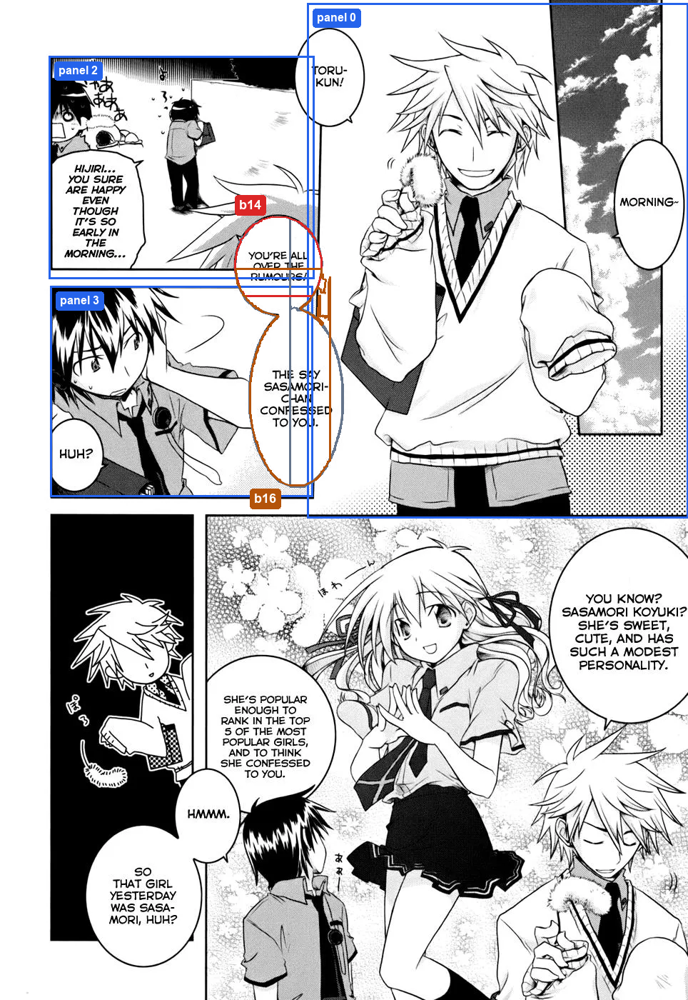
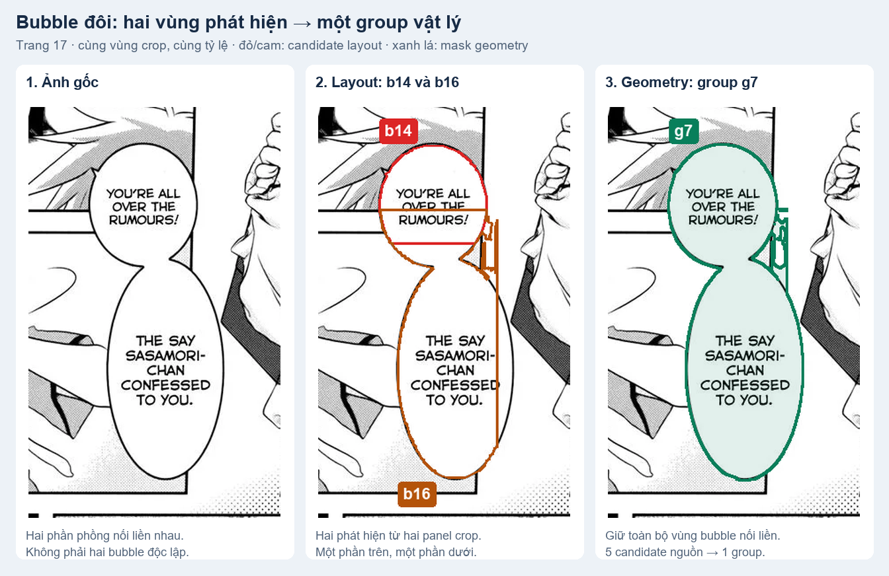
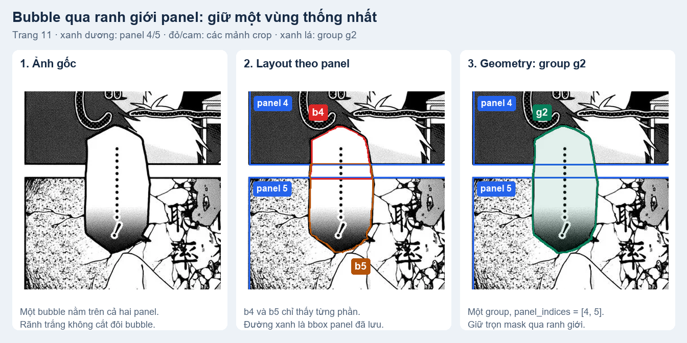

# 3. Bubble geometry — nhóm bubble và đối chiếu text

Bubble geometry xác định **những phát hiện nào thực ra thuộc cùng một bubble**. Layout chạy trên cả trang và từng panel nên một bubble đôi hoặc bubble vắt qua ranh giới panel có thể xuất hiện dưới dạng nhiều vùng rời rạc. Bước này gom chúng thành group vật lý, giữ hình dạng và gắn các text box vào đúng group để normalize sử dụng.

## Input

| Ảnh trang gốc | Input layout: panel và các vùng bubble phát hiện được |
|---|---|
|  |  |

Ví dụ chính là **trang 17 Iris Zero chapter 1**. Bên phải vẽ lại tọa độ đã lưu: **xanh dương là panel, đỏ/cam là hai mảnh bubble cần đối chiếu**, xám là các phát hiện khác của cùng bubble. Các hình chi tiết bên dưới phóng to đúng vùng này. ID trong hình bỏ tiền tố document để dễ đọc; JSON vẫn giữ ID đầy đủ.

| Input | Dữ liệu sử dụng |
|---|---|
| Ảnh trang | Hệ tọa độ gốc để đối chiếu các vùng. |
| Layout | Các ứng viên bubble, contour và mask từ Koharu. |
| Extract | Text box và vị trí nhân vật trên trang. |

## Output

| Output | Nội dung |
|---|---|
| Group bubble | `03_bubble_geometry/result.json` bổ sung `bubble_groups`, giữ các candidate nguồn, vùng bao và các panel liên quan. |
| Hình dạng | Contour, part và mask mô tả vùng bubble sau khi gom; file mask có checksum. |
| Mapping text | Mỗi text box được liên kết tới group/part phù hợp, kèm trạng thái và bằng chứng hình học. |

Hai trường hợp dưới cho thấy giá trị của output này, thay vì chỉ nhìn các detection độc lập từ layout.

## Vấn đề và giải pháp

### 1. Bubble đôi bị nhận thành các vùng riêng

**Vấn đề:** hai phần phồng của bubble nối liền nhau, nhưng lượt crop theo panel tạo ra `p17:b14` ở phần trên và `p17:b16` ở phần dưới. Nếu coi mỗi detection là một bubble độc lập, hai vùng text trong cùng cấu trúc sẽ bị tách rời. Lượt toàn trang cũng đã thấy cả bubble (`p17:b7`); ảnh giữa chỉ tô hai mảnh cần minh họa, không phải toàn bộ output layout.

**Giải pháp:** geometry đối chiếu vị trí và hình dạng, gom cả **5 candidate nguồn** vào `p17:g7`. Mask xanh lá bên phải là mask thật đã lưu, giữ bubble nối liền thay vì hai vùng độc lập. Hai text box `p17:t2`, `p17:t4` cùng được map vào group này; bước normalize mới ghép nội dung chữ.

### 2. Một bubble nằm trên nhiều panel

**Vấn đề:** trên **trang 11**, bubble dài nằm qua cả panel 4 và 5. Crop panel 4 tạo `p11:b4`, crop panel 5 tạo `p11:b5`; các mảnh bị cắt theo phạm vi crop, trong khi bubble trên ảnh gốc vẫn liên tục.

**Giải pháp:** geometry gom `p11:b2` (lượt toàn trang), `p11:b4`, `p11:b5` thành **một group `p11:g2`**, giữ `panel_indices = [4, 5]` và toàn bộ mask. Ranh giới panel không trở thành ranh giới bubble, nên các bước sau còn đủ vùng hình học để dựng ảnh và xử lý bubble.

## Kết luận

Bubble geometry biến **nhiều phát hiện chồng lấp hoặc bị cắt thành một cấu trúc bubble có nguồn gốc rõ ràng**. [Normalize](04_normalize.md) dựa vào group/mapping này để tạo utterance; hình dạng bubble chưa quyết định speaker hay dialogue/thought/narration.

[Dữ liệu đầy đủ của hai ví dụ](../examples/geometry-normalize/examples.json) · [Nguồn/checksum](../examples/geometry-normalize/manifest.json) · [Script dựng hình từ artifact, không gọi model](../../../scripts/build_v7_geometry_normalize_examples.py). Code: [geometry stage](../../../src/manga_pipeline/v6/stages.py), [grouping và mapping](../../../src/manga_pipeline/v6/visual.py).
