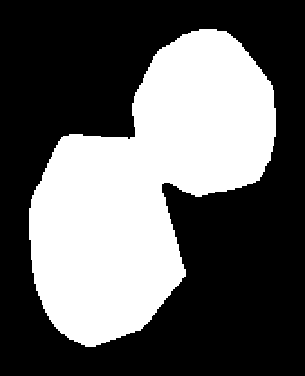
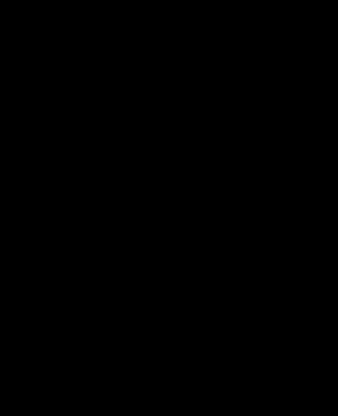

# 3. Bubble geometry — nhóm bubble và đối chiếu text

Stage này kết hợp các ứng viên bubble từ layout với các box text từ extract. Output mô tả nhóm vật lý, các part/body/bridge, mask và liên kết text → group/part. Hình dạng là dữ kiện thị giác; nội dung lời nói được analyze quyết định sau.


## Input và output

**Input:** ảnh, mask/contour của layout, bbox text và nhân vật của extract. **Output:** `03_bubble_geometry/result.json`, raw document được bổ sung `bubble_groups`, mapping của text, visual evidence và các mask có checksum.


Ảnh trên lấy từ artifact trang 11 Iris Zero. [JSON của group ví dụ và text được map](../examples/upstream/geometry-group.json).

## Group và part

Hai ứng viên layout `p11:b1`, `p11:b3` được ghép vào cùng nhóm. Trích các trường nguồn:

```json
{
  "id": "b68ed9e490d577e6:p11:g1",
  "bbox": [766, 66, 903, 242],
  "candidate_ids": ["p11:b1", "p11:b3"],
  "panel_indices": [0]
}
```

| Thành phần | Ý nghĩa |
|---|---|
| `id`, `bbox` | ID group và tọa độ bbox bao nhóm. |
| `candidate_ids` | Các phát hiện layout đã đóng góp vào nhóm; giữ được dấu vết trước khi gộp. |
| `panel_indices` | Các panel liên quan, chỉ số từ 0. |
| `parts[]` | Các phần thân bubble trong một group. |
| `outer_rings`, `body_rings` | Đường bao nhóm/phần thân. |
| `body_mask` | Mask của phần thân từng part, kèm đường dẫn và SHA-256. |

Group không đồng nghĩa một text box hay một người nói. Các phát hiện chồng lấp có thể là nhiều candidate của cùng vùng; nhóm có thể có nhiều part và nhiều box OCR.

## Các mask

| Mask quan sát | Mask hoàn thiện | Bridge |
|---|---|---|
|  |  |  |

Các ảnh là zoom cùng group. `observed_mask` giữ phần quan sát từ detector; `refined_mask` là vùng sau xử lý hình học; `bridge_mask` biểu diễn phần nối mà thuật toán ghi nhận. Một mask có thể rỗng: ảnh đen trong ví dụ bridge không có nghĩa file bị lỗi.

Mỗi mask được tham chiếu bằng object dạng sau, trích từ body của part 1:

```json
{
  "mask_path": "03_bubble_geometry/masks/b68ed9e490d577e6-p11/1-body-1.png",
  "mask_sha256": "42ebfc5943d26f4a280581c1fdbc451472330235c5e3baf16a3fc244336e993c"
}
```

Đường dẫn tương đối từ run; checksum cho phép phát hiện file mask bị đổi hoặc tải chưa đủ.

## Mapping text → group/part

Ví dụ text `t0` được map vào group trên:

```json
{
  "id": "b68ed9e490d577e6:p11:t0",
  "group_id": "b68ed9e490d577e6:p11:g1",
  "part_ids": ["b68ed9e490d577e6:p11:g1:part1"],
  "mapping_status": "matched",
  "coverage": 1,
  "role_evidence": {"koharu_class_1": [], "final_role": false}
}
```

`coverage` đo mức phủ theo hình học, không phải độ tin cậy speaker. `role_evidence` giữ dữ kiện từ detector; `final_role: false` cho biết chưa chốt semantic dialogue/thought/narration/effect.

## Xử lý, cache và config

Checkpoint hình học phụ thuộc ảnh/mask/vị trí, không dùng nội dung OCR để đoán thoại. Mapping text là checkpoint positional riêng. Vì vậy đổi spelling OCR không mặc nhiên buộc tính lại mọi mask.

| Cấu hình | Vai trò |
|---|---|
| `layout.mapping_coverage` (`0.8`) | Mức phủ cần đạt để map text vào vùng. |
| `layout.mapping_margin` (`0.15`) | Chênh lệch cần có khi nhiều ứng viên cùng phù hợp. |
| Geometry policy/config trong `v6` | Chính sách group/part/body/bridge của pipeline. |
| Runtime visual worker | Chọn môi trường/thiết bị xử lý và lưu receipt backend. |

Visual evidence có thể mô tả shape/border/style và confidence heuristic. Ví dụ group này có `bubble_shape: cloud`, nhưng `bubble_style: unknown`; code không vì hình cloud mà tự chốt đó là thought. Analyze còn phải dùng hình ảnh và ngữ cảnh thoại.

## Chuyển sang bước sau

Normalize dùng group/part/mapping để gộp các text box có liên quan và giữ source IDs. Analyze dùng geometry để dựng vùng ảnh event. Inpaint/typeset về sau sử dụng hình học và mask phù hợp với nhiệm vụ, không dùng nhãn hình dạng để viết lại speaker.

Code: [geometry stage](../../../src/manga_pipeline/v6/stages.py), [grouping và mapping](../../../src/manga_pipeline/v6/visual.py). [Manifest ví dụ](../examples/upstream/manifest.json).
