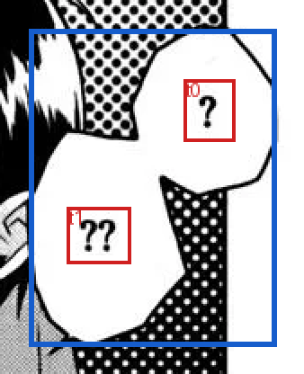

# 4. Normalize — tạo utterance có nguồn gốc rõ ràng

Normalize gom các box OCR thành đơn vị utterance để graph/analyze sử dụng. Một utterance giữ text, nguồn box, thứ tự đọc, group/part, bbox và panel mapping; đây chưa phải bước quyết định người nói hay danh tính.


## Input và output

**Input:** raw text cùng group/part/mapping từ bubble_geometry. **Output:** `04_normalize/result.json`, chứa `utterances`, source boxes, thông tin geometry, các phần bị loại hoặc cần xử lý riêng và failures.

Ví dụ trang 11: hai box OCR `t0` và `t1` có text `?`, `??` thuộc cùng group. Output tạo một utterance `? ??`, đồng thời giữ nguyên hai ID nguồn.



Khung đỏ là box OCR nguồn; khung xanh là bbox của utterance. [JSON utterance đầy đủ](../examples/upstream/normalized-utterance.json).

## Utterance và provenance

Đoạn trích thực tế:

```json
{
  "id": "b68ed9e490d577e6:p11:g1:u",
  "group_id": "b68ed9e490d577e6:p11:g1",
  "page": 11,
  "panel_index": 0,
  "panel_indices": [0],
  "bbox": [766, 66, 903, 242],
  "text": "? ??",
  "text_original": ["?", "??"],
  "source_text_ids": ["b68ed9e490d577e6:p11:t0", "b68ed9e490d577e6:p11:t1"],
  "part_ids": ["b68ed9e490d577e6:p11:g1:part1"],
  "content_type": "unknown",
  "content_review_status": "provisional",
  "reading_order": 51,
  "normalization_reasons": ["physical_group_v6"]
}
```

| Trường | Ý nghĩa |
|---|---|
| `id` | ID utterance dùng xuyên graph/analyze/translation. |
| `group_id`, `part_ids` | Nhóm và phần bubble đóng góp vào utterance. |
| `text`, `text_original` | Text đã ghép và các text OCR ban đầu. |
| `source_text_ids`, `source_boxes` | ID và bản ghi nguồn, dùng truy ngược tới từng vị trí OCR. |
| `bbox`, `page` | Vùng bao utterance và trang. |
| `panel_index`, `panel_indices` | Panel chính và toàn bộ panel liên quan. |
| `reading_order` | Thứ tự utterance theo nguồn. |
| `content_type`, `content_review_status` | Nhãn sơ bộ chưa chốt semantic. |
| `normalization_reasons` | Vì sao các box được normalize theo cách này. |

## Chọn panel chính và nhiều panel

Một utterance được phép liên quan nhiều panel. `panel_index` là panel chính, không phải một giới hạn cứng cho người nói/người nghe.

1. Ưu tiên panel của box đầu tiên theo reading order.
2. Nếu phần diện tích box đầu tiên nằm trong panel đó **nhỏ hơn 10% diện tích chính box**, chọn panel phủ nhiều diện tích text của toàn utterance nhất.
3. Không có giao hợp lệ thì giữ chưa gán; không tạo panel giả.

Code tính trên các source text box thật, không thay chúng bằng một bbox bao ngoài rộng để quyết định coverage. Renderer dùng `panel_indices` để giữ đủ các phần liên quan và các panel im lặng trong khoảng event.

## Dữ kiện hình học chưa phải semantic

`raw_character_candidates` giữ gợi ý association từ MAGI. `visual_evidence` giữ đặc tính bubble và lý do còn chưa chắc. Các dữ kiện này hỗ trợ analyze; normalize không chuyển một gợi ý thành identity hoặc tự xác định tên của speaker.

Caption là hình thức trình bày, không tự quyết định narration hay thought. Analyze có thể xác định một caption là thought. Bản OCR hiện hành sau sửa tên sẽ do graph tạo, còn nguồn cũ được giữ cho review.

## Config và artifact để review

Quy tắc panel 10% nằm trong [normalize.py](../../../src/manga_pipeline/v6/normalize.py), hiện không có key cấu hình riêng để đổi ngưỡng đó. Các threshold mapping text–bubble thuộc stage trước, không phải threshold speaker của normalize.

Khi review, đối chiếu `source_text_ids`, `source_boxes`, `normalization_reasons`, `excluded`, `translation_only` và `failures` của artifact. Một utterance ghép đúng vật lý vẫn có thể có OCR sai; hai vấn đề được giữ riêng để sửa ở đúng bước.

## Chuyển sang bước sau

Graph nhận toàn bộ utterance theo thứ tự để sửa spelling tên, tạo nhóm tên và scene/event. Analyze tiếp tục sử dụng cùng utterance IDs và các source box/panel để dựng ảnh. Translation/typeset về sau vẫn có thể quay về box gốc qua provenance này.

Code: [normalize.py](../../../src/manga_pipeline/v6/normalize.py). [Nguồn/checksum ảnh và JSON](../examples/upstream/manifest.json). [Script dựng ví dụ](../../../scripts/build_v7_upstream_examples.py).
