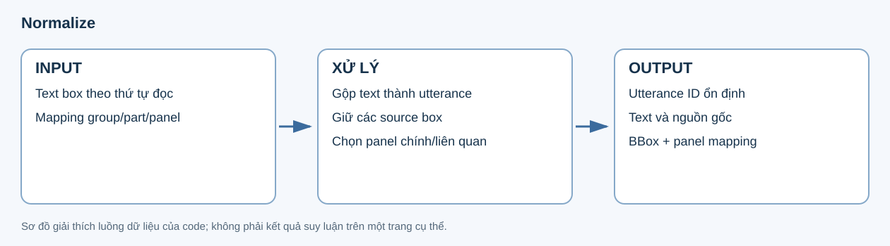
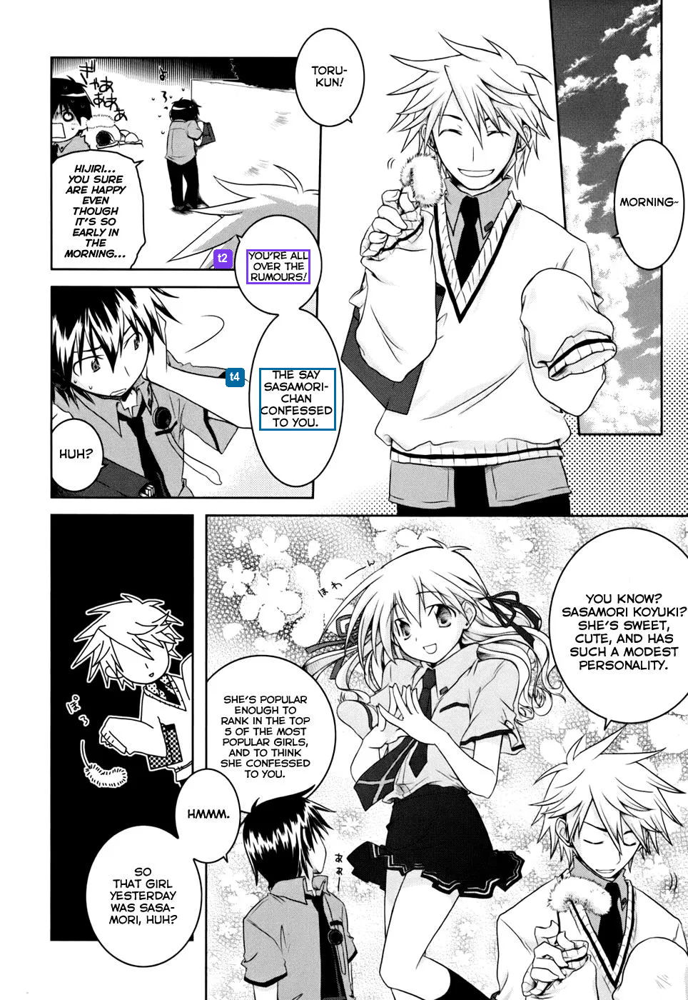
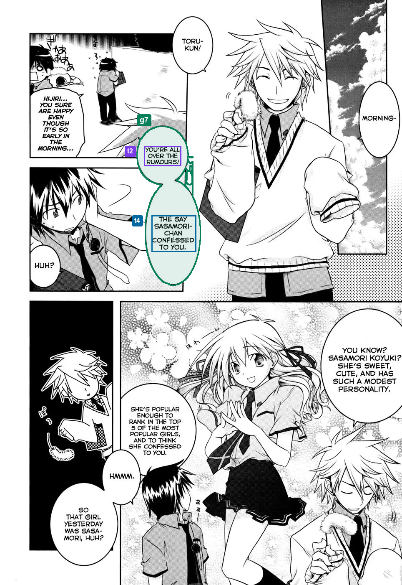
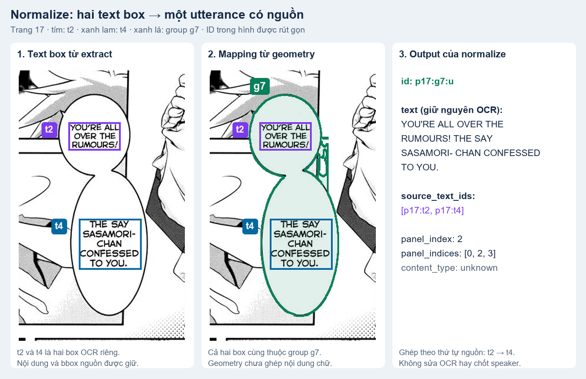

# 4. Normalize — tạo utterance có nguồn gốc rõ ràng

Normalize chuyển **các text box OCR và mapping bubble thành utterance** — đơn vị văn bản để graph/analyze xử lý. Geometry trả lời “những box này thuộc vùng bubble nào”; normalize dùng kết quả đó để ghép chữ theo thứ tự, đồng thời giữ từng nguồn gốc.

## Input

| Text box từ extract | Group và mapping từ bubble geometry |
|---|---|
|  |  |

Tiếp tục ví dụ **bubble đôi trang 17 Iris Zero chapter 1** ở [bước 03](03_bubble_geometry.md). Hai ảnh chỉ đánh dấu group và text của ví dụ; chúng vẫn là hai record OCR riêng trong input. **Tím là `t2`, xanh lam là `t4`, xanh lá là group `g7`.**

| Input | Dữ liệu sử dụng |
|---|---|
| Text từ extract | Nội dung OCR, ID và bbox từng box, thứ tự đọc và liên kết nhân vật nguồn. |
| Bubble geometry | Group/part và mapping text vào vùng bubble. |
| Trang và panel | Vị trí panel để gắn utterance vào bố cục trang. |

## Output

Normalize tạo **một utterance `p17:g7:u` từ hai box `p17:t2` và `p17:t4`**, theo thứ tự nguồn. Chữ được nối thành một record, nhưng text gốc, hai source ID và bbox vẫn được giữ. `THE SAY` trong hình là OCR nguyên văn của artifact, không được sửa ở bước này. ID hiển thị trong hình được rút gọn.

| Output | Nội dung |
|---|---|
| `04_normalize/result.json` | Danh sách `utterances` theo thứ tự, source boxes, geometry và các mục bị loại/lỗi. |
| Mỗi utterance | ID, text đã ghép, text gốc, source IDs/boxes, group/part, bbox và panel liên quan. Ví dụ giữ panel chính `2` và `panel_indices = [0, 2, 3]`. |
| Bằng chứng chuyển tiếp | Gợi ý nhân vật và dữ kiện thị giác để graph/analyze sử dụng. |

## Vấn đề và giải pháp

| Vấn đề | Cách xử lý |
|---|---|
| Một bubble chứa nhiều text box, như hai phần của bubble đôi trong hình. | Dùng group/mapping từ geometry để ghép theo thứ tự nguồn; khi source anchor MAGI hợp lệ xung đột, có thể tách thành các utterance riêng. |
| Bubble liên quan nhiều panel hoặc text không được map vào group. | Giữ panel chính và các panel liên quan; box không có group được giữ riêng, không ép vào bubble lân cận. |
| Ghép chữ làm mất dấu vết nguồn hoặc lẫn với sửa OCR. | Giữ text/box nguồn và lý do normalize; box OCR rỗng được ghi riêng. Ghép box không đồng nghĩa sửa nội dung OCR. |
| Association nhân vật hoặc hình dạng bubble chưa đủ để chốt semantic. | Chuyển tiếp bằng chứng cho analyze; chưa quyết định speaker, danh tính hay dialogue/thought/narration. |

## Kết luận

Normalize tạo **utterance có thứ tự và giữ nguồn gốc**. [Graph](05_graph.md) nhận các utterance để xử lý tên và tổ chức scene/event; [analyze](06_analyze.md) tiếp tục dùng cùng ID và bằng chứng nguồn để phân tích nội dung.

[Utterance và các record nguồn đầy đủ](../examples/geometry-normalize/examples.json) · [Nguồn/checksum](../examples/geometry-normalize/manifest.json) · [Script dựng hình từ artifact, không gọi model](../../../scripts/build_v7_geometry_normalize_examples.py). Code: [normalize.py](../../../src/manga_pipeline/v6/normalize.py).
