# 5. Graph — tổ chức câu chuyện theo 5 tầng

Graph tổ chức dữ liệu thành **5 tầng: truyện → chapter → scene → event → utterance**. Mỗi tầng có nhiều node: một truyện chứa nhiều chapter, một chapter chứa nhiều scene, mỗi scene chứa các event và mỗi event chứa một nhóm utterance liên quan.

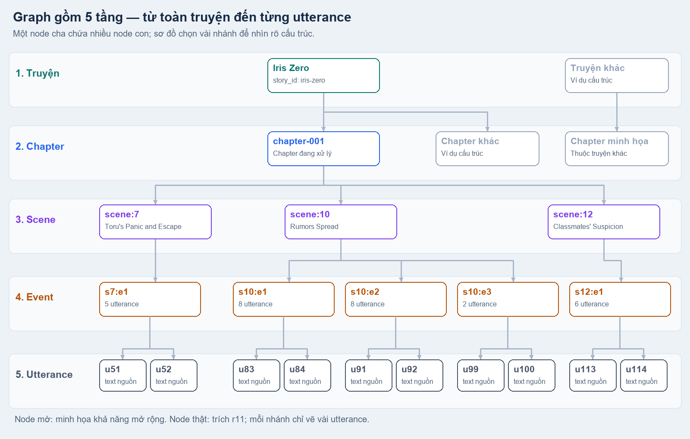

Trong một lượt chạy, pipeline xử lý **một chapter** của một truyện. Truyện/chapter lấy từ metadata, utterance đã có từ normalize; model graph tạo cách chia **scene/event** và mô tả cho hai tầng này. Cùng request đó còn đề xuất sửa tên gọi và nhóm các dạng tên để tạo **nhân vật giả định chỉ có tên, chưa gắn MAGI**. Các node mờ trong hình minh họa cấu trúc mở rộng, không phải dữ liệu đã xử lý thêm.

## Input

Input chính là **transcript MAGI đã normalize**, gồm toàn bộ utterance của chapter theo thứ tự nguồn. Bản dưới trình bày như transcript để dễ đọc, **đã giản lược metadata**, không phải nguyên dạng packet gửi model:

```text
TRANG 17 — trích transcript đã normalize

[u83 | panel 0] MORNING~
[u84 | panel 0] TORU-KUN!
[u85 | panel 2] YOU'RE ALL OVER THE RUMOURS! THE SAY SASAMORI- CHAN CONFESSED TO YOU.
[u86 | panel 2] HJIJIRI... YOU SURE ARE HAPPY EVEN THOUGH IT'S SO EARLY IN THE MORNING...
```

`u85` chính là utterance ghép từ hai box trong bubble đôi ở [normalize](04_normalize.md). Text vẫn giữ nguyên OCR, kể cả lỗi chữ; không thêm nhãn người nói vào transcript. “Transcript MAGI” ở đây là cách gọi gọn dữ liệu extract: MAGIv2 cung cấp text box/thứ tự/liên kết, GLM-OCR cung cấp chữ, rồi normalize ghép box thành utterance.

| Input | Model sử dụng để làm gì |
|---|---|
| Toàn bộ transcript đã normalize | Đọc liên tục để nhận ra phân cảnh và các cụm trao đổi; gồm cả bìa, giới thiệu, credit và lời tác giả. |
| Page, panel và bbox | Đối chiếu vị trí, thứ tự và sự tiếp nối của text. |
| Quan sát MAGI và name registry đã có | Nhận metadata nguồn và các dạng tên đã biết; chưa gán speaker hay tên vào nhân vật thị giác. |

Graph nhận **text và metadata, không nhận ảnh**. Một request đọc toàn chapter với context 64K, thinking tắt. [Xem transcript dễ đọc đầy đủ](../examples/graph/transcript-normalized.txt).

<details>
<summary><strong>Xem chi tiết input gửi model và giải thích từng field</strong></summary>

Packet dùng bảng gọn để tránh lặp tên field. Dưới đây là `target_columns` cùng ba dòng thật từ `targets`; chỉ đoạn trích này được rút ngắn. [Packet đầy đủ gửi model](../examples/graph/packet-full.json) giữ toàn bộ **260 target**, không bỏ text hay quan sát để tạo bảng.

```json
{
  "target_columns": ["id", "text", "page", "primary_panel", "panels", "bbox"],
  "targets": [
    ["u83", "MORNING~", 17, 0, [0, 1], [861, 196, 959, 378]],
    ["u84", "TORU-KUN!", 17, 0, [0, 2], [414, 41, 510, 177]],
    ["u85", "YOU'RE ALL OVER THE RUMOURS! THE SAY SASAMORI- CHAN CONFESSED TO YOU.", 17, 2, [0, 2, 3], [329, 303, 480, 682]]
  ]
}
```

**Các field cấp packet:**

| Field | Ý nghĩa |
|---|---|
| `policy` | Hợp đồng đang dùng: `chapter-story-graph-v7`. |
| `coverage_contract` | Các điều kiện để model phủ đủ chapter, giải thích bên dưới. |
| `target_columns` | Tên và thứ tự các cột của mỗi dòng `targets`. |
| `targets` | Toàn bộ utterance đầu vào theo thứ tự nguồn. |
| `name_registry` | Tên đã biết trước lượt graph; ví dụ r11 là `[]`. Mỗi mục có `person_id` dạng `pN`, `primary_name` là tên chính đã biết, `aliases` là các dạng tên đã lưu. |
| `person_columns` | Cột cho từng giá trị trong `people`: `["name", "observations"]`. |
| `observation_columns` | Cột cho mỗi quan sát: `["page", "magi_id", "bbox"]`. |
| `people` | Bảng metadata nhân vật với khóa tạm `pN`; giá trị theo `person_columns`. Đây chưa phải bảng người nói. |
| `panels` | Bố cục từng trang: `page` là số trang từ 1, `panels` là danh sách bbox panel theo chỉ số từ 0. |

**Các field trong `coverage_contract`:**

| Field | Ý nghĩa trong ví dụ |
|---|---|
| `first_target_id`, `last_target_id` | `u0`, `u259`: hai đầu phạm vi cần phủ. |
| `target_count` | `260` utterance, không phải số text box trước normalize. |
| `include_non_narrative_targets` | `true`: không bỏ bìa, credit, giới thiệu hoặc lời tác giả. |
| `description_language` | `en`: title/summary/evidence do model sinh dùng tiếng Anh; text OCR được trích giữ nguyên. |

**Các cột của một target:**

| Cột | Ý nghĩa |
|---|---|
| `id` | ID tạm `uN`, dùng khi model trả start marker hoặc tham chiếu text. |
| `text` | Nội dung utterance sau normalize, trước lượt sửa tên của graph. |
| `page` | Số trang từ 1. |
| `primary_panel` | Panel chính, chỉ số từ 0; có thể `null` khi chưa gán. |
| `panels` | Tất cả panel liên quan; một utterance có thể trải qua nhiều panel. |
| `bbox` | `[x1, y1, x2, y2]` trên ảnh gốc, làm tròn pixel khi đóng packet. |

**Metadata quan sát nhân vật:** `name` là tên đã biết hoặc `null`; `observations` giữ các lần xuất hiện. Mỗi quan sát có `page`, `magi_id` là ID bank nguồn, và `bbox` của nhân vật trên ảnh gốc. Tên trong metadata không chứng minh ai nói một utterance.

[Reference ledger](../examples/graph/reference-ledger.json) ánh xạ `uN` về utterance ID thật và `pN` về person ID thật. Ví dụ `u85` → `b68ed9e490d577e6:p17:g7:u`. Việc mã hóa ID và bảng cột chỉ làm gọn packet, không viết lại OCR.

</details>

## Output

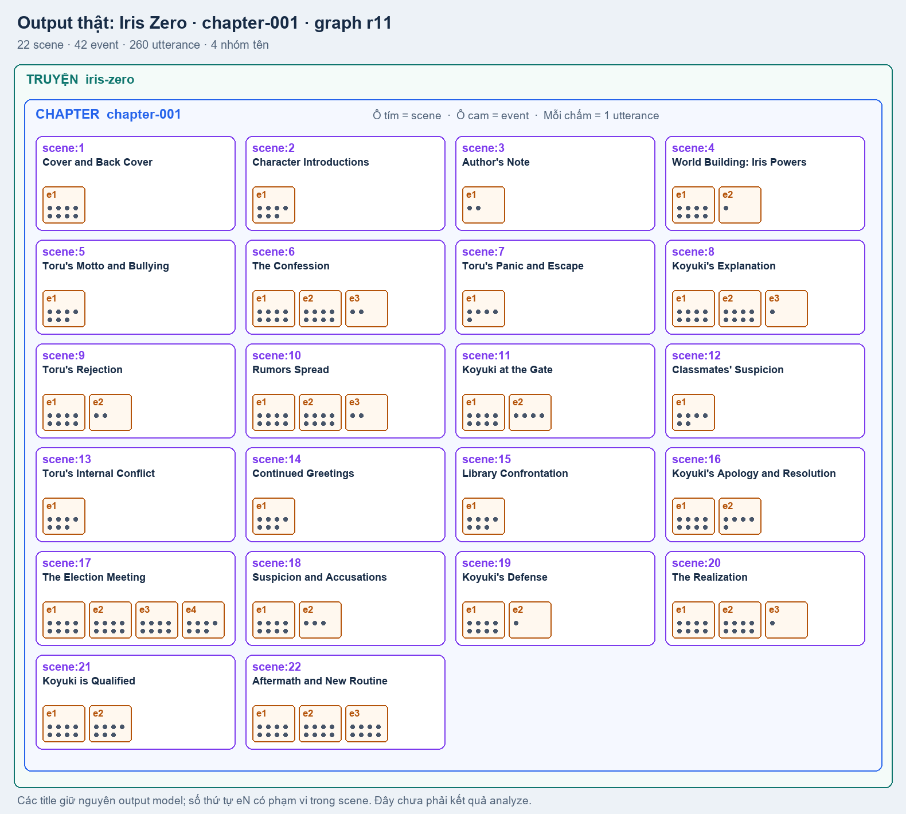

Ví dụ **Iris Zero chapter 1, lượt r11** tạo **22 scene, 42 event, phủ đủ 260 utterance**, cùng 4 nhóm tên. Hình giữ title model đã lưu; ô tím là scene, ô cam là event, mỗi chấm là một utterance. Đây là cách phân nhóm của lượt graph này, chưa phải kết quả phân tích speaker hay xác nhận chất lượng phân cảnh.

| Output | Nội dung |
|---|---|
| [`05_graph/result.json`](../examples/graph/result.json) | Hierarchy scene/event, mô tả, phạm vi utterance và các liên kết trong chapter. |
| [`ocr-current.json`](../examples/graph/ocr-current.json) | Text hiện hành sau sửa spelling/spacing/hyphen của tên, dùng cho analyze. |
| [`replacement-history.json`](../examples/graph/replacement-history.json) và nhóm tên | Lịch sử sửa trước/sau, alias và nhóm tên ở trạng thái đề xuất. |
| Nhân vật giả định theo tên | Các node `reference:gN`, có tên và `reference_only: true`, chưa gán bất kỳ MAGI ID nào. |

Model trả **start marker** của scene/event. Code kiểm tra thứ tự, phủ từ utterance đầu tới cuối, cấp ID và đóng băng phạm vi. `status: pending` ở event nghĩa là đang chờ analyze.

## Tóm tắt 5 tầng

| Tầng | Đại diện cho | Node con |
|---|---|---|
| **Truyện** | Toàn bộ một bộ truyện, xuyên nhiều chapter. | Chapter. |
| **Chapter** | Một chapter và toàn bộ text thuộc chapter đó. | Scene theo thứ tự nguồn. |
| **Scene** | Một phân cảnh hoặc tình huống rộng, liên tục. | Các event trong cùng phân cảnh. |
| **Event** | Một chuỗi utterance liên tiếp cùng trao đổi/chủ đề/diễn biến. | Tối đa 8 utterance. |
| **Utterance** | Một đơn vị text sau normalize, có thể gồm nhiều box hoặc nhiều câu văn. | Không có tầng narrative con; chỉ giữ tham chiếu nguồn. |

Các hình dưới phóng riêng từng node. `description` của scene/event được trích nguyên văn output tiếng Anh. Mô tả truyện/chapter và dòng diễn giải utterance là chú thích của tài liệu; artifact hiện tại chưa có field `description` riêng ở các tầng đó.

## 1. Tầng truyện

Truyện là phạm vi lớn nhất, ví dụ `story_id: iris-zero`. Nhiều chapter cùng thuộc truyện này; xử lý xong chapter 1 không có nghĩa đã phân tích toàn bộ truyện.

**Mô tả minh họa:** “Toàn bộ truyện Iris Zero; các chapter cùng story_id được tổ chức dưới node này.” Trong artifact một chapter, mối liên hệ này được giữ bằng `story_graph.chapter.story_id`.

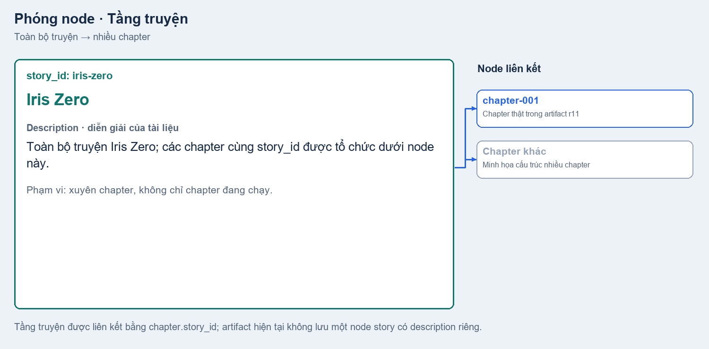

## 2. Tầng chapter

Chapter gom toàn bộ scene của lượt xử lý. `chapter_label: chapter-001` là nhãn dễ đọc; `chapter_id` là ID document nội bộ. Danh sách `scene_ids` giữ các scene theo thứ tự, gồm cả những phần không phải diễn biến truyện như bìa hoặc lời tác giả.

**Mô tả từ số liệu ví dụ:** “chapter-001 trong lượt graph này chứa 22 scene, 42 event và 260 utterance.”

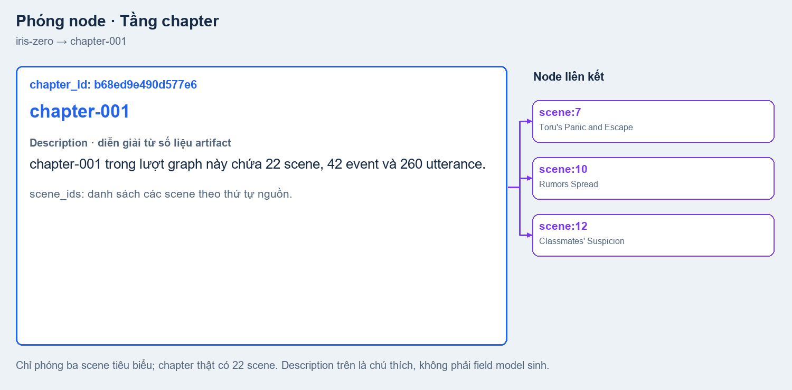

## 3. Tầng scene — một phân cảnh

Scene đại diện cho **một phân cảnh hoặc tình huống rộng đang diễn ra liên tục**. Các góc nhìn hoặc panel thay đổi vẫn có thể thuộc cùng scene; một scene cũng có thể đi qua nhiều trang. Graph nhận ra sự chuyển tình huống từ transcript và metadata, chưa nhìn ảnh để xác nhận.

Trích prompt hiện hành:

> A scene is a broad continuous situation, not every panel or camera cut.

Ví dụ `scene:10`, **Rumors Spread**, có `description`:

> The next morning, Toru's friends discuss the rumors of Koyuki's confession, while Toru tries to ignore it.

Mô tả nêu tình huống “sáng hôm sau, bạn bè bàn tán về lời tỏ tình”, bao quát cả chuỗi trao đổi. Nó chưa gán từng câu cho một nhân vật MAGI.

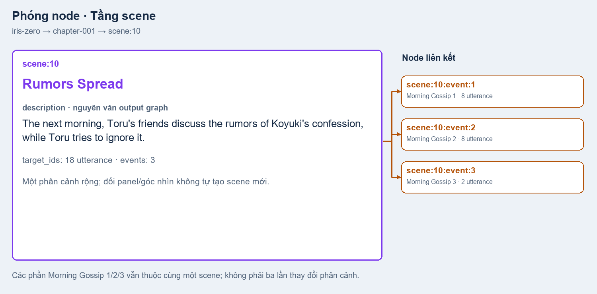

## 4. Tầng event — một chuỗi utterance liên quan

Event là **cụm utterance liên tiếp cùng trao đổi, giải thích hoặc diễn biến**, thường cùng chủ đề hay cùng mạch hỏi–đáp. Event nằm trọn trong một scene; không đồng nhất một event với một panel, một bubble hoặc một người nói.

Trích prompt hiện hành:

> Each event is a coherent consecutive exchange/explanation/action and contains at most EIGHT utterance IDs, including narration/thought/caption. Events cannot cross scenes.

Ví dụ `scene:10:event:1`, **Morning Gossip 1**, có `description`:

> Hijiri and others talk about the confession, while Toru tries to maintain his low profile.

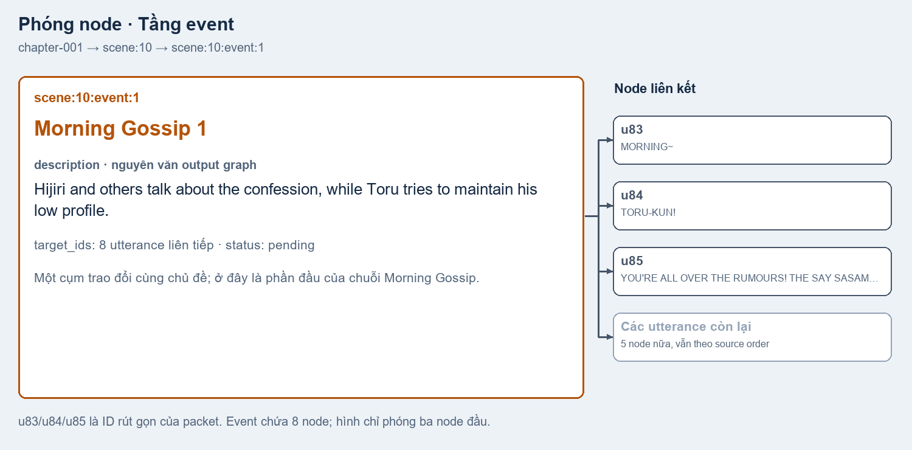

### Event đơn và event nối tiếp

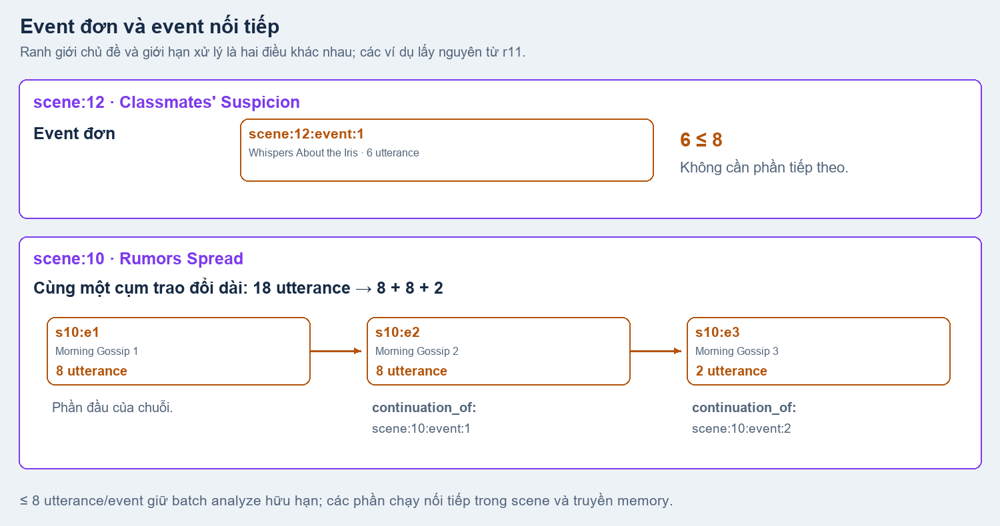

**Event đơn:** cụm trao đổi vừa giới hạn xử lý, không cần phần tiếp theo. Ví dụ `scene:12:event:1` chứa 6 utterance về lời bàn tán của bạn học. Một scene có thể có một hoặc nhiều event đơn, tùy mạch nội dung.

**Event nối tiếp:** một cụm trao đổi dài phải chia thành nhiều phần xử lý nhưng vẫn giữ mạch. Ví dụ Morning Gossip có 18 utterance, được chia **8 + 8 + 2**. Phần sau có `continuation_of` trỏ về phần trước, giữ cùng description ban đầu và nằm trong cùng scene.

`next` chỉ biểu thị thứ tự, không tự chứng minh hai event cùng chủ đề. `continuation_of` ghi rõ các phần do code chia từ một phạm vi event dài; ngoài ra model được đề xuất liên kết `continues`, `related`, `references` khi có căn cứ.

### Vì sao giới hạn 8 utterance/event?

Mỗi event là một batch cho **analyze ở bước sau**. Giữ tối đa 8 utterance giúp giới hạn lượng text, bằng chứng ảnh/metadata và output cần xử lý trong một lần gọi, qua đó giữ tải tính toán và tiến độ xử lý ổn định hơn. Giới hạn tính cả dialogue, thought, narration và caption; không phải 8 câu văn hay 8 bubble.

Prompt yêu cầu giới hạn này; code vẫn kiểm tra và tách phạm vi dài thành các phần đánh số nếu cần. Event không vượt ranh giới scene. Analyze chạy scene song song, còn các event trong một scene chạy tuần tự và truyền memory để tiếp nối ngữ cảnh. Context 64K của request toàn chapter không thay thế giới hạn batch này.

## 5. Tầng utterance — đơn vị text nhỏ nhất

Utterance kế thừa từ normalize, giữ ID và nguồn xuyên graph/analyze; graph chỉ được sửa dạng tên theo quy tắc OCR đã nêu. Ví dụ **`u85` ↔ `p17:g7:u`** chứa:

> YOU'RE ALL OVER THE RUMOURS! THE SAY SASAMORI- CHAN CONFESSED TO YOU.

Đây là text đã ghép từ hai box `p17:t2`, `p17:t4` trong bubble đôi. Description ở các tầng trên giúp đặt nó vào mạch truyện; bản thân node vẫn giữ text, ID và nguồn để analyze xác định speaker/addressee/semantic sau đó.

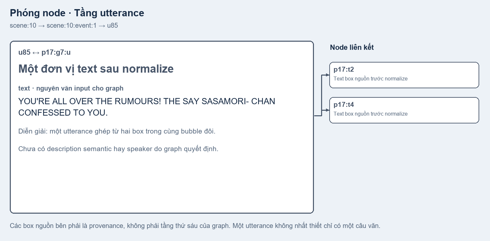

## Luồng tên gọi — sửa OCR, alias và nhân vật giả định

Ngoài khung cốt truyện, graph còn đọc **các tên xuất hiện trong transcript**, sửa lỗi OCR ở cách gọi và đề xuất những cách gọi nào cùng chỉ một người. Từ nhóm tên, code tạo thực thể nhân vật giả định **ở mức văn bản**, chưa biết đó là nhân vật MAGIv2 nào trên ảnh.

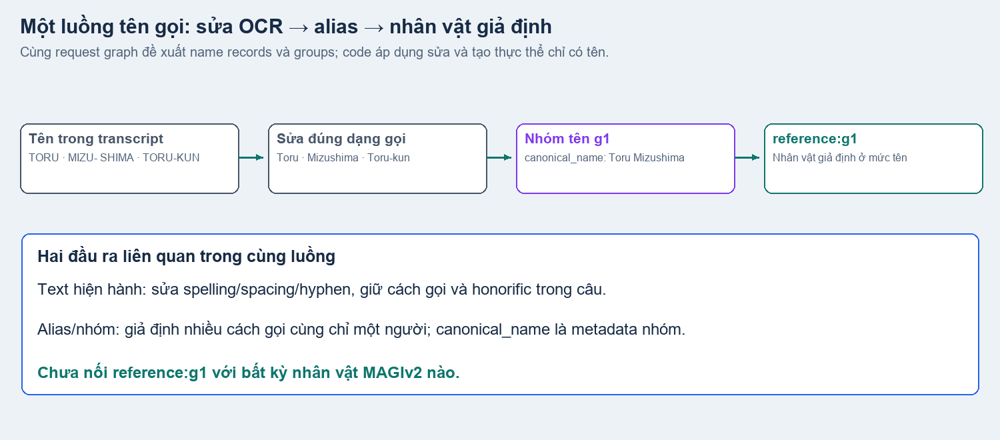

Hình là luồng dữ liệu trong **cùng một lượt graph**, không phải nhiều request model nối tiếp. Model đề xuất các name record `old_name`, `new_name`, `group_id` cùng metadata nhóm; code áp dụng phép sửa, giữ lịch sử và tổng hợp alias từ các dạng tên nguồn/đã sửa.

### 1. Sửa cách gọi, giữ nguyên cách xưng hô

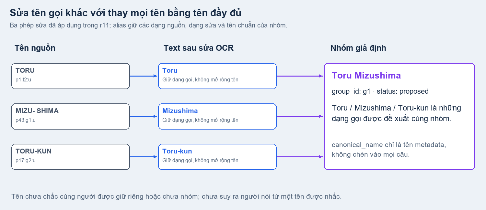

Ví dụ r11: `TORU → Toru`, `MIZU- SHIMA → Mizushima`, `TORU-KUN → Toru-kun`. Sửa spelling/spacing/hyphen giữ đúng dạng tên và honorific được dùng trong câu; không đổi mọi `Toru` thành `Toru Mizushima`.

### 2. Tạo alias và nhóm giả định cùng người

`Toru`, `Mizushima`, `Toru-kun` và các dạng nguồn liên quan được đề xuất vào **nhóm `g1`**, với `canonical_name: Toru Mizushima`. Tên chuẩn là metadata đại diện nhóm; từng occurrence vẫn giữ nguồn và cách gọi của nó. Nhóm có `status: proposed`, evidence và members để kiểm tra. Các trường hợp chưa chắc cùng người phải giữ riêng hoặc chưa nhóm.

Alias có thể gồm cả biến thể OCR nguồn và dạng đã sửa, nên danh sách alias không tự xác nhận mọi biến thể là cách gọi đúng. Nó giữ dấu vết để analyze/review đối chiếu.

### 3. Tạo nhân vật giả định, chưa gán nhân vật MAGIv2

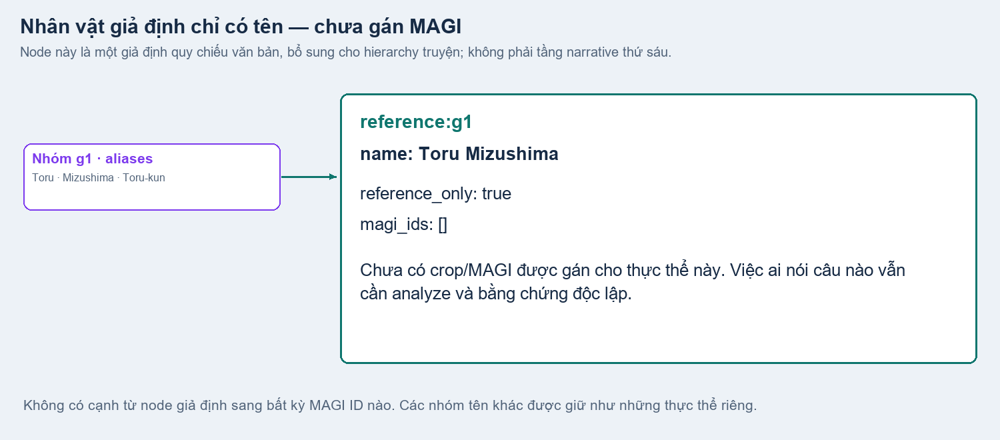

Ví dụ output thật:

```json
{
  "person_id": "reference:g1",
  "name": "Toru Mizushima",
  "magi_ids": [],
  "reference_only": true
}
```

Node này biểu diễn giả định **“các cách gọi trong nhóm đang quy chiếu cùng một người”**, chưa chứng minh người đó ứng với MAGI 2, 3 hay bất kỳ ID thị giác nào. Đây là thực thể tham chiếu bổ sung cho graph, không phải tầng narrative thứ sáu và không phải field `hypotheses` gán speaker.

Trong contract hiện hành, chỉ mention loại `reference` được trỏ vào thực thể chỉ có tên; speaker/addressee phải dùng person thị giác hợp lệ. Analyze tiếp tục đối chiếu text và ảnh trước khi đưa ra attribution. [Dữ liệu nhóm, phép sửa và node giả định](../examples/graph/name-flow.json); [prompt và xử lý tên](../../../src/manga_pipeline/v6/graph_names.py).

## Kết luận

Graph đặt **text có nguồn gốc rõ ràng vào một cấu trúc truyện có thứ bậc**, vừa giữ tình huống rộng ở scene, vừa chia các cụm trao đổi thành event đủ nhỏ để analyze. Luồng tên gọi bổ sung alias và các nhân vật giả định chưa gán MAGI. [Analyze](06_analyze.md) dùng hierarchy đã freeze, OCR hiện hành và bằng chứng nguồn để xác định speaker/addressee cho từng utterance.

[Dữ liệu các node minh họa](../examples/graph/selected-nodes.json) · [Nguồn/checksum hình và packet](../examples/graph/manifest.json) · [Script dựng hình từ artifact, không gọi model](../../../scripts/build_v7_graph_examples.py). Code/prompt: [graph.py](../../../src/manga_pipeline/v6/graph.py), [graph_wire.py](../../../src/manga_pipeline/v6/graph_wire.py), [story_graph.py](../../../src/manga_pipeline/v6/story_graph.py). Xem thêm [workspace review](../review-workspace.md) để mở graph tương tác.
