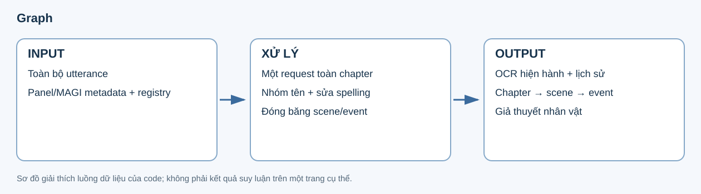
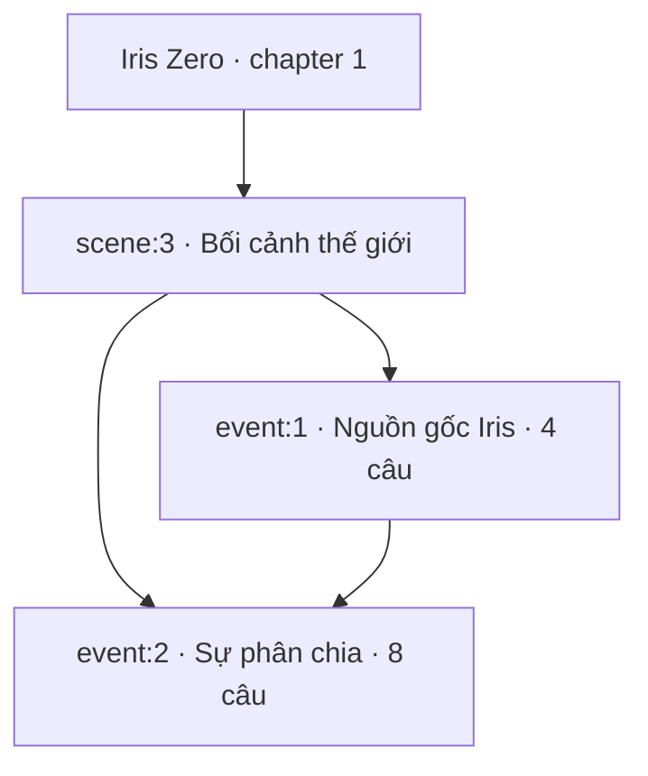

# 5. Graph — thay scan

**Input:** toàn bộ text normalize, thứ tự đọc, panel/MAGI metadata, prior name registry. **Không gửi ảnh.** **Output:** graph sơ bộ chapter → scene → event, nhóm tên và OCR hiện hành.



## Thành phần đầu vào

| Thành phần | Model nhận để làm gì |
|---|---|
| Toàn bộ utterance theo thứ tự | Đọc xuyên batch/scene, kể cả bìa, lời tác giả và giới thiệu nhân vật. |
| Page/panel/bbox | Biết vị trí và sự tiếp nối hình học của câu. |
| Quan sát MAGI và prior registry | Metadata nguồn và tên đã biết; không đề xuất người nói hoặc ánh xạ tên sang MAGI. |
| Hợp đồng phủ nguồn | Scene đầu bắt đầu tại target đầu, mỗi event đầu bắt đầu đúng scene của nó. |

Wire dùng bảng gọn với cột được khai báo và ID tạm `uN`, `pN`; `reference-ledger.json` ánh xạ lại ID thật. Đây là cách giảm metadata lặp, không bỏ text hay quan sát.

## Ví dụ output thật

Lượt Iris Zero r4 hoàn tất với 39 scene, 78 event, 260 utterance và 4 nhóm tên. Ví dụ scene thứ ba có nhánh sau; tên/mô tả là kết quả model được lưu, cần review chất lượng phân cảnh:



Trích các trường của event đầu tiên:

```json
{
  "event_id": "scene:3:event:1",
  "scene_id": "scene:3",
  "title": "Nguồn gốc Iris",
  "description": "Trẻ em sinh ra với năng lực Iris.",
  "description_confidence": 10,
  "target_ids": [
    "b68ed9e490d577e6:p4:g7:u",
    "b68ed9e490d577e6:p4:g4:u",
    "b68ed9e490d577e6:p4:g5:u",
    "b68ed9e490d577e6:p4:g1:u"
  ],
  "status": "pending"
}
```

| Trường | Cách hiểu |
|---|---|
| `scene_id`, `event_id` | Node do code cấp sau khi đóng băng phạm vi. |
| `title` | Tên ngắn tối đa 4 từ, dùng trên visual. |
| `description`, `initial_description` | Mô tả hiện hành và mô tả ban đầu để giữ lịch sử. |
| `description_confidence` | Model tự chấm 0–10; không phải xác suất đã hiệu chuẩn. |
| `target_ids` | Các utterance liên tiếp thuộc event; tối đa 8. |
| `status: pending` | Event đang chờ analyze, không phải lỗi của graph. |

Nhóm tên có `group_id`, `canonical_name`, `aliases`, `members` và `evidence_refs`. `members` trỏ tới occurrence cụ thể; tên chuẩn là metadata, không phải text dùng thay cho mọi alias trong câu.

Một request toàn chapter, context 64K, thinking off. Model trả scene/event start markers theo thứ tự nguồn, tên ngắn tối đa 4 từ, mô tả và confidence. Code đóng băng phạm vi; một event dài được tách thành các phần đánh số, mỗi phần tối đa 8 utterance và không vượt scene.

Mọi title, summary, evidence và reason do graph tạo phải bằng **tiếng Anh**; giữ nguyên surface OCR/tên được trích dẫn. `description_language=en`, `output_language=en`. Artifact của các run lịch sử không bị dịch hoặc sửa lại.

Scene là tình huống rộng; event là cụm liên tiếp cùng trao đổi/giải thích/diễn biến. Graph giữ liên kết chứa, thứ tự/tiếp nối và liên hệ/nhắc lại; chưa có cạnh suy luận động cơ/nhân quả.

Nhóm tên là metadata về alias, không phải MAGI identity. Sửa OCR chỉ sửa spelling/spacing/hyphenation, giữ cách dùng tên và honorific; không đổi `Toru` thành `Toru Mizushima`. Find-all/replace-all vẫn lưu lịch sử trước/sau và current OCR snapshot.

Graph không tạo giả thuyết nhân vật, người nói hoặc ánh xạ tên–MAGI. Schema response không còn `hypotheses`; trường tương thích trong artifact mới luôn rỗng. Mô tả chỉ nêu chủ đề/diễn biến, không phân công câu thoại cho nhân vật. Analyze xác định người nói bằng dữ liệu nguồn và ảnh.

Artifact: `result.json`, `ocr-current.json`, `replacement-history.json`, `reference-ledger.json`, `review.md`, `review.html`. Nhóm tên chỉ tổ chức các surface trong text, không phải bằng chứng nhận diện người nói.

## Sửa tên, kiểm tra và chuyển dữ liệu

`ocr-current.json` trở thành text hiện hành cho analyze; OCR trước sửa vẫn xem được qua lịch sử. Việc sửa chỉ chuẩn hóa spelling/spacing/hyphen của surface, giữ độ đầy đủ và honorific. Các nhóm tên/hypothesis không tự ghi vào character bank.

Code kiểm tra các start marker có thật, đúng thứ tự và phủ từ câu đầu. Scene/event dài được chia theo giới hạn trước khi analyze. Nếu context vượt budget trước POST hoặc response sai cấu trúc, receipt và packet vẫn giữ để review; không tạo một graph giả thành công.

Analyze nhận hierarchy, text sau sửa và nhóm tên; không nhận giả thuyết nhân vật. Khi đọc graph cũ, analyze bỏ giả thuyết khỏi packet và kết quả mới, giữ nguyên artifact graph gốc. Các phạm vi event đã đóng băng trở thành batch analyze; model analyze bổ sung speaker/listener/mention và mô tả chi tiết.

| Config | Giá trị mặc định | Tác dụng |
|---|---|---|
| `llm.num_ctx` | `65536` | Context chung. |
| `llm.graph_timeout` | `1200` giây | Timeout riêng của request toàn chapter. |
| `v6.graph_output_tokens` | `16384` | Dự phòng output graph. |
| `v6.analyze_batch_size` | `8` | Giới hạn câu của một event. |

Config: `v6.graph_policy`, `graph_output_tokens`, `analyze_batch_size`. Code: [graph.py](../../../src/manga_pipeline/v6/graph.py), [graph_names.py](../../../src/manga_pipeline/v6/graph_names.py).

## Visual local có thể tái lập

Giao diện hiện tại là [Storylens review workspace](../review-workspace.md): cây chapter → scene → event → utterance, bản đồ nối nhánh, reading room, ảnh bằng chứng, bộ lọc và tiến độ kiểm tra cá nhân. Graph/analyze/reanalyze dùng chung template; có thể dựng một website offline cho cả ba stage bằng `scripts/preview_story_review.py`.

Chạy từ thư mục gốc dự án, dùng artifact đã tải về; không cần pod hoặc model:

```powershell
venv/Scripts/python.exe -B scripts/review_story_graph.py --run-dir "<run-directory>" --output "<review-directory>" --source-folder "D:/download/EN-data/Iris Zero/EN/Chapter 1"
```

`run-directory` là thư mục có `manifest.json` và `05_graph/result.json`, không phải thư mục batch. Có thể thay `--run-dir` bằng `--artifact "<path>/result.json"`. Bỏ `--source-folder` nếu chỉ cần graph/text. Source folder phải chứa đúng ảnh gốc; code kiểm tra SHA-256 khi có receipt.

Mở `index.html` trong output bằng trình duyệt: cây chapter → scene → event, tìm kiếm, bấm node xem mô tả, confidence, câu nguồn, nhóm tên và giả thuyết. Ảnh event dùng cùng thuật toán envelope/panel/MAGI với analyze, bao gồm panel im lặng nằm giữa hai đầu event. Đây là preview được dựng từ graph, không phải kết quả analyze.

`review-data.json` giữ dữ liệu visual; `report.json` ghi checksum input, renderer/template, thống kê và cảnh báo. Cùng artifact, ảnh nguồn, phiên bản code và môi trường font/Pillow tạo cùng output khi chạy lại. Không sửa artifact đầu vào, không gọi model (`model_requests=0`). Giữ cả thư mục output để ảnh tương đối vẫn hoạt động; HTML không tải thư viện từ mạng.
