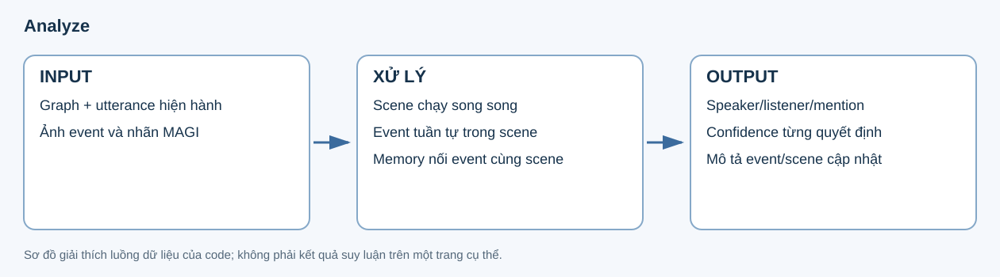
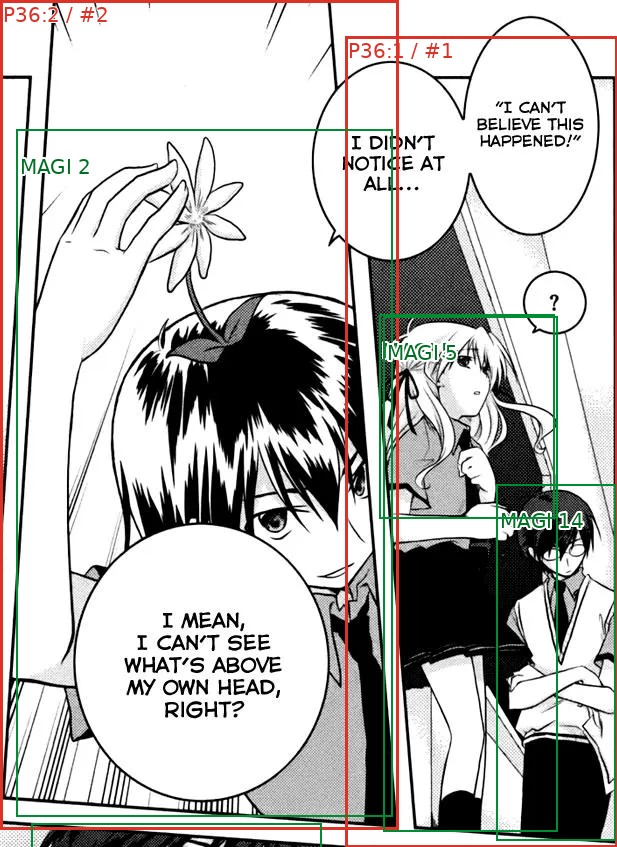

# 6. Analyze — hoàn thiện event và utterance

**Input:** graph đã freeze, OCR hiện hành, source anchors/character metadata và ảnh vùng trang. **Output:** semantic từng utterance, event prose, scene prose và memory tích lũy.



## Ví dụ ảnh và packet thật

Ảnh dưới thuộc event `scene:30:event:1`, trang 36 Iris Zero, đã được analyze xử lý trong lượt r6. Khung/nhãn panel cho biết thứ tự đọc; nhân vật được đánh số MAGI. Đây là ảnh đã gửi cho model, được sao chép theo checksum:



Trích thông tin ảnh trong packet:

```json
{
  "page_id": "b68ed9e490d577e6:p36",
  "page_index": 35,
  "bbox": [296, 0, 913, 847],
  "panel_indices": [0, 1],
  "render_size": [617, 847],
  "scale": 1,
  "context_ids": ["b68ed9e490d577e6:p36:g5:u"]
}
```

| Trường | Cách hiểu |
|---|---|
| `bbox` | Vùng chữ nhật cắt từ ảnh trang gốc. |
| `panel_indices` | Các panel được đưa vào ảnh event; chỉ số từ 0. |
| `render_size`, `scale` | Kích thước ảnh gửi model và tỷ lệ so với vùng crop. |
| `context_ids` | Câu xuất hiện trong ảnh nhưng không phải target của event. |
| `targets` của packet | Các câu model phải phân tích trong lượt này. |
| `scene_memory`, `previous_event` | Memory hợp lệ và diễn biến gần nhất của cùng scene. |

[Packet rút gọn](../examples/analyze/packet-summary.json) giữ nguyên các trường được trích. Phần chapter context/visual people đầy đủ vẫn nằm trong artifact của run.

## Ví dụ semantic output

Trích quyết định thật cho một utterance trong event trên:

```json
{
  "utterance_id": "b68ed9e490d577e6:p36:g6:anchor-segment-1:u",
  "scene_id": "scene:30",
  "event_id": "scene:30:event:1",
  "content_type": "dialogue",
  "speech_style": "normal",
  "speaker_kind": "person",
  "speaker_person_id": "person:bbd1cdc5e54921165151",
  "addressee_type": "audience",
  "addressee_person_ids": [],
  "mentions": [],
  "confidence": {"speaker": 10, "addressee": 8, "content_type": 10, "speech_style": 9}
}
```

Trong packet ví dụ, person này ánh xạ tới **MAGI 5**. `speaker_person_id` là tham chiếu nội bộ; chưa tự chứng minh tên của nhân vật. `audience` và danh sách người nghe rỗng là quyết định model trong ví dụ, không phải quy tắc mặc định cho mọi câu.

`mentions` chứa từng occurrence tên, mention type, target và confidence riêng. Speaker là người phát ngôn; mention target là người được nhắc đến. Hai vai trò không được đồng nhất chỉ vì cùng một câu có tên.

[Decision đầy đủ](../examples/analyze/decision.json) giữ evidence, anchor và provenance; [event output](../examples/analyze/event.json) giữ tên/mô tả/confidence sau analyze. [Manifest](../examples/analyze/manifest.json) ghi nguồn và checksum; đây là một checkpoint event, không phải tuyên bố toàn chapter đã phân tích đúng.

## Scheduling

Scene chạy song song, mỗi scene đọc cùng một chapter context ban đầu. Trong scene, event chạy tuần tự. Event sau nhận tóm tắt event thành công trước và memory tích lũy; scene khác không đọc graph cập nhật giữa chừng. Kết quả được hợp nhất theo source order.

Mỗi event là một batch tối đa 8 utterance, gồm dialogue/thought/narration/caption. Không thay ranh giới trong analyze. Model được sửa tên ngắn và mô tả scene/event.

## Ảnh theo trang

Từ panel đầu tới panel cuối theo khoảng đọc event, giữ cả panel không text ở giữa và các trang trung gian. Mỗi trang dựng bbox chữ nhật từ cực trị các panel, bubble liên quan theo normalize và text box mục tiêu, kể cả caption/thought ngoài panel.

Ảnh giữ bố cục, đường bao/ID panel, reading order và **chỉ đánh số nhân vật có MAGI**. Dữ liệu tọa độ/scale và checksum được lưu. Text ngoài event nằm trong vùng ảnh là context, không trở thành target bổ sung.

Đuôi bubble lấy trực tiếp từ `tails` và `text_tail_associations` của MAGIv2. Trước khi gửi model, renderer vẽ bbox màu tím và nhãn `TAIL <tail_index>` lên ảnh. Vùng crop giữ trọn bbox đuôi liên kết với target, kể cả khi đuôi nằm ngoài panel. Packet ảnh có bbox trang gốc và `render_bbox` sau crop/resize; cache ảnh có phiên bản riêng cho lớp nhãn đuôi.

Mỗi target nhận `bubble_tail` do code tạo: `source=MAGIv2`, `has_tail`, `page_id`, `coordinate_system=original_page_pixels` và `tails` gồm index, bbox, các source text ID liên kết. Một utterance gộp nhiều text giữ đủ liên kết nguồn, khử trùng cùng tail index. Chỉ dùng liên kết MAGI có sẵn; không tìm đuôi bằng khoảng cách hay gán đuôi của bubble khác.

**Model không detect đuôi và không trả bbox đuôi.** Khi `has_tail=false`, model phải coi target không có đuôi, không suy diễn thêm dù nhìn ảnh có vẻ gợi ý. Model dùng dữ liệu đuôi được cấp để hỗ trợ xác định người nói; không có đuôi thì phải dựa trên bằng chứng độc lập, không tự đổi thành thought/narration. Metadata MAGI được giữ trong semantic output và khi reanalyze sửa các quyết định khác. Ví dụ r6 phía trên là artifact lịch sử, chưa có lớp metadata/annotation mới này.

## Semantic và confidence

- Analyze ưu tiên nội dung scene và khả năng hiểu text: đọc source dialogue theo thứ tự, đặt event trong scene rồi lập giả thuyết riêng cho speaker và addressee từ lời gọi trực tiếp, hỏi–đáp, đại từ, tự xưng, kiến thức và ý định hội thoại. Graph prose và scene memory chỉ là context có thể sai, phải đối chiếu source text; tên được nhắc và luân phiên lượt nói không tự xác định hai vai trò này.
- Sau khi có giả thuyết từ text, đối chiếu source anchor, person mapping, đuôi MAGIv2 được liên kết và ảnh có nhãn để xác nhận, phân biệt hoặc sửa ứng viên. Ảnh không phải điểm khởi đầu cho attribution; khoảng cách, tư thế hoặc hướng nhìn mơ hồ không được lấn át bằng chứng hội thoại rõ ràng. Bằng chứng nguồn/thị giác mâu thuẫn rõ ràng có thể bác giả thuyết; không ép ảnh khớp giả thuyết. Khi chưa phân giải được, chọn ứng viên hợp lệ được hỗ trợ tốt nhất, giảm confidence và ghi source ID cùng mâu thuẫn trong evidence hiện có. Giả thuyết không trở thành identity fact hoặc bằng chứng độc lập cho lượt sau.
- Speaker/addressee dùng contract person/narrator/others và references hiện hành.
- Chỉ mention `reference` được trỏ đến nhân vật có tên nhưng không có crop/MAGI.
- Model chọn người hợp lý nhất khi trả kết quả thành công; confidence thấp được giữ là quyết định tạm. Không giữ somebody làm person ID cuối.
- Chấm độc lập 0–10 cho speaker, addressee, content type, speech style, mention type và name target.
- Anchor hỗ trợ quyết định liên quan; không suy ra tên từ việc người đó nói một tên.
- Analyze coi source anchor là bằng chứng quan trọng cho speaker với sức nặng **8/10**. Chỉ quyết định trái anchor khi có bằng chứng thị giác/nguồn rõ ràng cho thấy anchor sai và giải thích cụ thể bằng source ID/MAGI label; source dialogue tường minh cũng có thể chứng minh mâu thuẫn. Thứ tự text trước không miễn yêu cầu giải thích khi bác anchor. Đây là chỉ dẫn cho model, không phải khóa cứng hoặc điểm confidence tối thiểu. Reanalyze không có quy tắc ưu tiên anchor đặc biệt này.
- Tất cả title, description, evidence, memory fact và unresolved note do model tạo phải bằng **tiếng Anh**; giữ nguyên OCR/tên được trích dẫn. Review Markdown/HTML mới dùng nhãn tiếng Anh. Artifact lịch sử giữ nguyên ngôn ngữ đã freeze.
- Caption được phép là thought; không còn bộ bác kết quả chỉ vì caption-distance hoặc nhãn nguồn.

## Lỗi và artifact

Event lỗi không tự retry. Event sau nhận memory hợp lệ gần nhất, text event lỗi và danh sách khoảng thiếu. Không tạo semantic/tóm tắt giả. Stage ghi `completed_with_review`, giữ `event_failures` và `unresolved_targets` để reanalyze đối chiếu.

Artifact gồm plan freeze, request receipts, packet, event metadata, ảnh và `result.json`; HTML có hierarchy, semantic/confidence và ảnh. Resume reuse receipt, không POST lại request đã có kết quả/lỗi.

Config: `scene_concurrency`, `event_output_tokens`, `event_image_max_side`, `runtime.llm_slots`. Code: [event_analysis.py](../../../src/manga_pipeline/v6/event_analysis.py), [event_visuals.py](../../../src/manga_pipeline/v6/event_visuals.py), [story_contract.py](../../../src/manga_pipeline/v6/story_contract.py).

## Dữ liệu chuyển sang bước sau

Reanalyze đọc toàn bộ scene/event prose, semantic, confidence và source references để đối chiếu xuyên scene. Sau đó build_identity/relationship/export đọc semantic hiệu lực qua `RunStore.analysis()`. Bản analyze gốc vẫn được giữ để so trước/sau. Script [dựng ví dụ analyze](../../../scripts/build_v7_analysis_examples.py) chỉ sao chép checkpoint đã hoàn tất và ảnh đã có.
