# 6. Analyze — xác định người nói và người nghe

[Graph](05_graph.md) chia chapter thành các phần và tóm tắt chuyện đang xảy ra. Analyze đọc kỹ từng đơn vị văn bản đã normalize, gọi là **utterance**, để trả lời hai câu hỏi: **ai đang nói, và người đó đang nói với ai?** Hai vai trò này lần lượt là **speaker** và **addressee**.

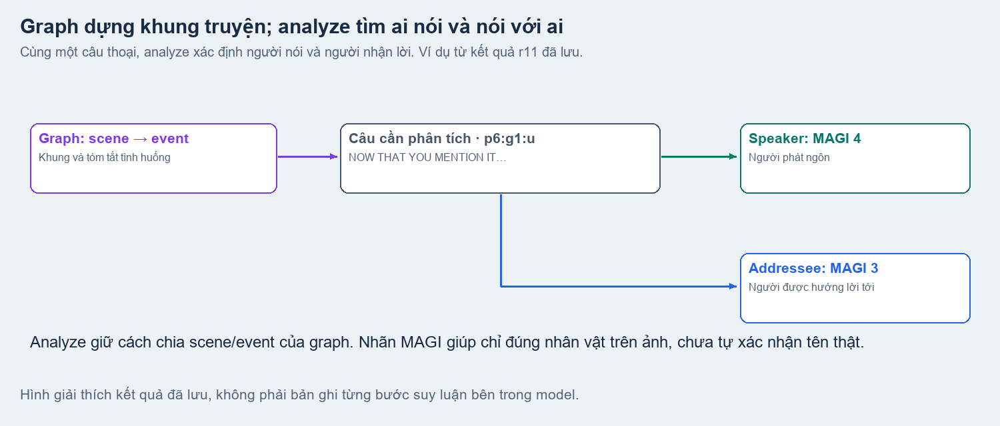

Ví dụ chính là **cặp đối đáp trang 6 Iris Zero chapter 1, lượt r11**. Hình và kết quả lấy từ dữ liệu đã lưu. Cách đọc lời thoại trước rồi kiểm tra ảnh là hướng dẫn hiện tại; các hình chỉ giúp giải thích, không ghi lại suy nghĩ bên trong model. Nhãn MAGI giúp chỉ đúng nhân vật trên ảnh, chưa tự xác nhận tên thật.

## Mục đích và vấn đề cần giải quyết

Một câu như “EHH, REALLY?” rất ngắn: nếu đọc riêng, ta chưa biết ai đang ngạc nhiên và đang hỏi lại ai. Trong một panel có nhiều nhân vật, nhìn vị trí đứng thôi cũng chưa đủ. Analyze cần nối **lời thoại, chuyện đang xảy ra và hình ảnh** để hiểu đúng người nói và người nhận lời.

| Vấn đề | Analyze cần làm rõ |
|---|---|
| Nhiều nhân vật cùng xuất hiện | Nhân vật nào thực sự phát ngôn câu này? |
| Câu đáp ngắn, dùng đại từ hoặc bỏ tên | Câu đang đáp lại ai, dựa vào những gì vừa xảy ra? |
| Một người được nhắc tên trong câu | Đó là người nói, người được gọi hay chỉ là người đang được bàn tới? |

**Mục tiêu:** mỗi utterance có người nói, người nhận lời, lý do lựa chọn và điểm thể hiện mức chắc chắn. Khi chưa đủ thông tin hoặc gặp lỗi, kết quả phải giữ rõ phần chưa xác định để kiểm tra lại.

## Input

| Ảnh trang gốc | Ảnh vùng trang 6 thực sự gửi model |
|---|---|
| 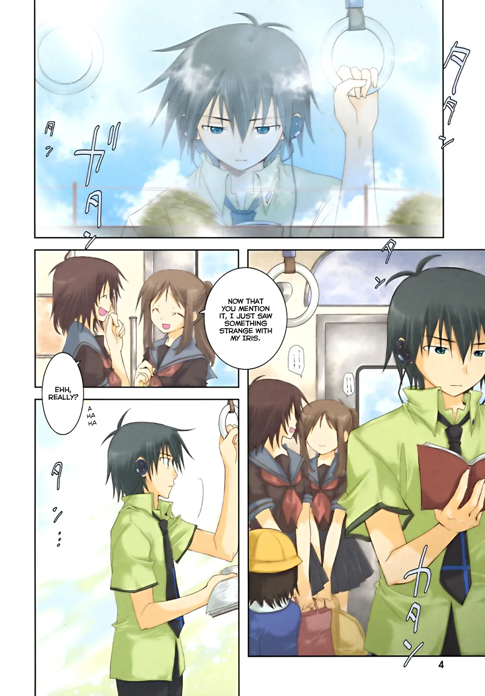 | 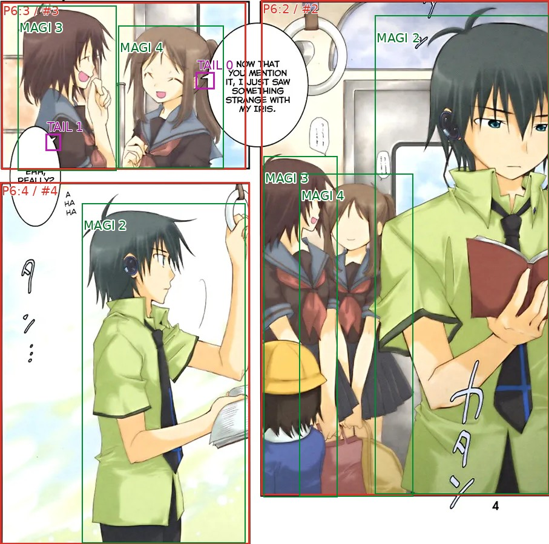 |

Ảnh bên phải là vùng trang cần đọc, có nhãn panel, nhân vật và các đuôi bubble đã được MAGIv2 liên kết với text. **Model không tự tìm đuôi bubble:** chỉ dùng `bubble_tail` được cấp. Nếu `has_tail=false`, phải coi câu đó không có đuôi, không đoán thêm hay mượn đuôi của câu khác.

### Text và ngữ cảnh đi cùng ảnh

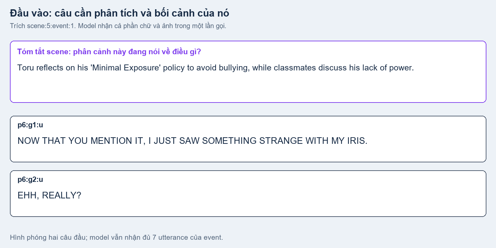

| Input | Vai trò |
|---|---|
| Graph và tóm tắt scene | Biết phân cảnh đang diễn ra chuyện gì, gồm những event nào và những nhóm tên nào đã được đề xuất. |
| Các utterance cần phân tích | Đọc lời thoại hiện hành sau graph, kèm ID và vị trí trên trang. |
| Tóm tắt event trước | Biết ngay trước đó vừa xảy ra chuyện gì; nằm trong `previous_event`. |
| Thông tin đã tích lũy | Giữ những điều cần nhớ từ các event trước của cùng scene; nằm trong `scene_memory`. |
| Gợi ý từ dữ liệu nguồn | Xem người nói nguồn, nhân vật quan sát được và các liên kết text/đuôi đã có. |
| Ảnh event có nhãn | Kiểm tra người nói/người nhận lời dự đoán từ lời thoại có phù hợp với hình hay không. |

Event ví dụ `scene:5:event:1` có **7 utterance**, đi từ trang 6 tới trang 8. Hình phóng hai câu để dễ giải thích; model vẫn nhận đầy đủ event trong cùng một lần gọi.

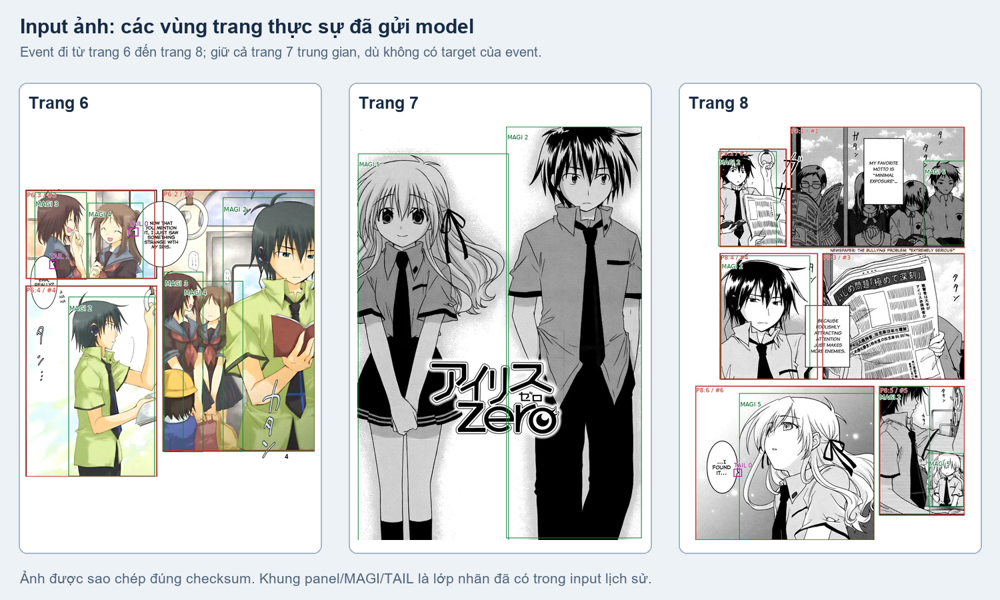

Ảnh giữ cả trang/panel không có câu mục tiêu nhưng nằm giữa hai đầu event, như trang 7 ở trên. Chữ ngoài event có thể giúp hiểu bối cảnh, nhưng model chỉ trả kết quả cho các utterance được yêu cầu. Tọa độ, tỷ lệ ảnh và checksum được lưu để đối chiếu lại.

<strong>Xem packet đầy đủ và giải thích các field input</strong>

[Input packet thật](../examples/analyze-attribution/input-packet.json) đi kèm các file ảnh đã sao chép theo checksum. Bảng này giải thích field của request, không phải semantic output.

| Field | Ý nghĩa |
|---|---|
| `policy`, `output_language` | Contract graph-v7 và ngôn ngữ output model (`en`). |
| `event_id`, `scene_id` | Event cần phân tích và scene chứa nó; phạm vi đã freeze. |
| `chapter_context` | Chapter, name groups, scene summaries và các link từ graph đã freeze. |
| `scene_initial_description`, `scene_current_description` | Mô tả scene ban đầu và mô tả hiện hành sau các event đã xử lý. |
| `previous_event` | ID, description và source IDs của event thành công gần nhất trong scene; event đầu nhận `null`. |
| `scene_memory` | Bản tích lũy gồm `description`, `facts`, `characters`, `unresolved`; facts có source IDs và confidence. |
| `incomplete_events`, `incomplete_event_text` | Các event lỗi trước đó và text nguồn tương ứng, để model biết khoảng thiếu. |
| `targets` | Các utterance phải trả quyết định, tối đa 8. |
| `context` | Text có trong vùng ảnh nhưng không thuộc target event. |
| `mentions` | Các occurrence tên cần phân loại và đối chiếu người được nhắc/gọi. |
| `visual_people` | Bảng `people` và `clusters`, tên đã biết nếu có, MAGI IDs, các quan sát/bbox nguồn. |
| `images` | Metadata ảnh: page, crop bbox, panel, tail, scale, context IDs, đường dẫn và checksum; ảnh thực được đính kèm request đa phương thức. |

Mỗi target giữ `id`, `text`, `page_id`, `panel_index`, `panel_indices`, `bbox`, `speaker_anchor`, `original_speaker`, `bubble_tail`. Anchor và original speaker là bằng chứng nguồn, chưa thay thế quyết định analyze. `bubble_tail.tails` giữ index/bbox và liên kết text nguồn của MAGIv2; một utterance ghép nhiều box giữ các liên kết tương ứng.

## Output

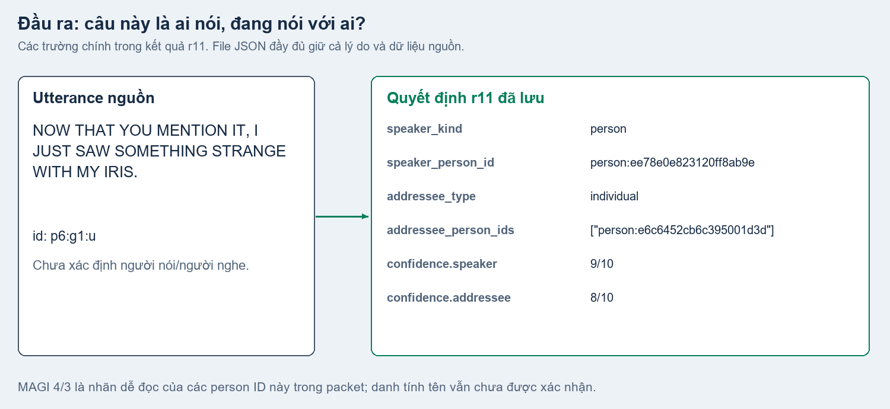

Kết quả r11 xác định hai câu như sau. Điểm 9/10 hay 8/10 là mức chắc chắn model tự chấm, **không có nghĩa tương đương 90% hay 80% đúng**:

| Utterance | Text rút gọn | Speaker | Addressee | Confidence speaker / addressee |
|---|---|---|---|---|
| `p6:g1:u` | NOW THAT YOU MENTION IT… | MAGI 4 | MAGI 3 | 9 / 8 |
| `p6:g2:u` | EHH, REALLY? | MAGI 3 | MAGI 4 | 9 / 8 |

Trong bảng, MAGI 3/4 là nhãn dễ đọc để đối chiếu ảnh. File kết quả giữ ID nhân vật và nhóm quan sát tương ứng. Hai nhân vật này chưa có tên được xác nhận trong đầu vào.

| Output | Nội dung |
|---|---|
| Kết quả cho từng utterance | Người nói, người nhận lời, mức chắc chắn, lý do và nguồn dùng để đối chiếu. |
| Tóm tắt scene và event | Cập nhật tên ngắn/mô tả sau khi đọc kỹ; giữ nguyên cách chia và danh sách utterance của graph. |
| Bộ ghi nhớ mới | Giữ những điều đã biết và những điểm còn chưa rõ để gửi cho event tiếp theo. |

[Xem đầy đủ hai kết quả và bảng đối chiếu nhân vật/MAGI](../examples/analyze-attribution/dialogue-decisions.json). Phần mô tả, lý do và ghi nhớ do model viết dùng tiếng Anh; OCR và tên được trích giữ nguyên.

<strong>Xem các field output trọng tâm</strong>

| Field | Cách đọc |
|---|---|
| `utterance_id` | Utterance nguồn, giữ nguyên từ normalize/graph. |
| `speaker_kind` | `person`, `narrator` hoặc `others`. |
| `speaker_person_id`, `speaker_cluster_ref` | Person thị giác và cluster quan sát tương ứng; narrator/others không có person ID. |
| `addressee_type` | `individual`, `group`, `self`, `audience`, `unknown` hoặc `not_applicable`. |
| `addressee_person_ids` | Các person thị giác được hướng lời tới; không phải mọi người có mặt hoặc có thể nghe. |
| `confidence` | Điểm độc lập 0–10 cho speaker, addressee, content type và speech style. |
| `evidence`, `evidence_refs` | Giải thích và các tham chiếu nguồn hỗ trợ quyết định. |
| `mentions`, `content_type`, `speech_style` | Thông tin hỗ trợ được giải thích trong một mục riêng bên dưới. |

Nhân vật giả định `reference:gN` từ nhóm tên của graph chưa có MAGI/crop. Chỉ mention loại `reference` được trỏ vào thực thể này; speaker/addressee phải dùng person thị giác hợp lệ.

## Model tìm người nói và người nhận lời như thế nào?

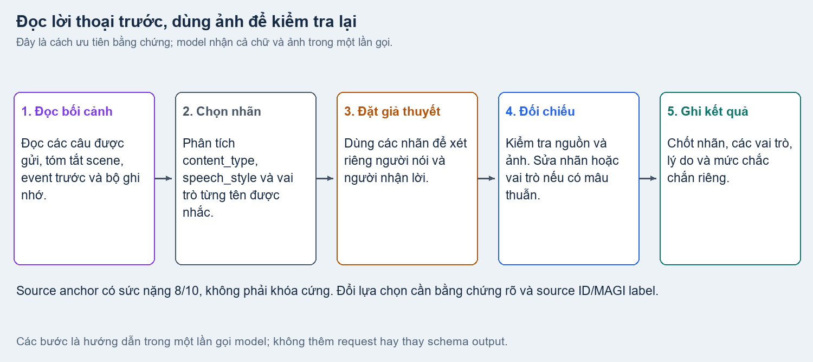

| Cách đọc | Điều cần hiểu |
|---|---|
| Đọc phần chữ và bối cảnh được gửi | Đọc các câu của event, các câu context có sẵn, tóm tắt scene, event trước và ghi nhớ. Không giả định model đã nhận nguyên văn cả scene. |
| **Phân tích hỗ trợ trước** | Chọn `content_type`, `speech_style`, `mention_type` và các phần tên có căn cứ. Những phần cần ảnh mới biết được có thể để chưa xác định ở bước này. |
| **Dùng nhãn để xét hai vai trò** | Lời gọi trực tiếp gợi người nhận lời; lời nhắc người thứ ba chưa xác định hai vai trò. Loại nội dung và cách nói giúp xét câu có giọng nói/người nhận lời như thế nào. |
| Kiểm tra bằng nguồn và ảnh | Đối chiếu với nhân vật, gợi ý người nói và đuôi bubble được cấp; chốt các tham chiếu nhân vật. Nếu có mâu thuẫn, sửa cả nhãn hỗ trợ hoặc lựa chọn vai trò liên quan. |
| Ghi kết quả nhất quán | Trả các nhãn, speaker/addressee, mức chắc chắn riêng và lý do ngắn. Lý do phải chỉ ra dấu hiệu hỗ trợ nào có ích và nguồn nào giúp chọn nhân vật. |

Trình tự được yêu cầu trong prompt là **phân tích nhãn hỗ trợ → dùng nhãn để lập giả thuyết người nói/người nhận lời → kiểm tra nguồn và ảnh → chốt kết quả**. Model vẫn nhận chữ và ảnh trong **một lần gọi**, trả các field trong **một JSON**. Code không thêm một lượt gọi riêng để tạo và duyệt nhãn trước; đây là hướng dẫn cách phân tích trong cùng request, không phải bảo đảm về thứ tự suy nghĩ bên trong model.

Các nhãn ban đầu có thể được sửa khi đối chiếu thêm bằng chứng. Model không được ép ảnh khớp với nhãn đã đoán, tự luân phiên người nói, hay coi chính nhãn mình vừa tạo là bằng chứng độc lập.

Gợi ý người nói từ nguồn là bằng chứng quan trọng. Nếu ảnh hoặc text cho thấy gợi ý đó sai, model phải giải thích rõ vì sao đổi lựa chọn. Một vị trí đứng gần hoặc hướng nhìn mơ hồ không đủ để lấn át lời thoại rõ ràng.

<strong>Quy tắc chính xác khi đối chiếu nguồn</strong>

Source anchor có sức nặng **8/10**, không phải khóa cứng hay confidence tối thiểu. Chỉ bác anchor khi có bằng chứng nguồn/thị giác rõ ràng và giải thích bằng source ID/MAGI label; source dialogue tường minh cũng có thể chỉ ra mâu thuẫn. Graph prose, luân phiên lượt nói hoặc một tên xuất hiện trong câu chưa đủ để bác anchor. Giả thuyết ban đầu không được biến thành thông tin danh tính đã xác nhận cho các lượt sau.

## Phân tích hỗ trợ — từng field và các nhãn được tạo

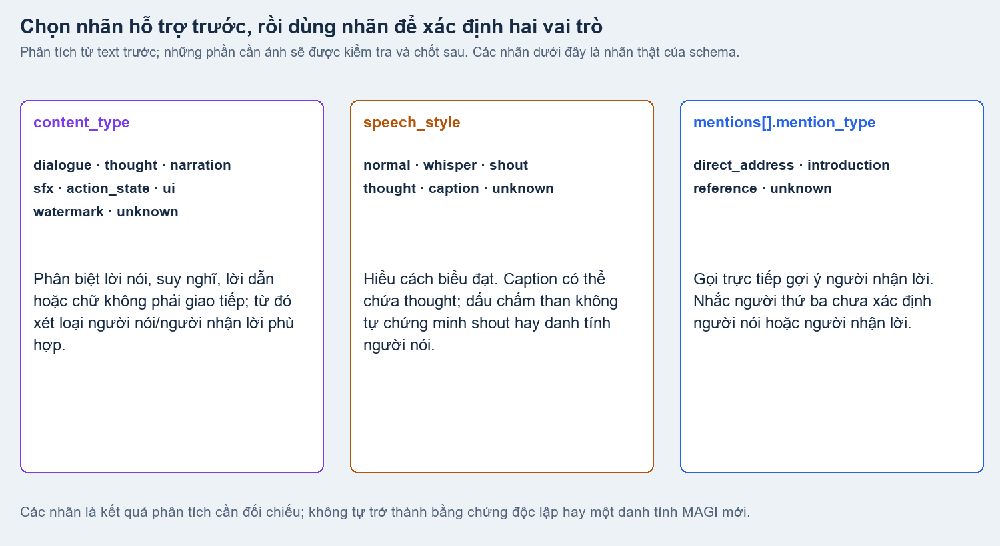

Phân tích hỗ trợ phải tạo **giá trị cụ thể cho từng field**, không chỉ nêu câu hỏi. Phần dưới giải thích các nhãn đúng theo schema hiện tại và cách model dùng chúng để chọn speaker/addressee.

### 1. `content_type` — câu/chữ này làm nhiệm vụ gì?

| Nhãn | Ý nghĩa | Dùng khi xét speaker/addressee |
|---|---|---|
| `dialogue` | Lời nói trong một cuộc trao đổi. | Tìm người đang nói và người mà câu nói hướng tới. |
| `thought` | Những lời nghĩ trong đầu của một nhân vật, kể cả khi đặt trong caption. | Tìm người đang nghĩ; không tự cho rằng có người khác đang nghe hoặc luôn gán `self`. |
| `narration` | Lời kể/giải thích diễn biến, không phải suy nghĩ riêng đã được xác định của nhân vật. | Xét giọng kể và đối tượng đọc/nghe phù hợp; nếu là lời kể của một nhân vật, vẫn cần căn cứ để chọn nhân vật đó. |
| `sfx` | Chữ mô phỏng âm thanh. | Không tự biến âm thanh thành câu do một người nói. |
| `action_state` | Chữ mô tả hành động, tình trạng hoặc trạng thái. | Xét đây có thực sự là giao tiếp hay chỉ là chú thích. |
| `ui` | Chữ của giao diện/hệ thống, menu, thông báo hoặc nhãn trên màn hình. | Xét chức năng thông báo, không tự gán cho một nhân vật trong panel. |
| `watermark` | Dấu tên, nhãn xuất bản/scan hoặc đánh dấu quyền sở hữu. | Không tự gán người nói/người nhận lời trong cuộc hội thoại. |
| `unknown` | Chưa đủ bằng chứng để phân loại. | Giữ điều chưa chắc khi xét các vai trò, không suy một danh tính từ nhãn này. |

Model phân loại theo **chức năng của text**, không chỉ hình dạng bubble. Các nhãn không tự quyết định person ID hoặc loại người nhận lời; chẳng hạn một thông báo giao diện vẫn phải xét xem có đối tượng được hướng tới hay không.

### 2. `speech_style` — câu được biểu đạt thế nào?

| Nhãn | Khi dùng |
|---|---|
| `normal` | Nói thông thường; chưa có bằng chứng riêng về nói nhỏ hay nói lớn. |
| `whisper` | Có căn cứ cho thấy đang thì thầm/nói nhỏ; text nhỏ hoặc dấu ba chấm riêng lẻ chưa đủ. |
| `shout` | Có dấu hiệu rõ của việc hét/gọi lớn. Chữ hoa, dấu chấm than, cảm xúc hoặc bubble nhọn riêng lẻ chưa đủ. |
| `thought` | Cách thể hiện giọng nghĩ bên trong được ngữ cảnh hỗ trợ. |
| `caption` | Cách trình bày bằng caption; nội dung có thể là suy nghĩ hoặc lời dẫn. |
| `unknown` | Chưa rõ cách biểu đạt/trình bày. |

Ví dụ, `content_type=thought` có thể đi cùng `speech_style=caption`: đó là suy nghĩ được đặt trong caption. Các nhãn giúp kiểm tra tình huống giao tiếp, nhưng không dùng âm lượng hay cảm xúc để tự suy danh tính. Khi chỉ phân vân giữa `shout` và lời nói thông thường, hướng dẫn hiện tại ưu tiên `normal`.

### 3. `mentions[].mention_type` — tên trong câu được dùng vào việc gì?

| Nhãn | Ý nghĩa | Liên hệ với hai vai trò |
|---|---|---|
| `direct_address` | Dùng tên để gọi hoặc nói trực tiếp với người mang tên đó. | Đề xuất người được gọi làm ứng viên addressee; chưa tự gán tên vào một MAGI ID. |
| `introduction` | Giới thiệu tên của bản thân hoặc một người khác. | Chỉ lời tự giới thiệu có căn cứ mới gợi tên của speaker; giới thiệu người khác không biến người đó thành speaker/addressee. |
| `reference` | Nhắc/bàn về một người. | Người được nói đến có thể là người thứ ba, chưa chắc là người nhận lời hay người nói. |
| `unknown` | Chưa đủ bằng chứng để hiểu vai trò của tên. | Không dùng tên này để chốt speaker/addressee khi chưa có căn cứ khác. |

Ví dụ “KOYUKI- CHAN!? REALLY!?” trong kết quả r11 có `mention_type=direct_address`, gợi việc gọi Koyuki trực tiếp. Sau đó vẫn cần đối chiếu người được gọi với các tham chiếu nhân vật hợp lệ. Hai câu trang 6 của ví dụ chính không có mention được cấp, nên `mentions=[]`; không tự tạo tên hoặc mention giả để lấp chỗ trống.

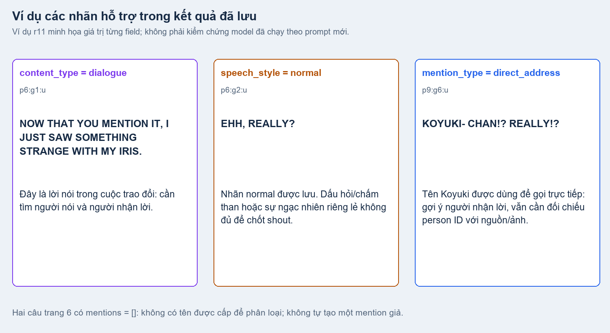

Đây là giá trị field trong **kết quả r11 đã lưu**, không phải kết quả chạy thử prompt mới. [Các field và ví dụ đầy đủ](../examples/analyze-attribution/auxiliary-fields.json).

### 4. Những field còn lại của một mention

| Field | Ý nghĩa và cách sử dụng |
|---|---|
| `candidate_id` | ID occurrence tên đã được cấp từ graph; phải giữ nguyên để truy về đúng câu. |
| `confirmed_person_name` | `true` khi có căn cứ xác nhận đây là tên người và đã chọn target hợp lệ; `false` khi chưa xác nhận. Không đồng nghĩa vừa xác nhận một danh tính MAGI mới. |
| `target_person_id` | Người được nhắc/gọi, chốt sau khi đối chiếu. Có thể `null` khi chưa đủ căn cứ. Chỉ mention `reference` được trỏ vào nhân vật giả định chỉ có tên. |
| `recipient_cluster_ref` | Nhóm quan sát của **người được nhắc/gọi**, phải khớp target; không mặc định là nhóm của addressee. Không có nhóm phù hợp thì dùng `null`. |
| `components` | Các phần tên có căn cứ trong text, mỗi phần có `kind` và `value`; không lấy canonical name để tự mở rộng tên đang được dùng. |
| `confidence.mention_type`, `confidence.target` | Chấm riêng mức chắc chắn về cách dùng tên và về người được tên đó trỏ tới. |
| `evidence` | Lý do ngắn cho quyết định mention, dựa trên lời thoại và nguồn được cấp. |

`visual_support` chỉ được chốt khi đã xét ảnh/quan sát được cấp:

| Nhãn | Ý nghĩa |
|---|---|
| `compatible` | Các quan sát hình ảnh được cấp hỗ trợ sự phù hợp khi đối chiếu target. Chưa tự chứng minh danh tính chỉ từ hình dáng. |
| `different_appearance` | Có bằng chứng hình ảnh cho thấy khác biệt ngoại hình. |
| `unknown` | Chưa đủ cơ sở để so sánh. Nhóm tên trên text không tự tạo bằng chứng thị giác. |

Các nhãn của `components[].kind`:

| Nhãn | Phần tên được ghi trong `value` |
|---|---|
| `given_name` | Tên riêng, như `Toru`. |
| `middle_name` | Tên đệm, khi có căn cứ từ nguồn. |
| `surname` | Họ, như `Mizushima`. |
| `nickname` | Biệt danh được dùng trong nguồn. |
| `full_name` | Tên đầy đủ thực sự được dùng trong text. |

### 5. Dùng kết quả hỗ trợ để chọn người, rồi kiểm tra lại

Những nhãn trên phải được dùng để thu hẹp cách hiểu câu. Chẳng hạn, `direct_address` gợi ứng viên người nhận lời; `reference` không có tác dụng tự động ấy; `thought` gợi việc tìm chủ thể đang nghĩ thay vì ép thành đối thoại giữa hai người. Sau đó model đối chiếu nguồn/ảnh để chọn person ID và kiểm tra các field có nhất quán không.

Nếu ảnh hoặc nguồn khác chỉ ra nhãn ban đầu sai, model được yêu cầu sửa nhãn cùng lựa chọn vai trò liên quan. Lý do trong `evidence`/`evidence_refs` cần nêu ngắn dấu hiệu hỗ trợ đã dùng và nguồn giúp chọn người; không yêu cầu xuất toàn bộ suy luận từng bước. Điểm speaker/addressee không được sao chép từ điểm loại câu, cách nói hoặc mention.

Tóm tắt scene, event trước và memory **nhận vào** giúp đặt câu trong bối cảnh. Tóm tắt/memory **mới tạo cho event hiện tại** được viết sau khi đối chiếu kết quả để dùng cho event sau; không dùng chúng làm bằng chứng độc lập cho chính kết luận vừa tạo.

## 1. Speaker — ai phát ngôn utterance này?

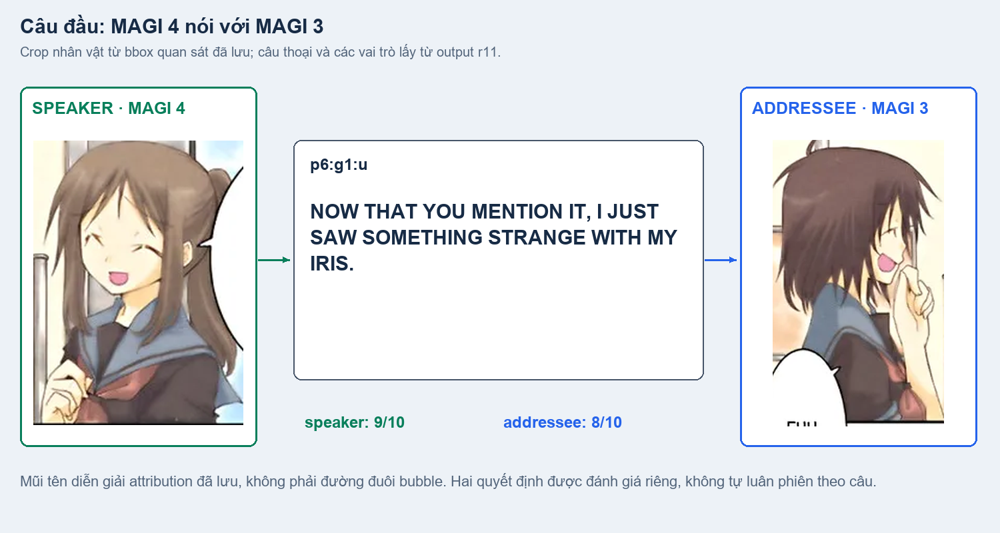

Câu “NOW THAT YOU MENTION IT…” có ý “nhắc mới nhớ…”, cho thấy người nói đang tiếp lời một cuộc trao đổi. Chỉ đọc câu này chưa đủ để biết người nào trên ảnh đang nói, nên model cần đối chiếu thêm với nhân vật và dữ liệu nguồn. Kết quả r11 chọn **MAGI 4**; gợi ý người nói nguồn và đuôi `TAIL 0` là các bằng chứng được cấp để kiểm tra.

Mũi tên trong hình thể hiện **ai nói với ai**, không phải đường đuôi bubble. Đuôi có thể chỉ ra ngoài panel; khi không có đuôi, vẫn cần xét bằng chứng khác, không tự coi đó là suy nghĩ hay lời dẫn.

`speaker_kind` có ba nhãn:

| Nhãn | Ý nghĩa và ID đi kèm |
|---|---|
| `person` | Quy lời nói/suy nghĩ về một person thị giác hợp lệ; có `speaker_person_id`. `speaker_cluster_ref` phải là nhóm quan sát của person đó, hoặc `null` khi không có nhóm phù hợp. |
| `narrator` | Giọng dẫn chuyện không được quy về một nhân vật thị giác cụ thể; person/cluster ID là `null`. |
| `others` | Nguồn khác không gán được vào hai loại trên theo các tham chiếu hiện có; person/cluster ID là `null`. |

Không quyết định chỉ từ một nhãn hỗ trợ. Nếu có nhiều ứng viên person, chọn người có bằng chứng tốt nhất và giữ mức chắc chắn thấp khi còn mâu thuẫn; không tạo person ID mới.

## 2. Addressee — người nói đang hướng lời tới ai?

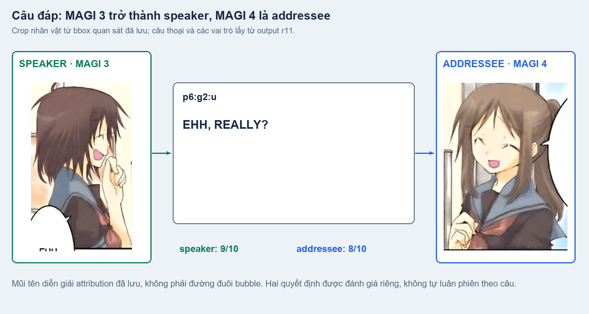

“EHH, REALLY?” là lời ngạc nhiên với điều vừa nghe. Kết quả r11 chọn **MAGI 3 nói với MAGI 4**. So với câu trước, hai người đổi vai: người nghe câu đầu trở thành người nói câu sau. Đây là kết quả của cặp thoại này; không phải quy tắc áp dụng cho mọi cặp câu.

Addressee là **người mà câu nói hướng tới**, không phải tất cả người có thể nghe thấy. Một câu có thể nói với một người, cả nhóm, chính mình hoặc độc giả. Nếu nhắc tên một người thứ ba, người đó chưa chắc là người đang nói hoặc người nhận lời.

Prompt hướng dẫn chọn `addressee_type` như sau:

| Nhãn | Ý nghĩa và cách chọn người |
|---|---|
| `individual` | Hướng tới một người; chọn đúng một person ID có căn cứ. |
| `group` | Hướng tới nhiều người; ghi các person ID được hỗ trợ, không tự coi mọi người trong panel đều là người nhận lời. |
| `self` | Thực sự nói với chính mình; khi speaker đã xác định, người nhận lời là người đó. Không tự dùng `self` cho mọi câu `thought`. |
| `audience` | Hướng tới độc giả/khán giả nói chung, không phải một person thị giác cụ thể. |
| `unknown` | Chưa có căn cứ để xác định người nhận lời. |
| `not_applicable` | Câu/chữ không có đối tượng nhận lời, chẳng hạn âm thanh hoặc chú thích không mang chức năng giao tiếp. |

Với `audience`, `unknown`, `not_applicable`, không tự tạo person ID người nhận lời. Đây là quy tắc hướng dẫn trong prompt; lần thay đổi này giữ nguyên schema và bộ kiểm tra code hiện tại. Confidence cho speaker/addressee được chấm riêng 0–10, còn `evidence` và `evidence_refs` ghi lý do/ngữ liệu giúp đối chiếu, không phải một nhãn danh tính mới.

## Scene song song, event trong scene nối tiếp

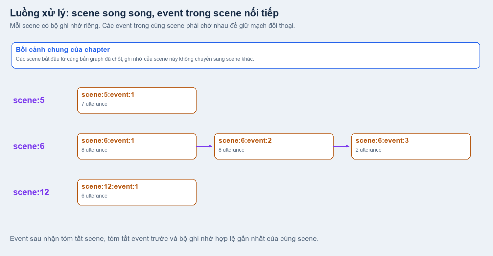

**Nhiều scene có thể được xử lý cùng lúc** để tăng tốc. Mỗi scene bắt đầu từ cùng bản graph đã chốt và có bộ ghi nhớ riêng. Số scene chạy cùng lúc được giới hạn bởi `scene_concurrency` và `runtime.llm_slots`.

**Trong một scene, các event phải đi lần lượt.** Event sau cần biết event trước vừa xảy ra gì để hiểu câu trả lời, đại từ hoặc những cách gọi bỏ tên. Bộ ghi nhớ đang cập nhật của scene này không chuyển sang scene khác. Kết quả cuối được ghép lại đúng thứ tự nguồn.

Mỗi event có tối đa **8 utterance**, tính cả lời nói, suy nghĩ, lời dẫn và caption. Analyze giữ nguyên cách chia của graph; có thể cập nhật tên ngắn và mô tả scene/event. Sơ đồ trên minh họa thứ tự xử lý, không phải thời gian chạy đo được.

### Tóm tắt và memory tích lũy qua các event

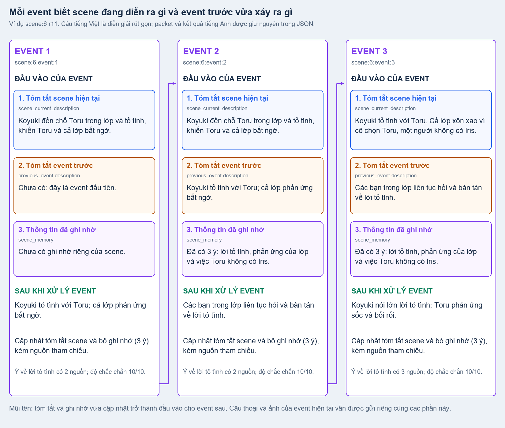

Model không bắt đầu lại từ đầu khi chuyển sang event mới. Ngoài các câu và ảnh cần đọc ở event hiện tại, nó nhận **ba phần để biết chuyện đã đi đến đâu**:

| Phần nhận vào | Câu hỏi nó trả lời |
|---|---|
| **Tóm tắt scene hiện tại** — `scene_current_description` | Phân cảnh này đang diễn ra chuyện gì? Event đầu dùng mô tả từ graph; về sau dùng bản mô tả hiện hành sau các event trước. |
| **Tóm tắt event trước** — `previous_event.description` | Ngay trước phần này vừa xảy ra điều gì? Event đầu chưa có phần này. |
| **Ghi nhớ tích lũy** — `scene_memory` | Những điều quan trọng nào đã biết và điều gì còn chưa rõ? |

Xử lý xong một event, model trả tóm tắt event vừa đọc, mô tả scene được cập nhật và bộ ghi nhớ mới. **Các phần này trở thành đầu vào cho event tiếp theo trong cùng scene.** Nhờ vậy, một câu như “thật sao?” có thể được hiểu dựa trên điều vừa kể, thay vì bị đọc tách rời.

Hình dùng ví dụ `scene:6`: Koyuki tỏ tình, rồi cả lớp phản ứng. Các câu tiếng Việt trong hình được diễn giải rút gọn từ đầu vào/kết quả thật để dễ đọc; file JSON giữ nguyên tiếng Anh. Event đầu đã có **tóm tắt scene**, dù chưa có event trước và ghi nhớ riêng còn rỗng. Hai event sau đều nhận tóm tắt scene, tóm tắt event trước và thông tin đã tích lũy.

Ghi nhớ không phải bản chép lại toàn bộ lời thoại. Trong ví dụ, số ý được giữ vẫn là 3, nhưng nguồn tham chiếu được bổ sung khi có thông tin mới. Mỗi ý có nguồn và mức chắc chắn để kiểm tra lại. [Đầu vào thật của ba event](../examples/analyze-attribution/memory-inputs.json) · [Tóm tắt và ghi nhớ đầu ra](../examples/analyze-attribution/memory-events.json).

## Khi chưa xác định được hoặc gặp lỗi

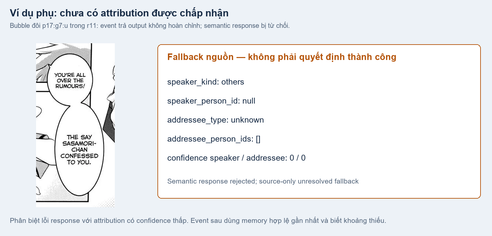

Bubble đôi `p17:g7:u` ở docs trước gặp lỗi trong r11: model trả thiếu kết quả cho event. Vì vậy, hệ thống giữ `speaker_person_id: null`, `addressee_type: unknown` và điểm 0 để đánh dấu **chưa có kết quả dùng được**. Đây là giá trị dự phòng do lỗi, khác với trường hợp model đã chọn một người nhưng tự chấm mức chắc chắn thấp. [Kết quả dự phòng và lỗi event](../examples/analyze-attribution/unresolved-decision.json).

Event lỗi không tự chạy lại. Event sau dùng bộ ghi nhớ hợp lệ gần nhất và được báo phần nào trước đó còn thiếu. Hệ thống giữ lỗi và các câu chưa giải quyết để kiểm tra sau, không tự tạo tóm tắt hoặc người nói giả. Nếu đã có lựa chọn nhưng mức chắc chắn thấp, lựa chọn ấy được giữ tạm để reanalyze đối chiếu.

## Kết luận và chuyển sang bước sau

Sau analyze, mỗi utterance có kết quả về **người nói và người nhận lời**, kèm lý do, nguồn đối chiếu và mức chắc chắn. Tóm tắt và bộ ghi nhớ giúp các event trong scene nối tiếp nhau. [Reanalyze](07_reanalyze.md) kiểm tra lại kết quả trên toàn chapter; bản analyze gốc vẫn được giữ để so sánh trước/sau.

[Nguồn/checksum hình và dữ liệu](../examples/analyze-attribution/manifest.json) · [Script dựng hình từ artifact đã lưu, không gọi model](../../../scripts/build_v7_analyze_doc_examples.py). Code: [event_analysis.py](../../../src/manga_pipeline/v6/event_analysis.py), [event_visuals.py](../../../src/manga_pipeline/v6/event_visuals.py), [story_contract.py](../../../src/manga_pipeline/v6/story_contract.py).
