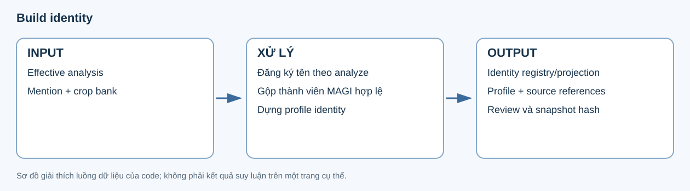

# 8. Build identity

**Input:** semantic hiệu lực, occurrence tên và crop/embedding bank. **Output:** identity registry/projection, quyết định gộp thành viên MAGI, profile và dữ liệu review.



## Nhìn một identity trong output

Ví dụ **minh họa cấu trúc**, với số liệu/ID giả định; đây không phải kết quả của lượt graph/analyze mới:

```json
{
  "eligible_identities": {
    "person:example": {
      "person_id": "person:example",
      "primary_name": "Koyuki Sasamori",
      "magi_ids": ["5"],
      "main_magi_id": "5",
      "chapter_appearances": 12
    }
  }
}
```

| Thành phần | Ý nghĩa |
|---|---|
| `primary_name` | Tên identity đã được đăng ký từ mention do analyze xác nhận. |
| `magi_ids` | Những số MAGI là thành viên của identity, không phải alias text. |
| `main_magi_id` | Thành viên chính được đóng băng để làm mốc visual matching. |
| `chapter_appearances` | Số lần xuất hiện/crop trong chapter đang xét. |
| `name_binding.selections` | Ứng viên nhóm tên, support, eligibility và lý do lựa chọn/loại. |
| `profiles` | Profile theo identity, với thuộc tính, trạng thái, basis và source references. |
| `frozen_main_members` | Các mốc chính dùng khi xét bổ sung thành viên. |
| `source_cluster_bank_mutated` | Thể hiện chính sách giữ nguyên bank MAGI nguồn. |

## Tên, thành viên và profile được tạo thế nào?

Occurrence được đếm theo nguồn riêng biệt để không tăng support chỉ vì cùng câu xuất hiện ở nhiều bản sao. Khi nhiều nhóm tên cạnh tranh cho cùng MAGI, output giữ ứng viên và tie-break để review. Một câu có tên không mặc nhiên đặt tên cho speaker: owner của mention lấy từ semantic đã analyze.

Đăng ký tên và xây profile là hai phần khác nhau. Phần đăng ký không gọi model nhìn panel để sửa owner. Phần profile dùng crop gần prototype và dữ kiện thoại để mô tả identity; thuộc tính chưa rõ phải giữ trạng thái tương ứng, không trở thành bằng chứng để quay lại ghi đè speaker.

Stage hiện hành đăng ký tên từ kết quả analyze có quyền ưu tiên, không gọi model gán tên lại và không dùng panel để đổi owner. Đầu vào semantic được lấy qua `RunStore.analysis()`: reanalyze hiệu lực hoặc nguyên analyze khi fallback.

Giữ điều kiện đang có: tối thiểu 8 crop chapter và 3 occurrence tên được xác nhận cho đăng ký mới; identity đã có được bảo vệ. Các mention được đếm theo occurrence nguồn riêng biệt. **Chưa bổ sung gate confidence sau reanalyze.**

Gộp theo cùng nhóm tên đã thắng hoặc visual min-crop <0.38 tới main MAGI đóng băng, chọn theo số lần xuất hiện. Không gộp xuyên sang identity đã có khác và không lan truyền visual match qua thành viên vừa thêm. MAGI bank nguồn không bị sửa.

Profile vẫn là phần của stage này, dùng crop bank và dialogue theo cơ chế hiện có. Không dùng story graph như một cơ chế gộp identity mới.

Artifact gồm name-binding result, identity plan/registry operation, profile và review. Code: [identity_from_analyze.py](../../../src/manga_pipeline/v6/identity_from_analyze.py), [identity_v2.py](../../../src/manga_pipeline/v6/identity_v2.py), [identity_profiles.py](../../../src/manga_pipeline/v6/identity_profiles.py).

## Config và chuyển dữ liệu

| Key trong `v6` | Mặc định | Tác dụng |
|---|---|---|
| `identity_min_chapter_crops` | `8` | Crop tối thiểu trong chapter cho đăng ký mới. |
| `min_confirmed_call_events` | `3` | Occurrence tên xác nhận tối thiểu. |
| `identity_visual_min_crop` | `0.38` | Ngưỡng visual min-crop đối chiếu thành viên chính. |
| `profile_crops` | `10` | Số crop gần prototype dùng cho profile khi có đủ. |
| `profile_concurrency`, `profile_output_tokens` | `8`, `4096` | Giới hạn song song và output profile. |

Relationship nhận danh sách identity/profile và hash snapshot. Export gắn identity projection vào semantic nhưng giữ riêng ID speaker/addressee ban đầu. Khi review, đọc cả eligibility/support, quyết định gộp, profile và failure; việc có tên trong registry không chứng minh mọi crop trong nhóm đều đúng người.
