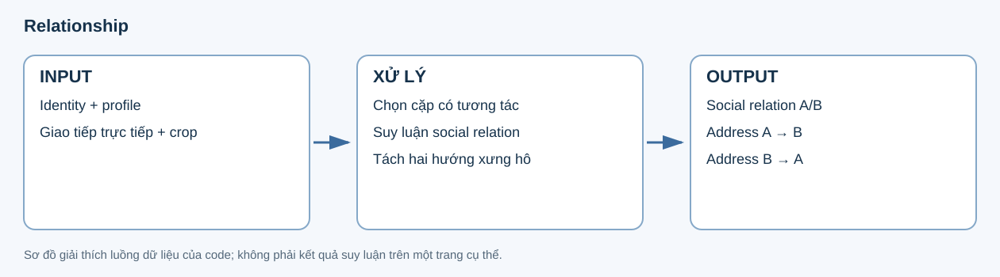
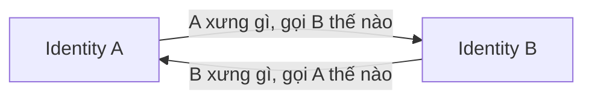

# 9. Relationship

**Input:** identity/profile và semantic hiệu lực. **Output:** social relation và hai cạnh xưng hô độc lập A→B, B→A cho cặp có giao tiếp trực tiếp.



## Thành phần và hướng của cạnh



Hai chiều có thể khác nhau. Một social relation như “bạn học” mô tả quan hệ chung; nó không thay thế hai quyết định xưng hô có hướng.

JSON sau là **ví dụ schema giả định**, không phải kết quả model trên Iris Zero:

```json
{
  "address_edges": [
    {"from_id": "person:A", "to_id": "person:B", "self": "tôi", "address": "cậu", "status": "inferred", "basis": "age_and_context", "reason": "Hai người cùng lứa tuổi trong ngữ cảnh giả định.", "evidence_refs": []},
    {"from_id": "person:B", "to_id": "person:A", "self": "tớ", "address": "bạn", "status": "inferred", "basis": "age_and_context", "reason": "Chiều ngược được xét độc lập.", "evidence_refs": []}
  ]
}
```

| Trường/thành phần | Cách đọc |
|---|---|
| `from_id`, `to_id` | Người đang nói và người được nói tới trong cạnh xưng hô. |
| `self`, `address` | Cách xưng bản thân và cách gọi đối phương. |
| `status`, `basis`, `reason` | Mức khẳng định, cơ sở và giải thích model. |
| `evidence_refs` | Nguồn model viện dẫn; các nguồn thực sự đã cung cấp còn được giữ riêng để audit. |
| `pairs` | Kết quả theo cặp identity, bao gồm decision và failure nếu có. |
| `address_table` | Bảng xưng hô hợp nhất dùng cho dịch. |
| `social_relations` | Quan hệ xã hội, vai trò từng phía và giải thích. |

## Chọn dữ kiện cho model

Cặp được chọn từ giao tiếp trực tiếp trong semantic hiệu lực. Crop/profile cung cấp mốc ngoại hình và tuổi biểu kiến khi cần suy luận xưng hô; thoại cung cấp ngữ cảnh tương tác. Model không nhận toàn bộ lịch sử audit trùng lặp của profile.

Khi không đủ dữ kiện, trạng thái unknown/failure được giữ cho review. Code không biến việc cùng xuất hiện trong ảnh thành một cuộc giao tiếp đã xác nhận.

Giữ cơ chế hiện hành: crop bank, profile appearance và thoại; concurrency tối đa 8. Không xem cùng panel hoặc chỉ nhắc tên là bằng chứng giao tiếp trực tiếp. Story graph mới chưa thay thế thiết kế relationship.

Profile gửi model chỉ gồm claims/citation cần thiết, bỏ bản sao audit lặp; profile đầy đủ vẫn giữ trong artifact. Failure/unknown phải hiển thị trong review, không được báo là suy luận quan hệ thành công.

HTML identity/relationship riêng tiếp tục được hỗ trợ. Code: [relationship_v2.py](../../../src/manga_pipeline/v6/relationship_v2.py), [identity_runtime.py](../../../src/manga_pipeline/v6/identity_runtime.py).

## Config, output và bước sau

`v6.relationship_concurrency=8` giới hạn request song song; `relationship_crops_per_magi=3` chọn crop theo mỗi số MAGI và `relationship_output_tokens=4096` dự phòng output. Điều kiện crop/identity được dựng từ stage trước; `relationship_min_appearances=8` là mốc số lần xuất hiện cấu hình được.

Review JSON/HTML cần nhìn cả hai cạnh và `inference_failures`, `needs_review`, `crop_issues`. `profile_snapshot_hash` và `snapshot_hash` cho biết bảng quan hệ đã dựa vào phiên bản dữ kiện nào. Export giữ snapshot này; translate dùng bảng xưng hô để dịch nhất quán. Thiết kế update graph quan hệ qua chapter sau chưa được mở rộng trong luồng này.
