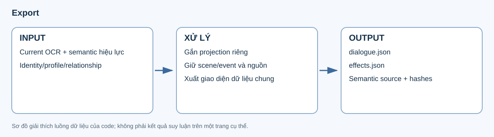

# 10. Export

**Input:** OCR hiện hành, semantic hiệu lực và kết quả identity/relationship. **Output:** tài liệu dialogue/effects có ID, vị trí, semantic và projection identity cho dịch/dàn chữ.



## Các thành phần của output

Ví dụ dưới **minh họa schema bằng ID/text giả định**, không phải câu đã dịch hoặc kết quả model của một run:

```json
{
  "kind": "structured_dialogue",
  "semantic_source": "reanalyze",
  "reanalyze_status": "completed",
  "utterances": [
    {
      "id": "example:p1:g1:u",
      "text": "Hello!",
      "speaker_person_id": "person:visualA",
      "speaker_identity_id": "person:identityA",
      "addressee_person_ids": ["person:visualB"],
      "addressee_identity_ids": ["person:identityB"],
      "scene_id": "scene:1",
      "event_id": "scene:1:event:1"
    }
  ],
  "effects": []
}
```

| Thành phần | Ý nghĩa |
|---|---|
| `utterances` | Các câu còn lại cho luồng thoại/thought/narration và dịch. |
| `effects` | Các dòng có semantic `sfx` hoặc `action_state`. |
| `excluded` | Các phần như UI/watermark được giữ ở danh sách loại trừ. |
| `speaker_person_id` | Quyết định speaker từ semantic hiệu lực. |
| `speaker_identity_id` | Projection qua registry sau build_identity; được lưu riêng với quyết định gốc. |
| `addressee_identity_ids`, `mention_identity_ids` | Projection tương tự cho người nghe và mention target. |
| `source_boxes`, `bbox`, page/panel | Dấu vết vị trí dùng cho xóa chữ và dàn chữ. |
| `semantic_source`, `reanalyze_status` | Nguồn thực sự đang được dùng, kể cả khi phải fallback. |

## Quá trình và config

Code lấy text hiện hành, gắn từng semantic row theo utterance ID, rồi tạo projection identity. Phân loại `sfx/action_state` vào effects và `ui/watermark` vào excluded. Nội dung được giữ theo provenance của normalize/current OCR; bước này không gọi LLM để viết lại thoại.

Export không có ngưỡng suy luận speaker mới. Các lựa chọn ngữ nghĩa thuộc analyze/reanalyze, còn chính sách identity thuộc stage 8. Config translation/inpaint/typeset quyết định cách các consumer sử dụng output, không đổi quyền ưu tiên semantic ở export.

Kết hợp normalize/current OCR, semantic hiệu lực và identity projection. Lưu dialogue/effects, source boxes, confidence, scene/event, story graph, profile và relationship snapshot hashes.

`semantic_source` cho biết dùng `reanalyze` hay fallback `analyze`; `reanalyze_status` giữ trạng thái đối chiếu. Speaker/addressee/mention từ semantic không bị build_identity viết lại; các trường projection identity được giữ riêng.

Đầu ra có `dialogue.json`, `effects.json` và result của stage. Code: [semantic.export](../../../src/manga_pipeline/v6/semantic.py), [dispatch](../../../src/manga_pipeline/v6/stages.py).

## Chuyển sang bước sau

Translate nhận text, scene/event, speaker/listener, profile/xưng hô và glossary. Inpaint nhận nguồn/vùng chữ cần xóa. Typeset về sau dùng cùng ID và vị trí để đặt bản dịch. Khi review một câu dịch hoặc vùng render sai, bắt đầu từ ID export để truy ngược tới semantic và source box, thay vì suy ra lại người nói từ trang đã dàn chữ.
