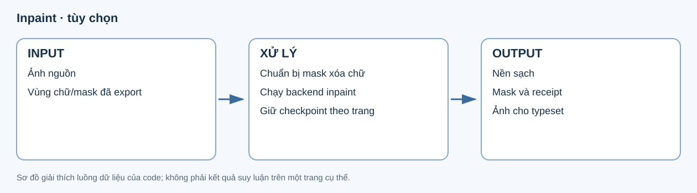
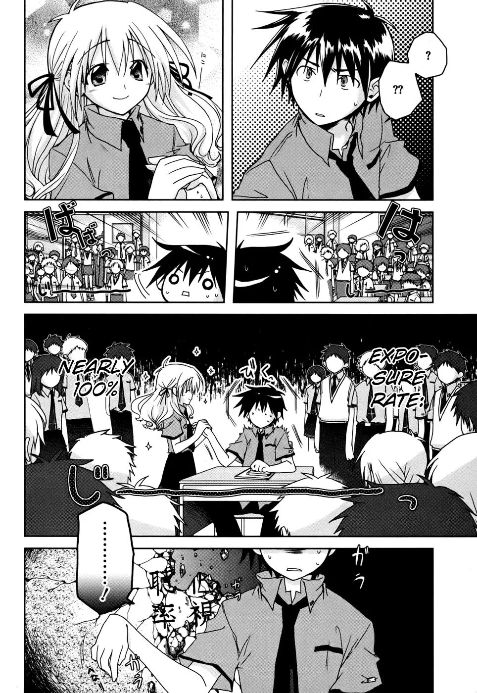
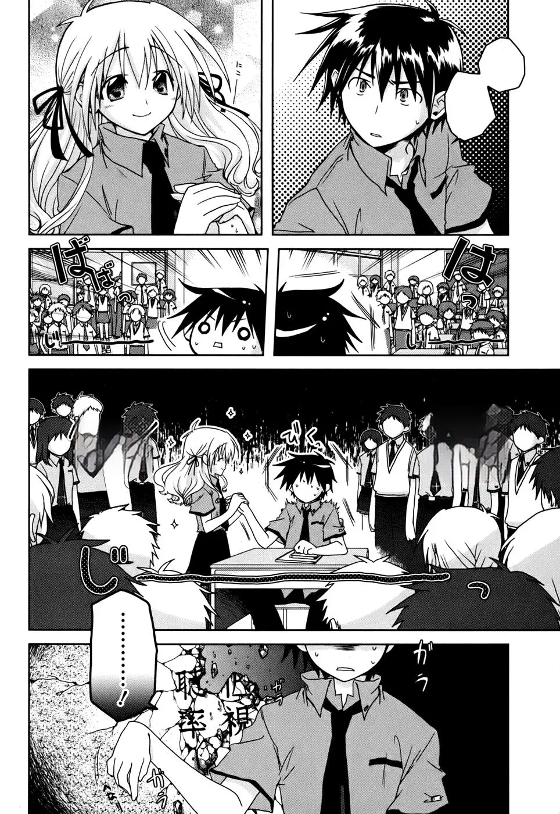
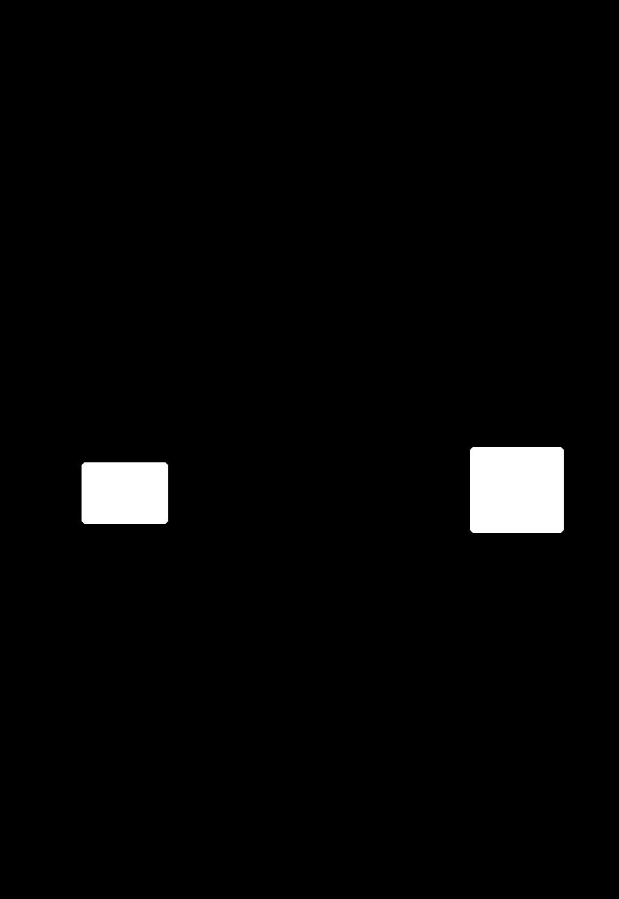

# 11. Inpaint — tùy chọn

**Input:** ảnh gốc, các text được chọn từ export và hình học/mask bubble. **Output:** ảnh nền sạch theo trang, mask theo phương pháp xử lý, quyết định và checksum để typeset tái sử dụng.



## Input/output thật

Ví dụ trang 11 Iris Zero dưới đây lấy từ **artifact inpaint lịch sử** của run `20261022T160100Z-07381866`, được lưu trong bản import r15 ngày 23/10. Nó minh họa backend hình ảnh; không phải output của lượt graph/reanalyze mới.

| Input | Ảnh nền sạch đã lưu |
|---|---|
|  |  |

Model của ví dụ là `mayocream/aot-inpainting`. Trên trang này, hai box dấu hỏi được white-fill, hai box không khớp bubble dùng AOT; `aot_calls=1` là số lần gọi backend cho trang.

## Mask và quyết định

| White-fill mask | AOT mask |
|---|---|
|  |  |

Màu trắng chỉ vùng được phương pháp tương ứng xử lý. Đây là mask xóa chữ đã chuẩn bị, khác mask toàn bubble ở layout.

Trích một quyết định thật:

```json
{
  "source_text_id": "b68ed9e490d577e6:p11:t0",
  "bubble_id": "b68ed9e490d577e6:p11:g1:part1",
  "method": "white_fill",
  "background": {"reason": "confident_white", "samples": 876, "white_fraction": 1, "std": 0.1541},
  "requires_review": false,
  "reason": null
}
```

| Trường | Ý nghĩa |
|---|---|
| `source_text_id`, `bubble_id` | Vùng text/bubble đã dùng khi chọn phương pháp. |
| `method` | White-fill khi nền đủ điều kiện, hoặc AOT khi cần khôi phục nền. |
| `background` | Các chỉ báo về nền đã đo để đưa ra lựa chọn. |
| `requires_review`, `reason` | Có cần review và nguyên nhân. |
| `clean_path`, `files` trong page record | Đường dẫn ảnh sạch và checksum các ảnh/mask output. |
| `model_asset_sha256`, `aot_calls` | Provenance model và số lần dùng backend. |

[Page record đầy đủ](../examples/inpaint/page.json) giữ cả quyết định white-fill/AOT. [Manifest](../examples/inpaint/manifest.json) ghi nguồn, revision và checksum từng ảnh.

## Xử lý và config

Code tạo vùng xóa từ text/geometry, kiểm tra nền, dùng white-fill hoặc backend phù hợp, rồi ghép kết quả theo mask. Phần nằm ngoài mask được bảo vệ khi ghép prediction. Mỗi trang có checkpoint; lỗi được ghi theo trang thay vì tạo ảnh sạch giả.

| Config trong `inpaint` | Vai trò |
|---|---|
| `enabled` | Bật/tắt stage. |
| `model`, `revision`, `model_root`, `device` | Backend, trọng số và môi trường chạy. |
| `dilation` | Mở rộng mask xóa chữ; ví dụ dùng 4 pixel. |
| `max_side` | Kích thước xử lý backend; ví dụ 1024. |
| `white_min`, `white_fraction`, `white_std`, `white_chroma` | Điều kiện chọn white-fill theo nền. |

Stage dùng exported text/mask và bubble geometry để xóa chữ, tạo nền sạch. Không dùng inference này để thay semantic của graph. Chỉ chạy khi `inpaint.enabled=true`; typeset chờ đầu ra tương ứng nếu được bật.

Giữ checksum mask/ảnh và provenance backend. Worker visual/model environment tách khỏi OCR/LLM. Code: [visual/inpaint.py](../../../src/manga_pipeline/visual/inpaint.py).

## Chuyển sang bước sau

Typeset nhận `clean_path` đúng trang khi inpaint được bật. Translate không cần chờ nền sạch để quyết định nội dung dịch. Lỗi inpaint không được xử lý bằng cách đổi semantic, speaker hoặc tên nhân vật. [Script sao chép ví dụ](../../../scripts/build_v7_inpaint_examples.py) chỉ lấy artifact đã có, không chạy model.
