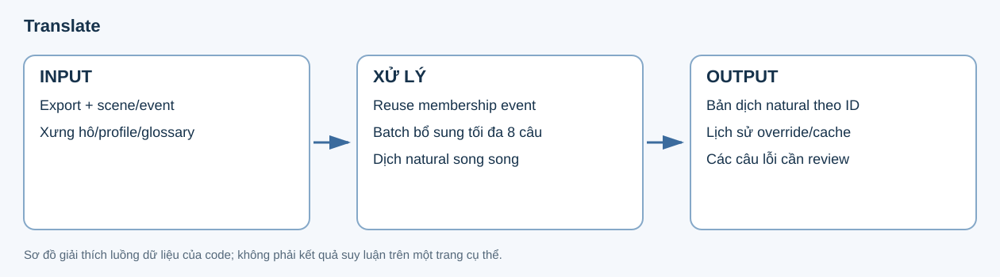

# 12. Translate

**Input:** dialogue/effects đã export, semantic hiệu lực, scene/event, profile, bảng xưng hô và glossary. **Output:** một bản dịch tiếng Việt **natural** theo từng ID, cùng cờ review, đề xuất glossary và checkpoint batch.



## Các thành phần input

| Thành phần | Dùng để làm gì? |
|---|---|
| Text và utterance ID | Dịch đúng đơn vị và trả về đúng câu. |
| Speaker/addressee, scene/event | Biết ai nói với ai và tình huống của câu. |
| Bảng xưng hô có hướng | Chọn đúng cạnh từ speaker tới người nghe; chiều ngược là quyết định riêng. |
| Profile/glossary | Giữ dữ kiện nhân vật và thuật ngữ đã xác nhận. |
| Manual/natural override | Giữ lựa chọn đã được lưu thay vì tự tạo phiên bản khác. |

## Batch vận hành thế nào?

Membership của event analyze được tái sử dụng cho các câu còn cần dịch. Những câu ngoài các batch này được gom bổ sung, tối đa 8 câu/batch, không yêu cầu cùng scene. Một utterance thuộc tối đa một job; các batch không phải nối đuôi bằng bản dịch của batch trước.

Plan được đóng băng cùng tài nguyên xưng hô/glossary. Mỗi job đi qua kiểm tra budget và runtime admission trước khi gửi model. Concurrency cấu hình là trần, còn số request thực chạy phụ thuộc slot/runtime và scheduler.

## JSON output

Ví dụ **minh họa cấu trúc lưu trữ**, không phải output model trên Iris Zero:

```json
{
  "id": "example:p1:g1:u",
  "text": "Hello!",
  "translations": {
    "natural": {
      "id": "example:p1:g1:u",
      "translation": "Chào cậu!",
      "needs_review": false,
      "review_reason": "",
      "glossary_proposals": []
    }
  }
}
```

| Trường | Ý nghĩa |
|---|---|
| `translations.natural.translation` | Text tiếng Việt được typeset dùng. |
| `needs_review`, `review_reason` | Chỗ còn chưa chắc về nguồn, semantic hoặc xưng hô. |
| `glossary_proposals` | Đề xuất thuật ngữ; chưa tự trở thành dữ kiện nhân vật. |
| `translation_resources` | Snapshot tài nguyên đã đóng băng cho lượt dịch. |
| `translation_plan_hash` | Nhận diện plan/batch tương ứng. |
| `unresolved_translation_targets`, `failures` | Các ID chưa có bản dịch hoặc lỗi thực thi. |

Model response dùng mảng `translations`; sau kiểm tra, code đặt từng item vào `row.translations.natural`. Một item phải có ID đúng, bản dịch không rỗng và các trường review hợp lệ. Giữ nguyên proper names/honorific đã xác nhận; không dùng bước dịch để gộp hay đổi identity.

Chỉ dịch **natural Vietnamese**. Reuse membership các event analyze; phần còn lại gom batch bổ sung tối đa 8 câu theo cơ chế hiện có. Các batch dịch chạy độc lập với concurrency cấu hình, mặc định 64, và admission runtime.

Dùng effective semantic đã export, bảng xưng hô/profile và bank/glossary hiện hành. Luồng graph mới chưa thêm một thiết kế translation khác. Receipt/cache, natural override và review lỗi tiếp tục được giữ.

Code: [translation_parallel.py](../../../src/manga_pipeline/v6/translation_parallel.py), [translation.py](../../../src/manga_pipeline/v6/translation.py). Config: `v6.translation_concurrency`, `translation`, `llm.translation_num_predict`.

## Config và dữ liệu chuyển tiếp

`v6.translation_concurrency=64` là trần mặc định; `runtime.llm_slots` có thể thấp hơn. `translation.instructions` bổ sung yêu cầu dịch, `llm.translation_num_predict` giới hạn output và `llm.num_ctx` kiểm soát context. Thinking tắt như các request khác.

Typeset nhận bản natural theo đúng utterance ID và box nguồn. Câu thiếu bản dịch, quan hệ xưng hô unknown hoặc quyết định dựa trên ước lượng tuổi thị giác được giữ cờ review; không tạo một vai trò xã hội mới để làm câu nghe trôi chảy hơn.
