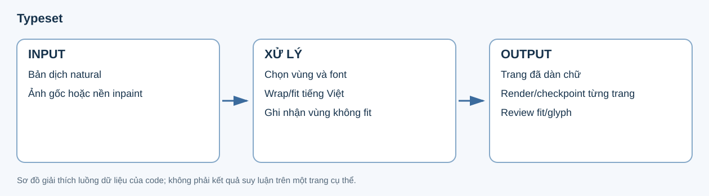

# 13. Typeset

**Input:** bản dịch natural, box/geometry nguồn, ảnh gốc hoặc nền inpaint và cấu hình font. **Output:** ảnh trang có chữ Việt, kế hoạch đặt chữ từng vùng, checksum và danh sách cần review.



## Đọc thành phần của bước dàn chữ

Text được tra theo utterance ID; vùng đặt chữ được tra về OCR/bubble geometry. Code chọn font, thử wrap/fit trong vùng cho phép và lưu cách đặt chữ đã dùng. Dàn chữ không quyết định lại ai đang nói hoặc người được nhắc tên.

| Thành phần | Vai trò |
|---|---|
| `translations.natural` | Câu Việt cần đặt lên ảnh. |
| OCR/source boxes và geometry | Vị trí và giới hạn của vùng đặt chữ. |
| Font và size range | Bộ glyph và khoảng cỡ chữ được phép thử. |
| `plans` | Nội dung/đường dòng/font/vị trí đã tính cho các vùng. |
| `files` | Các file render/plan kèm checksum. |
| `needs_review`, `failures` | Vùng không fit, cần xử lý thêm hoặc trang không render được. |

## Phân biệt ảnh sạch và preview

Nếu có nền inpaint, typeset dùng đúng `clean_path` của trang. Khi không có nền sạch, output là placement preview trên ảnh còn chữ nguồn, có `render_kind` tương ứng; không nên đọc nó như một trang đã xóa chữ hoàn chỉnh.

Ví dụ sau **minh họa schema một page record**, với ID/file giả định, không phải trang đã render của lượt v7 mới:

```json
{
  "page_id": "example:p1",
  "page": 1,
  "style": "natural",
  "render_kind": "clean_render",
  "files": {},
  "plans": [],
  "needs_review": [],
  "effects_rendered": false,
  "runtime_limits": {"shorten_attempts": 2}
}
```

`clean_render` cho biết nền sạch đã được dùng; `placement_preview_original_text_present` cho biết chữ nguồn vẫn có thể còn. Các mảng/file rỗng trong ví dụ chỉ trình bày hình dạng record, không đại diện cho một trang hoàn tất.

## Fit chữ và config

Code thử phân bố dòng/cỡ chữ, kiểm tra glyph và vùng hiển thị. Khi không fit có thể dùng cơ chế rút gọn trong giới hạn cấu hình; việc rút gọn phải giữ nội dung nghĩa và được lưu để review. Hết giới hạn thì giữ vấn đề ở output thay vì sửa speaker/relationship để làm câu ngắn hơn.

| Key trong `v6` | Mặc định | Tác dụng |
|---|---|---|
| `typeset_mode` | `ocr-box` | Chế độ đặt chữ hiện hành. |
| `font_path` | `assets/fonts/astro-city-teddy-bear.ttf` | Font chính. |
| `font_min_px`, `font_max_px` | `10`, `48` | Khoảng cỡ chữ thử. |
| `line_spacing` | `1.6` | Giãn dòng. |
| `shorten_attempts` | `2` | Số lần được rút gọn khi cần fit; đặt 0 để tắt. |

Đặt bản dịch natural vào vùng OCR/bubble theo cấu hình font, kích thước và line spacing. Reuse nền inpaint nếu được bật; giữ render/checkpoint theo trang.

Kiểm tra glyph/vùng hiển thị và xuất review khi không fit hoặc cần rút gọn theo cơ chế hiện có. Không sửa graph/person ownership để giải quyết vấn đề render.

Code: [typeset.py](../../../src/manga_pipeline/v6/typeset.py). Config: `v6.typeset_mode=ocr-box`, font/min/max/spacing và `shorten_attempts`.

## Output cuối và review

Kết quả được giữ theo page/style cùng kế hoạch đặt chữ và checksum. `effects_rendered=false`/`effects_image_edits=false` cho biết luồng này chưa vẽ lại SFX trên ảnh; effect vẫn là dữ liệu ở các stage trước. Mở ảnh render cùng review/plan để đối chiếu nội dung, dấu tiếng Việt, cỡ chữ và vùng đặt.

Đây là stage cuối của luồng 13 bước. Các lỗi fit/glyph cần quay về bản dịch/vùng render tương ứng, còn lỗi semantic phải truy về analyze/reanalyze qua provenance của export.
