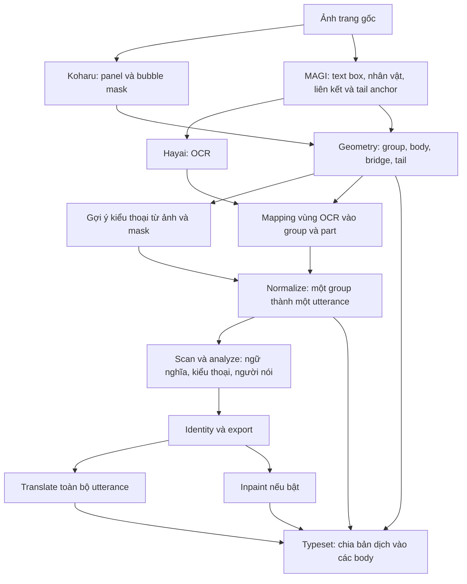

# Bubble speech trong `src`: phát hiện, chia vùng, phân loại và dàn chữ

Tài liệu này là bản đồ mã nguồn của pipeline **v6 hiện tại**, giúp tìm đúng nơi xử lý bong bóng thoại và đặt bản dịch trở lại trang truyện. Các đường dẫn đều tương đối để dùng được khi clone repository trên máy khác.

## 1. Tìm nhanh phần cần đọc

| Công việc | File và hàm chính |
| --- | --- |
| Phát hiện bubble, panel và mask | [visual/koharu.py](manga_pipeline/visual/koharu.py): `Koharu.detect()`; [visual/stages.py](manga_pipeline/visual/stages.py): `layout()` |
| Gộp các detection trùng, giữ topology của bubble ghép | [v6/visual.py](manga_pipeline/v6/visual.py): `fuse_candidates()`, `refine_mask()`, `build_groups()` |
| Chia bubble thành vùng chứa chữ, cầu nối và đuôi | [v6/visual.py](manga_pipeline/v6/visual.py): `partition()` |
| Gán vùng OCR vào group/part | [v6/visual.py](manga_pipeline/v6/visual.py): `map_text()` |
| Gợi ý kiểu thoại chỉ bằng ảnh/mask | [v6/visual.py](manga_pipeline/v6/visual.py): `visual_hint()`; [visual/bubbles.py](manga_pipeline/visual/bubbles.py): `classify_bubble()` |
| Gộp các mảnh OCR thành một lượt thoại | [v6/normalize.py](manga_pipeline/v6/normalize.py): `normalize()` |
| Chốt loại nội dung, kiểu thoại và người nói | [v6/semantic.py](manga_pipeline/v6/semantic.py): `analyze()`, `export()` |
| Dịch toàn bộ lượt thoại, rút gọn khi thiếu chỗ | [v6/translation.py](manga_pipeline/v6/translation.py): `translate()`, `shorten()` |
| **Dàn chữ trở lại từng body của bubble** | **[v6/typeset.py](manga_pipeline/v6/typeset.py): `safe_parts()`, `allocate()`, `fit()`, `typeset()`** |
| Xóa chữ gốc trước khi dàn chữ, khi được bật | [visual/inpaint.py](manga_pipeline/visual/inpaint.py): `plan_masks()`, `inpaint()` |

Điểm điều phối là [pipeline.py](manga_pipeline/pipeline.py), sau đó chuyển các bước v6 sang [v6/stages.py](manga_pipeline/v6/stages.py): `dispatch()`. Thứ tự và phụ thuộc giữa các bước nằm trong [storage/runs.py](manga_pipeline/storage/runs.py): `V6_STEPS`.

Trong [visual/stages.py](manga_pipeline/visual/stages.py) vẫn có hàm `bubble_geometry()` của luồng cũ. Với v6, phần hình học đang đi qua **`v6/stages.py: geometry()` và `v6/visual.py`**. Cần phân biệt hai nơi này khi sửa code.

## 2. Luồng xử lý tổng quát

Ảnh, mask, contour và OCR box dùng hệ tọa độ **pixel của trang gốc**. Detection trên crop panel được đưa về tọa độ trang trước khi xử lý tiếp.

### Input, phương pháp và output của từng đoạn

| Đoạn | Phương pháp / mô hình | Input | Output chính |
| --- | --- | --- | --- |
| `layout` | Koharu `mayocream/koharu-layout-rfdetr-seg-2xl-1152`, RF-DETR segmentation; chạy trên trang và crop panel | Ảnh trang | Panel, bubble candidates, bbox, confidence, mask PNG, ứng viên onomatopoeia |
| `extract` | MAGI `ragavsachdeva/magiv2` và Hayai `JustANormalTinkerer/hayai-ocr-v2.5-nova` | Ảnh trang | Text box, OCR gốc, nhân vật, liên kết text–character, tail anchor |
| `bubble_geometry` | NumPy/SciPy: hợp mask, morphology, connected components; heuristic hình ảnh | Candidates, mask, pixel ảnh, panel, tail anchor; text box dùng riêng ở mapping | `bubble_groups`, `parts`, các mask, connections, gợi ý và kết quả mapping |
| `normalize` | Gộp theo `group_id`; chuẩn hóa NFC và khoảng trắng | Text đã mapping, group/part | `utterances`, giữ text gốc, source box, ID nguồn và bằng chứng ảnh |
| `scan`, `analyze` | GLiNER tìm ứng viên tên; LLM hiện có qua Ollama chốt phân tích | Utterance, ngữ cảnh, gợi ý ảnh, bằng chứng liên kết; crop gọn khi cần | `content_type`, `speech_style`, người nói/người được gọi và evidence |
| `translate` | LLM dịch cả utterance | Kết quả export, ngữ cảnh và dữ liệu tên | Bản dịch `natural` và `localized`; effects có tuyến riêng |
| `inpaint`, nếu bật | White fill hoặc AOT theo kế hoạch mask | Trang gốc, nội dung được chọn và hình học bubble | Trang `clean.png` và mask sửa ảnh |
| `typeset` | Pillow đo/vẽ font; erosion tạo vùng an toàn; quy hoạch động phân bổ từ | Bản dịch, body mask, OCR box gốc, trang gốc hoặc trang clean | Ảnh, `typeset-plan.json`, safe/glyph mask và các mục `needs_review` |

Không có mô hình neural mới riêng cho việc chia body/cầu nối hoặc phân bổ chữ. Hai phần này dùng thuật toán hình học và đo font.

## 3. Bubble ghép được biểu diễn và chia như thế nào?

Ba khái niệm cần phân biệt:

- **Group**: nhóm bubble vật lý được giữ chung để phân tích và dịch thành một lượt thoại.
- **Part/body**: từng vùng rộng có thể đặt chữ, có mask và contour riêng.
- **Utterance**: đơn vị câu thoại sau khi gộp OCR; có một kết quả phân tích người nói và một bản dịch cho cả nhóm.

`build_groups()` thực hiện chuỗi sau:

1. `fuse_candidates()` gộp detection trùng bằng mask IoU hoặc mức chứa nhau. Việc bbox giao nhau đơn thuần không đủ để gộp.
2. `refine_mask()` dùng closing để sửa khe nhỏ. Pixel bổ sung phải có hỗ trợ độ sáng từ ảnh nguồn; mask quan sát và mask suy ra được lưu riêng.
3. Các thành phần lớn rời nhau trở thành group riêng. Thành phần nhỏ ở gần có thể được giữ cùng thành phần lớn theo khoảng cách. Code không gộp các bubble rời chỉ vì OCR hoặc người nói giống nhau.
4. `partition()` dùng opening để tìm các lõi rộng. Bán kính phụ thuộc diện tích mask và `neck_width_ratio`; lõi phải đạt `min_body_area`.
5. Phần mỏng còn lại tiếp xúc nhiều lõi được đánh dấu **bridge** và tạo connection giữa các part. Phần tiếp xúc một lõi, có tail anchor của MAGI, được đánh dấu **tail**; nếu không có anchor thì được ghép lại vào body đó.
6. Group ghi lại các panel liên quan. Bubble liền nhau qua nhiều panel vẫn giữ cùng group; panel index khác nhau không tự tạo hai lượt thoại.

Nếu không tìm được lõi rộng, `partition()` giữ nguyên mask làm một body. Kết quả body/bridge/tail vì vậy vẫn phụ thuộc chất lượng segmentation và tham số hình học; đây không phải cam kết tách đúng mọi bubble.

Các trường cần lần theo trong output:

| Cấp | Trường đáng chú ý |
| --- | --- |
| Group | `id`, `candidate_ids`, `panel_indices`, `bbox`, `outer_rings`, `parts`, `connections` |
| Mask của group | `observed_mask`, `refined_mask`, `inferred_mask`, `bridge_mask`, `tail_mask` |
| Part | `id`, `bbox`, `body_mask`, `body_rings`, `visual_evidence`, `visual_cache_key` |
| Tham chiếu mask | `mask_path`, `mask_sha256` |

`map_text()` là bước riêng: dùng độ phủ của OCR bbox lên mask để chọn group và các part liên quan. Nếu thiếu độ phủ hoặc hai group quá gần nhau về điểm số, kết quả giữ trạng thái không chắc chắn cùng ứng viên; không ép OCR vào một group bất kỳ.

## 4. “Phân loại bubble” gồm ba việc khác nhau

### 4.1. Phân vùng vật lý để biết chỗ được đặt chữ

`partition()` tạo **body / bridge / tail**. Đây là phân vùng hình học và trực tiếp quyết định vùng dàn chữ ở `safe_parts()`.

### 4.2. Gợi ý kiểu thoại từ hình ảnh

`classify_bubble()` dùng contour và pixel để đo hình dạng, độ lồi, mức giống hình chữ nhật, góc nhọn và đặc điểm đường viền. Nó tạo gợi ý như `shout`, `thought`, `caption`, `whisper`.

`visual_hint()` áp dụng điều kiện chấp nhận bảo thủ trước khi đưa gợi ý vào pipeline:

- Chỉ nhận pixel ảnh, body mask, observed/inferred mask và cấu hình. **Không nhận OCR, text box hoặc dialogue score.**
- Có thể từ chối khi biên có quá nhiều phần suy ra, confidence heuristic thấp hoặc hình dạng không đủ đặc trưng.
- Hình dạng cloud riêng lẻ chưa đủ để kết luận thought; tròn/viền liền cũng chưa đủ để kết luận normal.
- Khi từ chối, lưu `bubble_style="unknown"`, `style_hints=[]` và `rejection_reasons`. Điểm heuristic không phải xác suất mô hình đã hiệu chỉnh.

Kết quả này chỉ là bằng chứng hỗ trợ. Nhãn onomatopoeia của Koharu cũng chỉ tạo `role_evidence`, chưa chốt một chuỗi OCR là SFX hay tên người.

### 4.3. Chốt ngữ nghĩa trong `analyze()`

`v6/semantic.py: analyze()` kết hợp **câu OCR của toàn group + ngữ cảnh + gợi ý hình ảnh + bằng chứng liên kết nhân vật** trong lượt LLM phân tích hiện có. Không có lượt LLM riêng chỉ để tạo visual hint.

Hai trường khác nhau được chốt ở đây:

- `content_type`: `dialogue`, `narration`, `sfx`, `action_state`, `ui`, `watermark`, `unknown`.
- `speech_style`: `normal`, `whisper`, `shout`, `thought`, `caption`, `unknown`.

`export()` đưa `sfx`/`action_state` vào effects, loại `ui`/`watermark` khỏi tuyến thoại. Effects được dịch và lưu riêng, không xóa hoặc dàn chữ lên ảnh. Nội dung còn `unknown` được giữ để xem lại và bị bỏ qua khi render.

Hiện tại `speech_style` được lưu cùng evidence, nhưng **typeset chưa có nhánh chọn font đậm/nghiêng hoặc font riêng theo từng kiểu thoại**. Vùng đặt chữ chủ yếu do body mask, margin, OCR anchor và kích thước chữ quyết định.

## 5. Từ nhiều mảnh OCR đến một bản dịch

`normalize()` thu các text có cùng `group_id` thành một utterance. Nó giữ `text_original`, `source_text_ids`, `source_boxes`, `part_ids`, gợi ý ảnh và liên kết nhân vật gốc để truy vết.

OCR trong cùng group được nối theo thứ tự nguồn. Chỉ có chuẩn hóa Unicode NFC và khoảng trắng; chưa có bước tự sửa từ ngắt kiểu `cont-ribu-tion` hoặc ghép lại hậu tố bị OCR tách. Câu gốc được chuyển tiếp cho LLM.

Ví dụ về cách biểu diễn, không phải kết quả kiểm thử: hai body A/B nối bằng một bridge, mỗi body có một mảnh OCR, sẽ cho **một group → một utterance → một bản dịch**. Khi typeset, bản dịch mới được chia thành hai đoạn từ để đặt vào A/B. Việc có hai vị trí đặt chữ không tạo hai người nói.

OCR chưa gán được group tạo utterance riêng. Code không tự gộp các câu rời chỉ vì cùng tên hoặc cùng người nói.

## 6. Dàn chữ ngược vào contour nằm ở đâu và làm gì?

Toàn bộ phần chính ở **[v6/typeset.py](manga_pipeline/v6/typeset.py)**. “Dàn vào contour” trong code là đặt glyph vào **safe mask được suy ra từ body**, rồi dùng contour/mask để kiểm tra giới hạn.

| Hàm | Vai trò |
| --- | --- |
| `safe_parts()` | Lấy body mask, loại bridge/tail, co mask vào trong theo margin; lấy tâm OCR gốc làm anchor và sắp thứ tự part |
| `slots()` | Tạo các khoảng ngang chứa được cả chiều cao một dòng; mỗi dòng dùng một khoảng liên tục, không nhảy qua lỗ hoặc cầu nối |
| `segment_layout()` | Xếp các từ nguyên vẹn vào dòng theo chiều rộng font đo được; căn giữa và ưu tiên gần anchor OCR |
| `allocate()` | Dùng quy hoạch động chia bản dịch thành các đoạn từ liên tiếp, cân bằng mật độ theo sức chứa của từng part |
| `fit()` | Tìm một cỡ font chung cho các part, từ lớn xuống nhỏ; vẽ glyph mask để kiểm tra nằm trọn trong safe mask |
| `measured_budget()` | Ước lượng sức chứa tại font nhỏ nhất để cung cấp yêu cầu rút gọn |
| `typeset()` | Điều phối fit/rút gọn, vẽ ảnh và ghi kế hoạch cùng mask truy vết |

Các nguyên tắc hiện có:

1. Margin là giá trị lớn hơn giữa `body_margin_px` và tỷ lệ cạnh ngắn của body. Erosion tạo vùng cho phép đặt chữ bên trong viền.
2. OCR box gốc cung cấp anchor; không bắt bản dịch phải có số từ giống OCR gốc. Thứ tự part ưu tiên reading order nguồn, sau đó vị trí trên trang theo hướng manga.
3. Phân bổ cân bằng theo **sức chứa dòng**, không chia đều số ký tự. Các đoạn giữ nguyên thứ tự từ và dùng một cỡ font chung cho cả utterance.
4. Kiểm tra glyph thực tế bằng Pillow để tránh vượt mask, mất từ, lặp từ hoặc đảo thứ tự từ.
5. Nếu chưa vừa ở font nhỏ nhất và còn vùng hợp lệ, `translation.shorten()` có thể yêu cầu rút gọn tối đa số lần cấu hình; sau đó fit lại. Điều kiện rút gọn bảo vệ tên, hậu tố, số và phủ định.
6. Nếu vẫn không vừa hoặc vùng an toàn rỗng, ghi `needs_review` cùng lý do, không vẽ chữ tràn ra ngoài mask.

Với text chưa có group, `safe_parts()` có phương án lấy vùng từ source OCR box rồi áp dụng margin. Đây là vùng dự phòng, không phải contour bubble được tái phát hiện.

### Xóa chữ gốc và vẽ chữ mới là hai bước

`typeset()` vẽ chữ mới; việc xóa chữ cũ thuộc `visual/inpaint.py`. Trong [cấu hình mặc định](../configs/pipeline.json), `inpaint.enabled=false`, nên output typeset hiện là **preview đặt chữ có chữ gốc còn trên trang**, được đánh dấu `placement_preview_original_text_present`.

Khi inpaint được bật và có ảnh `clean.png`, typeset dùng ảnh sạch và ghi `clean_render`. Inpaint v6 chọn nội dung dialogue/narration từ export; effects không được sửa ảnh.

## 7. Tìm output để đối chiếu với code

Đường dẫn dưới đây nằm trong thư mục run. `<NN_...>` là thư mục step do `RunStore` cấp; số thứ tự có thể thay đổi khi bật/tắt bước tùy chọn.

| Output | Nội dung |
| --- | --- |
| `01_layout/result.json`, `01_layout/masks/`, `01_layout/overlays/` | Detection, mask bubble đầu vào và overlay |
| `<NN_bubble_geometry>/result.json`, `masks/<page-id>/`, `overlays/` | Group/part, body/bridge/tail/inferred mask và contour overlay |
| `<NN_normalize>/result.json` | Utterance cùng group, part và source OCR box |
| `<NN_analyze>/result.json`, `<NN_export>/dialogue.json`, `effects.json` | Nhãn ngữ nghĩa, kiểu thoại, người nói và tuyến effects |
| `<NN_translate>/result.json` | Bản dịch theo utterance và style dịch |
| `<NN_inpaint>/pages/page-N/clean.png`, nếu bật | Ảnh đã xóa chữ gốc |
| `<NN_typeset>/pages/page-N/{natural,localized}/rendered.png` | Ảnh đã đặt chữ mới |
| Cùng thư mục typeset: `typeset-plan.json`, `*-safe.png`, `*-glyph.png` | Phân bổ từ, dòng, font, vùng cho phép và glyph thực tế |

Cách truy vết một câu: **source text ID → `group_id` → `part_ids` → utterance ID → bản dịch → `word_range` và glyph mask trong typeset plan**. Các mask có checksum để kiểm tra đúng artifact nguồn.

## 8. Tham số nằm ở đâu?

| Cấu hình | Mặc định | Tác dụng |
| --- | --- | --- |
| `layout.bubble_threshold` | `0.45` | Chấp nhận detection bubble của Koharu |
| `layout.mapping_coverage`, `layout.mapping_margin` | `0.80`, `0.15` | Độ phủ OCR vào group và khoảng cách điểm số để tránh mapping mơ hồ |
| `v6.mask_merge_iou`, `v6.mask_containment` | `0.35`, `0.85` | Gộp mask detection trùng |
| `v6.repair_radius` | `2` px | Sửa khe nhỏ bằng morphology |
| `v6.neck_width_ratio`, `v6.min_body_area` | `0.035`, `2500` px² | Diện tích tối thiểu của lõi body sau opening, không phải bộ lọc mọi bubble nhỏ |
| `v6.max_reconstructed_fraction`, `v6.hint_acceptance` | `0.20`, `0.80` | Điều kiện chấp nhận visual hint |
| `v6.body_margin_px`, `v6.body_margin_ratio` | `10` px, `0.0` | Margin cố định theo pixel ảnh gốc |
| `v6.font_min_px`, `v6.font_max_px` | `10`, `48` | Khoảng tìm cỡ font |
| `v6.font_path` | `assets/fonts/astro-city-teddy-bear.ttf` | AstroCity TeddyBear; đường dẫn từ gốc repository, ghi SHA-256 khi dàn chữ |
| `v6.line_spacing`, `v6.shorten_attempts` | `1.18`, `2` | Giãn dòng và số lần yêu cầu rút gọn |

Giá trị nền nằm ở [visual/config.py](manga_pipeline/visual/config.py) và [v6/config.py](manga_pipeline/v6/config.py); cấu hình run có thể ghi đè qua [configs/pipeline.json](../configs/pipeline.json).

Các ngưỡng MAGI nằm riêng trong [extraction/config.py](manga_pipeline/extraction/config.py): text detection `0.45`, text–character association `0.25`, dialogue **logit** `-0.5`. Dialogue logit không phải bubble threshold hoặc ngưỡng text–character association; các ngưỡng này không điều khiển việc erosion/body splitting trong typeset.

## 9. Tài liệu chi tiết để đọc tiếp

- [Chẩn đoán từng bước tái tạo chữ và giới hạn bubble đôi](../docs/v6/delivery/text-reconstruction-diagnostics.md).
- [Tổng quan thiết kế v6](../docs/v6/README.md).
- [Topology của group](../docs/v6/vision/m3-group-topology.md), [contour và parts](../docs/v6/vision/m4-contour-and-parts.md), [mapping và gợi ý ảnh](../docs/v6/vision/m5-text-mapping-and-hints.md).
- [Dịch theo group](../docs/v6/translation/m8-group-translation.md), [dàn chữ](../docs/v6/translation/m9-typesetting.md), [xử lý overflow](../docs/v6/translation/m10-overflow.md), [tuyến effects](../docs/v6/translation/effects-route.md).
- [Trạng thái triển khai](../docs/v6/delivery/implementation-status.md) để phân biệt phần đã có trong code với các mốc kiểm chứng còn lại.

Tài liệu mô tả code hiện có; việc tạo tài liệu này không chạy inference, kiểm thử pipeline hoặc Runpod.
